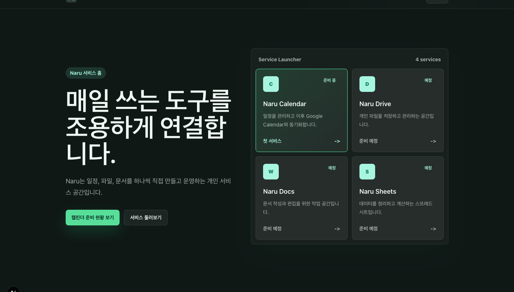
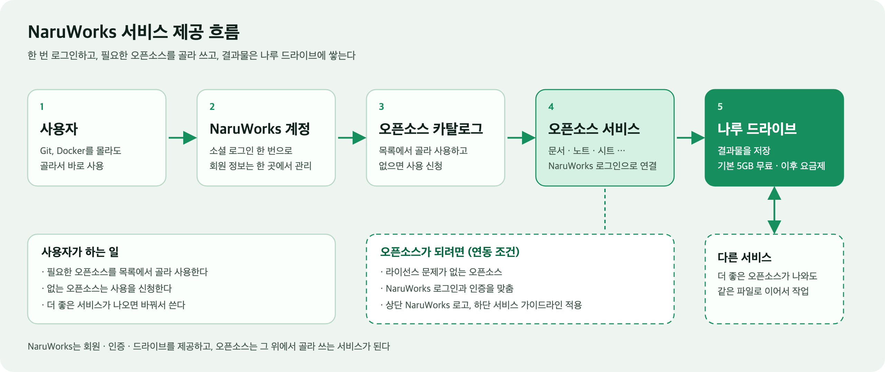
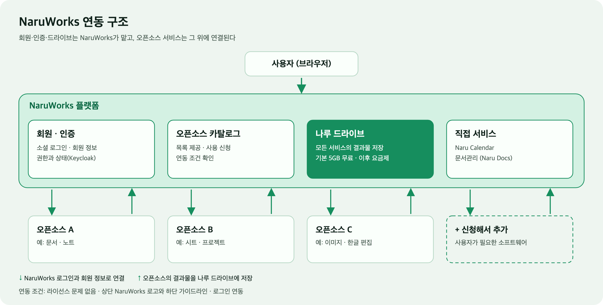

<p align="center">
  
</p>

<h1 align="center">NaruWorks</h1>

<p align="center">
  오픈소스 소프트웨어를 Git도 Docker도 몰라도 골라 쓰고,<br>
  결과물은 하나의 드라이브에 쌓는 서비스 플랫폼
</p>



> 위 화면은 현재 개발 중인 홈의 데모 상태입니다.

## 한 줄 소개

NaruWorks는 **드라이브, 문서관리, 캘린더**를 직접 제공하고, 여기에 **오픈소스 서비스를 NaruWorks 회원 정보로 연결해 골라 쓸 수 있게 하는** 플랫폼입니다. 오픈소스로 만든 결과물은 모두 나루 드라이브에 저장됩니다.

## 해결하려는 문제

AI 시대가 되면서 SaaS와 오픈소스 서비스가 매일 새로 나옵니다. 서비스는 점점 개인화되고, 사용자는 자기 취향에 맞는 소프트웨어를 고르고 싶어 합니다. 더 좋은 소프트웨어가 나오면 바꿔 쓰고 싶기도 합니다.

개발자는 GitHub에서 내려받아 직접 설치하면 되지만, 일반 사용자는 Git이 무엇인지, Docker가 무엇인지 모릅니다. 그래서 **사용자가 원하는 오픈소스 소프트웨어를 직접 골라 바로 쓸 수 있는 환경**이 필요하다고 보았습니다. 오픈소스판 Steam처럼 원하는 소프트웨어를 선택해서 사용하는 방향입니다.

## 서비스 구성

| 구분 | 내용 |
| --- | --- |
| 직접 제공하는 서비스 | **나루 드라이브**, **문서관리**, **Naru Calendar** |
| 오픈소스 카탈로그 | 연동된 오픈소스 목록을 제공하고, 사용자가 골라서 사용한다. 필요한 오픈소스는 사용을 신청할 수 있다. |
| 회원과 인증 | 다양한 소셜 로그인과 회원 정보 관리. 오픈소스 서비스에는 NaruWorks 계정으로 연결한다. |
| 저장소 | 오픈소스를 쓰며 만든 결과물은 나루 드라이브에 저장한다. |

## 사용자에게 서비스를 제공하는 흐름



1. 사용자는 NaruWorks 계정(소셜 로그인)으로 한 번 로그인한다.
2. 오픈소스 카탈로그에서 필요한 소프트웨어를 고른다. 없으면 사용을 신청한다.
3. 선택한 오픈소스를 별도 가입 없이 NaruWorks 로그인으로 사용한다.
4. 결과물은 나루 드라이브에 쌓인다.
5. 더 좋은 서비스가 나와도 그 파일 형식을 지원하면 같은 파일로 이어서 작업할 수 있다.

## 핵심 구조



NaruWorks가 회원 정보, 인증, 드라이브, 카탈로그를 맡고, 오픈소스 서비스는 그 위에 연결됩니다. 서비스가 계속 늘어날 것을 전제로, 오픈소스를 하나 붙일 때마다 같은 작업을 반복하지 않는 구조를 목표로 합니다.

### 오픈소스가 되려면

오픈소스를 NaruWorks에 연동하려면 다음 조건을 만족해야 합니다.

- **라이선스**: 서비스로 제공해도 문제가 없는 라이선스여야 한다.
- **인증 연동**: NaruWorks 로그인과 회원 정보에 맞춘다. 사용자는 오픈소스에 따로 가입하거나 로그인하지 않는다.
- **화면 가이드라인**: 상단에 NaruWorks 로고가 보이고, 하단도 NaruWorks 서비스 가이드라인에 맞춘다.
- **산출물 저장**: 결과물을 나루 드라이브에 저장할 수 있게 한다.

## 비즈니스 모델

- 모든 회원은 **기본 5GB 드라이브를 무료**로 사용한다.
- 그 이상은 **드라이브 요금제**로 제공한다.
- 오픈소스 서비스를 쓰는 만큼 결과물이 드라이브에 쌓이고, 다른 서비스로 옮겨 가도 같은 파일로 이어 쓸 수 있다.

## 현재 상태

아직 개발 중이며, 아래는 방향 문서가 아니라 현재 진행 상황입니다.

| 영역 | 상태 |
| --- | --- |
| 회원·소셜 로그인 | Keycloak 기반 중앙 로그인(Google) 운영 중 |
| Naru Calendar | 구현되어 있고 계속 개선 중 |
| 나루 드라이브 | 개발 중. 폴더 조회·생성, 이름 변경, 이동까지 구현 |
| 문서관리 | 오픈소스 [Litpage](https://github.com/litmers-dev/litpage)를 첫 오픈소스로 연동 중. 로그인 연동 코드는 반영되었고 배포 전 |
| 오픈소스 카탈로그·신청 | 설계 단계 |
| 인증 구조 정리 | 서비스별 세션과 로그아웃을 하나로 맞추는 방법을 논의 중 ([#80](https://github.com/HoBaeBang/naruworks-platform/issues/80)) |

## 개발 문서

- 서비스별 문서: [`docs/services/naru-calendar`](docs/services/naru-calendar/README.md), [`docs/services/naru-drive`](docs/services/naru-drive/README.md)
- Litpage 수정 내역: [`services/litpage/NARU.md`](services/litpage/NARU.md)
- 협업과 PR 규칙: [`docs/development/git-github-session-runbook.md`](docs/development/git-github-session-runbook.md)

## Codex 작업 방식

새 대화에서 이 프로젝트를 이어서 작업할 때는 먼저 아래 문서를 읽습니다.

```text
docs/프로젝트_운영_메모리.md
```

그 다음 README, architecture, roadmap 문서를 확인하고 현재 Phase의 작은 단위 작업부터 진행합니다.

GitHub 이슈, 브랜치, PR, CI 운영 방식은 아래 문서에 정리합니다.

```text
docs/development/github-workflow.md
```

## Local Runtime

Docker Compose 기반 로컬 실행과 재시작 절차는 아래 문서에 정리합니다.

```text
infra/README.md
```

## Test

백엔드 전체 테스트는 `backend` 디렉터리에서 `./gradlew test`로 실행합니다.

---

# 초기 기획 기록

아래는 프로젝트를 처음 시작할 때(개인 홈서버 서비스 플랫폼 기준) 적어 둔 내용입니다. 위의 방향성과 다른 부분이 있으며, 기술 선택과 단계 구분의 기록으로 남겨 둡니다.

## 초기 소개

NaruWorks는 개인 홈서버 위에서 여러 웹/앱 서비스를 직접 기획, 개발, 배포, 운영하기 위한 개인 서비스 플랫폼입니다.

이 프로젝트는 단순 포트폴리오 사이트가 아니라, 실제로 사용할 수 있는 서비스들을 하나씩 올리고 운영 경험을 쌓기 위한 장기 프로젝트입니다. StablePay는 이 플랫폼 안에서 결제, 원장, 정산 기능을 담당하는 금융 모듈 또는 외부 결제 서비스로 연결합니다.

```text
NaruWorks Platform
-> Portfolio / Service Hub
-> Auth / Admin / User
-> Web & App Services
-> Home Server Operations
-> StablePay Payment / Ledger / Settlement
```


## 목표

- 내가 만든 프로젝트와 서비스를 한곳에서 보여주는 전용 사이트를 구축한다.
- 직접 기획한 웹/앱 서비스를 만들고 지인들이 실제로 사용할 수 있게 운영한다.
- 프론트엔드, 백엔드, 데이터베이스, 인프라, CI/CD, 모니터링까지 end-to-end로 경험한다.
- StablePay의 결제/원장/정산 기능을 플랫폼의 유료 기능, 크레딧, 정산 흐름에 연결한다.
- 한국 백엔드 채용 시장에서 설명 가능한 Spring Boot 기반 운영형 포트폴리오를 만든다.

## 초기 기술 방향

| 영역 | 선택 |
| --- | --- |
| Frontend | Next.js, TypeScript |
| Backend | Java 21, Spring Boot |
| Database | PostgreSQL |
| Infra | Docker Compose, Caddy |
| CI/CD | GitHub Actions 또는 self-hosted runner |
| Observability | health check, structured logs, 이후 Prometheus/Grafana |
| Payment module | StablePay 연동 또는 Spring 재구현 |

## 초기 구조

```text
naruworks-platform/
  README.md
  docs/
    프로젝트_운영_메모리.md
    architecture/
      platform-overview.md
      home-server-architecture.md
      service-boundaries.md
    roadmap/
      phase-1-platform-core.md
      phase-2-home-server-ops.md
      phase-3-stablepay-integration.md
    decisions/
      0001-project-name-and-direction.md
  backend/
    README.md
  frontend/
    README.md
  infra/
    README.md
    caddy/
    scripts/
  services/
    README.md
```

## Phase

```text
Phase 1: Platform Core
-> NaruWorks 사이트, 사용자/관리자 기본 구조, 프로젝트/서비스 허브

Phase 2: Home Server Ops
-> Docker Compose, reverse proxy, HTTPS, CI/CD, 백업, 로그, health check

Phase 3: StablePay Integration
-> 결제 요청, 크레딧/포인트, ledger, settlement, admin 정산 화면

Phase 4: Real Services
-> 지인 또는 나 자신이 실제로 사용하는 작은 웹/앱 서비스들을 추가
```

## StablePay와의 관계

StablePay는 NaruWorks 안에 무리하게 합치지 않습니다. 먼저 독립 결제/원장 기준 구현으로 유지하고, NaruWorks에서는 adapter 또는 API 연동 형태로 사용합니다.

```text
NaruWorks
-> 서비스/사용자/관리자/운영 플랫폼

StablePay
-> 결제/원장/정산/입출금 모듈
```

나중에 Spring Boot 재구현을 진행할 때는 Go StablePay에서 검증한 도메인 규칙을 NaruWorks payment module 또는 별도 Spring payment service로 옮깁니다.
