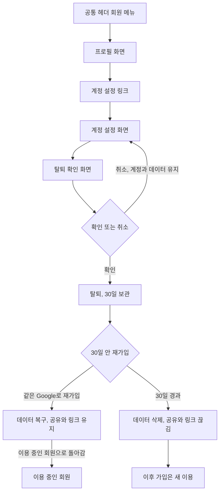
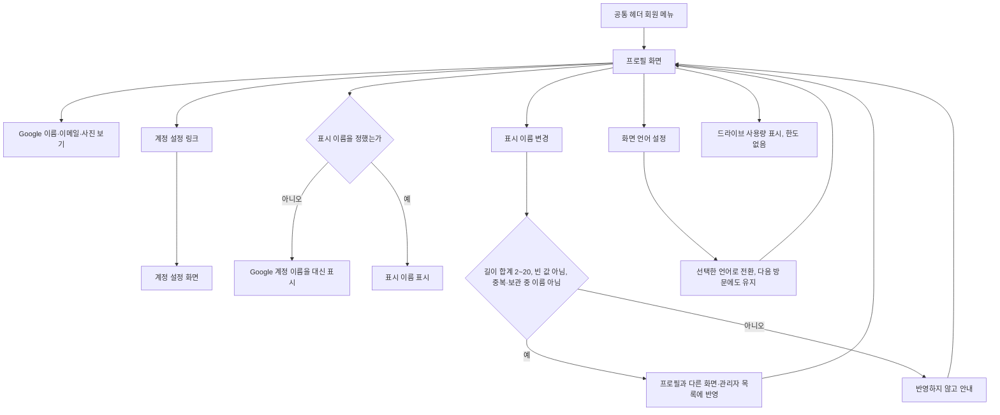

# FRD·BR·NFR v1.1 변경 제안 (라운드 09~12)

상태: 승인 반영 완료 (호배님 승인 2026-11-18 18:52 KST). FRD·BR·NFR v1.1과 AC v0.2, UF v0.3, matrix.csv에 적용함. PRD v1.0은 수정하지 않음.

## 1. 문서 정보

| 항목 | 내용 |
|---|---|
| 문서명 | NaruWorks FRD·BR·NFR v1.1 변경 제안 |
| 작성일 | 2026-11-18 18:34 KST (Asia/Seoul) |
| 개정일 | 2026-11-18 18:52 KST (Asia/Seoul) |
| 작성 | 기획 봇 |
| 근거 | 인터뷰 라운드 09~12, DEC-047~061. 호배님 승인 2026-11-18 18:52 KST |
| 대상 | 승인된 FRD·BR·NFR v1.0의 개정 후보, 그리고 이에 의존하는 AC·UF·추적 표 초안 |
| 관련 문서 | `drafts/01-interview/round-09.md` ~ `round-12.md`, `drafts/02-decision-log/decision-log.md`, `drafts/02-decision-log/open-questions.md`, `drafts/frd/FRD.md`, `drafts/business-rules/BR.md`, `drafts/nfr/NFR.md`, `drafts/acceptance-criteria/AC.md`, `drafts/user-flow/UF.md`, `drafts/traceability/matrix.csv` |

PRD v1.0은 변경하지 않는다. 프로필과 회원 메뉴는 REQ-007, 사용량 표시(한도 없음)는 REQ-017, 공통 푸터 법적 문서는 REQ-006, 탈퇴는 REQ-026, 회원 목록은 REQ-018, 회원 공유는 REQ-015로 포괄한다. 동시 접속 20명은 비기능 요구로만 추가한다.

라운드 11에서 계정 설정 진입을 프로필 화면 안 링크로 정했으므로, 이전 제안의 ‘회원 메뉴에 계정 설정을 둔다’는 안은 폐기한다. FR-SHELL-001 회원 메뉴에는 계정 설정을 추가하지 않는다.

## 2. 반영할 결정

| DEC | 요지 | 주요 반영 |
|---|---|---|
| DEC-047 | 프로필 화면: Google 계정 이름·이메일·사진(보기), 표시 이름 변경, 화면 언어 설정, 드라이브 사용량 표시. 탈퇴 메뉴는 프로필에 두지 않는다. | 신규 FR-SHELL-003, 신규 BR-025, FR-SHELL-001·FR-DRV-001·BR-010 보완 |
| DEC-048 | 법적 문서는 한국어와 영어로 모두 제공한다. | FR-SHELL-002·BR-021 보완, 신규 NFR-I18N-003 |
| DEC-049 | 동시 접속 목표는 20명이다. | 신규 NFR-PERF-004, NFR-PERF-001·NFR-PERF-003 보완 |
| DEC-050 | 탈퇴 메뉴는 프로필과 별도인 계정 설정 화면에 둔다. | 신규 FR-AUTH-006, 신규 BR-027, FR-AUTH-003 보완 |
| DEC-051 | 표시 이름은 2~20자, 중복 불가, 빈 값 불가. | 신규 BR-026, FR-SHELL-003 |
| DEC-052 | 고른 화면 언어는 다음 방문에도 유지한다. 기기 언어 규칙(DEC-045)은 설정 전에만 적용한다. | NFR-I18N-002·FR-SHELL-003 보완 |
| DEC-053 | 표시 이름 초기값은 비워 두고, 정하기 전에는 Google 계정 이름을 대신 보여 준다. | BR-026, FR-SHELL-003 |
| DEC-054 | 표시 이름은 다른 회원에게 보이는 화면과 관리자 회원 목록에도 표시된다. | BR-026, FR-ADM-001, FR-DRV-006, FR-SHELL-003 |
| DEC-055 | 계정 설정 화면은 프로필 화면 안의 링크로 진입한다. | FR-AUTH-006, FR-SHELL-003, BR-027, BR-025. FR-SHELL-001 회원 메뉴는 변경하지 않음 |
| DEC-056 | 표시 이름 길이(2~20)는 한글 1자를 2, 영문·숫자 1자를 1로 센다. | BR-026, FR-SHELL-003 |
| DEC-057 | 탈퇴 후 30일 보관 동안 그 회원의 표시 이름은 다른 회원이 쓸 수 없다. | BR-026, FR-SHELL-003 |
| DEC-058 | 회원 공유 대상은 이메일로만 검색한다. | FR-DRV-006, BR-026 |
| DEC-059 | 표시 이름에는 한글·영문·숫자만 허용한다(공백·문장부호·이모지 불가). | BR-026, FR-SHELL-003 |
| DEC-060 | 탈퇴 보관 30일이 끝나면 그 표시 이름을 다른 회원이 쓸 수 있다. | BR-026, FR-SHELL-003, FR-AUTH-003 |
| DEC-061 | 공유 대상 이메일 검색은 전체 이메일 완전 일치(대소문자 무시)이며 활동 회원만 찾는다. | FR-DRV-006, BR-026 |

## 3. 초안 반영 방침

호배님이 2026-11-18 18:52 KST에 FRD·BR·NFR v1.1을 승인했다. 본 제안의 전문(라운드 12·DEC-059~061 포함)은 `FRD.md`, `BR.md`, `NFR.md` v1.1과 `AC.md` v0.2, `UF.md` v0.3, `matrix.csv`에 적용했다. PRD v1.0과 결정 로그의 승인 기록 행은 수정하지 않는다. 아래 전문은 적용된 확정 문구이다.

## 4. FRD v1.1 제안

승인 시 버전을 v1.1로 올리고 개정 이력을 추가한다.

### 4.1 영역 정의 (변경)

| 영역 코드 | 변경 후 범위 |
|---|---|
| AUTH | 통합 로그인·로그아웃·가입·탈퇴, 계정 설정, 정지 회원의 로그인 차단 |
| SHELL | 공통 헤더·푸터, 프로필 화면 (나루 화면과 연동 오픈소스 화면) |

다른 영역 행은 v1.0과 같다. FR-SHELL-001의 회원 메뉴 구성(프로필·로그아웃)은 v1.0과 같다.

### 4.2 FR 목록 (추가)

| ID | 이름 | 상위 REQ | 관련 BR | MoSCoW | 화면 |
|---|---|---|---|---|---|
| FR-SHELL-003 | 프로필 화면 | REQ-007, REQ-017, REQ-006 | BR-025, BR-026, BR-010, BR-021, BR-027 | Must | 예 (WF 예정) |
| FR-AUTH-006 | 계정 설정 화면 | REQ-026 | BR-027, BR-007 | Must | 예 (WF 예정) |

### 4.3 FR-SHELL-001 공통 헤더 (변경)

v1.0 대비 바뀌는 점은 프로필 메뉴가 FR-SHELL-003으로 연결된다는 것뿐이다. 회원 메뉴에 계정 설정을 추가하지 않는다(DEC-055).

```
### FR-SHELL-001 공통 헤더

- **설명**: 나루 화면과 연동 오픈소스 화면 모두에 공통 헤더를 둔다. 헤더에는 로고(누르면 홈으로 이동), 서비스 전환 메뉴, 카테고리, 회원 메뉴(프로필·로그아웃)가 들어간다.
- **상위 REQ**: REQ-006, REQ-007
- **관련 BR**: BR-015, BR-016, BR-020, BR-021, BR-004, BR-013, BR-023, BR-025
- **사용자/권한**: 로그인한 회원. 비회원이 링크 공유만 보는 화면에 헤더를 어떻게 붙일지는 본 FR의 대상이 아니며 정하지 않았다.
- **입력·처리·결과**: 로고를 누르면 서비스 목록 홈으로 이동한다. 서비스 전환 메뉴에서 노출되어 쓸 수 있는 다른 서비스로 이동한다. 숨긴 오픈소스는 메뉴에 두지 않는다(BR-013). 카테고리는 기본값 문서·저장소와 관리자가 정한 배정(FR-HOME-002, FR-ADM-004, BR-023)을 따른다. 회원 메뉴에서 프로필과 로그아웃을 고른다. 프로필을 고르면 프로필 화면(FR-SHELL-003, DEC-047)으로 이동한다. 계정 설정은 이 메뉴에 두지 않으며, 프로필 화면 안의 링크(FR-AUTH-006, DEC-055)로 들어간다. 로그아웃은 FR-AUTH-002를 수행한다.
- **예외·빈 상태**: 숨긴 오픈소스는 모든 회원의 서비스 전환 메뉴에 보이지 않으며, 그 오픈소스 사용도 차단된다(BR-013, DEC-028).
- **화면 필요 여부**: 예 (WF 예정)
- **MoSCoW**: Must
```

### 4.4 FR-SHELL-002 공통 푸터 (변경)

```
### FR-SHELL-002 공통 푸터

- **설명**: 나루 화면과 연동 오픈소스 화면 모두에 공통 푸터를 둔다. 푸터에는 이용약관·개인정보처리방침, 문의·고객센터, 오픈소스 라이선스 고지, 회사 정보가 들어간다.
- **상위 REQ**: REQ-006
- **관련 BR**: BR-015, BR-021
- **사용자/권한**: 해당 화면을 보는 사용자.
- **입력·처리·결과**: 푸터의 각 항목을 선택하면 해당하는 안내 또는 연락 수단으로 이동한다. 이용약관·개인정보처리방침 등 법적 문서는 한국어와 영어로 모두 제공한다(DEC-048, NFR-I18N-003).
- **예외·빈 상태**: 해당 문서나 연락 수단이 아직 준비되지 않은 경우는 본 FR에서 내용을 만들지 않으며, 항목 자체는 푸터에 둔다. 언어가 준비된 법적 문서는 화면 언어에 맞는 본문을 보여 준다.
- **화면 필요 여부**: 예 (WF 예정)
- **MoSCoW**: Must
```

### 4.5 FR-SHELL-003 프로필 화면 (신규)

```
### FR-SHELL-003 프로필 화면

- **설명**: 로그인한 회원은 공통 헤더의 회원 메뉴에서 프로필 화면을 연다. 프로필 화면에는 Google 계정 이름·이메일·사진(보기만), 표시 이름 변경, 화면 언어 설정, 드라이브 사용량 표시를 둔다(DEC-047). 탈퇴 메뉴는 이 화면에 두지 않는다. 계정 설정 화면(FR-AUTH-006)은 프로필 화면 안의 링크로 들어간다(DEC-055).
- **상위 REQ**: REQ-007, REQ-017, REQ-006
- **관련 BR**: BR-025, BR-026, BR-010, BR-021, BR-027
- **사용자/권한**: 로그인한 회원(본인 프로필만).
- **입력·처리·결과**: Google 계정 이름·이메일·사진은 조회만 할 수 있고 이 화면에서 수정하지 않는다. 표시 이름에는 한글·영문·숫자만 허용하며, 공백·문장부호·이모지는 쓸 수 없다(DEC-059). 표시 이름의 초기값은 비어 있으며, 회원이 정하기 전에는 Google 계정 이름을 대신 보여 준다(DEC-053). 표시 이름을 정하거나 바꾸면 길이 합계가 2 이상 20 이하여야 하고, 빈 값은 허용하지 않으며, 이미 다른 회원이 쓰는 이름과 같아도 안 된다(BR-026, DEC-051). 길이 합계는 한글 1자를 2, 영문·숫자 1자를 1로 센다(DEC-056). 한 번 정한 표시 이름은 빈 값으로 되돌릴 수 없다. 탈퇴 후 30일 보관 중인 회원의 표시 이름은 다른 회원이 쓸 수 없고(DEC-057), 보관 30일이 끝나면 다른 회원이 쓸 수 있다(DEC-060). 정한 표시 이름은 본인 프로필뿐 아니라 다른 회원에게 보이는 화면과 관리자 회원 목록에도 표시된다(DEC-054). 아직 정하지 않았으면 그 자리에도 Google 계정 이름을 대신 보여 준다. 화면 언어를 한국어 또는 영어로 설정할 수 있다(DEC-039, DEC-047). 설정한 언어는 다음 방문에도 유지되며, 기기 언어 규칙(DEC-045)은 아직 설정하기 전에만 적용한다(DEC-052, NFR-I18N-002). 드라이브 사용량(현재 사용 중인 용량)을 보여 주되, 총용량 한도는 표시하지 않고 한도로 쓰지 않는다(BR-010, DEC-010). 프로필 화면 안의 계정 설정 링크를 누르면 계정 설정 화면(FR-AUTH-006)으로 이동한다.
- **예외·빈 상태**: Google 프로필 사진이 없으면 사진이 없음을 안내한다. 사용량이 0이면 0으로 보여 준다. 표시 이름에 한글·영문·숫자 외 문자가 있거나, 길이 합계가 2 미만이거나 20을 넘거나, 비어 있거나, 이용 중이거나 탈퇴 보관 30일 중인 다른 회원이 쓰는 이름이면 반영하지 않고 안내한다. 탈퇴 메뉴 자체는 이 화면에 두지 않는다.
- **화면 필요 여부**: 예 (WF 예정)
- **MoSCoW**: Must

```

### 4.6 FR-AUTH-006 계정 설정 화면 (신규)

```
### FR-AUTH-006 계정 설정 화면

- **설명**: 탈퇴 메뉴는 프로필과 별도인 계정 설정 화면에 둔다(DEC-050). 이 화면은 프로필 화면 안의 링크로 진입한다(DEC-055). 공통 헤더 회원 메뉴에는 계정 설정을 두지 않는다. 1차에서 이 화면의 결정된 항목은 탈퇴 메뉴이다.
- **상위 REQ**: REQ-026
- **관련 BR**: BR-027, BR-007
- **사용자/권한**: 로그인한 일반 회원(본인 계정만). 관리자 정지는 이 기능이 아니다(FR-ADM-002).
- **입력·처리·결과**: 프로필 화면의 계정 설정 링크를 누르면 계정 설정 화면이 열린다. 여기서 탈퇴를 고르면 탈퇴 확인을 거쳐 FR-AUTH-003을 수행한다. 프로필 화면에는 탈퇴 메뉴를 두지 않는다.
- **예외·빈 상태**: 탈퇴 확인을 취소하면 계정과 데이터를 그대로 두고 계정 설정 화면으로 돌아간다. 이미 탈퇴한 계정은 다시 탈퇴할 수 없다(FR-AUTH-003).
- **화면 필요 여부**: 예 (WF 예정)
- **MoSCoW**: Must
```

### 4.7 FR-AUTH-003 회원 탈퇴 (변경)

동작(30일 보관 등)은 v1.0과 같다. 진입 위치만 계정 설정 화면으로 정한다. 관련 BR에 BR-027을 추가한다.

```
### FR-AUTH-003 회원 탈퇴

- **설명**: 회원이 스스로 이용을 종료할 수 있다. 탈퇴 후 데이터는 30일 보관되고, 그 기간이 지나면 삭제된다. 탈퇴 메뉴는 프로필과 별도인 계정 설정 화면(FR-AUTH-006, DEC-050)에 두며, 계정 설정은 프로필 화면 안의 링크로 들어간다(DEC-055).
- **상위 REQ**: REQ-026
- **관련 BR**: BR-007, BR-027
- **사용자/권한**: 로그인한 일반 회원(본인 계정만). 관리자 정지는 이 기능이 아니다(FR-ADM-002).
- **입력·처리·결과**: 사용자가 계정 설정 화면에서 탈퇴를 확인하고 실행하면, 해당 계정은 탈퇴 상태가 되고 데이터는 30일 보관된다. 탈퇴가 완료되면 사용자는 더 이상 그 계정으로 서비스를 이용할 수 없다.
- **예외·빈 상태**: 탈퇴를 중간에 취소하면 계정과 데이터는 그대로 두고, 계정 설정 화면으로 돌아갈 수 있다. 이미 탈퇴한 계정은 다시 탈퇴할 수 없다. 탈퇴 후 30일 보관 기간 동안 기존 공유·링크는 유지되고, 데이터가 삭제되면 끊긴다(BR-007, DEC-029). 그 기간 동안 탈퇴한 회원의 표시 이름은 다른 회원이 쓸 수 없고(BR-026, DEC-057), 보관 30일이 끝나면 다른 회원이 쓸 수 있다(DEC-060).
- **화면 필요 여부**: 예 (WF 예정)
- **MoSCoW**: Must

```

### 4.8 FR-DRV-001 나루 드라이브 화면 (변경)

설명에 사용량 표시 위치를 보완한다. 나머지 항목은 v1.0과 같다.

변경 후 설명:

`1차 범위에 나루 드라이브 화면을 둔다. 사용자는 저장된 결과물과 올린 파일을 한곳에서 본다. 1차에는 드라이브 총용량 제한을 두지 않는다(BR-010). 파일 하나 업로드 한도는 1GB다(BR-024, DEC-037). 사용한 용량의 표시는 프로필 화면(FR-SHELL-003)에서 하며, 총용량 한도는 두지 않고 표시하지도 않는다(BR-010, DEC-010, DEC-047).`

### 4.9 FR-DRV-006 회원 공유 (변경)

대상 검색은 이메일만, 목록에 보이는 이름은 표시 이름(없으면 Google 계정 이름)이다. 관련 BR에 BR-026을 추가한다. 권한·다운로드 규칙은 v1.0과 같다.

```
### FR-DRV-006 회원 공유(보기/편집 권한 선택, 보기 시 다운로드 선택)

- **설명**: 드라이브 파일을 나루 회원에게 공유할 수 있다. 공유할 때 사용자가 보기 권한과 편집 권한 중 하나를 선택한다. 보기 권한으로 공유할 때는 다운로드 허용 여부를 공유하는 사람이 선택한다(BR-022, DEC-031). 대상 회원은 이메일로만 검색하며, 검색은 전체 이메일 완전 일치(대소문자 무시)이고 활동 회원만 찾는다(DEC-058, DEC-061).
- **상위 REQ**: REQ-015
- **관련 BR**: BR-007, BR-009, BR-014, BR-018, BR-022, BR-026
- **사용자/권한**: 공유를 거는 사람(파일 소유자). 공유받는 사람은 선택된 보기 또는 편집 권한과, 보기일 경우 공유자가 정한 다운로드 허용 범위만큼만 사용한다.
- **입력·처리·결과**: 소유자가 대상 회원을 전체 이메일 완전 일치(대소문자 무시)로만 찾아 권한(보기/편집)을 정해 공유한다. 표시 이름이나 이메일의 일부만으로는 검색하지 않으며, 활동 회원이 아니면 찾아지지 않는다(DEC-058, DEC-061). 보기 권한을 줄 때는 다운로드를 허용할지 끄거나 켠다. 보기 권한을 받은 회원은 파일을 볼 수 있고, 다운로드가 허용된 경우에만 내려받을 수 있다. 편집 권한을 받은 회원은 내용을 수정할 수 있다. 공유받은 파일은 공유받은 회원이 드라이브에서 찾을 수 있어야 한다. 검색된 대상과 이미 공유된 회원을 보일 때는 표시 이름을 쓰고, 표시 이름을 아직 정하지 않았으면 Google 계정 이름을 대신 보여 준다(BR-026, DEC-053, DEC-054).
- **예외·빈 상태**: 해당 이메일의 활동 회원을 찾을 수 없거나 자기 자신에게만 공유하려는 경우 완료하지 않고 안내한다. 공유를 취소하면 해당 회원의 접근을 거둔다. 소유자가 탈퇴해도 30일 보관 기간 동안 공유는 유지되고, 데이터가 삭제되면 끊긴다(BR-007, DEC-029).
- **화면 필요 여부**: 예 (WF 예정)
- **MoSCoW**: Must

```

### 4.10 FR-ADM-001 회원 목록 조회 (변경)

```
### FR-ADM-001 회원 목록 조회

- **설명**: 관리자는 회원 목록을 조회할 수 있다.
- **상위 REQ**: REQ-018
- **관련 BR**: BR-017, BR-026
- **사용자/권한**: 미리 지정한 관리자 계정만 이 기능을 쓴다. 화면에서 관리자 권한을 부여하거나 회수하지 않는다(BR-017, DEC-033).
- **입력·처리·결과**: 관리자가 관리 기능에서 회원 목록을 열면 회원들을 볼 수 있다. 정지 여부 등 관리에 필요한 상태를 구분해 보여 준다. 목록에는 표시 이름을 보이고, 표시 이름을 아직 정하지 않은 회원은 Google 계정 이름을 대신 보여 준다(BR-026, DEC-053, DEC-054).
- **예외·빈 상태**: 회원이 없으면 빈 목록을 보여 준다. 관리자 권한이 없는 사용자는 이 기능에 들어갈 수 없다.
- **화면 필요 여부**: 예 (WF 예정)
- **MoSCoW**: Must
```

### 4.11 추적 표 10.1 (변경)

| 상위 REQ | 추가·변경할 FR |
|---|---|
| REQ-006 | 기존 FR-SHELL-001, FR-SHELL-002에 FR-SHELL-003 추가 |
| REQ-007 | 기존 목록에 FR-SHELL-003 추가 (FR-AUTH-006은 회원 메뉴 항목이 아니므로 여기 넣지 않음) |
| REQ-015 | FR-DRV-006 유지(이메일 검색, 표시 이름 노출 보완) |
| REQ-017 | 기존 FR-DRV-001, FR-DRV-003에 FR-SHELL-003 추가 |
| REQ-018 | FR-ADM-001 유지(표시 이름 노출 보완) |
| REQ-026 | 기존 FR-AUTH-003, FR-AUTH-004에 FR-AUTH-006 추가 |

## 5. BR v1.1 제안

### 5.1 BR-010 1차 드라이브 총용량 제한 없음 (변경)

```
### BR-010 1차 드라이브 총용량 제한 없음

- **규칙**: 1차에는 드라이브 총용량 제한을 두지 않는다. 다만 파일 하나의 업로드 최대 크기는 1GB이며, 이는 BR-024(DEC-037)를 따른다. 프로필 화면에서 현재 사용량을 보여 줄 수 있으나, 그 표시는 한도가 아니며 한도 초과로 이용을 막지 않는다(DEC-010, DEC-047, FR-SHELL-003).
- **적용 FR**: FR-DRV-001, FR-DRV-003, FR-SHELL-003
- **출처 DEC**: DEC-010, DEC-047
```

### 5.2 BR-021 공통 헤더·푸터 구성 (변경)

회원 메뉴 항목은 v1.0과 같이 프로필·로그아웃만 둔다.

```
### BR-021 공통 헤더·푸터 구성

- **규칙**: 공통 헤더에는 로고(누르면 홈으로 이동), 서비스 전환 메뉴, 카테고리, 회원 메뉴(프로필·로그아웃)가 들어간다. 프로필은 프로필 화면(FR-SHELL-003, BR-025, DEC-047)을 연다. 계정 설정은 회원 메뉴에 두지 않고, 프로필 화면 안의 링크(FR-AUTH-006, BR-027, DEC-055)로 연다. 공통 푸터에는 이용약관·개인정보처리방침, 문의·고객센터, 오픈소스 라이선스 고지, 회사 정보가 들어간다. 이용약관·개인정보처리방침 등 법적 문서는 한국어와 영어로 모두 제공한다(DEC-048).
- **적용 FR**: FR-SHELL-001, FR-SHELL-002, FR-SHELL-003
- **출처 DEC**: DEC-013, DEC-025, DEC-047, DEC-048, DEC-055
```

### 5.3 BR-025 프로필 화면 항목 (신규)

```
### BR-025 프로필 화면 항목

- **규칙**: 프로필 화면에는 Google 계정 이름·이메일·사진(보기만), 표시 이름 변경, 화면 언어 설정, 드라이브 사용량 표시를 둔다. Google 계정 정보는 이 화면에서 수정하지 않는다. 탈퇴 메뉴는 프로필 화면에 두지 않는다. 계정 설정 화면은 프로필 화면 안의 링크로 진입한다(BR-027, DEC-050, DEC-055). 사용량 표시는 현재 사용 중인 용량만 보여 주고, 총용량 한도는 두지 않으며 한도로 쓰지 않는다(BR-010, DEC-010). 표시 이름 규칙은 BR-026을 따른다. 화면 언어를 설정하면 다음 방문에도 유지하고, 기기 언어 규칙(DEC-045)은 설정하기 전에만 적용한다(DEC-052, NFR-I18N-002).
- **적용 FR**: FR-SHELL-003, FR-SHELL-001
- **출처 DEC**: DEC-047, DEC-010, DEC-039, DEC-045, DEC-050, DEC-052, DEC-055
```

### 5.4 BR-026 표시 이름 규칙 (신규)

```
### BR-026 표시 이름 규칙

- **규칙**: 표시 이름에는 한글·영문·숫자만 쓸 수 있고, 공백·문장부호·이모지는 허용하지 않는다(DEC-059). 길이 합계는 2 이상 20 이하여야 하고, 빈 값은 허용하지 않으며, 이미 다른 회원이 쓰는 이름과 같을 수 없다(DEC-051). 길이 합계는 한글 1자를 2, 영문·숫자 1자를 1로 센다(DEC-056). 초기값은 비워 두고, 회원이 정하기 전에는 Google 계정 이름을 대신 보여 준다(DEC-053). 한 번 정한 표시 이름은 빈 값으로 되돌릴 수 없다. 탈퇴 후 30일 보관 동안 그 회원의 표시 이름은 다른 회원이 쓸 수 없고(DEC-057), 보관 30일이 끝나면 다른 회원이 쓸 수 있다(DEC-060). 표시 이름은 본인 프로필뿐 아니라 다른 회원에게 보이는 화면(회원 공유 대상 등)과 관리자 회원 목록에도 표시한다. 아직 정하지 않은 회원은 그 자리에도 Google 계정 이름을 대신 보여 준다(DEC-054, DEC-053). 회원 공유의 대상 검색은 전체 이메일 완전 일치(대소문자 무시)이며 활동 회원만 찾고, 표시 이름으로는 검색하지 않는다(DEC-058, DEC-061, FR-DRV-006).
- **적용 FR**: FR-SHELL-003, FR-DRV-006, FR-ADM-001, FR-AUTH-003
- **출처 DEC**: DEC-051, DEC-053, DEC-054, DEC-047, DEC-056, DEC-057, DEC-058, DEC-059, DEC-060, DEC-061

```

### 5.5 BR-027 탈퇴 메뉴는 계정 설정 화면에 둔다 (신규)

```
### BR-027 탈퇴 메뉴는 계정 설정 화면에 둔다

- **규칙**: 탈퇴 메뉴는 프로필과 별도인 계정 설정 화면에 둔다. 프로필 화면에는 탈퇴 메뉴를 두지 않는다. 계정 설정 화면은 프로필 화면 안의 링크로 진입하며, 공통 헤더 회원 메뉴에는 계정 설정을 두지 않는다(DEC-055). 탈퇴의 보관·복구 규칙은 BR-007을 따른다.
- **적용 FR**: FR-AUTH-006, FR-AUTH-003, FR-SHELL-003
- **출처 DEC**: DEC-050, DEC-047, DEC-020, DEC-055
```

규칙 목록 표에 BR-025, BR-026, BR-027 행을 추가한다.

## 6. NFR v1.1 제안

라운드 11로 NFR ID를 더 추가하거나 바꾸지는 않는다. 아래는 라운드 09·10에서 제안한 그대로이다.

### 6.1 NFR-PERF-001 1차 사용자 규모 (변경)

```
#### NFR-PERF-001 1차 사용자 규모

- **내용**: 1차 예상 사용자는 지인 위주 100명 이내다. 성능·용량 목표는 이 규모를 전제로 한다.
- **적용 범위**: 전체
- **측정 기준**: 1차 운영에서 기대하는 사용자 수가 100명을 넘지 않는 규모인지를 전제로 검증한다. 동시 접속 목표는 NFR-PERF-004(DEC-049)를 따른다.
- **출처 DEC**: DEC-036 (동시 접속은 DEC-049)
```

### 6.2 NFR-PERF-003 응답 시간 (변경)

```
#### NFR-PERF-003 응답 시간

- **내용**: 주요 화면 이동은 2초 이내, 썸네일 표시는 3초 이내에 끝나야 한다. 1GB 업로드처럼 파일 크기에 따라 달라지는 전송 시간은 이 목표에서 따로 본다.
- **적용 범위**: 전체 (로그인, 홈, 드라이브, Litpage 진입, 썸네일 미리보기 등)
- **측정 기준**: 동시 접속 20명(NFR-PERF-004, DEC-049), 사용자 규모 100명 이내(NFR-PERF-001, DEC-036) 전제에서, 화면 이동이 2초 이내, 썸네일 미리보기가 3초 이내에 표시되는지 확인한다. 파일 전송 시간은 제외한다.
- **출처 DEC**: DEC-041 (규모 전제는 DEC-036, 동시 접속은 DEC-049)
```

### 6.3 NFR-PERF-004 동시 접속 20명 (신규)

```
#### NFR-PERF-004 동시 접속 20명

- **내용**: 1차 동시 접속 목표는 20명이다. 전체 사용자 규모 100명 이내(NFR-PERF-001, DEC-036)와 구분한다.
- **적용 범위**: 전체
- **측정 기준**: 동시 접속 20명을 전제로 1차 주요 기능(로그인, 홈, 드라이브, Litpage, 관리자, 비회원 링크 보기)을 검증한다.
- **출처 DEC**: DEC-049
```

### 6.4 NFR-I18N-001 한국어와 영어 (변경)

```
#### NFR-I18N-001 한국어와 영어

- **내용**: 1차 화면 언어는 한국어와 영어다. 사용자에게 두 언어로 화면을 제공해야 한다.
- **적용 범위**: 전체 화면 문구 (공통 헤더·푸터, 홈, 드라이브, 로그인·탈퇴, 관리자, 비회원 링크 보기 안내, 프로필, 계정 설정). 이용약관·개인정보처리방침 등 법적 문서의 언어는 NFR-I18N-003(DEC-048)을 따른다.
- **측정 기준**: 주요 화면 문구를 한국어와 영어로 전환하거나 선택해 볼 수 있다. 기본값과 전환·유지 방식은 NFR-I18N-002를 따른다.
- **출처 DEC**: DEC-039
```

### 6.5 NFR-I18N-002 기본 언어와 전환 방식 (변경)

```
#### NFR-I18N-002 기본 언어와 전환 방식

- **내용**: 화면 언어를 아직 설정하지 않은 경우에는, 기기 언어가 영어면 영어로, 그 외에는 한국어로 시작한다(DEC-045). 프로필 화면에서 한국어 또는 영어로 설정한 뒤에는 다음 방문에도 그 언어를 유지한다(DEC-052). 기기 언어 규칙은 설정을 하기 전에만 적용한다.
- **적용 범위**: 전체 화면
- **측정 기준**: 설정 전에는 기기 언어 규칙으로 시작하는지, 설정한 뒤에는 다시 방문해도 고른 언어가 유지되는지, 프로필에서 언어를 바꿀 수 있는지 확인한다.
- **출처 DEC**: DEC-045, DEC-052 (언어 범위는 DEC-039, 설정 위치는 DEC-047)
```

### 6.6 NFR-I18N-003 법적 문서 한국어·영어 (신규)

```
#### NFR-I18N-003 법적 문서 한국어·영어

- **내용**: 이용약관·개인정보처리방침 등 법적 문서는 한국어와 영어로 모두 제공한다.
- **적용 범위**: 공통 푸터에서 여는 이용약관·개인정보처리방침 등 법적 문서(FR-SHELL-002, BR-021)
- **측정 기준**: 한국어 본문과 영어 본문을 모두 확인할 수 있다.
- **출처 DEC**: DEC-048 (화면 언어 범위는 DEC-039)
```

NFR 목록 표에 NFR-PERF-004, NFR-I18N-003 행을 추가한다.

## 7. AC 제안 (파일 미반영)

아래는 승인 후 `drafts/acceptance-criteria/AC.md`에 넣을 전문이다. 지금 초안은 유지한다.

### 7.1 기존 AC 변경

```
### AC-NFR-PERF-001-01 1차 규모 전제
- **Given**: 1차 출시 환경을 검증한다.
- **When**: 성능·용량 전제를 확인한다.
- **Then**: 지인 위주 100명 이내 규모를 전제로 검증한다. 동시 접속 목표는 NFR-PERF-004에 따라 20명이다.
- **인용**: NFR-PERF-001, NFR-PERF-004, DEC-036, DEC-049

### AC-NFR-PERF-003-01 화면 이동 2초·썸네일 3초
- **Given**: 공식 지원 브라우저에서 사용자 규모 100명 이내, 동시 접속 20명 전제로 주요 화면을 이용한다.
- **When**: 화면을 이동하거나, 드라이브 목록에서 썸네일 미리보기를 띄운다.
- **Then**: 화면 이동은 2초 이내, 썸네일 표시는 3초 이내에 끝난다. 1GB 업로드 등 파일 전송 시간은 이 측정에서 제외한다.
- **인용**: NFR-PERF-003, NFR-PERF-004, FR-DRV-008, DEC-041, DEC-036, DEC-049

### AC-NFR-I18N-001-01 한국어와 영어 화면
- **Given**: 사용자가 1차 화면을 보고 있다.
- **When**: 화면 언어를 한국어 또는 영어로 본다.
- **Then**: 주요 화면 문구를 한국어와 영어로 볼 수 있다. 이용약관·개인정보처리방침 등 법적 문서는 NFR-I18N-003을 따른다.
- **인용**: NFR-I18N-001, NFR-I18N-003, DEC-039, DEC-048

### AC-NFR-I18N-002-01 시작 언어와 전환·유지
- **Given**: 화면 언어를 아직 설정하지 않은 사용자와, 이미 프로필에서 언어를 정한 사용자가 있다.
- **When**: 각각 처음 들어오거나 다시 방문하고, 프로필에서 언어를 바꾼다.
- **Then**: 설정 전에는 기기 언어가 영어면 영어, 그 외에는 한국어로 시작한다. 설정한 뒤에는 다시 방문해도 고른 언어가 유지되고, 기기 언어 규칙은 더 이상 시작 언어를 바꾸지 않는다. 프로필에서 한국어와 영어를 전환할 수 있다.
- **인용**: NFR-I18N-002, NFR-I18N-001, FR-SHELL-003, DEC-045, DEC-052, DEC-039, DEC-047

### AC-FR-SHELL-001-01 나루와 Litpage에 공통 헤더
- **Given**: 회원이 나루 화면 또는 Litpage 화면에 있다.
- **When**: 화면을 보고 회원 메뉴를 연다.
- **Then**: 공통 헤더에 로고, 서비스 전환 메뉴, 카테고리, 회원 메뉴(프로필·로그아웃)가 있다. 회원 메뉴에 계정 설정은 없다. 로고를 누르면 서비스 목록 홈으로 이동한다. 프로필을 고르면 프로필 화면(FR-SHELL-003)으로 이동한다.
- **인용**: FR-SHELL-001, FR-SHELL-003, BR-015, BR-021, BR-025, DEC-002, DEC-013, DEC-047, DEC-055

### AC-FR-SHELL-002-01 공통 푸터 구성
- **Given**: 회원이 나루 화면 또는 Litpage 화면에 있다.
- **When**: 화면 하단을 보고 이용약관 또는 개인정보처리방침을 연다.
- **Then**: 공통 푸터에 이용약관·개인정보처리방침, 문의·고객센터, 오픈소스 라이선스 고지, 회사 정보가 있다. 이용약관·개인정보처리방침은 한국어와 영어로 모두 제공된다.
- **인용**: FR-SHELL-002, BR-015, BR-021, NFR-I18N-003, DEC-002, DEC-025, DEC-048

### AC-FR-AUTH-003-01 탈퇴 후 30일 보관
- **Given**: 로그인한 회원이 계정 설정 화면에서 탈퇴 확인 화면에 있다.
- **When**: 탈퇴를 확인하고 실행한다.
- **Then**: 계정은 탈퇴 상태가 되고 데이터는 30일 보관되며, 그 계정으로 더 이상 서비스를 이용할 수 없다. 보관 기간 동안 기존 공유·링크는 유지되고, 그 회원의 표시 이름은 다른 회원이 쓸 수 없다.
- **인용**: FR-AUTH-003, FR-AUTH-006, BR-007, BR-027, BR-026, DEC-020, DEC-021, DEC-029, DEC-050, DEC-057

### AC-FR-ADM-001-01 관리자 회원 목록 조회
- **Given**: 미리 지정한 관리자 계정으로 로그인한 상태이다. 어떤 회원은 표시 이름을 정했고, 어떤 회원은 아직 정하지 않았다.
- **When**: 관리자 회원 목록 화면을 연다.
- **Then**: 회원들과 정지 여부 등 관리에 필요한 상태를 볼 수 있다. 표시 이름을 정한 회원은 그 이름이 보이고, 아직 정하지 않은 회원은 Google 계정 이름이 대신 보인다.
- **인용**: FR-ADM-001, BR-017, BR-026, DEC-009, DEC-033, DEC-053, DEC-054

### AC-FR-DRV-006-01 회원 공유 권한·다운로드 선택
- **Given**: 파일 소유자가 나루 드라이브에서 다른 회원의 이메일로 대상을 찾을 수 있다. 대상 중 일부는 표시 이름을 정했고, 일부는 아직 정하지 않았다.
- **When**: 이메일로 찾은 대상 회원에게 보기 또는 편집 권한을 주고, 보기이면 다운로드 허용을 켜거나 끈 뒤 공유한다.
- **Then**: 공유받은 회원은 드라이브에서 그 파일을 찾을 수 있다. 보기 권한이면 볼 수 있고 내려받기는 허용된 경우만 되며, 편집 권한이면 내용을 수정할 수 있다. 검색된 대상과 공유 회원은 표시 이름(없으면 Google 계정 이름)으로 구분되어 보인다.
- **인용**: FR-DRV-006, BR-009, BR-014, BR-022, BR-026, DEC-016, DEC-017, DEC-031, DEC-053, DEC-054, DEC-058
```

### 7.2 신규 AC

```
### AC-FR-SHELL-003-01 Google 계정 정보 보기와 계정 설정 링크
- **Given**: 로그인한 회원이 공통 헤더의 회원 메뉴에서 프로필 화면을 열었다.
- **When**: 프로필 화면을 본다.
- **Then**: Google 계정 이름·이메일·사진을 볼 수 있고, 이 화면에서 그 값을 수정하는 수단은 없다. 사진이 없으면 사진이 없음이 안내된다. 탈퇴 메뉴는 없고, 계정 설정으로 가는 링크는 있다.
- **인용**: FR-SHELL-003, FR-AUTH-006, BR-025, BR-027, DEC-047, DEC-050, DEC-055

### AC-FR-SHELL-003-02 표시 이름 변경
- **Given**: 로그인한 회원이 프로필 화면에 있다.
- **When**: 길이 합계가 2 이상 20 이하(한글 1자=2, 영문·숫자 1자=1)이고 다른 회원과 겹치지 않는 표시 이름을 저장한다. 예: 영문 "AB"(합계 2), 한글 "가"(합계 2).
- **Then**: 표시 이름이 변경되어 프로필 화면에 반영된다. 빈 값으로 되돌리지는 못한다.
- **인용**: FR-SHELL-003, BR-025, BR-026, DEC-047, DEC-051, DEC-056

### AC-FR-SHELL-003-03 표시 이름 규칙 위반
- **Given**: 로그인한 회원이 프로필 화면에서 표시 이름을 바꾸려 한다.
- **When**: 빈 값이거나, 길이 합계가 2 미만(예: 영문 "A")이거나 20을 넘거나, 이미 다른 회원이 쓰는 이름을 저장하려 한다.
- **Then**: 표시 이름은 바뀌지 않고 안내가 나타난다.
- **인용**: FR-SHELL-003, BR-026, DEC-051, DEC-056

### AC-FR-SHELL-003-04 표시 이름 미설정 시 Google 이름 대신 표시
- **Given**: 회원이 아직 표시 이름을 정하지 않았다.
- **When**: 본인 프로필, 다른 회원에게 보이는 화면, 관리자 회원 목록에서 그 회원을 본다.
- **Then**: 표시 이름 자리에 Google 계정 이름이 대신 보인다.
- **인용**: FR-SHELL-003, FR-DRV-006, FR-ADM-001, BR-026, DEC-053, DEC-054

### AC-FR-SHELL-003-05 화면 언어 설정과 유지
- **Given**: 로그인한 회원이 프로필 화면에 있다. 아직 언어를 설정하지 않았거나, 이미 설정한 상태이다.
- **When**: 화면 언어를 한국어 또는 영어로 설정한 뒤, 나중에 다시 방문한다.
- **Then**: 화면이 선택한 언어로 바뀌고, 다시 방문해도 그 언어가 유지된다. 설정 전에만 기기 언어 규칙이 시작 언어에 적용된다.
- **인용**: FR-SHELL-003, BR-025, NFR-I18N-001, NFR-I18N-002, DEC-047, DEC-039, DEC-045, DEC-052

### AC-FR-SHELL-003-06 드라이브 사용량 표시(한도 없음)
- **Given**: 로그인한 회원이 프로필 화면에 있다. 드라이브에 파일이 있거나 사용량이 0이다.
- **When**: 드라이브 사용량 표시를 본다.
- **Then**: 현재 사용 중인 용량이 보인다. 총용량 한도는 보이지 않고, 사용량을 이유로 이용을 막지 않는다. 사용량이 0이면 0으로 보인다.
- **인용**: FR-SHELL-003, BR-025, BR-010, FR-DRV-001, DEC-047, DEC-010

### AC-FR-SHELL-003-07 탈퇴 보관 중 표시 이름 예약
- **Given**: 한 회원이 탈퇴하여 데이터가 30일 보관 중이고, 그 계정에 표시 이름이 있다.
- **When**: 다른 회원이 프로필에서 그 표시 이름과 같은 이름을 저장하려 한다.
- **Then**: 저장되지 않고 안내된다. 보관 기간이 끝날 때까지 다른 회원은 그 이름을 쓸 수 없다.
- **인용**: FR-SHELL-003, FR-AUTH-003, BR-026, BR-007, DEC-051, DEC-057

### AC-FR-AUTH-006-01 프로필 링크로 계정 설정에 들어가 탈퇴
- **Given**: 로그인한 회원이 프로필 화면에 있다. 공통 헤더 회원 메뉴에는 계정 설정이 없다.
- **When**: 프로필 화면 안의 계정 설정 링크를 누른 뒤 탈퇴를 고른다.
- **Then**: 계정 설정 화면이 열리고 탈퇴 메뉴가 있다. 탈퇴 확인으로 이어지며, 프로필 화면에는 탈퇴 메뉴가 없고 링크만 있다.
- **인용**: FR-AUTH-006, FR-AUTH-003, FR-SHELL-003, FR-SHELL-001, BR-027, DEC-050, DEC-047, DEC-055

### AC-FR-DRV-006-03 대상 회원은 이메일로만 검색
- **Given**: 파일 소유자가 회원 공유 화면에 있다. 대상 회원에게 표시 이름이 있다.
- **When**: 표시 이름으로 검색하고, 이어서 그 회원의 이메일로 검색한다.
- **Then**: 표시 이름 검색으로는 대상이 찾아지지 않고, 이메일 검색으로는 찾아진다. 찾아진 대상은 표시 이름(없으면 Google 계정 이름)으로 보인다.
- **인용**: FR-DRV-006, BR-026, DEC-058, DEC-054, DEC-053

### AC-NFR-PERF-004-01 동시 접속 20명
- **Given**: 1차 출시 환경을 검증한다.
- **When**: 동시 접속 20명을 전제로 주요 기능을 수행한다.
- **Then**: 로그인, 홈, 드라이브, Litpage, 관리자, 비회원 링크 보기를 그 전제로 검증할 수 있다. 전체 사용자 규모 100명 이내(NFR-PERF-001)와 혼동하지 않는다.
- **인용**: NFR-PERF-004, NFR-PERF-001, DEC-049, DEC-036

### AC-NFR-I18N-003-01 법적 문서 한국어·영어
- **Given**: 사용자가 공통 푸터에서 이용약관 또는 개인정보처리방침을 연다.
- **When**: 한국어와 영어 본문을 확인한다.
- **Then**: 두 언어 본문을 모두 볼 수 있다.
- **인용**: NFR-I18N-003, FR-SHELL-002, BR-021, DEC-048
```

## 8. UF 제안 (파일 미반영)

승인 후 `drafts/user-flow/UF.md`를 v0.3으로 올린다. 지금 v0.2 초안은 유지한다.

### 8.1 화면 역할 이름 (변경)

기존 목록에 `프로필 화면`, `계정 설정 화면`을 추가한다.

### 8.2 흐름 목록 (추가·변경)

| ID | 흐름 | 관련 FR |
|---|---|---|
| UF-05 | 계정 설정·탈퇴와 재가입 (프로필 화면의 링크로 진입) | FR-SHELL-003, FR-AUTH-006, FR-AUTH-003, FR-AUTH-004 |
| UF-07 | 프로필 조회·표시 이름·언어·사용량·계정 설정 링크 | FR-SHELL-001, FR-SHELL-003, FR-AUTH-006, FR-DRV-006, FR-ADM-001 |

UF-01 단계 1에, 화면 언어를 설정하기 전에는 기기 언어 규칙(DEC-045)으로 시작하고, 설정한 뒤에는 고른 언어를 유지한다(DEC-052)는 문구를 보완한다.

UF-02 단계 5 끝에 `공통 푸터의 이용약관·개인정보처리방침은 한국어와 영어로 모두 제공한다.`를 덧붙인다.

UF-03 회원 공유 단계에, 대상은 이메일로만 검색하고, 찾아진 회원은 표시 이름(없으면 Google 계정 이름)으로 보인다는 문장을 덧붙인다.

UF-06 회원 목록 단계에, 표시 이름(없으면 Google 계정 이름)으로 회원을 구분한다는 문장을 덧붙인다.

### 8.3 UF-05 계정 설정·탈퇴와 재가입 (변경)

관련 FR: FR-SHELL-003, FR-AUTH-006, FR-AUTH-003, FR-AUTH-004. 관련 AC: AC-FR-AUTH-006-01, AC-FR-AUTH-003-01~02, AC-FR-AUTH-004-01~02. 출처: DEC-020, DEC-021, DEC-029, DEC-050, DEC-055, DEC-057.

#### 단계

1. 로그인한 회원이 공통 헤더의 회원 메뉴에서 프로필 화면을 연다. 회원 메뉴에 계정 설정은 없다.
2. 프로필 화면 안의 계정 설정 링크로 계정 설정 화면을 연다. 이 화면은 프로필과 별도이며, 탈퇴 메뉴가 있다.
3. 계정 설정에서 탈퇴를 고르면 탈퇴 확인 화면이 열린다.
4. 탈퇴를 중간에 취소하면 계정과 데이터를 그대로 두고, 계정 설정 화면으로 돌아간다.
5. 탈퇴를 확인하고 실행하면 계정은 탈퇴 상태가 되고 데이터는 30일 보관된다. 이용은 종료되며, 보관 기간 동안 기존 공유·링크는 유지되고, 그 표시 이름은 다른 회원이 쓸 수 없다.
6. 30일이 지나기 전에 같은 Google 계정으로 다시 가입하면 보관 데이터가 복구되고, 공유·링크는 끊기지 않은 채로 남는다. 복구되었음이 안내되고 이용 중인 회원 상태로 돌아간다.
7. 30일이 지나면 데이터는 삭제되고, 그 뒤에 같은 계정으로 가입하면 새 이용으로 시작하며 이전 공유·링크는 끊겨 있다.
8. 이미 탈퇴한 계정으로 다시 탈퇴할 수는 없다.



#### 단계별 FR

| 단계 | 노드·화면 | FR |
|---|---|---|
| 1 | header → profile 프로필 화면. 회원 메뉴에 계정 설정 없음 | FR-SHELL-001, FR-SHELL-003 |
| 2 | settingsLink → settings 계정 설정 화면 | FR-SHELL-003, FR-AUTH-006 |
| 3 | settings에서 confirm 탈퇴 확인 화면 | FR-AUTH-006, FR-AUTH-003 |
| 4 | choice 취소 → settings | FR-AUTH-003, FR-AUTH-006 |
| 5 | withdrawn 탈퇴, 30일 보관, 표시 이름 예약 | FR-AUTH-003 |
| 6 | period 30일 안 재가입, restoredAcc → member | FR-AUTH-004 |
| 7 | deleted·newJoin 30일 경과 후 새 이용 | FR-AUTH-004 |
| 8 | withdrawn 이후 재탈퇴 불가 | FR-AUTH-003 |

### 8.4 UF-07 프로필 조회·표시 이름·언어·사용량 (신규)

관련 FR: FR-SHELL-001, FR-SHELL-003, FR-AUTH-006, FR-DRV-006, FR-ADM-001. 관련 AC: AC-FR-SHELL-003-01~07, AC-FR-SHELL-001-01, AC-FR-AUTH-006-01. 출처: DEC-013, DEC-047, DEC-010, DEC-039, DEC-045, DEC-051~058.

#### 단계

1. 로그인한 회원이 공통 헤더의 회원 메뉴에서 프로필을 고르면 프로필 화면이 열린다. 회원 메뉴에 계정 설정은 없다.
2. Google 계정 이름·이메일·사진을 볼 수 있고, 이 화면에서 수정하지는 못한다. 사진이 없으면 사진이 없음을 안내한다. 탈퇴 메뉴는 없고, 계정 설정 링크는 있다. 그 링크는 UF-05로 이어진다.
3. 아직 표시 이름을 정하지 않았으면 Google 계정 이름이 대신 보인다. 길이 합계 2~20(한글 1자=2, 영문·숫자 1자=1)이고 다른 회원·탈퇴 보관 중인 이름과 겹치지 않으면 반영된다. 빈 값, 길이 위반, 중복은 반영되지 않고 안내된다.
4. 정한 표시 이름은 다른 회원에게 보이는 화면과 관리자 회원 목록에도 보이고, 아직 정하지 않은 회원은 그곳에서도 Google 계정 이름이 대신 보인다. 회원 공유 대상은 이메일로만 검색한다.
5. 화면 언어를 한국어 또는 영어로 설정하면 화면 언어가 바뀌고, 다음 방문에도 유지된다. 설정 전에만 기기 언어 규칙이 적용된다.
6. 드라이브 사용량(현재 사용 중인 용량)이 보이며, 총용량 한도는 보이지 않는다. 사용량이 0이면 0으로 보인다.



#### 단계별 FR

| 단계 | 노드·화면 | FR |
|---|---|---|
| 1 | header → profile 프로필 화면 | FR-SHELL-001, FR-SHELL-003 |
| 2 | googleInfo, settingsLink → settings | FR-SHELL-003, FR-AUTH-006 |
| 3 | nameState·googleAlias·rename·nameCheck·saved 또는 nameFail | FR-SHELL-003 |
| 4 | saved가 다른 회원 화면·관리자 목록에도 반영. 공유 검색은 이메일만 | FR-SHELL-003, FR-DRV-006, FR-ADM-001 |
| 5 | langSet·switched 언어 설정 유지 | FR-SHELL-003 |
| 6 | usage 드라이브 사용량 표시, 한도 없음 | FR-SHELL-003 |

## 9. 추적 표(matrix.csv) 제안 (파일 미반영)

승인 후 다음 행을 추가·갱신한다. 열은 REQ,FR,BR,NFR,AC,UF,DEC이다.

```
REQ,FR,BR,NFR,AC,UF,DEC
REQ-007;REQ-017;REQ-006,FR-SHELL-003,BR-025;BR-026;BR-010;BR-021;BR-027,,AC-FR-SHELL-003-01,UF-07,DEC-047;DEC-050;DEC-055
REQ-007;REQ-017;REQ-006,FR-SHELL-003,BR-025;BR-026,,AC-FR-SHELL-003-02,UF-07,DEC-047;DEC-051;DEC-056
REQ-007,FR-SHELL-003,BR-026,,AC-FR-SHELL-003-03,UF-07,DEC-051;DEC-056
REQ-007;REQ-015;REQ-018,FR-SHELL-003;FR-DRV-006;FR-ADM-001,BR-026,,AC-FR-SHELL-003-04,UF-07;UF-03;UF-06,DEC-053;DEC-054
REQ-007,FR-SHELL-003,BR-025,NFR-I18N-001;NFR-I18N-002,AC-FR-SHELL-003-05,UF-07,DEC-047;DEC-039;DEC-045;DEC-052
REQ-007;REQ-017;REQ-006,FR-SHELL-003,BR-025;BR-010,,AC-FR-SHELL-003-06,UF-07,DEC-047;DEC-010
REQ-007;REQ-026,FR-SHELL-003;FR-AUTH-003,BR-026;BR-007,,AC-FR-SHELL-003-07,UF-07;UF-05,DEC-051;DEC-057
REQ-026,FR-AUTH-006;FR-AUTH-003;FR-SHELL-003;FR-SHELL-001,BR-027;BR-007,,AC-FR-AUTH-006-01,UF-05;UF-07,DEC-050;DEC-047;DEC-055
REQ-026,FR-AUTH-003;FR-AUTH-006,BR-007;BR-027;BR-026,,AC-FR-AUTH-003-01,UF-05,DEC-020;DEC-021;DEC-029;DEC-050;DEC-057
REQ-006;REQ-007,FR-SHELL-001;FR-SHELL-003,BR-015;BR-021;BR-025,,AC-FR-SHELL-001-01,UF-01;UF-07,DEC-002;DEC-013;DEC-047;DEC-055
REQ-006,FR-SHELL-002,BR-015;BR-021,NFR-I18N-003,AC-FR-SHELL-002-01,UF-02,DEC-002;DEC-025;DEC-048
REQ-018,FR-ADM-001,BR-017;BR-026,,AC-FR-ADM-001-01,UF-06,DEC-009;DEC-033;DEC-053;DEC-054
REQ-015,FR-DRV-006,BR-009;BR-014;BR-022;BR-026,,AC-FR-DRV-006-01,UF-03,DEC-016;DEC-017;DEC-031;DEC-053;DEC-054;DEC-058
REQ-015,FR-DRV-006,BR-026,,AC-FR-DRV-006-03,UF-03,DEC-058;DEC-054;DEC-053
,,,NFR-PERF-004,AC-NFR-PERF-004-01,,DEC-049
,,,NFR-PERF-001;NFR-PERF-004,AC-NFR-PERF-001-01,,DEC-036;DEC-049
REQ-016,FR-DRV-008,,NFR-PERF-003;NFR-PERF-004,AC-NFR-PERF-003-01,UF-03,DEC-041;DEC-036;DEC-049
,,,NFR-I18N-001;NFR-I18N-003,AC-NFR-I18N-001-01,,DEC-039;DEC-048
,,,NFR-I18N-002;NFR-I18N-001,AC-NFR-I18N-002-01,UF-01;UF-07,DEC-045;DEC-052;DEC-039;DEC-047
REQ-006,FR-SHELL-002,BR-021,NFR-I18N-003,AC-NFR-I18N-003-01,UF-02,DEC-048
```

기존 AC-FR-SHELL-001-01, AC-FR-SHELL-002-01, AC-FR-AUTH-003-01, AC-FR-ADM-001-01, AC-FR-DRV-006-01, AC-NFR-PERF-001-01, AC-NFR-PERF-003-01, AC-NFR-I18N-001-01, AC-NFR-I18N-002-01 행은 위 내용으로 교체한다.

## 10. 열린 질문

Q-056~067은 DEC-050~061로 해소되어 열린 질문 목록에 두지 않는다. 남는 항목은 설계 이관 두 가지뿐이다.

- [설계 이관] 인증 구현 방식(Keycloak vs 자체 개발), 수정 Litpage 코드 재사용 여부 (DEC-008)
- [설계 이관] Litpage 문서의 드라이브 저장 파일 형식 (DEC-026은 위치만 정함)

1차에서 계정 설정 화면의 결정된 항목은 탈퇴 메뉴이며, 진입은 프로필 화면 안의 링크이다. 회원 메뉴에는 계정 설정을 두지 않는다.

## 11. 자체 점검

- 승인된 FRD·BR·NFR v1.0과 PRD v1.0, AC.md, UF.md, matrix.csv는 이 개정에서 수정하지 않았다.
- 이전 제안의 회원 메뉴 진입 안은 DEC-055에 맞춰 폐기했다. FR-SHELL-001 회원 메뉴는 프로필·로그아웃만 유지한다.
- 표시 이름 길이 계산(DEC-056), 허용 문자(DEC-059), 보관 종료 후 재사용(DEC-060), 이메일 완전 일치·활동 회원만(DEC-061)을 BR-026·FR-SHELL-003·FR-DRV-006·AC·UF에 반영했다.
- 새 Must FR은 REQ와 DEC를 인용한다. BR-025~027은 각각 1개 이상의 FR에 적용된다.
