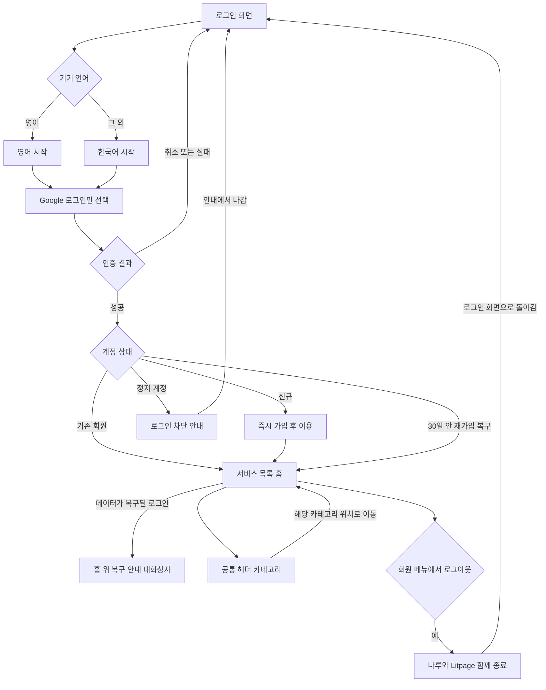
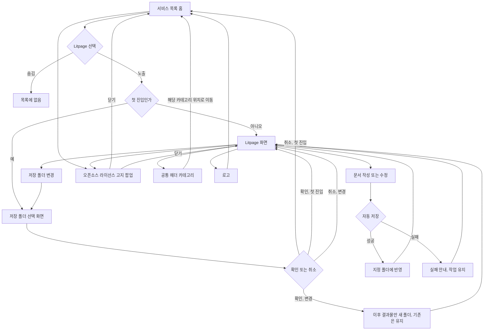
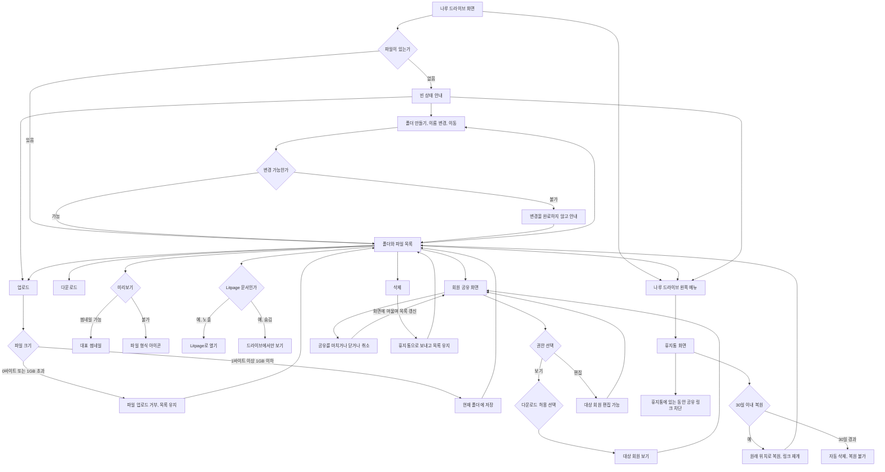
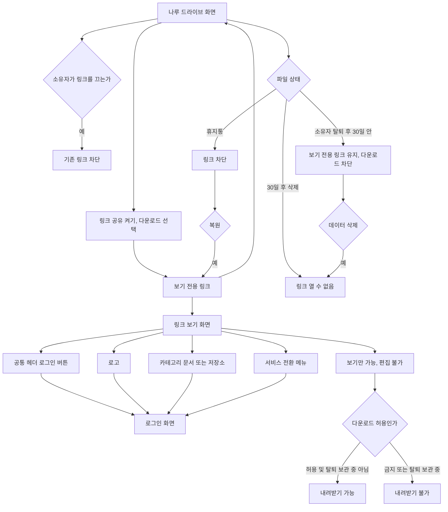
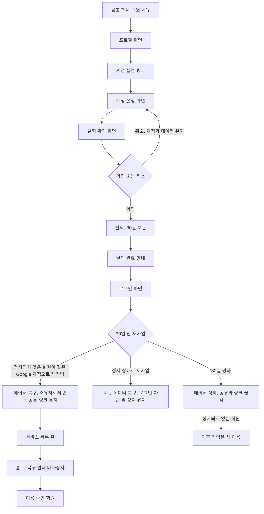
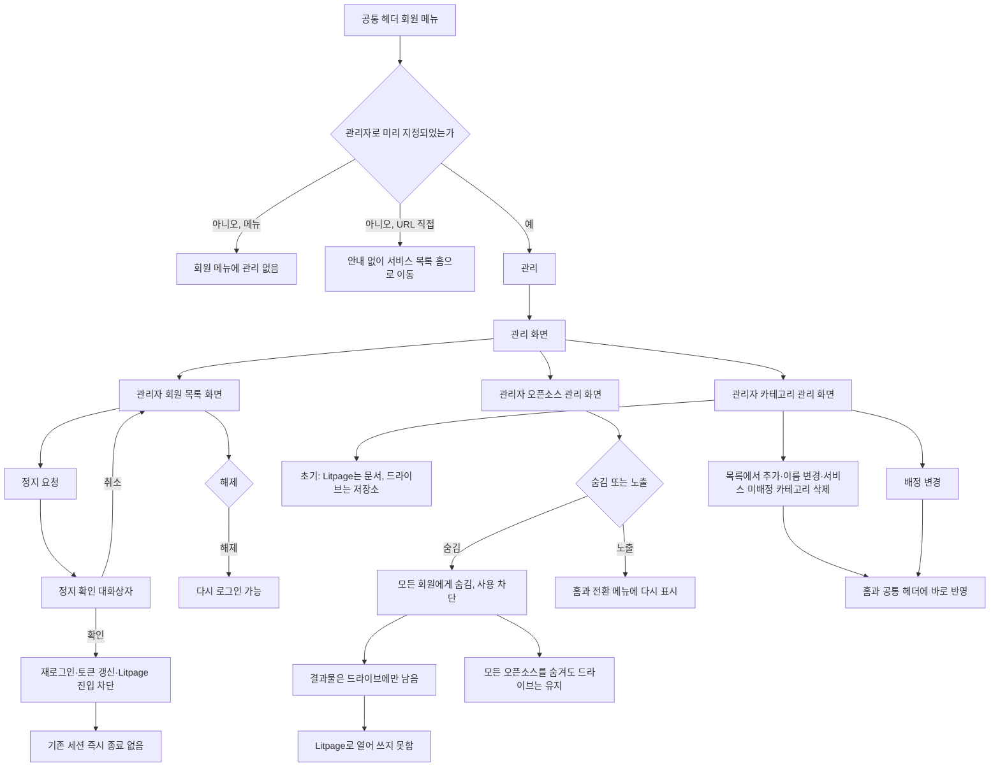
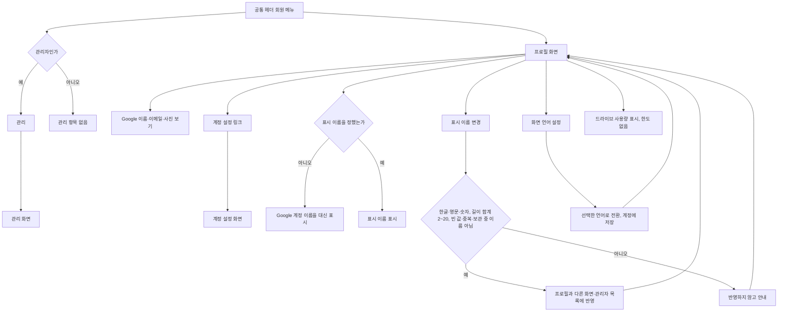

# NaruWorks 사용자 흐름 (UF)

상태: 기준선 v1.0 = develop 4b66d1d + 이번 개정(v1.2, 라운드 16~19) (호배님 승인 대기)

## 1. 문서 정보·개정 이력

| 항목 | 내용 |
|---|---|
| 문서명 | NaruWorks 사용자 흐름 |
| 버전 | v1.2 |
| 상태 | 기준선 v1.0 = develop 4b66d1d + 이번 개정(v1.2, 라운드 16~19). 라운드 18·19 반영분(DEC-107~121)은 호배님 승인 대기. |
| 작성일 | 2026-11-18 17:44 KST (Asia/Seoul) |
| 개정일 | 2026-11-26 (Asia/Seoul) |
| 작성 | 기획 봇 |
| 관련 문서 | `docs/01-planning/frd/FRD.md` (v1.4), `docs/01-planning/business-rules/BR.md` (v1.4), `docs/01-planning/acceptance-criteria/AC.md` (v1.2), `docs/01-planning/prd/PRD.md` (v1.2) |

본 문서는 1차 출시의 주요 이용 경로와 화면 상태를 정리한다. 화면은 역할 이름으로 부르고 시각 디자인은 디자인 산출물에서 다룬다. 기존 흐름도는 주요 경로의 요약이며 세부 조건은 번호 단계와 §10의 상태 설명을 따른다.

### 개정 이력

| 버전 | 일시 (Asia/Seoul) | 내용 |
|---|---|---|
| v0.1 초안 | 2026-11-18 17:44 KST | 주요 이용 경로 6개를 Markdown 흐름으로 작성. |
| v0.2 초안 | 2026-11-18 18:04 KST | FigCraft 검토 반영. 화면 목록에 관리 화면을 추가하고, UF-03의 저장 결과 허브를 목록 기준으로 재구성하며, 모든 흐름도의 루프백을 기존 화면 노드로 잇고, 단계별 FR 표를 추가. |
| v0.3 초안 | 2026-11-18 18:52 KST | FRD·BR·NFR v1.1 반영. 프로필 화면·계정 설정 화면, UF-07, UF-05 진입을 프로필 링크로 변경. 표시 이름·이메일 검색·언어 유지 보완. |
| v0.4 초안 | 2026-11-18 21:18 KST | 라운드 13·DEC-062~068 반영. 헤더 카테고리 이동, 저장 폴더 화면 재사용, 휴지통 왼쪽 메뉴 진입, 공유 화면 유지, 탈퇴 완료 안내, 차단 안내 종료, 회원 메뉴의 관리, 정지 확인·카테고리 인라인 조작. 흐름 목록에서 UF-06을 UF-07 앞에 둠. 관련 문서 경로를 docs/01-planning/으로 맞춤. |
| v0.5 초안 | 2026-11-18 22:05 KST | 라운드 14·DEC-069~074 반영. 푸터 구성(약관·개인정보 새 창, 문의 이메일만, 라이선스 고지, Dev. Aslan0), 로그인 전 화면 푸터, 링크 보기 화면 헤더·로그인 버튼, 재가입 복구 안내를 홈 위 대화상자로 이동, 관리 URL은 안내 없이 홈으로 보냄. |
| v0.6 초안 | 2026-11-18 22:34 KST | DEC-076 반영. 링크 보기 화면 비회원 헤더의 로고·카테고리·서비스 전환도 로그인 화면으로 이동. |
| v0.7 초안 | 2026-11-18 22:39 KST | DEC-077 반영. 푸터 문의 이메일은 aslanhobae@gmail.com, 오픈소스 라이선스 고지는 같은 창 팝업. |
| v0.7 초안 | 2026-11-18 23:02 KST | 머리말만 갱신. FRD·BR v1.2 반영, 승인④ 완료. UF 본문 단계는 변경하지 않음. UF-01 흐름도만 복구 안내 순서를 맞춤(M-06). |
| v1.0 | 2026-11-18 23:54 KST | 승인⑤에서 확정. 기준선 develop 4b66d1d. |
| v1.1 | 2026-11-19 (Asia/Seoul) | 라운드 16 반영(승인 대기). UF-03 단계 3에 1GB=1,073,741,824바이트와 폴더 통째 업로드(DEC-086), 단계 4에 터치 기기에서 썸네일 생략(DEC-084)을 추가. |
| v1.1 | 2026-11-19 (Asia/Seoul) | 라운드 17 반영(승인 대기). UF-01은 로그인 화면 언어 전환(DEC-100), 정지 회원 차단과 세션 만료(DEC-092, DEC-093, DEC-098), 현재 기기 로그아웃(DEC-094)을 반영. UF-02는 Litpage 화면 언어 연동(DEC-100)을 반영. UF-03은 한 번에 업로드하고 중단 시 처음부터 다시 업로드(DEC-090), 폴더 업로드 중 1GB 초과 파일만 제외·안내(DEC-106), 동시 편집 충돌 사본·버전(DEC-097), 탈퇴 보관 중 휴지통 시계(DEC-096)를 반영. UF-04는 다운로드 금지 링크의 원본 미전송(DEC-095)과 탈퇴 보관 중 공유 보기(DEC-099)를 반영. UF-05는 재가입 후 정지 유지(DEC-093), 달력 30일(DEC-096), 탈퇴 보관 중 공유 보기와 탈퇴자가 받은 공유의 즉시 해제(DEC-099)를 반영. UF-06은 정지 회원 차단과 감사 기록(DEC-098, DEC-104)을, UF-07은 언어·테마의 계정 저장(DEC-100, DEC-101)을 반영. 본문 흐름도에는 UF-05의 정지 상태 재가입 분기, UF-06의 차단 범위, UF-07의 언어 계정 저장을 표시한다. |
| v1.2 | 2026-11-26 (Asia/Seoul) | 라운드 18·19의 로그인 복귀·공유·드라이브·회원·관리 흐름과 화면 상태 설명을 반영. 호배님 승인 대기. |

### 화면 역할 이름

로그인 화면, 서비스 목록 홈, 공통 헤더, 공통 푸터, 저장 폴더 선택 화면, Litpage 화면, 나루 드라이브 화면, 휴지통 화면, 회원 공유 화면, 링크 보기 화면, 탈퇴 확인 화면, 탈퇴 완료 안내, 로그인 차단 안내, 재가입 복구 안내 대화상자, 관리 화면(관리자 진입 화면), 관리자 회원 목록 화면, 정지 확인 대화상자, 관리자 오픈소스 관리 화면, 관리자 카테고리 관리 화면, 프로필 화면, 계정 설정 화면, 오픈소스 라이선스 고지 팝업.

## 2. 흐름 목록

| ID | 흐름 | 관련 FR |
|---|---|---|
| UF-01 | 가입·로그인·로그아웃 | FR-AUTH-001, FR-AUTH-002, FR-AUTH-004, FR-AUTH-005, FR-HOME-001, FR-SHELL-001, FR-SHELL-002 |
| UF-02 | 홈에서 Litpage 최초 진입과 저장 폴더 | FR-HOME-001, FR-HOME-002, FR-SHELL-001, FR-SHELL-002, FR-OSS-001, FR-OSS-002, FR-OSS-003 |
| UF-03 | 드라이브 업로드·회원 공유·휴지통 | FR-DRV-001, FR-DRV-002, FR-DRV-003, FR-DRV-004, FR-DRV-005, FR-DRV-006, FR-DRV-008 |
| UF-04 | 비회원 링크 공유 | FR-DRV-007, FR-DRV-004, FR-AUTH-003, FR-SHELL-001, FR-SHELL-002 |
| UF-05 | 계정 설정·탈퇴와 재가입 | FR-SHELL-003, FR-AUTH-006, FR-AUTH-003, FR-AUTH-004 |
| UF-06 | 관리자 정지·오픈소스 숨김·카테고리 | FR-ADM-001, FR-ADM-002, FR-ADM-003, FR-ADM-004, FR-AUTH-005, FR-HOME-001, FR-HOME-002, FR-SHELL-001, FR-OSS-001, FR-DRV-005 |
| UF-07 | 프로필 조회·표시 이름·언어·사용량·계정 설정 링크 | FR-SHELL-001, FR-SHELL-003, FR-AUTH-006, FR-DRV-006, FR-ADM-001 |

## 3. UF-01 가입·로그인·로그아웃

관련 FR: FR-AUTH-001, FR-AUTH-002, FR-AUTH-004, FR-AUTH-005, FR-HOME-001, FR-SHELL-001, FR-SHELL-002. 관련 AC: AC-FR-AUTH-001-01~04, AC-FR-AUTH-002-01~03, AC-FR-AUTH-004-01, AC-FR-AUTH-004-03~04, AC-FR-AUTH-005-01~05, AC-FR-HOME-001-01, AC-FR-SHELL-001-03~04, AC-FR-SHELL-002-01~02, AC-NFR-SEC-006-01, AC-FR-AUTH-001-05, AC-FR-AUTH-001-06, AC-NFR-I18N-002-01, AC-NFR-I18N-003-01, AC-NFR-SEC-004-01. 출처: DEC-001, DEC-005, DEC-007, DEC-012, DEC-014, DEC-015, DEC-027(DEC-098로 정정), DEC-045, DEC-052, DEC-062, DEC-066, DEC-067, DEC-069, DEC-070, DEC-072, DEC-092, DEC-093, DEC-094, DEC-098, DEC-100, DEC-110, DEC-111, DEC-114, DEC-118, DEC-119.

### 단계

1. 사용자가 로그인 화면에 들어온다. 이 화면에도 공통 푸터가 있다. 화면 언어를 아직 설정하지 않았으면, 기기 언어가 영어이면 영어, 그 외에는 한국어로 시작한다. 이미 프로필에서 언어를 정했으면 고른 언어(계정에 저장됨)를 유지한다. 프로필에서 언어를 바꿀 수 있고, (v1.1) 로그인 화면에서도 언어를 전환할 수 있다(DEC-100). 로그인 전에 고른 언어와 계정 언어가 다르면 로그인 후 계정 언어를 따른다(DEC-110). 로그인하지 않은 사용자가 로그인이 필요한 주소에 바로 들어오면 로그인 화면으로 이동하고, 로그인에 성공하면 원래 주소로 돌아간다. 링크 보기에서 로그인한 경우에도 원래 링크로 돌아간다(DEC-118). 이미 로그인한 사용자가 로그인 화면 주소에 접근하면 서비스 목록 홈으로 이동한다(DEC-119).
2. 1차에는 Google 로그인만 선택할 수 있다.
3. Google 인증을 취소하거나 실패하면 로그인 화면 노드로 돌아간다.
4. 인증에 성공하고 아직 회원이 아니면, 관리자 승인 없이 바로 가입되어 이용을 시작한다.
5. 이미 회원이면 추가 가입 없이 로그인한다.
6. 정지된 계정이면 다음 로그인은 차단되고 로그인 차단 안내가 나타난다. 이 안내 화면에도 공통 푸터가 있다. 안내에서 나가면 로그인 화면으로 돌아간다. (v1.1) 정지 회원의 재로그인, 토큰 갱신, Litpage 진입은 모두 새 로그인으로 보아 차단된다(DEC-098). 이미 열린 세션은 즉시 끊기지 않지만 "로그아웃할 때까지 그대로 사용"할 수 있는 것은 아니다(DEC-027 문구 정정). 세션은 유휴 7일, 최대 30일에 만료된다(DEC-092). 정지 회원이 탈퇴 후 재가입해도 정지는 유지된다(DEC-093).
7. 일반 로그인에 성공하면 서비스 목록 홈으로 이동한다. 로그인 필요 주소나 링크 보기에서 시작한 경우 단계 1의 원래 주소 복귀를 따른다. 공통 헤더에는 로고, 서비스 전환 메뉴, 카테고리, 회원 메뉴가 있다. 헤더의 카테고리(문서·저장소 등)를 누르면 서비스 목록 홈의 해당 카테고리 위치로 이동한다. 회원 메뉴의 기본 항목은 프로필·로그아웃이며, 관리자에게만 '관리'가 보인다. 탈퇴 후 30일 안에 같은 Google 계정으로 다시 가입해 데이터가 복구된 경우에는, 홈이 열린 뒤 그 위에 복구 안내 대화상자를 보여 준다. 이 안내는 로그인 화면에 두지 않는다.
8. 회원 메뉴에서 로그아웃하면 지금 쓰는 기기의 나루와 연동 오픈소스(Litpage)가 함께 로그아웃되고 로그인 화면 노드로 돌아간다. (v1.1) 다른 기기의 세션은 끊지 않는다(DEC-094).

### 단계별 FR

| 단계 | 노드·화면 | FR |
|---|---|---|
| 1 | startNode 로그인 화면, lang·enStart·koStart 기기 언어, 공통 푸터 | FR-AUTH-001, FR-SHELL-002 |
| 2 | google Google 로그인만 선택 | FR-AUTH-001 |
| 3 | auth 취소 또는 실패 → startNode 로그인 화면 | FR-AUTH-001 |
| 4 | signup 즉시 가입 후 이용 | FR-AUTH-001 |
| 5 | account 기존 회원 → home | FR-AUTH-001, FR-HOME-001 |
| 6 | blocked 로그인 차단 안내 → startNode 로그인 화면. 푸터 | FR-AUTH-005, FR-SHELL-002 |
| 7 | home 서비스 목록 홈, 공통 헤더, headerCat, restoreNotice 홈 위 복구 안내 | FR-HOME-001, FR-HOME-002, FR-SHELL-001, FR-AUTH-004 |
| 8 | logout·out → startNode 로그인 화면 | FR-AUTH-002 |

## 4. UF-02 홈에서 Litpage 최초 진입과 저장 폴더

관련 FR: FR-HOME-001, FR-HOME-002, FR-SHELL-001, FR-SHELL-002, FR-OSS-001, FR-OSS-002, FR-OSS-003. 관련 AC: AC-FR-HOME-002-01, AC-FR-SHELL-001-03, AC-FR-SHELL-002-01~04, AC-FR-OSS-001-01, AC-FR-OSS-001-03, AC-FR-OSS-002-01~04, AC-FR-OSS-003-01~02, AC-FR-OSS-001-02, AC-NFR-I18N-002-01, AC-NFR-I18N-003-01. 출처: DEC-002, DEC-003, DEC-004, DEC-026, DEC-032, DEC-034, DEC-040, DEC-062, DEC-063, DEC-069, DEC-070, DEC-077, DEC-100, DEC-110, DEC-113, DEC-120.

### 단계

1. 로그인한 회원이 서비스 목록 홈에서 서비스를 본다. 초기에는 Litpage가 문서 카테고리, 나루 드라이브가 저장소 카테고리에 있다. 공통 헤더의 카테고리(문서·저장소)를 누르면 서비스 목록 홈의 해당 카테고리 위치로 이동한다. 서비스당 카테고리는 하나이며, 입력한 카테고리 이름을 그대로 표시한다(DEC-120).
2. 홈 또는 공통 헤더의 서비스 전환 메뉴에서 Litpage를 고른다. 숨긴 오픈소스는 목록에 없다. 숨긴 Litpage는 직접 접근하거나 이미 열어 사용 중인 경우에도 진입·사용이 차단된다(DEC-028). 정지 회원의 Litpage 진입도 차단된다(DEC-098).
3. 해당 오픈소스에 처음 들어가면 저장 폴더 선택 화면이 나타난다. 기본값은 서비스 이름 폴더(/litpage)이다.
4. 선택을 취소하고 진입을 그만두면 사용은 시작되지 않으며, 서비스 목록 홈 노드로 돌아간다. 다음에 다시 들어올 때 선택을 다시 요청한다.
5. 폴더를 확인하면 Litpage 화면이 열리고, 공통 헤더와 공통 푸터가 붙는다. 따로 가입하지 않는다. (v1.1) Litpage 화면의 언어는 나루 화면 언어에 맞춘다(DEC-100). 공통 푸터에는 이용약관·개인정보처리방침, 문의·고객센터, 오픈소스 라이선스 고지, 'Dev. Aslan0' 표시가 있고 회사 정보는 없다. 이용약관·개인정보처리방침은 새 창으로 열리며 한국어와 영어로 모두 제공한다. 문의·고객센터는 연락용 이메일 주소 aslanhobae@gmail.com만 보여 주고, 문의 양식이나 별도 페이지는 두지 않는다. 오픈소스 라이선스 고지를 누르면 같은 창에 팝업(대화상자)이 열리고, 닫으면 원래 화면에 머문다. 이용약관·개인정보처리방침의 한·영 초안과 검토는 T-01·T-02로 관리한다(DEC-103). 나루 테마 설정은 법적 문서에 적용되고 Litpage 화면에는 적용하지 않는다(DEC-113).
6. 문서를 만들거나 바꾸면 지정한 나루 드라이브 폴더에 자동 저장된다. 저장에 실패하면 안내하고 작업 내용을 잃지 않은 채 Litpage 화면으로 이어진다. 저장에 성공해도 Litpage 화면에서 작업을 이어간다.
7. 이후 Litpage에서 저장 폴더를 바꾸면, 처음 진입 때와 같은 저장 폴더 선택 화면이 다시 열린다. 확인하면 다음 결과물만 새 폴더에 저장되고, 기존 결과물은 옮기지 않으며 Litpage 화면으로 이어진다. 변경을 취소하면 폴더를 바꾸지 않고 Litpage 화면으로 돌아간다.
8. 로고를 누르면 서비스 목록 홈 노드로 돌아간다. 헤더 카테고리를 눌러도 서비스 목록 홈의 해당 카테고리 위치로 이동한다.

### 단계별 FR

| 단계 | 노드·화면 | FR |
|---|---|---|
| 1 | home 서비스 목록 홈, 초기 카테고리 배정, headerCat | FR-HOME-001, FR-HOME-002, FR-SHELL-001 |
| 2 | pick Litpage 선택, noEnter 숨김 시 목록에 없음 | FR-HOME-001, FR-SHELL-001, FR-OSS-001 |
| 3 | folder 저장 폴더 선택 화면, first 첫 진입 | FR-OSS-002 |
| 4 | decide 취소, 첫 진입 → home 서비스 목록 홈 | FR-OSS-002 |
| 5 | decide 확인, 첫 진입 → litpage, 공통 헤더·푸터, ossNotice 같은 창 팝업 | FR-OSS-001, FR-SHELL-001, FR-SHELL-002 |
| 6 | work·save, driveFolder 또는 failNote → litpage | FR-OSS-003 |
| 7 | changeFolder → folder, newOnly 또는 취소 → litpage | FR-OSS-002 |
| 8 | logo·headerCat → home 서비스 목록 홈 | FR-SHELL-001, FR-HOME-002 |

## 5. UF-03 드라이브 업로드·회원 공유·휴지통

관련 FR: FR-DRV-001, FR-DRV-002, FR-DRV-003, FR-DRV-004, FR-DRV-005, FR-DRV-006, FR-DRV-008. 관련 AC: AC-FR-DRV-001-01~02, AC-FR-DRV-002-01~02, AC-FR-DRV-003-01~06, AC-FR-DRV-004-01~04, AC-FR-DRV-004-06~07, AC-FR-DRV-005-01~02, AC-FR-DRV-006-01~07, AC-FR-DRV-008-01~03, AC-FR-DRV-003-07, AC-FR-DRV-003-08, AC-FR-DRV-004-08, AC-NFR-PERF-002-01, AC-NFR-SEC-003-01, AC-NFR-SEC-004-01. 출처: DEC-006, DEC-010, DEC-011, DEC-016, DEC-017, DEC-018, DEC-019, DEC-022, DEC-031, DEC-037, DEC-058, DEC-061, DEC-064, DEC-065, DEC-084, DEC-086, DEC-090, DEC-096, DEC-097, DEC-106, DEC-107, DEC-108, DEC-109, DEC-111, DEC-112, DEC-114, DEC-116.

미리보기·문서 열기·공유·삭제는 저장 결과 노드가 아니라 폴더와 파일 목록에서 시작한다. 업로드·폴더 변경이 끝나면 목록 노드로 돌아간다. 휴지통 화면은 나루 드라이브 왼쪽 메뉴에서 들어간다.

### 단계

1. 회원이 홈 또는 서비스 전환 메뉴에서 나루 드라이브를 연다. 파일이 없으면 빈 상태가 보이고, 폴더 만들기와 올리기를 안내한다. 1차에는 총용량 초과 안내를 두지 않는다. 드라이브와 휴지통은 1차에 항목을 하나씩 조작하며 다중 선택을 제공하지 않는다(DEC-116).
2. 폴더와 파일 목록(또는 빈 상태)에서 폴더를 만들거나 이름을 바꿀 때 이름을 입력하고, 폴더를 옮길 때 대상 폴더를 고른다. 완료되면 목록으로 돌아간다. 빈 이름, 같은 위치의 같은 이름, 자기 자신 아래로의 이동은 완료되지 않고 안내된 뒤 목록으로 돌아간다.
3. 목록 또는 빈 상태에서 1바이트 이상 1GB(1,073,741,824바이트) 이하 파일을 올리면 현재 폴더에 저장된 뒤 폴더와 파일 목록으로 돌아간다. 1,073,741,825바이트부터는 올리지 않고 한도를 안내한 뒤 목록으로 돌아간다. (v1.1) 폴더를 통째로 올릴 수도 있으며, 폴더 안의 파일에도 같은 한도를 적용한다. 폴더 안에 한도를 넘는 파일이 섞여 있으면 그 파일만 빼고 나머지는 올리며, 빠진 파일은 안내한다(DEC-106). 업로드는 한 번에 올리며, 중간에 끊기면 이어 올리지 않고 처음부터 다시 올린다(DEC-090). 0바이트 파일은 개별 업로드와 폴더 업로드 모두에서 올리지 않는다(DEC-107). 업로드 대상 위치에 같은 이름의 폴더·파일이 있으면 이름 뒤에 (1)을 붙인다. (1)이 있으면 (2), (3) 순으로 비어 있는 번호를 쓴다. 폴더 업로드에도 적용한다(DEC-108). 목록에서 파일을 내려받을 수 있다.
4. 목록에서 이미지·PDF·동영상에 마우스를 올리면 대표 썸네일이 보이고, 만들 수 없는 형식은 파일 형식 아이콘으로 보인다. (v1.1) 터치 기기에서는 마우스 올림 썸네일 미리보기를 생략한다.
5. 목록에서 Litpage 문서를 누르면 Litpage 화면으로 열린다. Litpage가 숨김이면 파일은 드라이브에서 볼 수 있으나 Litpage로 열 수는 없다.
6. 목록에서 회원 공유 화면으로 들어가, 대상 회원을 전체 이메일 완전 일치(대소문자 무시)로만 찾고 보기 또는 편집 권한을 고른다. 활동 회원만 찾아지며, 표시 이름이나 이메일의 일부로는 검색하지 않는다. 찾아진 회원은 표시 이름(없으면 Google 계정 이름)으로 보인다. 보기이면 다운로드 허용을 함께 선택한다. 다운로드를 금지한 회원 보기 공유와 비회원 보기 링크는 원본 파일을 보내지 않고 화면용으로만 보여 준다(DEC-095, DEC-109). 공유 파일을 동시에 편집해 충돌하면 원본이 있던 폴더에 '이름 (충돌 사본)'으로 저장하고, 버전은 최근 10개를 30일 보관한다(DEC-097, DEC-112). 대상을 찾지 못하거나 자신에게만 공유하려 하면 완료하지 않는다. 공유를 마치거나 닫거나 공유를 취소한 뒤에는 회원 공유 화면에 그대로 머물며 공유 중인 회원 목록만 갱신한다.
7. 목록에서 항목을 삭제하면 그 항목은 휴지통으로 들어가고, 나루 드라이브의 폴더와 파일 목록에 머문다. 휴지통 화면은 나루 드라이브 왼쪽 메뉴에서 연다. 30일이 지나기 전에 되돌리면 원래 위치의 목록으로 돌아간다. 30일이 지나면 자동 삭제되어 되돌릴 수 없다. (v1.1) 30일은 달력 날짜 기준이며, 소유자가 탈퇴해 보관 중인 동안에도 휴지통 시계는 계속 간다(DEC-096).
8. 휴지통에 있는 동안 그 파일의 공유 링크는 막히고, 복원하면 다시 열린다.

### 단계별 FR

| 단계 | 노드·화면 | FR |
|---|---|---|
| 1 | enter 나루 드라이브 화면, empty·emptyState·list | FR-DRV-001 |
| 2 | folderAct·folderCheck, folderFail → list | FR-DRV-002 |
| 3 | upload·size, stored 또는 reject → list, download | FR-DRV-003 |
| 4 | preview, thumb 또는 icon | FR-DRV-008 |
| 5 | openDoc, litpage 또는 stay | FR-DRV-005 |
| 6 | share·perm·dl·memberView·memberEdit, closeShare → share | FR-DRV-006 |
| 7 | del·moved → list. leftNav → trash, restore → list 또는 gone | FR-DRV-004 |
| 8 | linkHold 휴지통에 있는 동안 링크 차단, back 시 재개 | FR-DRV-004 |

## 6. UF-04 비회원 링크 공유

관련 FR: FR-DRV-007, FR-DRV-004, FR-AUTH-003, FR-SHELL-001, FR-SHELL-002. 관련 AC: AC-FR-DRV-007-01~05, AC-FR-DRV-004-03, AC-FR-SHELL-001-05~06, AC-FR-SHELL-002-02, AC-FR-AUTH-001-05, AC-FR-DRV-007-06, AC-FR-SHELL-002-01, AC-NFR-I18N-003-01, AC-NFR-SEC-003-01, AC-NFR-SEC-004-01. 출처: DEC-016, DEC-023, DEC-029, DEC-030, DEC-035, DEC-069, DEC-070, DEC-071, DEC-076, DEC-095, DEC-099, DEC-109, DEC-111, DEC-114, DEC-117, DEC-118.

### 단계

1. 파일 소유자가 나루 드라이브에서 비회원 링크 공유를 켠다. 1차에는 만료와 비밀번호를 두지 않는다.
2. 다운로드 허용 여부를 선택한 뒤 보기 전용 링크를 만든다. 생성된 주소를 표시하고 복사할 수 있게 한다. 생성 흐름을 마치면 나루 드라이브 화면으로 돌아간다.
3. 링크를 받은 비회원이 링크 보기 화면을 연다. 이 화면에는 공통 헤더와 공통 푸터가 있다. 헤더에는 로그인 버튼이 있으며, 로고, 카테고리(문서·저장소), 서비스 전환 메뉴를 눌러도 모두 로그인 화면으로 이동한다. 파일은 볼 수 있고 편집은 할 수 없다. 내려받기는 공유자가 허용한 경우에 가능하며 탈퇴 보관 중에는 차단한다(DEC-111). (v1.1) 다운로드를 금지한 링크는 원본 파일을 보내지 않고 화면용으로만 보여 준다(DEC-095). 링크 보기에서 로그인에 성공하면 원래 링크로 돌아간다(DEC-118).
4. 소유자가 나루 드라이브 화면에서 링크 공유를 끄면 기존 링크로 더 이상 볼 수 없다.
5. 파일이 휴지통에 들어가면 링크는 막히고, 복원하면 보기 전용 링크 노드로 돌아가 다시 열린다. 30일 후 자동 삭제되면 파일을 열 수 없다.
6. 소유자가 탈퇴하면 30일 보관 중에는 보기 전용으로 링크를 유지하며 다운로드를 막는다. 데이터가 삭제되면 링크가 끊긴다(DEC-099, DEC-111). 비회원이 링크 꺼짐, 휴지통, 삭제, 탈퇴로 인해 링크를 열 수 없으면 이유에 관계없이 같은 안내를 보여 준다(DEC-117).

### 단계별 FR

| 단계 | 노드·화면 | FR |
|---|---|---|
| 1 | owner 나루 드라이브 화면, create 링크 공유 켜기 | FR-DRV-007 |
| 2 | linkMade 보기 전용 링크 → owner | FR-DRV-007 |
| 3 | guest 링크 보기 화면, loginBtn·logo·headerCat·svcMenu → login, view·dl·canGet·noGet, 공통 푸터 | FR-DRV-007, FR-SHELL-001, FR-SHELL-002 |
| 4 | owner에서 off → closed | FR-DRV-007 |
| 5 | owner에서 state, blocked, restored → linkMade, dead | FR-DRV-004, FR-DRV-007 |
| 6 | keep 탈퇴 후 30일 안 링크 유지, dead 데이터 삭제 후 끊김 | FR-AUTH-003, FR-DRV-007 |

## 7. UF-05 계정 설정·탈퇴와 재가입

관련 FR: FR-SHELL-003, FR-AUTH-006, FR-AUTH-003, FR-AUTH-004, FR-AUTH-005, FR-HOME-001. 관련 AC: AC-FR-AUTH-006-01, AC-FR-AUTH-003-01~03, AC-FR-AUTH-004-01~04, AC-FR-DRV-006-06~07, AC-FR-DRV-004-07, AC-NFR-I18N-002-01, AC-NFR-SEC-004-01, AC-NFR-USAB-002-01. 출처: DEC-020, DEC-021, DEC-029, DEC-050, DEC-055, DEC-057, DEC-060, DEC-066, DEC-072, DEC-093, DEC-096, DEC-099, DEC-110, DEC-111, DEC-113, DEC-114.

### 단계

1. 로그인한 회원이 공통 헤더의 회원 메뉴에서 프로필 화면을 연다. 회원 메뉴에 계정 설정은 없다.
2. 프로필 화면 안의 계정 설정 링크로 계정 설정 화면을 연다. 이 화면은 프로필과 별도이며, 탈퇴 메뉴가 있다.
3. 계정 설정에서 탈퇴를 고르면 탈퇴 확인 화면이 열린다.
4. 탈퇴를 중간에 취소하면 계정과 데이터를 그대로 두고, 계정 설정 화면으로 돌아간다.
5. 탈퇴를 확인하고 실행하면 계정은 탈퇴 상태가 되고 데이터는 30일 보관된다. 이용은 종료되며, 보관 기간 동안 기존 공유·링크는 유지되되 공유받은 사람은 그 파일을 보기만 할 수 있고(편집·다운로드 불가, DEC-111), 탈퇴한 회원이 받은 공유는 탈퇴 즉시 끊기며(v1.1, DEC-099), 그 표시 이름은 다른 회원이 쓸 수 없다. 30일은 달력 날짜 기준이다(DEC-096). 보관 30일이 끝나면 다른 회원이 그 이름을 쓸 수 있다. 탈퇴가 끝나면 완료 안내를 보여 준 다음 로그인 화면으로 이동한다.
6. 보관 기간 안에 같은 Google 계정으로 재가입하면 보관 데이터가 복구되며, 보관 중 소유자로서 만든 공유·링크는 유지된다. 정지 회원도 같은 Google 계정으로 보관 기간 안에 재가입하면 보관 데이터를 복구한다. 탈퇴 시 끊긴 받은 공유는 재가입해도 복구하지 않는다. 정지는 유지되며 관리자가 회원 목록에서 해제한다(DEC-114). 로그인에 성공해 홈이 열리면 복구 안내 대화상자를 보여 준다(DEC-072).
7. 30일이 지나면 데이터와 이전 공유·링크가 사라진다. 같은 계정으로 다시 가입하면 신규 가입과 같은 상태로 시작하며 복구 안내는 나타나지 않는다(AC-FR-AUTH-004-02). 정지 처리는 UF-01을 따른다.
8. 이미 탈퇴한 계정으로 다시 탈퇴할 수는 없다.

### 단계별 FR

| 단계 | 노드·화면 | FR |
|---|---|---|
| 1 | header → profile 프로필 화면. 회원 메뉴에 계정 설정 없음 | FR-SHELL-001, FR-SHELL-003 |
| 2 | settingsLink → settings 계정 설정 화면 | FR-SHELL-003, FR-AUTH-006 |
| 3 | settings에서 confirm 탈퇴 확인 화면 | FR-AUTH-006, FR-AUTH-003 |
| 4 | choice 취소 → settings | FR-AUTH-003, FR-AUTH-006 |
| 5 | withdrawn, doneNotice → login 로그인 화면. 표시 이름 예약 | FR-AUTH-003 |
| 6 | period 30일 안 재가입, restoredAcc → homeAfter·restoreNotice → member 또는 blockRejoin 정지 유지 | FR-AUTH-004, FR-AUTH-005, FR-HOME-001 |
| 7 | deleted·newJoin 30일 경과 후 새 이용 | FR-AUTH-004 |
| 8 | withdrawn 이후 재탈퇴 불가 | FR-AUTH-003 |

## 8. UF-06 관리자 정지·오픈소스 숨김·카테고리

관련 FR: FR-ADM-001, FR-ADM-002, FR-ADM-003, FR-ADM-004, FR-AUTH-005, FR-HOME-001, FR-HOME-002, FR-SHELL-001, FR-OSS-001, FR-DRV-005. 관련 AC: AC-FR-ADM-001-01~03, AC-FR-ADM-002-01~04, AC-FR-ADM-003-01~04, AC-FR-ADM-004-01~03, AC-FR-AUTH-005-01~05, AC-FR-SHELL-001-04, AC-FR-ADM-004-04, AC-FR-AUTH-004-04, AC-FR-OSS-001-02. 출처: DEC-009, DEC-014, DEC-027(DEC-098로 정정), DEC-028, DEC-033, DEC-034, DEC-040, DEC-067, DEC-068, DEC-074, DEC-098, DEC-104, DEC-114, DEC-115, DEC-120, DEC-121.

### 단계

1. 미리 지정한 관리자만 공통 헤더 회원 메뉴에서 '관리'를 볼 수 있고, 그 항목으로 관리 화면(관리자 진입 화면)에 들어간다. 일반 회원의 회원 메뉴에는 '관리'가 없다. 일반 회원이 관리 화면 URL로 직접 들어오면, 안내 없이 서비스 목록 홈으로 보낸다.
2. 관리 화면에서 관리자 회원 목록 화면으로 들어가 회원과 정지 여부를 조회한다. 표시 이름을 정한 회원은 그 이름이 보이고, 아직 정하지 않은 회원은 Google 계정 이름이 대신 보인다. 회원이 없으면 빈 목록이 보인다. 관리자 회원 목록에는 페이지 나눔만 제공한다. 검색·정렬은 1차에 포함하지 않는다(DEC-121).
3. 관리자가 회원을 정지하려면 확인 대화상자에서 확인해야 한다. 취소하면 정지하지 않고 회원 목록에 머문다. 확인하면 이미 열린 세션은 즉시 끊기지 않지만 토큰 갱신과 Litpage 진입은 차단되고(v1.1, DEC-098), 그다음 로그인은 해제 전까지 차단된다. 정지·해제는 감사 기록으로 남는다(DEC-104).
4. 정지된 회원을 해제하면 다시 로그인하여 사용할 수 있다. 이미 정지된 회원을 다시 정지해도 상태는 정지이고, 이미 이용 중인 회원을 해제하면 이용 중이 그대로이다. 탈퇴 후 재가입한 정지 회원도 관리자가 회원 목록에서 해제한다(DEC-114).
5. 관리 화면에서 관리자 오픈소스 관리 화면으로 들어가 오픈소스를 숨기면, 이미 쓰던 회원을 포함해 모든 회원의 홈·카테고리·서비스 전환 메뉴에서 사라지고 사용도 차단된다. 숨김·노출은 감사 기록으로 남는다(DEC-104). 기존 결과물은 나루 드라이브에만 남고, Litpage로 열어 쓰지는 못한다.
6. 모든 오픈소스를 숨겨도 나루 드라이브는 1차 직접 서비스로 남는다. 다시 노출하면 목록에 나타난다.
7. 초기 카테고리는 문서·저장소이고, Litpage는 문서, 나루 드라이브는 저장소에 배정되어 있다.
8. 관리 화면에서 관리자 카테고리 관리 화면으로 들어가, 목록에서 카테고리를 추가하거나 이름을 바꾸거나, 서비스가 없는 카테고리를 삭제하거나, 서비스 배정을 바꾸면, 서비스 목록 홈과 공통 헤더 카테고리에 바로 반영된다. 해당 카테고리에 노출된 서비스가 없으면 빈 상태가 보인다. 서비스당 카테고리는 하나이며, 입력한 카테고리 이름을 그대로 표시한다(DEC-120). 카테고리에 배정된 서비스가 있으면 삭제를 막고 확인 대화상자를 띄운다(DEC-115). 숨긴 서비스도 배정된 서비스에 해당한다.

### 단계별 FR

| 단계 | 노드·화면 | FR |
|---|---|---|
| 1 | header·gate, deny 또는 redirectHome 홈, 또는 adminItem → adminHome 관리 화면 | FR-SHELL-001, FR-ADM-001, FR-HOME-001 |
| 2 | members 관리자 회원 목록 화면 | FR-ADM-001 |
| 3 | susAsk·susConfirm, nextLogin, session | FR-ADM-002, FR-AUTH-005 |
| 4 | sus 해제, usable | FR-ADM-002 |
| 5 | oss, hide 숨김, hidden, leftover, noLitpage | FR-ADM-003, FR-OSS-001, FR-DRV-005 |
| 6 | driveKept 드라이브 유지, shown 재노출 | FR-ADM-003, FR-HOME-001 |
| 7 | cat, initCat 초기 배정 | FR-ADM-004, FR-HOME-002 |
| 8 | inline·change, reflect 홈과 공통 헤더에 반영 | FR-ADM-004, FR-HOME-002, FR-SHELL-001 |

## 9. UF-07 프로필 조회·표시 이름·언어·테마·사용량

관련 FR: FR-SHELL-001, FR-SHELL-003, FR-AUTH-006, FR-DRV-006, FR-ADM-001. 관련 AC: AC-FR-SHELL-003-01~09, AC-FR-SHELL-001-01, AC-FR-AUTH-006-01, AC-NFR-I18N-002-01, AC-NFR-USAB-002-01. 출처: DEC-013, DEC-047, DEC-010, DEC-039, DEC-045, DEC-051~061, DEC-067, DEC-100, DEC-101, DEC-110, DEC-113.

### 단계

1. 로그인한 회원이 공통 헤더의 회원 메뉴에서 프로필을 고르면 프로필 화면이 열린다. 회원 메뉴에 계정 설정은 없다. 관리자에게만 같은 메뉴에 '관리'가 보이며, 일반 회원에게는 보이지 않는다.
2. Google 계정 이름·이메일·사진을 볼 수 있고, 이 화면에서 수정하지는 못한다. 사진이 없으면 사진이 없음을 안내한다. 탈퇴 메뉴는 없고, 계정 설정 링크는 있다. 그 링크는 UF-05로 이어진다.
3. 아직 표시 이름을 정하지 않았으면 Google 계정 이름이 대신 보인다. 한글·영문·숫자만 쓰고, 길이 합계 2~20(한글 1자=2, 영문·숫자 1자=1)이며 다른 회원·탈퇴 보관 중인 이름과 겹치지 않으면 반영된다. 빈 값, 허용되지 않는 문자, 길이 위반, 중복은 반영되지 않고 안내된다. 보관 30일이 끝난 이름은 다른 회원이 쓸 수 있다.
4. 정한 표시 이름은 다른 회원에게 보이는 화면과 관리자 회원 목록에도 보이고, 아직 정하지 않은 회원은 그곳에서도 Google 계정 이름이 대신 보인다. 회원 공유 대상은 전체 이메일 완전 일치(대소문자 무시)로만 검색하며 활동 회원만 찾는다.
5. 화면 언어를 한국어 또는 영어로 설정하면 화면 언어가 바뀌고, 계정에 저장되어 다음 방문에도 유지된다(DEC-100). 설정 전에만 기기 언어 규칙이 적용된다. 프로필에서 시스템·밝게·어둡게 중 하나를 고른다. 선택은 계정에 저장되며, 나루 화면과 이용약관·개인정보처리방침 등 법적 문서에 적용한다. Litpage 화면에는 적용하지 않는다(DEC-101, DEC-113).
6. 드라이브 사용량(현재 사용 중인 용량)이 보이며, 총용량 한도는 보이지 않는다. 사용량이 0이면 0으로 보인다.

### 단계별 FR

| 단계 | 노드·화면 | FR |
|---|---|---|
| 1 | header → profile 프로필 화면. adminOnly·adminItem 관리(관리자만) | FR-SHELL-001, FR-SHELL-003 |
| 2 | googleInfo, settingsLink → settings | FR-SHELL-003, FR-AUTH-006 |
| 3 | nameState·googleAlias·rename·nameCheck·saved 또는 nameFail | FR-SHELL-003 |
| 4 | saved가 다른 회원 화면·관리자 목록에도 반영. 공유 검색은 이메일 완전 일치 | FR-SHELL-003, FR-DRV-006, FR-ADM-001 |
| 5 | langSet·switched 언어 설정 유지 | FR-SHELL-003 |
| 6 | usage 드라이브 사용량 표시, 한도 없음 | FR-SHELL-003 |

## 10. 전용 와이어프레임이 없는 상태

| 흐름 | 상태 설명 |
|---|---|
| UF-05 | 탈퇴가 완료되면 완료 안내 뒤 로그인 화면으로 이동한다. |
| UF-01, UF-05 | 보관 데이터를 복구하고 로그인에 성공하면 서비스 목록 홈 위에 복구 안내 대화상자가 보인다. |
| UF-05 | 30일 경과 후 재가입은 신규 가입과 같이 시작한다. 이전 데이터·공유·링크와 복구 안내는 나타나지 않는다(AC-FR-AUTH-004-02). |
| UF-06 | 관리자 회원 목록에서 정지를 요청하면 확인 대화상자가 열린다. 확인 시 정지하고, 취소 시 상태를 유지하며 목록에 머문다. |
| UF-02 | 오픈소스 라이선스 고지는 같은 창 팝업으로 열리고, 닫으면 원래 화면에 머문다. |
| UF-02 | 이용약관·개인정보처리방침은 새 창에서 열고 원래 화면은 그대로 둔다. |
| UF-04 | 링크 생성 뒤 주소를 표시하고 복사할 수 있게 한다. 생성 흐름을 마치면 드라이브 목록으로 돌아간다. |
| UF-03 | 폴더를 만들거나 이름을 바꿀 때는 이름을 입력한다. 이동할 때는 대상 폴더를 고른다. 작업이 끝나면 결과가 목록에 반영된다. |
| UF-02, UF-03, UF-06 | 숨긴 Litpage는 진입·사용을 차단한다. 기존 결과 파일은 드라이브에 남고 선택해도 Litpage로 열리지 않는다. 정지 회원의 Litpage 진입도 차단한다. |
| UF-06 | 배정된 서비스가 있는 카테고리의 삭제를 요청하면 확인 대화상자를 띄우고 카테고리를 유지한다. |
