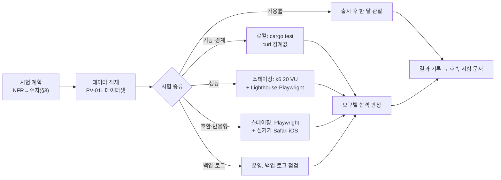
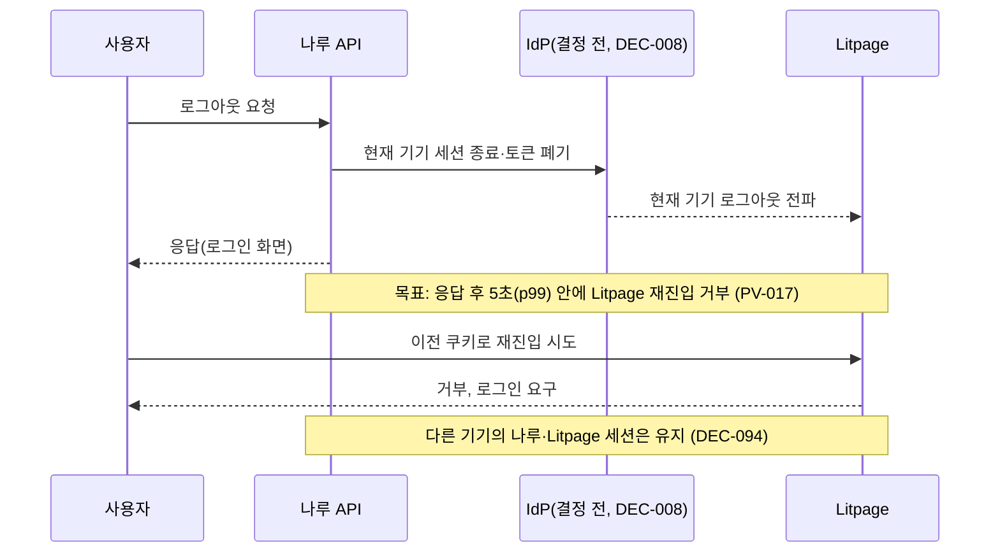
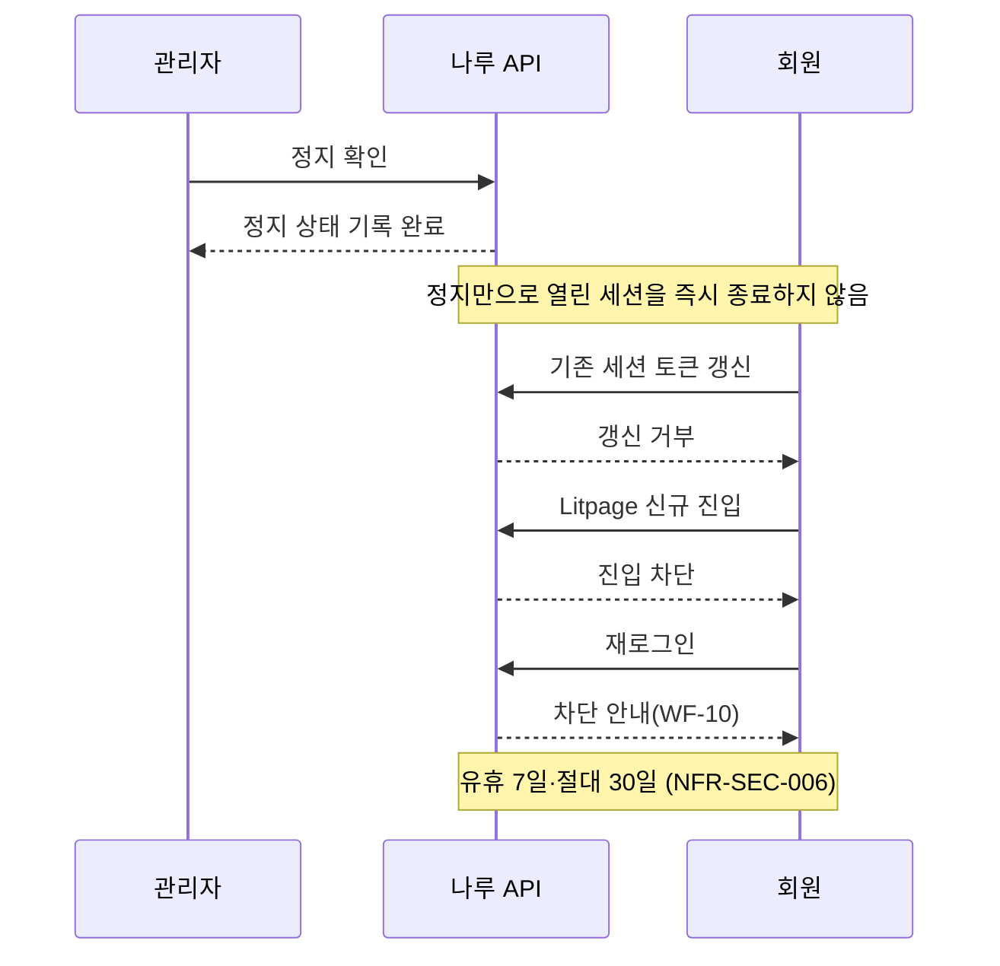

# 04. NFR 기술 수치화 (+ 기획 기준선 입력 검증)

## 1. 문서 정보

| 항목 | 내용 |
|---|---|
| 문서명 | NaruWorks 설계 문서 04 — NFR 기술 수치화 |
| 버전 | v0.3 |
| 작성일 | 2026-11-19 (Asia/Seoul) |
| 작성 | 설계 봇 (naru-orch P2-1) |
| 상태 | 재대조 반영, Gemini 재검토 대기 |
| 작업 브랜치·기준 | `feature/NARU-94-architecture`, develop `2f1db92` (PR #99) |
| 개정일 | 2026-11-26 (KST), rebaseline 2f1db92 |
| 백엔드 전제 | Rust. 프런트엔드 스택은 미정이며 이 문서에서 고르지 않는다(필요한 곳은 "프런트 스택 결정 후 확정"). |

### 1.0 개정 이력

| 버전 | 일시 | 내용 |
|---|---|---|
| v0.1 | 2026-11-19 (KST) | 초안 |
| v0.2 | 2026-11-19 (KST) | v0.2 — Gemini 검토(P2-1-nfr-review-gemini-01) 반영. RV-001~010 처리 내역은 부록 A |
| v0.3 | 2026-11-26 (KST) | rebaseline 2f1db92. 라운드 16~19의 결정과 NFR 5개 추가, GAP 재대조 반영. |

### 1.1 입력 기준선 (실제 확인한 버전)

설계 기준은 develop `2f1db92` (PR #99)이다. 라운드 16~19의 DEC-081~121을 반영한다. 버전은 워크트리 원문의 머리말에서 확인했다. 충돌 시 최신 DEC가 우선하며 FRD·BR > AC·UF > NFR > PRD > glossary·서비스 정의 순으로 따른다(DEC-081).

| 입력 문서 | 실제 표기 | 용도 |
|---|---|---|
| [NFR.md](../01-planning/nfr/NFR.md) | v1.3 | NFR 23개 |
| [PRD.md](../01-planning/prd/PRD.md) | v1.2 | §6 성공 지표 |
| [FRD.md](../01-planning/frd/FRD.md) | v1.4 | 기능·예외 |
| [BR.md](../01-planning/business-rules/BR.md) | v1.4 | 업무 규칙 |
| [AC.md](../01-planning/acceptance-criteria/AC.md) | v1.2 | 수용 기준 |
| [UF.md](../01-planning/user-flow/UF.md) | v1.2 | 사용자 흐름 |
| [matrix.csv](../01-planning/traceability/matrix.csv) | 버전 표기 없음 | 요구·검증 연결 |
| [decision-log.md](../01-planning/02-decision-log/decision-log.md) | 버전 표기 없음 | DEC-001~121, 이번 재대조 DEC-081~121 |
| [open-questions.md](../01-planning/02-decision-log/open-questions.md) | 라운드 19 이후 | Q-081·085·087·091·092 [미확인] |
| [carry-over/README.md](../01-planning/carry-over/README.md) | 위치 기록 (DEC-082, 라운드 16) | CO-01~03 보관 위치 |

## 2. 범위와 원칙

### 2.1 범위

- NFR 23개를 측정 가능한 기술 수치와 시험 방법으로 바꾼다.
- §1.1의 기획 원문을 대조해 설계에 영향을 주는 일관성 문제를 §5에 기록한다. 기획 문서는 고치지 않는다.
- IdP, 저장소 제품과 프런트 프레임워크는 후속 ADR에서 결정한다.

### 2.2 기획 수치와 제안값의 구분 규칙

| 표기 | 뜻 |
|---|---|
| **[기획]** + 출처(NFR ID·DEC 번호) | 기획 원문에 있는 수치·규칙. 임의로 바꾸지 않는다. |
| **[파생]** | 기획 수치에서 산술로 도출한 값(예: 99% → 월 허용 중단 시간). 계산 근거를 적는다. |
| **[제안값 PV-###]** | 기획에 없는 숫자·방식. §6에 근거와 확인 주체를 둔다. 확인 전까지 기획 사실로 취급하지 않는다. |
| **[미확인]** | 확인하지 못했거나 기획·법률 확인이 필요한 내용. |

### 2.3 측정 환경 정의

기획에는 측정 환경·네트워크·기기 조건이 없다. 아래의 시험 환경은 **제안값**이다. 측정 범위와 합격 기준은 §3을 따른다.

| 환경 | 용도 | 합격 판정 사용 |
|---|---|---|
| 로컬(개발) | `cargo test`, `criterion` 마이크로벤치, 단위·통합 시험 | 기능·경계값만. 성능 SLO 판정에는 쓰지 않음 |
| 스테이징 | 운영과 같은 사양·구성의 시험 환경(AS-012). 부하·E2E·브라우저 시험 | 성능·보안·호환 합격 판정의 기준 환경 |
| 운영 | 합성 모니터링(업타임 프로브), 실사용 로그 | 가용률·로그·백업의 실측 |

| 항목 | 기준 |
|---|---|
| 측정 위치 | 서버 외부의 별도 호스트(서울 인근). 서버 내부 지표는 보조 |
| 클라이언트 프로파일 P-DESK | PC 브라우저, 유선 100 Mbps 이상, RTT 30 ms 이하 (PV-007) |
| 클라이언트 프로파일 P-MOB | 모바일 에뮬레이션, 하향 10 Mbps·상향 5 Mbps, RTT 100 ms, CPU 4배 감속 (PV-007) |
| Google 인증 구간 | **[기획]** Google 로그인 구간 제외, Litpage 로딩 포함(DEC-087) |
| 합격 판정 통계 | **[기획]** 화면 이동·썸네일은 p95(DEC-087). **[제안값 PV-004]** p99 참고, 화면당 30회 이상 |

## 3. NFR 기술 수치 표

설계 반영 위치와 후속 문서의 배정은 §8.2를 따른다.

| NFR ID | 기획 원문 요약 (출처 DEC) | 기술 수치 목표 | 측정 방법 (도구·명령, 환경, 합격 조건) | 관련 FR/AC/BR | 설계 반영 위치 | 비고 |
|---|---|---|---|---|---|---|
| NFR-PERF-001 | 1차 예상 사용자 100명 이내(DEC-036). 가입자 80명·100명 도달 시 운영 경보만 발송(DEC-088) | **[기획]** 100명 이내 전제와 80명·100명 경보. 가입 제한 없음. **[제안값 PV-011]** 회원 100, 회원당 폴더 20·파일 500, 단일 폴더 최대 1,000항목, 공유 5,000건, 링크 1,000건 | 스테이징 데이터셋에서 PERF-003·004를 수행하고 목록 질의 실행 계획을 확인한다. 가입자가 각 기준에 도달할 때 운영 경보가 나가고 이후에도 가입할 수 있는지 검증한다. | AC-NFR-PERF-001-01, AC-NFR-PERF-004-03 | 05, 운영·시험 설계 | 가입자 경보의 수신자·방법 [미확인] |
| NFR-PERF-002 | 파일당 1GB, 단일 요청 업로드, 중단 시 처음부터 전송(DEC-086·090), 폴더 예외와 충돌 처리(DEC-106~108) | **[기획]** 1~1,073,741,824 B 허용, 초과·0바이트 거부. 폴더 업로드에 파일별 적용. 한도 초과 파일만 제외·안내. 같은 이름이면 첫 빈 번호 부여. 총용량 한도 없음(DEC-010). **[제안값 PV-003]** 업로드당 서버 메모리 증가 ≤64 MiB | 로컬에서 경계와 부분 실패를 검증하고 스테이징에서 단일 요청 스트리밍의 무결성·메모리를 측정한다(§4.1). | FR-DRV-003, BR-010·024, AC-FR-DRV-003-02~08, AC-NFR-PERF-002-01 | 05 §6.1·§8, 06 §5·§8 | CO-02 프록시 경로와 본문 한도 충돌 여부 [미확인] (RB-017, GAP-005) |
| NFR-PERF-003 | 화면 이동 2초, 썸네일 3초(DEC-041·087), 터치 기기 마우스 올림 썸네일 생략(DEC-084) | **[기획]** 화면 이동 p95 ≤2초, 썸네일 표시 p95 ≤3초. 파일 전송·썸네일 최초 생성·Google 로그인 제외, Litpage 로딩 포함. **[제안값 PV-004·006·008]** p99 참고, 브라우저 측정 구간과 목록·메타데이터 API 예산은 §4.2. **[제안값 PV-005]** 비동기 썸네일 | 스테이징에서 활성 세션 20개와 PV-011 데이터셋을 유지하고 P-DESK·P-MOB에서 Playwright로 화면별 30회 이상 측정한다. 시험용 세션과 WF-09·10 절차는 PV-032를 적용한다. 마우스 올림 지원 환경에서 이미지·PDF·동영상 각 30개의 준비된 썸네일을 측정하고, 터치 환경에서는 해당 미리보기가 생략되는지 확인한다. | FR-AUTH-001, FR-HOME-001, FR-DRV-001·007·008, FR-OSS-001, FR-ADM-001, BR-012, AC-NFR-PERF-003-01, AC-FR-DRV-008-03 | 05 §6·§9, 프런트·시험 설계 | 표본 수·측정 기간·지점의 기획 기준 [미확인] (시험 설계는 §2.3·§4.2) |
| NFR-PERF-004 | 동시 접속 목표 20명(DEC-049·088) | **[기획]** 최근 60초 이내 요청한 활성 세션 20개, 오류율(5xx·타임아웃) ≤0.1%. **[제안값 PV-009·010]** 20 VU, 3~8초 간격, 15분씩 3회, 백그라운드 업로드 3건, 데이터 손실 0 | 스테이징 k6에서 활성 세션 수를 확인하고 홈·로그인 10%, 드라이브 목록 35%, 썸네일 15%, 폴더·공유 15%, Litpage 진입 10%, 링크 보기 10%, 관리자 5%를 수행한다. 오류율과 PERF-003을 검증하고 업로드 3건의 해시를 비교한다. | AC-NFR-PERF-004-01~03, FR-AUTH-001, FR-HOME-001, FR-DRV-001·007, FR-OSS-001, FR-ADM-001 | 05, 06 §8, 시험 설계 | 오류율 분모·집계 창 [미확인]. 참고 부하 산술은 약 15 rps(PV-033) |
| NFR-SEC-001 | 현재 기기의 나루·Litpage 통합 로그아웃(DEC-015·094) | **[기획]** 현재 기기의 두 세션 종료. 다른 기기 세션 유지. **[제안값 PV-017]** 전파 p99 ≤5초, 로그아웃 API p95 ≤2초 | 스테이징에서 같은 계정으로 두 기기에서 로그인한다. 첫 기기에서 나루 로그아웃 후 새로고침·이전 쿠키 요청·Litpage 재진입이 거부되고 두 번째 기기의 나루·Litpage 세션은 유지되는지 확인한다. 30회 전파 지연 최댓값과 API p95를 판정한다(PV-028). | FR-AUTH-002, FR-OSS-001, BR-004, AC-FR-AUTH-002-01~03, AC-NFR-SEC-001-01 | 05 §6.3, 06 §5, 09 예정 | 연동 종료 구현은 [ADR 대기] |
| NFR-SEC-002 | 정지 회원의 새 로그인 차단(DEC-092·098), 정지 유지와 관리자 해제(DEC-093·114) | **[기획]** 재로그인·토큰 갱신·Litpage 진입을 차단한다. 열린 세션은 즉시 종료하지 않는다. **[제안값 PV-018]** 정지 확정 후 새 로그인 차단 반영 ≤5초 | 스테이징에서 나루·Litpage 세션을 연 뒤 관리자 정지를 확정한다. 즉시 종료되지 않음을 확인하고 재로그인, 기존 세션의 토큰 갱신, 기존 나루 세션의 Litpage 신규 진입을 각각 시도해 차단을 확인한다. 정지 상태 저장 확정에서 새 로그인 차단까지의 시간을 재어 PV-018 제안값을 확인한다. 정지 해제 뒤 로그인 성공을 확인한다. | FR-AUTH-005, FR-ADM-002, BR-005·017, AC-FR-AUTH-005-01~05, AC-NFR-SEC-002-01 | 05 §6.4, 06 §5·§8, 09 예정 | 토큰 갱신 때 차단되기까지의 최대 시간 Q-087 [미확인] |
| NFR-SEC-003 | 보기 공유·비회원 링크의 접근 통제(DEC-023·035·095·109·117) | **[기획]** 비회원 링크는 보기만 제공하며 만료·비밀번호를 두지 않는다. 다운로드 금지 회원 보기 공유·비회원 링크는 화면용만 제공하고 원본은 전송하지 않는다. 비회원이 열 수 없는 링크에는 동일 안내. **[제안값 PV-019]** 128비트 이상 CSPRNG 토큰, IP당 분당 60회, `no-store`·색인 금지·`no-referrer`, 링크 끄기 반영 ≤5초 | 스테이징에서 회원 보기 공유와 비회원 링크를 다운로드 켬/끔 각각 검증한다. 금지 상태에서는 네트워크 응답에 원본이 없고 다운로드가 거부되는지 확인한다. 비회원 편집 거부, 링크 꺼짐·휴지통·삭제·탈퇴로 열 수 없는 경우의 동일 안내, 휴지통 복원 시 다시 열림을 확인한다. 토큰 생성·추측·빈도는 PV-030으로 분리 시험한다. | FR-DRV-006·007, BR-006·007·008·022, AC-NFR-SEC-003-01, AC-FR-DRV-004-03, AC-FR-DRV-007-05·06 | 05 §6.2, 06 §5 | 화면용 형식 [미확인] (설계 이관) |
| NFR-SEC-004 | 탈퇴 데이터 달력 날짜 30일 보관·복구 및 삭제(DEC-096·099·111·114) | **[기획]** 기간 내 같은 Google 계정으로 재가입 시 정지 여부와 관계없이 보관 데이터 복구. 정지는 관리자 해제까지 유지. 받은 공유는 탈퇴 즉시 회수, 재가입 시에도 미복구. 보관 중 소유 공유·링크는 보기만 허용. 휴지통 시계는 계속 진행. **[제안값 PV-020]** 요청 시 복구·접근 경계 판정, 매시간 스위프 | 주입 시계로 만료 전후 복구·공유·링크·표시 이름 예약을 검증한다. 보관 중 편집·다운로드 차단, 받은 공유 회수·미복구, 정지 유지·해제, 휴지통 시계 지속, 스위퍼 실행 전 경계 판정과 재실행 후 결과 일치를 확인한다. | FR-AUTH-003·004·006, FR-DRV-004·006·007, BR-006·007·026·027, AC-NFR-SEC-004-01, AC-FR-DRV-004-06·07 | 05 §7, 06 §5·§8 | 시간대·경계 시각·시작일 Q-085 [미확인] |
| NFR-SEC-005 | 비밀 값과 계정명 미기재, CO-01~03 보관 위치만 표기(DEC-082) | **[기획]** 비밀 값과 계정명 0건. CO-01·02는 Cloudflare 대시보드, CO-03은 Google Cloud Console. **[제안값 PV-021]** CI 검사 범위를 코드·설정 예시·샘플 로그로 확대 | 설계·기획 산출물의 위치 참조만 확인한다. CI 스캔은 허용된 대상에서 수행하며 비밀 파일을 읽지 않는다. | AC-NFR-SEC-005-01·02 | 05 §3, 06 §7, 운영·시험 설계 | CI 추가 범위 [미확인] (GAP-032) |
| NFR-SEC-006 | 유휴 7일·절대 30일 세션 만료(DEC-092) | **[기획]** 7일 무요청 또는 로그인 시작 후 30일 경과 시 만료. 만료 후 재로그인 필요. 정지 회원은 재로그인 차단. | 주입 시계로 유휴 경계 직전·도달과 지속 활동 중 절대 경계를 검증한다(PV-029). | FR-AUTH-001·002·005, BR-004·005, AC-NFR-SEC-006-01 | 05 §6.4, 06 §5·§8, 09 예정 | 시각 기준과 Litpage 자체 세션에 동일 기간 적용 여부 [미확인] (설계 이관) |
| NFR-AVAIL-001 | 월 99% 가용률, 미리 알린 점검과 외부 장애 제외(DEC-042·089) | **[기획]** 출시 전 별도 검증 없이 출시 후 한 달 관찰만 수행. **[제안값 PV-012]** 1분 간격 외부 프로브와 중단 경보 | 운영 한 달 동안 가용률을 관찰한다. 미리 알린 점검과 Google·Cloudflare 등 외부 장애는 중단으로 세지 않는다. 미공지 점검과 서비스 자체 장애는 중단에 포함한다(§4.6). | AC-NFR-AVAIL-001-01·02 | 후속 배포·운영 설계 | 공지 기준·장애 귀책 판정·목표 미달 시 조치 [미확인] |
| NFR-USAB-001 | PC 웹과 반응형 모바일 웹, 모바일 앱 제외 (DEC-038) | **[기획]** 1차 기능을 PC·모바일 웹에서 수행, 앱 설치 불필요. **[제안값 PV-024]** 최소 폭 360 px, 검증 뷰포트 5종(360×640, 390×844, 768×1024, 1280×800, 1920×1080), 가로 스크롤 없음, 탭 대상 44×44 CSS px 이상 | 환경: 스테이징. 도구: Playwright 뷰포트 프로젝트 + 실기기 1대. 시나리오: UF-01~07의 핵심 경로 7개를 5개 뷰포트에서 수행. 합격: 모든 경로 완료, 가로 스크롤·잘림·겹침 0건, 탭 대상 크기 기준 충족 | AC-NFR-USAB-001-01. UF-01~07 | 05 §9, 프런트 설계 | 터치 기기 마우스 올림 썸네일 생략(DEC-084). 프런트 스택 결정 후 토큰·브레이크포인트 확정 |
| NFR-USAB-002 | 테마 계정 저장(DEC-101·113) | **[기획]** 프로필에서 system/light/dark를 선택. 시스템 모드는 기기 설정을 따른다. 나루·법적 문서에 적용하고 Litpage는 적용 범위에서 제외한다. | 재로그인·다른 기기에서 저장값, 시스템 모드에서 기기 설정 변경, 나루와 새 창 법적 문서 적용, Litpage 미적용을 확인한다. | FR-SHELL-002·003, BR-025, AC-NFR-USAB-002-01 | 05 §9, 프런트 설계 | 로그인 전 적용 방식 [미확인] (설계 이관) |
| NFR-USAB-003 | WCAG 2.1 AA(DEC-102) | **[기획]** 1차 화면의 라이트·다크 모두 WCAG 2.1 AA | 주요 화면에서 WCAG 2.1 A·AA 성공 기준을 점검한다. 일반 텍스트 대비, 키보드 조작·포커스 표시, 대체 텍스트 등을 두 테마에서 확인한다. | AC-NFR-USAB-003-01 | 05 §9, 프런트·시험 설계 | Litpage와 법적 문서 등 화면별 범위·검증 방법 세부 [미확인] |
| NFR-OPS-001 | 회원 정보·드라이브 파일만 매일 백업, 30일 자동 만료와 복원 시 삭제 재적용(DEC-046·083·091) | **[기획]** 공유·링크·설정 제외. 복원 절차와 안내에 복원되지 않을 수 있음을 명시. **[제안값 PV-013~015]** RPO ≤24시간·RTO ≤4시간, 월 1회 복원 훈련과 삭제 원장 | 스테이징 복원 훈련과 운영 기록에서 매일 수행·30일 만료를 확인한다. 회원 정보와 파일을 복구하고 공유·링크·설정 제외 안내를 확인한다. 이미 만료된 탈퇴 데이터와 삭제 처리된 휴지통 파일이 복원 후에도 삭제 상태인지 확인한다. 복원 파일은 1% 해시 표본(PV-034)으로 비교한다. | AC-NFR-OPS-001-01~03, BR-006·007 | 05 §7, 운영 설계 | 복원 주체·절차와 재적용 완료 전 접근 제어 [미확인] |
| NFR-OPS-002 | 로그 30일 보관, 성공 지표 집계는 별도 보관(DEC-044·085) | **[기획]** 로그는 30일 후 보관하지 않으며 로그 만료가 지표 집계에 영향을 주지 않는다. **[제안값 PV-016]** 접근·애플리케이션 로그 마스킹, 비식별 일 집계 | 표식 로그로 30일 만료를 확인한다. 지표 집계가 로그와 다른 보관 대상이고 로그 만료 뒤에도 남아 있는지 확인한다. 로그 샘플 1만 줄(PV-035)에서 토큰·시크릿·원문 이메일 패턴 0건을 확인한다. | AC-NFR-OPS-002-01·02 | 05 §4·§7, 06 §6, 운영 설계 | 지표 집계 항목·보관 기간 및 로그 정책의 법적 적정성 [미확인] (DEC-085, Q-081·091) |
| NFR-OPS-003 | 관리자 감사 기록(DEC-104) | **[기획]** 회원 정지·해제, 오픈소스 숨김·노출을 감사 기록으로 남긴다. | 네 동작의 기록을 각각 확인하고 취소한 정지에는 성공 기록이 남지 않는지 검증한다. | FR-ADM-002·003, BR-017, AC-FR-ADM-002-04, AC-FR-ADM-003-04 | 05 §7·§8, 06 §5 | 감사 항목·보관 기간과 운영 로그 30일 정책 적용 여부 Q-091 [미확인] |
| NFR-OPS-004 | 전체 저장 용량 운영 경보(DEC-105) | **[기획]** 전체 저장 용량이 기준을 넘을 때 운영 경보를 발행한다. 업로드 차단·회원별 총용량 제한 없음(DEC-010). | 기준 설정 후 초과를 모의하여 운영 경보와 이후 정상 업로드를 함께 확인한다. | AC-NFR-OPS-004-01 | 05 §7·§8, 06 §5 | 기준 수치·수신 대상·방법 Q-092 [미확인] |
| NFR-COMP-001 | 지원 환경 PC 웹·반응형 모바일 웹, 앱 없음 (DEC-038) | **[기획]** 앱스토어 앱 없이 웹으로 1차 기능 사용 | 환경: 스테이징. 도구: Playwright·실기기. 절차: 설치 없이 PC·모바일 브라우저에서 1차 기능 6종(로그인·홈·드라이브·Litpage·관리자·링크 보기) 수행. 합격: 전부 성공, 앱 설치·플러그인 요구 0건 | AC-NFR-COMP-001-01 | 05, 프런트 설계 | NFR-USAB-001과 중복 서술 |
| NFR-COMP-002 | 최신 Chrome(PC·Android), 최신 Safari(iOS·macOS) (DEC-043) | **[기획]** 대상 4환경. **[제안값 PV-025]** "최신" = 시험일 기준 각 브라우저 stable 최신 메이저. 시험 매트릭스 4환경, iOS Safari는 실기기 1대, Playwright chromium·webkit은 보조 | 환경: 스테이징. 도구: Playwright(`chromium`·`webkit`) + 실기기(iOS Safari, Android Chrome). 시나리오: 핵심 6종 + 업로드(소·대용량) + 링크 보기. 합격: 4환경 전부 통과. Playwright WebKit은 실제 Safari와 같지 않으므로 iOS는 실기기 결과로만 합격 판정 | AC-NFR-COMP-002-01 | 프런트·시험 설계 | "최신" 정의·iOS 타 브라우저 취급 미정 → GAP-018 [미확인] |
| NFR-I18N-001 | 화면 언어 한국어·영어 (DEC-039) | **[기획]** 주요 화면 문구 한·영 제공. **[제안값 PV-027]** 번역 키 한·영 대칭, 누락 0건을 CI 게이트로 | 환경: CI·스테이징. 도구: 번역 키 목록 비교 스크립트, Playwright(로캘별 컨텍스트). 합격: 키 누락 0, WF-01~16 전 화면을 두 언어로 열었을 때 미번역 문구 0 | FR-SHELL-003, BR-025. AC-FR-SHELL-003-05, AC-NFR-I18N-001-01 | 05 §9, 프런트 설계 | 프런트 스택 결정 후 도구 확정 |
| NFR-I18N-002 | 기기 기본 언어·로그인 화면 전환·계정 언어 우선·Litpage 언어 동기화(DEC-045·052·100·110) | **[기획]** 설정 전 영어 기기는 영어, 그 외는 한국어. 로그인 화면에서 한·영 전환. 로그인 후 계정 언어 우선 및 계정 저장. Litpage 화면은 나루 언어 사용. **[제안값 PV-026]** 기기 언어 판정은 브라우저 언어 목록 첫 항목의 `en`·`en-*` 여부 | 스테이징에서 영어·한국어·기타 로캘로 처음 방문하고 로그인 전 언어를 바꾼다. 다른 계정 언어로 로그인한 뒤 나루·Litpage가 계정 언어를 쓰고 프로필 변경이 다른 기기에도 유지되는지 확인한다. | FR-AUTH-001, FR-SHELL-003, FR-OSS-001, BR-025, AC-FR-AUTH-001-04, AC-FR-OSS-001-03, AC-NFR-I18N-002-01 | 05 §9, 프런트 설계 | 로그인 전 선택의 임시 저장 방식 [미확인] (설계 이관) |
| NFR-I18N-003 | 법적 문서 한국어·영어 모두 제공 (DEC-048) | **[기획]** 한·영 본문 모두 확인 가능, 새 창(DEC-069) | 환경: 스테이징. 도구: Playwright·`curl`. 시험: 푸터 링크 → 새 창 → 한국어·영어 본문 각각 HTTP 200·본문 비어 있지 않음 → 화면 언어에 맞는 본문 표시. 합격: 두 언어 본문 모두 접근 가능 | FR-SHELL-002, BR-021. AC-FR-SHELL-002-01, AC-NFR-I18N-003-01 | 05 §9, 프런트 설계 | 본문 작성·검토는 DEC-103 T-01·T-02 |

## 4. ID별 상세 노트

### 4.1 NFR-PERF-002 — 1GB 업로드

**[기획]** 파일당 1GB는 1,073,741,824 B이며 이 크기까지 허용한다(DEC-086). 파일 하나를 한 번의 요청으로 스트리밍한다. 연결이 끊기면 해당 파일을 처음부터 다시 전송한다(DEC-090). 클라이언트 사전 검사와 별도로 서버는 실제 수신한 파일 바이트를 센다.

- 1 B, 1,073,741,823 B, 1,073,741,824 B 파일을 저장하고 내려받은 파일의 SHA-256을 원본과 비교한다. 1,073,741,825 B부터 거부하고 한도를 안내한다. 선언 크기를 신뢰해 한도를 넘기는 경우가 없도록 실수신 바이트 판정을 검증한다. HTTP 매핑은 06 §6을 따른다.
- 단일 요청을 중단하고 미확정 임시 파일이 정리되며 목록에 부분 파일이 노출되지 않는지 확인한다. 같은 파일을 다시 올릴 때 처음부터 모두 전송하는지 확인한다(AC-FR-DRV-003-05).
- 개별·폴더 업로드 모두 0바이트 파일을 거부한다(DEC-107, AC-FR-DRV-003-07). 정상 파일과 한도 초과 파일을 섞은 폴더는 초과 파일만 제외하고 그 이름을 안내하며, 나머지를 하위 구조 그대로 저장하는지 검증한다(DEC-106, AC-FR-DRV-003-06).
- 파일·폴더 이름이 충돌하면 `(1)`, 이미 있으면 `(2)` 등 첫 빈 번호가 붙고 기존 항목은 유지되는지 검증한다. 폴더 업로드에도 적용한다(DEC-108, AC-FR-DRV-003-08).
- 스테이징에서 1GB 스트리밍 중 업로드당 서버 메모리 증가가 64 MiB 이하인지 확인한다([제안값 PV-003]).
- [미확인] Litpage 자동 저장 지연·재시도·실패 정의와 1GB 한도 적용(GAP-025).
- **RB-017 [미확인] · 기획 결정 대기 중.** Cloudflare(CO-02) 프록시 경로와 요청 본문 한도가 1GB 단일 업로드(DEC-090)와 충돌하는지 확인이 필요하다. 설계 기준은 단일 요청 스트리밍이다.

### 4.2 NFR-PERF-003 — 측정 대상 화면과 예산

기획에 적힌 주요 화면과 Litpage 로딩 구간(DEC-087)을 포함한다. WF별 시나리오, 표본 수·측정 기간·측정 지점은 시험 설계 제안이다.

| 구분 | WF | 합격선 |
|---|---|---|
| 화면 이동 p95 ≤ 2.0초 | WF-01 로그인, 02 홈, 03 저장 폴더 선택, 04 Litpage 진입, 05 드라이브(목록), 06 휴지통, 07 회원 공유, 08 링크 보기, 09 탈퇴 확인, 10 차단 안내, 11~14 관리, 15 프로필, 16 계정 설정 | [기획] DEC-087 |
| 썸네일 p95 ≤ 3.0초 | WF-05 목록의 이미지·PDF·동영상 마우스 올림(지원 기기) | [기획] DEC-084·087 |
| 제외 | 파일 전송, 썸네일 최초 생성, Google 로그인 구간 | [기획] DEC-087 |

예산 분해(참고): 총 2.0초 = DNS·TLS·연결 약 0.2초 + 문서·스크립트 수신 + API 직렬 호출 최대 2회 × 300 ms + 렌더링. 초기 스크립트 전송량 상한은 프런트 스택 결정 후 확정한다.

썸네일은 업로드 직후 비동기로 만들고(PV-005), 만들기 전에는 형식 아이콘을 보여 주어 FRD "준비 중이면 아이콘이나 대기 표시"(FR-DRV-008 예외)와 맞춘다. 썸네일 최초 생성 시간은 3초 판정에서 제외한다(DEC-087).

### 4.3 NFR-PERF-004 — 20명 부하

최근 60초 내 요청한 활성 세션 20개와 오류율 0.1% 이하가 기획 기준이다(DEC-088). §3의 시나리오와 §6의 PV-009·010·033은 시험 설계 제안이다. 로그인은 Google을 직접 부하 대상으로 삼을 수 없으므로(외부 서비스 약관·한도) 시험용 세션 발급으로 대체하고, 실제 Google 흐름은 별도로 Playwright로 10회 확인한다. 헤드룸(40 VU)은 참고 측정이며 합격 판정에 쓰지 않는다.

### 4.4 NFR-SEC-001·002 — 세션 흐름

- **[기획] NFR-SEC-006 (DEC-092).** 유휴 7일과 절대 30일 중 먼저 도달하는 시점에 만료한다. 로그인 시작과 요청 시점을 제어해 두 경계를 시험한다(PV-029). 유휴·절대 만료의 시각 기준과 Litpage 자체 세션 수명 적용은 [미확인]이며 인증/IdP·세션 설계(09 예정)에서 다룬다.
- **Q-087 [미확인].** 열린 세션이 토큰 갱신 때 차단되기까지의 최대 시간은 기획 확인이 필요하다. 09에서 PV-017의 짧은 토큰 수명 또는 백채널 로그아웃 후보와 실제 전파를 확인한다.

### 4.5 NFR-SEC-004 — 탈퇴 30일 타임라인

- [기획] DEC-096. 휴지통과 탈퇴 보관은 달력 날짜 30일이며 탈퇴 보관 중에도 휴지통 시계는 계속 간다. 시간대·경계 시각·시작일은 Q-085 [미확인]이다.
- [기획] 보관 기간 안에 같은 Google 계정으로 재가입하면 정지 상태에서도 보관 데이터를 복구한다. 받은 공유는 복구하지 않으며 정지는 관리자가 해제할 때까지 유지한다(DEC-099·111·114).
- [제안값 PV-020] 요청 시 만료 여부를 판정하고 스위퍼가 멱등하게 물리 삭제를 처리한다. 배치 지연과 복구·접근 판정을 구분한다.

### 4.6 NFR-AVAIL-001 — 월 허용 중단 시간

| 월 길이 | 총 분 | 1% 허용 중단 |
|---|---|---|
| 28일 | 40,320 | 403.2분 = 6시간 43.2분 |
| 30일 | 43,200 | 432분 = 7시간 12분 |
| 31일 | 44,640 | 446.4분 = 7시간 26.4분 |
| 연평균(365÷12일) | 43,800 | 438분 = 7시간 18분 |

표는 제외 시간이 없을 때의 산술 예시다. [기획] 미리 알린 점검과 Google·Cloudflare 등 외부 장애는 중단에서 제외한다. 출시 전 별도 검증 없이 출시 후 한 달 관찰만 한다(DEC-089). 공지 기준과 외부 장애 판정 방법은 [미확인]이다. 관측 도구는 PV-012를 참고한다.

### 4.7 NFR-OPS-001~004 — 백업·로그·감사·경보

- **백업(OPS-001).** 회원 정보·드라이브 파일만 매일 백업한다. 공유·링크·설정은 제외되며 복원 시 없을 수 있음을 안내한다(DEC-091). 백업은 30일 후 자동 만료되고, 복원 후 이미 처리된 탈퇴·휴지통 삭제를 재적용한다(DEC-083). 삭제 원장과 복원 훈련은 제안값(PV-014·015)이다.
- **운영 로그(OPS-002).** 30일 보관을 확인한다(DEC-044). 성공 지표 집계는 로그 만료와 독립적으로 보관한다(DEC-085). 집계 보관 기간·항목은 [미확인]이다. 운영 로그 마스킹 시험은 PV-016·035를 따른다.
- **관리자 감사(OPS-003).** 회원 정지·해제와 서비스 숨김·노출 동작의 기록을 검증한다(DEC-104). 취소한 정지는 성공 동작으로 기록하지 않는다. 기록 항목·보관 기간·로그 30일 적용 여부 및 법적 적정성은 Q-091 [미확인]이다. 법적 적정성은 Q-081과 함께 정식 배포 전에 확인한다.
- **저장 용량 경보(OPS-004).** 서비스 전체 사용량을 관측하는 운영 경계에서 경보를 발행한다(DEC-105). 기준 수치·수신 대상·방법은 Q-092 [미확인]이다. 기준이 정해지면 임계 초과 경보와 기존 업로드 허용을 함께 확인한다.

### 4.8 NFR-COMP/USAB/I18N 시험 매트릭스

| 환경 | 도구 | 판정 |
|---|---|---|
| Chrome 최신, Windows 또는 macOS | Playwright chromium | 자동 |
| Safari 최신, macOS | Playwright webkit(보조) + 수동 | 수동 확인으로 판정 |
| Chrome 최신, Android | 실기기 또는 클라우드 기기 | 수동·반자동 |
| Safari 최신, iOS | 실기기 1대 | 수동(대용량 업로드 포함) |

USAB-002는 프로필에서 세 테마를 바꾸고 재로그인·다른 기기에서 계정 저장을 확인한다. 시스템 모드는 기기 변경을 따르며, 나루와 새 창 법적 문서에 적용하고 Litpage에는 적용하지 않는다(DEC-101·113).
USAB-003은 라이트·다크에서 WCAG 2.1 AA를 점검한다(DEC-102). 화면별 세부 범위와 검증 방식은 [미확인]이다.
I18N-002는 로그인 화면 전환, 로그인 후 계정 언어 우선, Litpage 언어 동기화를 확인한다(DEC-100·110). 브라우저의 "최신" 정의는 GAP-018 [미확인]이며 시험에는 PV-025를 제안한다.

### 4.9 기본 보안선 검증 (PV-022·PV-023, GAP-016)

GAP-016 [미확인]. PV-022·023은 설계 자체 기본선의 제안값이며, 아래 절차로 PERF-002·SEC-001~003 시험과 함께 수행한다. 환경: 스테이징. 도구는 후속 운영·시험 설계에서 확정한다(아래는 예시, 버전별 옵션은 도입 시 확인 [미확인]).

| 항목 | 시험 | 합격 조건 |
|---|---|---|
| TLS 1.2 이상 | 외부 호스트에서 TLS 스캐너(예: testssl.sh) 또는 `curl --tls-max 1.1`로 접속 | TLS 1.1 이하 거부, 1.2·1.3 성공. 평문 HTTP는 HTTPS로 이동 |
| HSTS | `curl -sI https://<STAGING_URL>/` | `Strict-Transport-Security` 헤더 존재(max-age 값은 후속 보안 설계에서 확정 [미확인]) |
| 쿠키 속성 | 로그인 후 `curl -sI`·Playwright `context.cookies()`로 세션 쿠키 확인 | `Secure`, `HttpOnly`, `SameSite=Lax` 모두 존재 |
| 동시 업로드 제한 | 한 계정에서 업로드 4건을 동시에 시작 | 3건까지 진행, 4번째는 정의된 오류(429 등)와 안내 |
| 업로드 시작 빈도 | 한 계정에서 1분 안에 업로드 31건 시작 | 30건까지 허용, 31번째 거부 |
| 가입 빈도 | 같은 IP에서 1시간 안에 시험용 가입 11건 | 10건까지 허용, 11번째 거부(시험 계정은 시험 후 삭제) |
| 링크 보기 빈도 | NFR-SEC-003 시험 참조 | IP당 분당 60회, 61회째 429 |

## 5. 기준선 재대조와 남은 질문

[재대조 보고서](./_reviews/rebaseline-2f1db92-gemini.md) §3의 GAP를 기획 원문과 대조했다. 기획 질문과 설계 이관 항목은 [열린 질문](../01-planning/02-decision-log/open-questions.md)을 따른다.

| GAP | 2f1db92 반영 결과 |
|---|---|
| GAP-001·GAP-002·GAP-029 | 반영 완료. DEC-081의 우선순위와 버전 규칙을 §1.1에 적용. PRD §6 성공 지표 반영. |
| GAP-003 | 해소. DEC-082에 따라 CO-01·02는 Cloudflare 대시보드, CO-03은 Google Cloud Console. |
| GAP-004 | 해소. DEC-086·106·107·108의 업로드 경계와 폴더·이름 정책을 §4.1에 반영. |
| GAP-005 | 전송 방식은 DEC-090으로 해소. **RB-017 [미확인] · 기획 결정 대기 중.** Cloudflare(CO-02) 프록시 경로와 본문 한도가 1GB 단일 업로드와 충돌하는지 확인 필요. |
| GAP-006·GAP-007·GAP-008 | DEC-087·088·089의 성능 기준과 출시 후 가용률 관찰을 §3·§4에 반영. p95 표본·기간·측정 지점, 오류율 분모·집계 창 및 가입자 경보 전달, 가용률 점검 공지·외부 장애 판정 세부는 [미확인]. |
| GAP-009 | 백업 범위는 DEC-091로 해소. RPO·RTO·복원 훈련과 복원 주체·절차 세부 [미확인]. PV-013·014는 제안값. |
| GAP-010 | 해소. DEC-083의 30일 자동 만료·복원 시 삭제 재적용. 삭제 원장 등 구현 세부는 운영 설계 이관. |
| GAP-011 | 관리자 감사 기록의 필요는 DEC-104로 해소. 항목·기간·법적 적정성은 Q-091 [미확인]. |
| GAP-012·GAP-034 | 해소. NFR-SEC-006·DEC-092, NFR-SEC-002·DEC-098. 열린 세션이 갱신 시 차단되기까지의 최대 시간은 Q-087 [미확인]. |
| GAP-013·GAP-033 | 해소. DEC-093·099·111·114의 정지 유지·복구, 보관 중 보기만, 받은 공유 즉시 회수·미복구. 정지 상태에서 탈퇴를 실행할 수 있는지는 설계 이관 [미확인]. |
| GAP-014 | 현재 기기 통합 로그아웃은 DEC-094로 확정. 전파 시간은 PV-017 제안값. |
| GAP-015 | DEC-095·109대로 다운로드 금지 시 원본 미전송. 화면용 형식은 설계 이관 [미확인]. |
| GAP-016 | [미확인] 기획의 기본 보안선. PV-022·023은 설계 자체 기본선 제안값. |
| GAP-017 | DEC-084로 터치 기기의 마우스 올림 미리보기 생략 확정. 대체 수단 [미확인]. |
| GAP-018 | [미확인] 지원 브라우저의 "최신" 정의. 시험일 stable 최신 메이저는 PV-025 제안값. |
| GAP-019·GAP-035 | DEC-100·110으로 로그인 화면 전환·계정 언어 저장 및 우선·Litpage 언어 동기화 확정. 로그인 전 임시 저장 방식은 설계 이관 [미확인]. |
| GAP-020 | DEC-103으로 이용약관·개인정보처리방침 작성 및 검토를 T-01·T-02로 분리. |
| GAP-021 | DEC-096의 달력 날짜 30일과 탈퇴 보관 중 휴지통 시계 지속 반영. 시간대·경계 시각·시작일 Q-085 [미확인]. 폴더 하위 항목의 만료 판정 세부 [미확인]. |
| GAP-022·GAP-023 | matrix.csv의 주요 화면 FR, 통합 로그아웃, 성공 지표 연결을 반영. 전역 요구는 NFR·AC로 추적. |
| GAP-024 | 지표 집계와 로그의 별도 보관은 DEC-085로 확정. 집계 항목·보관 기간·지표 집계 세부 [미확인]. |
| GAP-025 | [미확인] Litpage 자동 저장 지연·재시도·실패 정의·1GB 한도 적용. 저장 파일 형식은 설계 이관. |
| GAP-026 | DEC-097·112로 원본 폴더에 '이름 (충돌 사본)' 저장, 최근 10개 버전 30일 보관 확정. 사본의 별도 소유권 처리 [미확인]. |
| GAP-027 | DEC-105로 운영 경보만 발행하고 업로드는 허용. 기준 수치·수신 대상·방법 Q-092 [미확인]. |
| GAP-028 | 인증/IdP 방식 [ADR 대기]. Litpage 코드 재사용·저장 형식 [미확인]. |
| GAP-030 | 운영자·사업자 정보 표시 의무와 운영 로그·감사 기록의 법적 적정성은 Q-081·091 [미확인]. |
| GAP-031 | 표시 이름 문자 범위와 정규화, 이메일 별칭 등 정규화 세부 [미확인]. 이메일 전체 일치(대소문자 무시)는 FR-DRV-006에 따름. |
| GAP-032 | 문서 외 코드·설정 예시·로그 검사 범위는 [미확인]. CI 검사는 PV-021 제안값. |

## 6. 제안값 목록

확인 주체: 호배님(제품·운영 결정), 기획 봇(기획 문서와의 정합), 설계 봇 자체(기술 판단이지만 다른 문서와 정합 필요).

| 번호 | 관련 NFR ID | 값 | 근거 | 확인 주체 |
|---|---|---|---|---|
| PV-003 | NFR-PERF-002 | 업로드당 서버 메모리 증가 64 MiB 이하, 동시 업로드 3건 가정 | Rust 스트리밍 처리로 1 GiB를 메모리에 올리지 않기 위한 상한 | 설계 봇 |
| PV-004 | NFR-PERF-003 | 참고선 p99: 화면 3.0초·썸네일 5.0초. 화면당 30회 이상 | p95 합격선은 DEC-087을 따르고 p99는 추가 관측에 사용 | 설계 봇 |
| PV-005 | NFR-PERF-003 | 업로드 후 썸네일 비동기 생성, 준비 전 형식 아이콘 | FR-DRV-008. 첫 생성 시간 제외는 DEC-087의 기획 기준 | 설계 봇 |
| PV-006 | NFR-PERF-003 | 화면 이동 시작 = 클릭·주소 이동, 끝 = 핵심 콘텐츠(목록 첫 행 등) 첫 가시 | 사용자 체감 기준. 프런트 스택 결정 후 사용자 정의 지표로 확정 | 설계 봇 |
| PV-007 | §2.3, NFR-PERF-003 | P-DESK: 100 Mbps↑, RTT 30 ms↓. P-MOB: 10↓/5↑ Mbps, RTT 100 ms, CPU 4배 감속 | 기획에 환경이 없음. 국내 평균적인 유선·LTE/5G 수준을 가정 | 호배님·기획 봇 |
| PV-008 | NFR-PERF-003 | 서버 API p95 ≤ 300 ms, p99 ≤ 800 ms(목록·메타, 20 동시) | 2초 예산에서 API 직렬 2회를 300 ms씩 쓰도록 분해(§4.2) | 설계 봇 |
| PV-009 | NFR-PERF-004 | 20 VU 폐쇄 모델, 사고 3~8초, 15분, 3회, 헤드룸 40 VU 5분, 백그라운드 업로드 3건(1 GiB 1건·100 MiB 2건) | 산술상 약 15 rps. Rust 서버에는 보수적. 시나리오 비율은 §3 | 기획 봇·설계 봇 |
| PV-010 | NFR-PERF-004 | 데이터 손실 0 | 업로드 3건의 원본·저장본 해시 일치로 확인. 오류율은 DEC-088의 기획 기준 | 설계 봇 |
| PV-011 | NFR-PERF-001 | 회원 100·회원당 폴더 20·파일 500·단일 폴더 1,000항목·공유 5,000·링크 1,000 | 규모 시험용 데이터셋. 80·100명 경보는 DEC-088의 기획 기준 | 기획 봇 |
| PV-012 | NFR-AVAIL-001 | 출시 후 관찰용 외부 1분 프로브 3종(서비스 상태, 로그인 화면, 합성 링크 보기). 연속 2회 실패 탐지, 월 누적 4시간 경보 | DEC-089의 점검·외부 장애 제외와 출시 후 한 달 관찰에 적용 | 호배님·설계 봇 |
| PV-013 | NFR-OPS-001 | RPO ≤24시간·RTO ≤4시간 | 일일 백업 전제의 복구 목표 제안 | 호배님·기획 봇 |
| PV-014 | NFR-OPS-001 | 매일 03:00 KST, 26시간 미성공 경보, 체크섬 기록, 월 1회 복원 훈련, 백업은 원본과 다른 장애 도메인·암호화 저장 | 복원 가능성을 검증하지 않은 백업은 보증이 아님 | 설계 봇·호배님 |
| PV-015 | NFR-OPS-001 | 백업 세트별 만료 정책과 월 1회 잔존물 점검, 삭제 원장으로 삭제 재적용 | DEC-083의 자동 만료·복원 시 재적용을 구현하는 제안 | 설계 봇·호배님 |
| PV-016 | NFR-OPS-002 | 접근·애플리케이션 로그의 토큰·시크릿·원문 이메일 마스킹, 비식별 일 집계 | 로그 30일은 DEC-044. 별도 지표 집계는 DEC-085이며 항목·보관 기간 [미확인]. 감사 기록 정책은 Q-091 [미확인] | 호배님·기획 봇 |
| PV-017 | NFR-SEC-001 | 로그아웃 전파 p99 ≤ 5초, 로그아웃 API p95 ≤ 2초, 액세스 토큰 5분 이하 또는 백채널 로그아웃 | 기획에 전파 시간이 없음. 사용자가 로그아웃 직후 재진입을 시도하는 가장 흔한 상황을 덮음 | 기획 봇·설계 봇(IdP ADR 이후 재조정) |
| PV-018 | NFR-SEC-002 | 정지 확정 후 새 로그인 차단 반영 ≤5초. 재로그인·토큰 갱신·Litpage 진입 차단은 [기획] DEC-098 | 정지 확정이 새 로그인에 반영되는 지연에 대한 제안. 열린 세션의 갱신 주기·차단까지 최대 시간 Q-087 [미확인] | 호배님·기획 봇 |
| PV-019 | NFR-SEC-003 | 링크 토큰 128비트 이상 CSPRNG, IP당 분당 60회, `no-store`·색인 금지·no-referrer, 끄기 반영 ≤ 5초 | 만료·비밀번호가 없으므로 토큰의 추측 불가성이 유일한 보호선 | 설계 봇 |
| PV-020 | NFR-SEC-004 | 요청 시 즉시 만료 판정, 매시간 스위프(작업 시간 제외 최대 1시간 대기) | 달력 날짜 30일은 DEC-096. 시간대·경계 시각·시작일 Q-085 [미확인] | 설계 봇 |
| PV-021 | NFR-SEC-005 | 시크릿 스캐너를 CI 게이트로, 대상 소스·문서·샘플 로그 | AC가 문서만 검사하지만 유출 경로가 더 넓음 | 설계 봇·기획 봇 |
| PV-022 | NFR 보안 기본 | TLS 1.2 이상, HSTS, 쿠키 Secure·HttpOnly·SameSite=Lax | NFR에 기본 보안선이 없어(GAP-016) 설계 기본값으로 둠 | 설계 봇 |
| PV-023 | NFR 보안 기본 | 계정당 동시 업로드 3건·업로드 시작 분당 30건, 가입 IP당 시간당 10건 | 누구나 가입·무제한 용량·무만료 링크 조합의 남용 완화(GAP-016). 수치는 임의이므로 운영 후 조정 | 호배님·설계 봇 |
| PV-024 | NFR-USAB-001 | 최소 폭 360 px, 뷰포트 5종, 가로 스크롤 0, 탭 대상 44×44 CSS px 이상 | 대표적 모바일 폭과 모바일 가이드의 터치 크기 관행. 프런트 스택 결정 후 확정 | 호배님·설계 봇 |
| PV-025 | NFR-COMP-002 | "최신" = 시험일 stable 최신 메이저, 4환경, iOS 실기기 1대, Playwright는 보조 | WebKit 엔진이 실제 Safari와 다름 | 기획 봇·설계 봇 |
| PV-026 | NFR-I18N-002 | 브라우저 언어 목록 첫 항목이 `en`·`en-*`이면 영어, 그 외 한국어를 기본으로 제공 | DEC-045의 기기 언어 판정 제안. 로그인 화면 전환, 계정 저장·우선, Litpage 동기화는 DEC-100·110의 기획 기준 | 기획 봇 |
| PV-027 | NFR-I18N-001 | 번역 키 한·영 대칭, 누락 0건 CI 게이트 | 문구 누락은 가장 흔한 i18n 결함 | 설계 봇 |
| PV-028 | NFR-SEC-001 | 로그아웃 전파 시험 30회 반복. 전파 지연은 최댓값 ≤ 5초로 판정(30회에서 p99 ≈ 최댓값), 로그아웃 API p95 ≤ 2초를 같은 30회로 측정 | PV-017의 p99·p95 목표를 측정 가능하게 맞춤. 반복 횟수는 PV-004의 30회 규칙과 통일 | 설계 봇 |
| PV-029 | NFR-SEC-006·002 | 주입 시계로 유휴 7일 직전 요청 시 유지·7일 무요청 시 만료, 꾸준히 요청해도 절대 30일에 만료 확인. 정지된 세션의 토큰 갱신 거부와 Litpage 진입 차단을 별도 검증 | 만료 경계는 DEC-092, 차단은 DEC-098. 최대 갱신 지연 Q-087 [미확인] | 설계 봇·기획 봇 |
| PV-030 | NFR-SEC-003 | 토큰 추측 시험 10,000건은 레이트 리밋 예외(시험 호스트 허용 목록) 또는 다중 IP에서 수행, 128비트 CSPRNG는 단위 시험. 레이트 리밋(분당 60/61회째 429)은 예외 없는 단일 IP로 별도 시험 | 한 IP에서 하면 61회째부터 429라 추측 불가성이 아닌 레이트 리밋을 시험하게 됨(RV-002). 10,000건은 임의 수치 | 설계 봇 |
| PV-031 | §4.9 (PV-022·023 검증) | TLS 1.1 이하 거부·1.2 이상 허용, HSTS 헤더, 쿠키 `Secure`·`HttpOnly`·`SameSite=Lax`, 동시 업로드 4번째 거부, 업로드 시작 31번째·가입 11번째 거부 | PV-022·023 값을 §4.9에서 합격 조건으로 풀어쓴 것. 새 수치 없음, HSTS max-age는 [미확인] | 설계 봇·호배님 |
| PV-032 | NFR-PERF-003 | 로그인 필요 화면은 시험용 세션을 Playwright `storageState`·Lighthouse 추가 헤더로 주입, P-MOB은 Playwright 모바일 에뮬레이션, WF-09·10은 상태 변경 전 화면 진입만 30회 | 인증·모바일 측정 절차가 없다는 지적(RV-005) 반영. Lighthouse 옵션명은 버전별 [미확인] | 설계 봇 |
| PV-033 | NFR-PERF-004 | 화면당 API 호출 약 4회(**[추정]**, 산술용) | 부하 산술(약 15 rps)의 가정. 프런트 스택·화면 설계 후 실측으로 교체 | 설계 봇 |
| PV-034 | NFR-OPS-001 | 복원 훈련의 파일 체크섬 샘플 비율 1% | 전수 비교는 비용이 커 샘플링. 수치는 임의, 운영 후 조정 | 설계 봇·호배님 |
| PV-035 | NFR-OPS-002 | 로그 마스킹 점검 샘플 1만 줄 | 소규모 서비스 한 달 분량의 대표 표본으로 가정한 임의 수치 | 설계 봇 |

## 7. 가정 목록

| 번호 | 내용 | 영향 | 틀렸을 때의 대응 |
|---|---|---|---|
| AS-001 | 백엔드 Rust, 프런트 스택 미정. 서울 리전 단일 환경의 소규모 구성 | 측정 위치·네트워크 프로파일(PV-007) | 리전·구성이 다르면 PV-007·PV-012를 다시 정한다 |
| AS-002 | 05는 아키텍처, 06은 크레이트 구조. API 계약 07과 인증/IdP·세션 09는 예정 | §3·§8 추적 | 그 외 후속 문서 번호는 배정 시 반영 |
| AS-003 | Cloudflare(CO-02) 프록시 경로와 본문 한도의 1GB 단일 업로드 충돌 여부 [미확인] | PERF-002, RB-017·GAP-005 | 기획 결정 대기 중 |
| AS-004 | 저장소 제품 [ADR 대기]. 04의 수치는 저장소 종류에 비종속 | 업로드·백업 수치 | 저장소 결정 후 처리량·삭제 방식 재확인 |
| AS-006 | "화면 이동"은 SPA·MPA 구분 없이 사용자 내비게이션 1회 | PERF-003 | 프런트 스택 결정 후 측정 지점을 재정의한다 |
| AS-008 | 인증/IdP·세션 ADR에서 짧은 토큰 수명 또는 로그아웃 전파 수단을 확인 | SEC-001, PV-017 | 전파 목표 충족 여부 및 Q-087 최대 갱신 지연 [미확인] |
| AS-011 | 법적 해석은 04에서 하지 않는다(로그 법정 보관, 개인정보처리방침, 사업자 정보) | OPS-002, I18N-003 | 법률 확인 결과가 나오면 PV-016을 조정한다 |
| AS-012 | 스테이징이 운영과 같은 사양으로 존재한다 | 합격 판정 신뢰도 | 약한 환경이면 가장 약한 쪽을 합격선으로 하고 운영 합성 모니터링으로 보완 |
| AS-013 | [기획] 백업 대상은 회원 정보와 드라이브 파일만. 공유·링크·설정 제외(DEC-091) | OPS-001 | 복원 시 제외 항목이 없을 수 있음을 안내하고 탈퇴·휴지통 삭제 재적용(DEC-083) |
| AS-015 | 관리자 수는 소수이며 관리자 트래픽은 부하 시나리오에서 5%로 충분하다 | PERF-004 | 관리자 사용량이 크면 시나리오 비율을 바꾼다 |

## 8. 추적 요약

### 8.1 NFR 23개와 설계 반영 위치

| NFR ID | 핵심 기술 목표 | 설계 반영 |
|---|---|---|
| NFR-PERF-001 | 100명 규모, 가입자 80·100명에서 운영 경보 | 05, 운영·시험 설계 |
| NFR-PERF-002 | 파일당 1,073,741,824 B, 단일 요청 스트리밍 | 05 §6.1·§8, 06 §5·§8 |
| NFR-PERF-003 | 화면 이동 p95 ≤2초·썸네일 p95 ≤3초, Litpage 로딩 포함 | 05 §6·§9, 프런트·시험 설계 |
| NFR-PERF-004 | 최근 60초 활성 세션 20개, 오류율 ≤0.1% | 05, 06 §8, 시험 설계 |
| NFR-SEC-001 | 현재 기기의 나루·Litpage 통합 로그아웃 | 05 §6.3, 06 §5, 09 예정 |
| NFR-SEC-002 | 정지 후 재로그인·토큰 갱신·Litpage 진입 차단 | 05 §6.4, 06 §5·§8, 09 예정 |
| NFR-SEC-003 | 보기 공유의 원본 차단과 불가 링크 단일 안내 | 05 §6.2, 06 §5 |
| NFR-SEC-004 | 달력 날짜 30일 보관·복구, 휴지통 시계 지속 | 05 §7, 06 §5·§8 |
| NFR-SEC-005 | 비밀 값 미기재, CO-01~03 위치만 참조 | 05 §3, 06 §7 |
| NFR-SEC-006 | 세션 유휴 7일·절대 30일 | 05 §6.4, 06 §5·§8, 09 예정 |
| NFR-AVAIL-001 | 월 99%, 출시 후 한 달 관찰 | 배포·운영 설계 |
| NFR-USAB-001 | PC 웹·반응형 모바일 웹 | 05 §9, 프런트 설계 |
| NFR-USAB-002 | 계정 테마를 나루·법적 문서에 적용 | 05 §9, 프런트 설계 |
| NFR-USAB-003 | 라이트·다크 모두 WCAG 2.1 AA | 05 §9, 프런트·시험 설계 |
| NFR-OPS-001 | 회원 정보·파일만 백업, 30일 만료와 삭제 재적용 | 05 §7, 운영 설계 |
| NFR-OPS-002 | 로그 30일, 성공 지표 집계 별도 보관 | 05 §4·§7, 06 §6 |
| NFR-OPS-003 | 회원 정지·해제 및 오픈소스 숨김·노출 감사 | 05 §7·§8, 06 §5 |
| NFR-OPS-004 | 전체 저장 용량 운영 경보, 업로드 차단 없음 | 05 §7·§8, 06 §5 |
| NFR-COMP-001 | 앱 없이 웹으로 1차 기능 제공 | 05, 프런트 설계 |
| NFR-COMP-002 | Chrome·Safari 지원 환경 검증 | 프런트·시험 설계 |
| NFR-I18N-001 | 주요 화면 한·영 제공 | 05 §9, 프런트 설계 |
| NFR-I18N-002 | 로그인 화면 전환, 계정 우선, Litpage 연동 | 05 §9, 프런트 설계 |
| NFR-I18N-003 | 법적 문서 한·영 제공 | 05 §9, 프런트 설계 |

### 8.2 설계 문서 번호

| 번호 | 문서 |
|---|---|
| 05 | [아키텍처](05-architecture.md) |
| 06 | [크레이트 구조](06-crate-layout.md) |
| 06F | [백엔드 스택 타당성 검토](06F-stack-feasibility.md) |
| 07 | API 계약 예정 |
| 09 | 인증/IdP·세션 설계 예정 |

배포·운영, 파일 저장소, 프런트, 시험 설계의 세부 문서 번호는 [미확인]이다.

## 부록 A. v0.2 검토 반영 이력

v0.2 당시 검토: `_reviews/04-review-gemini.md` (P2-1-nfr-review-gemini-01). 기준 문서에서 근거를 직접 확인한 뒤 반영했다. 위치는 이 문서의 절·행이다.

| RV | 심각도 | 처리 | 변경 위치 | 미반영·부분 반영 사유 |
|---|---|---|---|---|
| RV-001 | major | 반영 | §3 NFR-SEC-002 측정 방법, PV-029, §8.1 | NFR.md §4.2·AC-FR-AUTH-005-02에서 "나루와 연동 오픈소스 모두 사용" 확인 |
| RV-002 | major | 반영 | §3 NFR-SEC-003 측정 방법, PV-030 | 단일 IP 61회째 429 모순 확인. 추측 시험과 레이트 리밋 시험 분리 |
| RV-003 | major | 반영 | §3 NFR-SEC-001 측정 방법, PV-028, §8.1 | 10회 반복·실패 0건만 있고 API p95 측정이 없음을 확인. 30회로 늘리고 전파는 최댓값으로 판정 |
| RV-004 | major | 반영 | §4.9 신설, PV-031 | §3 표에는 행을 만들지 않음(NFR 18개 유지). 새 수치 없이 PV-022·023을 합격 조건으로 풀어씀. HSTS max-age는 [미확인] |
| RV-005 | major | 부분 반영 | §3 NFR-PERF-003 측정 방법, PV-032 | 인증 세션 전달·모바일·WF-09/10 진입 기준은 명시. Lighthouse 옵션명은 도입 버전 확인 필요 [미확인]. 본 문서에서 실행해 검증하지 않음 |
| RV-006 | major | 반영 | §3 NFR-I18N-002, PV-026, GAP-019 | PV-026 브라우저 저장소를 "로그인·설정 시 갱신되는 기기 캐시"로 한정. 전환 UI 필요 여부는 기획 답이 필요해 GAP-019로 유지(DEC-045 "화면에서 전환", DEC-052 확인) |
| RV-007 | minor | 부분 반영 | GAP-022 | PERF-001(84행)·I18N-001(99행) 추가(matrix.csv 확인). OPS-001↔FR-DRV-004는 NFR.md §4.5·DEC-046의 의도적 분리라 누락 서술에서 제외 |
| RV-008 | minor | 반영 | §3 NFR-PERF-003 관련 FR/AC/BR | matrix.csv 86행 BR-012;BR-018 확인 |
| RV-009 | minor | 반영 | §3 PERF-004·OPS-001·OPS-002, PV-033~035 | 임의 수치에 [추정]·PV 번호 부여 |
| RV-010 | minor | 반영 | §3 NFR-OPS-002, §4.7, PV-016 | 허용 지연 24시간·보관 상한 약 31일 명시. 법정 요건은 GAP-011 그대로 |
| (검토의 누락 GAP 제안 3건) | — | 반영 | GAP-033~035 | 1번은 FRD FR-DRV-006·BR-007에서 규칙 부재 확인. 2·3번은 설계 판단 영향이라 기획 질문으로 추가 |
