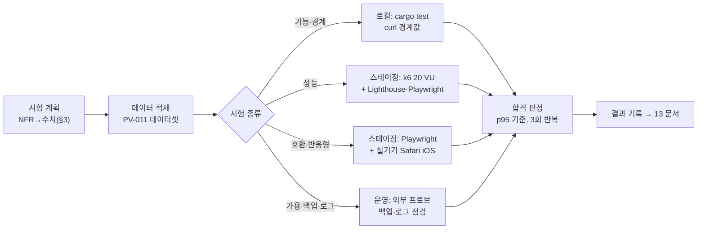
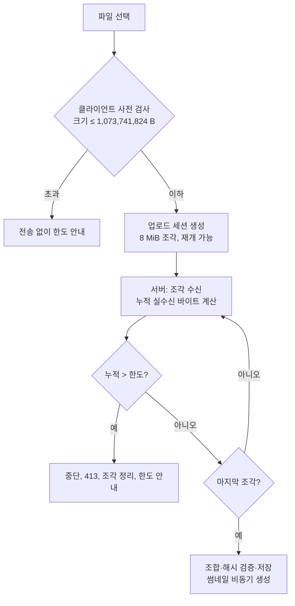
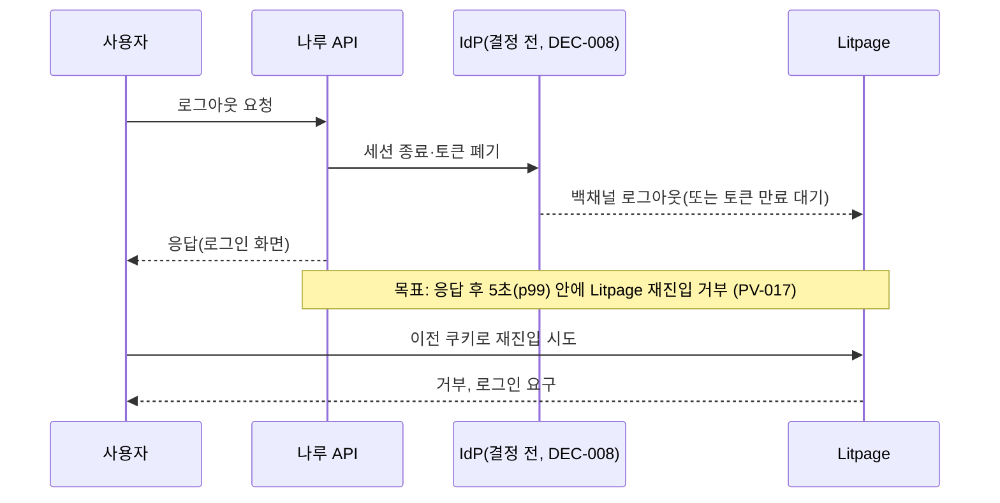
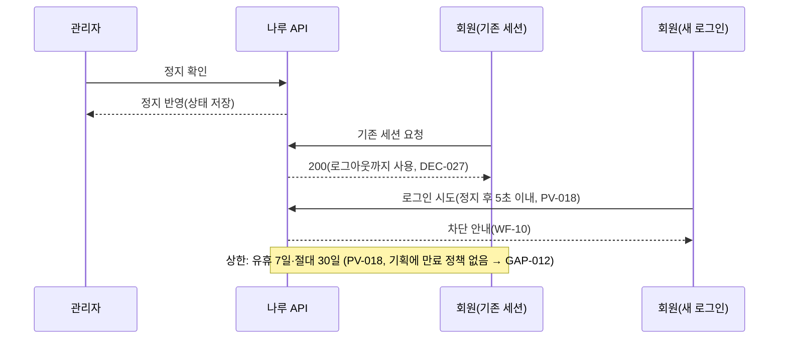
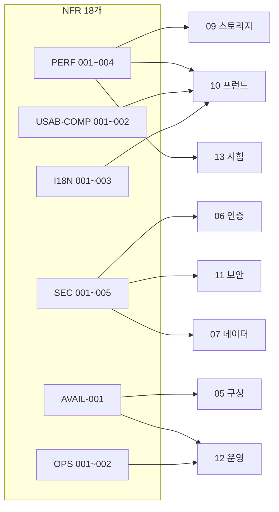

# 04. NFR 기술 수치화 (+ 기획 기준선 입력 검증)

## 1. 문서 정보

| 항목 | 내용 |
|---|---|
| 문서명 | NaruWorks 설계 문서 04 — NFR 기술 수치화 |
| 버전 | v0.2 (Gemini 검토 반영) |
| 작성일 | 2026-11-19 (Asia/Seoul) |
| 작성 | 설계 봇 (naru-orch P2-1) |
| 상태 | 검토 반영본, 재검토 대기 |
| 작업 브랜치·기준 | `feature/NARU-94-architecture`, 기준 develop `4b66d1d` |
| 백엔드 전제 | Rust. 프런트엔드 스택은 미정이며 이 문서에서 고르지 않는다(필요한 곳은 "프런트 스택 결정 후 확정"). |

### 1.0 개정 이력

| 버전 | 일시 | 내용 |
|---|---|---|
| v0.1 | 2026-11-19 (KST) | 초안 |
| v0.2 | 2026-11-19 (KST) | v0.2 — Gemini 검토(P2-1-nfr-review-gemini-01) 반영. RV-001~010 처리 내역은 부록 A |

### 1.1 입력 기준선 (실제 확인한 버전)

지시상 기준선은 "기획 v1.0"이지만, 문서마다 표기 버전이 다르다. 아래는 파일 머리말에서 직접 확인한 값이다(→ GAP-001, GAP-029).

| 입력 문서 | 실제 표기 | 비고 |
|---|---|---|
| `nfr/NFR.md` | v1.1 (승인 2026-11-18 18:52 KST, 서론만 23:02 보강) | 18개 ID. 본 문서의 주 입력 |
| `prd/PRD.md` | v1.0 (승인② 2026-11-18 17:14 KST) | §6 성공 지표가 아직 [미확인]. v1.1 변경안은 승인됐으나 PRD.md 미개정(→ GAP-002) |
| `frd/FRD.md` | v1.2 (승인 22:47, 정리 23:16 KST) | FR 26개, WF-01~16 연결(DEC-078) |
| `business-rules/BR.md` | v1.2 (승인 22:47 KST) | BR 27개 |
| `acceptance-criteria/AC.md` | v0.7 초안 | 문서상 100개. 본 문서에서 재계수하지 않음 |
| `user-flow/UF.md` | v0.7 초안 | UF-01~07 |
| `traceability/matrix.csv` | 버전 칸 없음 | 데이터 행 106개 확인 |
| `02-decision-log/decision-log.md` | 버전 칸 없음 | DEC-001~080, 승인⑤(2026-11-18 23:54 KST)까지 |
| `02-decision-log/open-questions.md` | 라운드 15 이후 | 열린 질문 Q-081 1건, 설계 이관 2건 |
| `change-proposal-v1.1/v1.2`, `change-proposal-prd-v1.1` | 승인됨 | PRD v1.1 변경안은 승인⑤ |
| `consistency-check-v1.md`, `gemini-consistency-review-01.md` | 2026-11-18 | 기획 쪽 정합성 기록 |
| `00-context/glossary.md` | "PRD v0.3 초안과 맞춘 초안" | 오래된 내용(헤더 회원 메뉴·푸터 '회사 정보') |
| `00-context/service-definition.md` | v1.0 (승인①) | 동결 문서 |
| `carry-over/` | **파일 0개 (비어 있음)** | CO-01~03이 문서로 확인되지 않음(→ GAP-003) |
| `wireframe/column-proposal.md` | 확정(DEC-075) | 열 구성 참고 |

읽지 않은 입력: `01-interview/`, `wireframe/exports`, `00-context/readme-analysis.md`, `docs/03-ui-design/`. 지시 목록 밖이거나 "필요 시"였다. 이 문서의 결론은 이들에 의존하지 않는다 [미확인].

## 2. 범위와 원칙

### 2.1 범위

- NFR 18개를 측정 가능한 기술 수치와 시험 방법으로 바꾼다.
- 기획 기준선 전체를 읽으며 설계에 영향을 주는 일관성 문제를 §5에 기록한다. 기획 문서는 고치지 않는다.
- 구체 구현 선택(IdP, 스토리지 제품, 프런트 프레임워크)은 다루지 않는다. 해당 결정은 05~13 문서의 몫이다.

### 2.2 기획 수치와 제안값의 구분 규칙

| 표기 | 뜻 |
|---|---|
| **[기획]** + 출처(NFR ID·DEC 번호) | 기획 원문에 있는 수치·규칙. 임의로 바꾸지 않는다. |
| **[파생]** | 기획 수치에서 산술로 도출한 값(예: 99% → 월 허용 중단 시간). 계산 근거를 적는다. |
| **[제안값 PV-###]** | 기획에 없는 숫자·방식. §6에 근거와 확인 주체를 둔다. 확인 전까지 기획 사실로 취급하지 않는다. |
| **[미확인]** | 확인하지 못했거나 기획·법률 확인이 필요한 내용. |

### 2.3 측정 환경 정의

기획에는 측정 환경·네트워크·기기 조건이 없다. 아래는 모두 **제안값**이다.

| 환경 | 용도 | 합격 판정 사용 |
|---|---|---|
| 로컬(개발) | `cargo test`, `criterion` 마이크로벤치, 단위·통합 시험 | 기능·경계값만. 성능 SLO 판정에는 쓰지 않음 |
| 스테이징 | 운영과 같은 사양·구성의 시험 환경(AS-012). 부하·E2E·브라우저 시험 | 성능·보안·호환 합격 판정의 기준 환경 |
| 운영 | 합성 모니터링(업타임 프로브), 실사용 로그 | 가용률·로그·백업의 실측 |

| 항목 | 제안값 |
|---|---|
| 측정 위치 | 서버 외부의 별도 호스트(서울 인근). 서버 내부 지표는 보조 |
| 클라이언트 프로파일 P-DESK | PC 브라우저, 유선 100 Mbps 이상, RTT 30 ms 이하 (PV-007) |
| 클라이언트 프로파일 P-MOB | 모바일 에뮬레이션, 하향 10 Mbps·상향 5 Mbps, RTT 100 ms, CPU 4배 감속 (PV-007) |
| Google 인증 구간 | Google 자체 화면·응답 시간은 측정에서 제외하고 NaruWorks 구간만 잰다(AS-005) |
| 합격 판정 통계 | p95를 합격선, p99를 참고선으로 사용. 화면당 30회 이상 반복(PV-004) |

## 3. NFR 기술 수치 표

설계 문서 05~13의 제목은 아직 확정되지 않았다. 아래 번호·주제는 **추정**이며(AS-002), 추정 목록은 §8.2에 있다.

| NFR ID | 기획 원문 요약 (출처 DEC) | 기술 수치 목표 | 측정 방법 (도구·명령, 환경, 합격 조건) | 관련 FR/AC/BR | 설계 반영 위치 | 비고 |
|---|---|---|---|---|---|---|
| NFR-PERF-001 | 1차 예상 사용자는 지인 위주 100명 이내 (DEC-036) | **[기획]** 100명 이내. **[제안값 PV-011]** 시험 데이터셋: 회원 100, 회원당 폴더 20·파일 500, 단일 폴더 최대 1,000항목, 공유 5,000건, 링크 1,000건. 회원 수 80명·100명 도달 시 운영 경보 | 환경: 스테이징. 도구: 적재 스크립트(Rust 바이너리 또는 SQL 시드)로 데이터셋 생성 후 §3 PERF-003·004 시험을 이 데이터 위에서 수행. 합격: 데이터셋 위에서 PERF-003·004 합격 + 목록 질의가 인덱스를 사용(실행 계획 확인). 경보는 임계 초과 시 알림 발송을 시험 | FR 없음(matrix.csv 84행). AC-NFR-PERF-001-01 | 07(데이터 모델·인덱스, 추정), 12(모니터링 경보, 추정), 13(데이터셋, 추정) | 전제 조건일 뿐 합격 판정할 값이 없음. 가입이 "누구나 즉시"(DEC-005)라 100명 초과 시 동작이 미정 → GAP-007, GAP-016 |
| NFR-PERF-002 | 파일 하나 업로드 최대 1GB, 총용량 제한 없음 (DEC-037, DEC-010) | **[제안값 PV-001]** 1GB = 1 GiB = **1,073,741,824 바이트**. 이하 허용, +1바이트 거부. **[제안값 PV-002]** 8 MiB 단위 분할·재개 업로드. 미완료 조각은 24시간 후 정리. **[제안값 PV-003]** 업로드 중 서버 메모리 증가 업로드당 64 MiB 이하(스트리밍) **[기획]** 총용량 한도 없음 | 환경: 로컬(경계), 스테이징(전송). 도구: `curl`, `head -c`. 경계 파일: `head -c 1073741823 /dev/urandom > a.bin`(−1), `…824 > b.bin`(정확히), `…825 > c.bin`(+1), `…1000000000`·`…1000000001`(SI 1GB 오해 검출), 0바이트. 합격: a·b 업로드 성공 후 다운로드 SHA-256 일치, c는 거부(HTTP 413 또는 정의된 오류)와 한도 안내 문구, 거부 후 임시 조각 잔존 0, 서버가 선언 크기가 아닌 실수신 바이트로 강제(선언 1 MiB 후 2 GiB 전송 시 한도 지점에서 중단). 1 GiB 업로드 중 서버 RSS 증가 64 MiB 이하(`ps`·메트릭) | FR-DRV-003, FR-DRV-001, BR-024, BR-010, REQ-012, REQ-017. AC-FR-DRV-003-01·02, AC-NFR-PERF-002-01 | 09(드라이브 스토리지·업로드, 추정), 08(API, 추정), 05(프록시·배포 한도, 추정), 10(클라이언트 사전 검사, 추정) | GiB/GB 미정·경계 미정 → GAP-004. 프록시(Cloudflare) 한도 충돌 가능 → GAP-005, AS-003. 라인레이트 이론 시간: 100 Mbps에서 약 86초, 10 Mbps에서 약 14.3분(전송 시간은 PERF-003 제외) |
| NFR-PERF-003 | 화면 이동 2초, 썸네일 3초 이내. 파일 전송 시간 제외 (DEC-041) | **[기획]** 화면 이동 2초, 썸네일 3초. **[제안값 PV-004]** 합격선 p95 ≤ 2.0초(화면)·p95 ≤ 3.0초(썸네일, 캐시된 것), 참고선 p99 ≤ 3.0초·5.0초. **[제안값 PV-006]** 시작 = 이동 조작, 끝 = 핵심 콘텐츠 첫 가시(목록 첫 행 등). **[제안값 PV-008]** 서버 API p95 ≤ 300 ms, p99 ≤ 800 ms(목록·메타, 20 동시). **[제안값 PV-005]** 썸네일은 업로드 후 비동기 생성, 준비 전에는 형식 아이콘 | 환경: 스테이징, 프로파일 P-DESK·P-MOB. 대상 화면: WF-01~16 중 전송이 없는 화면(§4.2 목록). 도구: Playwright(`performance.mark`로 시작·끝 기록, 화면당 30회), Lighthouse CLI는 보조(`lighthouse <STAGING_URL> --preset=desktop --output=json`, 3회 중앙값; 모바일은 기본 모바일 프로파일로 별도 실행, 옵션명은 도입 버전에서 확인 [미확인]). 로그인이 필요한 화면(WF-02~07, 09~16)은 시험용 세션 발급(AS-005)으로 만든 세션을 Playwright `storageState`로 주입해 측정하고, Lighthouse에는 같은 세션 쿠키를 추가 헤더로 전달한다(PV-032). P-MOB은 Playwright 모바일 에뮬레이션(PV-007)으로 측정한다. WF-09·10은 상태를 바꾸기 전 화면 진입만 30회 반복한다(WF-09는 탈퇴 확정 전 확인 화면, WF-10은 시험용 정지 계정의 로그인 시도 때 나오는 안내 화면. 탈퇴·정지를 실제로 실행하지 않음). 서버 지표(k6 트렌드). 썸네일: 이미지·PDF·동영상 각 30개 hover → 표시까지(캐시 적중). 합격: 화면별 p95 ≤ 2.0초, 썸네일 p95 ≤ 3.0초, 20 VU 부하 중에도 유지 | FR-DRV-008, BR-012, BR-018, REQ-016(matrix 86행 기준). 전 화면 FR은 matrix에 연결 없음. AC-FR-DRV-008-01·02, AC-NFR-PERF-003-01 | 10(프런트 구조·렌더링, 추정), 08(API 예산, 추정), 09(썸네일 파이프라인, 추정), 13(성능 시험, 추정) | 백분위·네트워크·"주요 화면" 목록·첫 생성 시간 미정 → GAP-006. 모바일은 hover 없음 → GAP-017. Litpage 진입은 외부 앱·IdP 경유(→ GAP-028) |
| NFR-PERF-004 | 동시 접속 목표 20명 (DEC-049) | **[기획]** 20명. **[제안값 PV-009]** 동시 접속 = 최근 60초 안에 요청한 활성 세션 20개. 폐쇄 모델 20 VU, 사고 시간 3~8초 랜덤, 15분, 3회 반복. 참고 헤드룸 40 VU 5분. 백그라운드 업로드 3건(1×1 GiB, 2×100 MiB) **[제안값 PV-010]** 오류율(5xx·타임아웃) 0.1% 이하, 데이터 손실 0 | 환경: 스테이징. 도구: k6 — `k6 run --vus 20 --duration 15m scripts/load/main.js`(스크립트는 13 문서에서 작성). 시나리오 비율: 홈·로그인 10%, 드라이브 목록 35%, 썸네일 15%, 폴더·공유 15%, Litpage 진입 10%, 링크 보기 10%, 관리자 5%. 로그인은 Google 대신 시험용 세션 발급(AS-005). 합격: PV-010 충족 + PERF-003 합격선 유지 + 업로드 3건 모두 해시 일치 | AC-NFR-PERF-004-01. FR 없음(matrix 87행) | 13(부하 시험, 추정), 05(용량 산정, 추정), 12(모니터링, 추정) | 산술: 20 ÷ (사고 5초 + 응답 0.5초) ≈ 초당 3.6 화면, 화면당 API 약 4회 **[추정 PV-033]** → 약 15 rps. 정의·합격 오류율 미정 → GAP-007 |
| NFR-SEC-001 | 로그아웃하면 연동 오픈소스까지 한 번에 로그아웃 (DEC-015) | **[기획]** 나루 로그아웃 뒤 연동 오픈소스에 같은 흐름으로 재진입 불가. **[제안값 PV-017]** 로그아웃 응답 이후 5초(p99) 안에 Litpage 쪽 세션도 무효. 로그아웃 API p95 ≤ 2초. 액세스 토큰 수명 5분 이하 또는 백채널 로그아웃 | 환경: 스테이징. 도구: Playwright 두 탭(나루·Litpage). 절차: 로그인 → Litpage 진입 → 나루 로그아웃 → 응답 수신 즉시 Litpage 새로고침·뒤로가기·이전 쿠키 재사용 요청·API 호출. `curl -b old_cookie`로 이전 세션 재사용도 확인. **30회 반복**(PV-028). 로그아웃 API 응답 시간은 같은 30회에서 기록. 합격: ①전파 지연(로그아웃 응답~Litpage 거부) 30회 모두 5초 이내(30회 표본에서 p99는 최댓값과 같으므로 최댓값으로 판정) ②로그아웃 API p95 ≤ 2초 ③전부 거부(재로그인 요구), 실패 0건 | FR-AUTH-002, FR-OSS-001, BR-004, REQ-004. AC-FR-AUTH-002-01·02, AC-NFR-SEC-001-01 (matrix 88행엔 FR-OSS-001 없음) | 06(인증·IdP·세션, 추정), 11(보안, 추정), 08 | 다기기 세션·발급된 토큰 범위 미정 → GAP-014. IdP 결정(DEC-008) 선행 → GAP-028 |
| NFR-SEC-002 | 정지는 다음 로그인부터 차단, 기존 세션은 로그아웃까지 사용 (DEC-014, DEC-027) | **[기획]** 정지 후 새 로그인 차단, 기존 세션 유지. **[제안값 PV-018]** 정지 확정 후 5초 이내 신규 로그인 차단 반영. 기존 세션은 유휴 7일·절대 30일까지만 유지(기획에 만료 정책이 없어 상한을 둠) | 환경: 스테이징. 도구: Playwright 두 컨텍스트(회원·관리자). 절차: 회원 로그인 유지 → 관리자 정지(확인 대화상자 거침) → T+1초·T+1시간(시계 조작)에 기존 세션 API 200 확인 + **같은 기존 세션으로 Litpage 진입·사용 가능 확인**(NFR.md §4.2·AC-FR-AUTH-005-02: 나루와 연동 오픈소스 모두) → 회원이 로그아웃 → 5초 후 재로그인 시도 → 차단 안내(WF-10)와 서비스 미사용 확인 → 해제 후 로그인 성공. 세션 상한(PV-029, 경계 판정 여유 1분): 시계를 유휴 7일−1분 시점까지 당기되 그 사이 활동이 있으면 세션 유지, 활동 없이 7일+1분이면 만료·재로그인 요구, 활동을 계속해도 절대 30일+1분에서 만료. 합격: 모든 단계가 기획 문구와 일치, 차단 반영 지연 5초 이하, 상한 경계 3건 일치 | FR-AUTH-005, FR-ADM-002, BR-005, BR-017. AC-FR-AUTH-005-01~03, AC-FR-ADM-002-01~03, AC-NFR-SEC-002-01 | 06, 07(회원 상태 모델, 추정), 11 | 세션 수명 부재 → GAP-012. 정지·탈퇴·재가입 상호작용 → GAP-013 |
| NFR-SEC-003 | 비회원 링크는 보기만, 만료·비밀번호 없음, 다운로드는 공유자 선택 (DEC-023, DEC-035) | **[기획]** 편집 불가, 만료·비밀번호 없음, 다운로드는 허용된 링크만. **[제안값 PV-019]** 링크 토큰 128비트 이상 CSPRNG, 링크 보기 요청 IP당 분당 60회, 응답 `no-store`·검색 색인 금지·`Referrer-Policy: no-referrer`, 링크 끄기 반영 5초 이내 | 환경: 스테이징. 도구: `curl`, Playwright. 절차: 링크 생성(다운로드 켬/끔 각각) → 비로그인에서 보기 200 → 편집류 요청(PUT/POST/DELETE) 거부(403 또는 405) → 다운로드 끔 링크에서 다운로드 경로 거부, 켬 링크는 허용 → 링크 끄기 후 5초 이내 404/차단 → 휴지통 이동 시 차단, 복원 시 재개. 추측 시험(PV-030): 레이트 리밋과 분리한다. 토큰 생성이 128비트 이상 CSPRNG인지는 단위 시험(엔트로피·길이)으로 판정하고, 무작위 토큰 10,000건 요청은 스테이징의 시험 전용 레이트 리밋 예외(시험 호스트 허용 목록) 또는 다중 IP 분산 실행에서 수행해 적중 0을 확인한다. 레이트 리밋 시험은 예외 없는 단일 IP에서 분당 60회까지 200, 61회째 429. 합격: 위 전부 충족 | FR-DRV-007, BR-008, BR-022, BR-006, REQ-015. AC-FR-DRV-007-01·02, AC-FR-DRV-004-03, AC-NFR-SEC-003-01 | 11(공유 링크·접근통제, 추정), 09, 08 | "보기 허용·다운로드 금지"의 합격 조건 모호, 남용 방지 부재 → GAP-015, GAP-016 |
| NFR-SEC-004 | 탈퇴 데이터 30일 보관 후 삭제, 기간 안 재가입 시 복구, 보관 중 공유·링크 유지 (DEC-021, DEC-029) | **[기획]** 30일 보관·복구, 30일 후 복구 불가·링크 끊김. **[제안값 PV-020]** 30일 = 탈퇴 시각 + 30×24시간(AS-009). 복구·링크·표시 이름 예약은 요청 시점에 시각으로 즉시 판정(배치 무관). 물리 삭제는 매시간 도는 멱등 스위퍼, 경계 후 1시간 이내(작업 시간 별도) | 환경: 스테이징(시계 조작 가능). 도구: 통합 시험(`cargo test`로 시계 주입) + Playwright. 시나리오: ①탈퇴 T0. T0+29일23시간59분 재가입 → 복구·공유·링크 유지 ②T0+30일 정각 직후 재가입 → 복구 불가·링크 404·표시 이름 재사용 가능 ③스위퍼가 아직 돌지 않은 상태에서도 ②가 성립 ④스위퍼 실행 후 파일·DB·썸네일·링크 레코드 삭제 확인 ⑤스위퍼 중복 실행해도 결과 동일. 합격: 모든 경계가 기획 문구와 일치 | FR-AUTH-003·004·006, BR-007, BR-026, BR-027, REQ-026. AC-FR-AUTH-003-01~03, AC-FR-AUTH-004-01~03, AC-FR-SHELL-003-07·08, AC-NFR-SEC-004-01 | 07(보관·삭제 정책, 추정), 06, 12(스위퍼 운영, 추정), 09 | 기산 방식·경계·백업 잔존·정지 상호작용 → GAP-021, GAP-010, GAP-013 |
| NFR-SEC-005 | 비밀 값은 문서에 적지 않고 CO-03 위치만 참조 (서비스 정의 v1.0·PRD CO-03) | **[기획]** 문서·산출물에 비밀 값 0건. **[제안값 PV-021]** 저장소 전체(코드·문서·설정 예시)와 로그 샘플 스캔 0건을 CI 게이트로 | 환경: 로컬·CI. 도구: gitleaks 같은 시크릿 스캐너(하위 명령은 버전별로 다르므로 도입 시 확인 [미확인]) + 키 패턴 정규식 grep. 대상: `docs/`, 소스, 샘플 로그. `.env*` 파일은 읽지 않고 `.gitignore` 등록 여부만 확인. 합격: 검출 0건, 문서에는 CO-03 위치만 존재 | AC-NFR-SEC-005-01. FR 없음(matrix 92행) | 12(비밀 관리·CI, 추정), 13 | CO-03 위치가 문서로 없음 → GAP-003. AC 검사 범위 미정 → GAP-032 |
| NFR-AVAIL-001 | 월 가용률 99%, 월 약 7시간 이내 중단 (DEC-042) | **[기획]** 월 99%. **[파생]** 28일 403.2분(6시간 43.2분), 30일 432분(7시간 12분), 31일 446.4분(7시간 26.4분). 하루 환산 14.4분. **[제안값 PV-012]** KST 달력월 기준, 외부 1분 프로브 3종, 연속 2회 실패부터 중단, 계획 점검도 중단에 포함(보수적), 월 누적 4시간에 경보 | 환경: 운영. 도구: 외부 업타임 모니터(1분 간격 지원 SaaS 또는 별도 호스트의 Uptime Kuma). 프로브: ①심층 헬스체크(DB·스토리지 연결) ②로그인 화면 ③합성 링크 보기 페이지. 계산: 가용률 = 1 − 중단 분 ÷ 월 총 분. 합격: 월 99% 이상. 출시 전에는 스테이징에서 배포·재시작 시 중단 시간을 측정해 월 예산과 대조 | AC-NFR-AVAIL-001-01(출시 후 관측만). FR 없음(matrix 93행) | 05(배포·무중단 롤링, 추정), 12(모니터링·점검 창, 추정) | "이용 가능"·계획 점검·외부 의존 장애 귀책 미정 → GAP-008 |
| NFR-USAB-001 | PC 웹과 반응형 모바일 웹, 모바일 앱 제외 (DEC-038) | **[기획]** 1차 기능을 PC·모바일 웹에서 수행, 앱 설치 불필요. **[제안값 PV-024]** 최소 폭 360 px, 검증 뷰포트 5종(360×640, 390×844, 768×1024, 1280×800, 1920×1080), 가로 스크롤 없음, 탭 대상 44×44 CSS px 이상 | 환경: 스테이징. 도구: Playwright 뷰포트 프로젝트 + 실기기 1대. 시나리오: UF-01~07의 핵심 경로 7개를 5개 뷰포트에서 수행. 합격: 모든 경로 완료, 가로 스크롤·잘림·겹침 0건, 탭 대상 크기 기준 충족 | AC-NFR-USAB-001-01. FR 없음(matrix 94행). UF-01~07 | 10(반응형·레이아웃, 추정) | 터치에서 hover 썸네일 불가 → GAP-017. 프런트 스택 결정 후 토큰·브레이크포인트 확정 |
| NFR-OPS-001 | 매일 백업, 30일 보관, 휴지통과 별개 (DEC-046) | **[기획]** 매일·30일, 대상 회원 정보·드라이브 파일. **[파생]** RPO 24시간 이하(매일 백업의 귀결, 기획에 명시 없음). **[제안값 PV-013]** RTO 4시간 이하(서비스 재개). **PV-014** 매일 03:00 KST, 26시간 넘게 성공 백업 없으면 경보, 체크섬 기록, 월 1회 복원 훈련. **[제안값 PV-015]** 삭제 방식: 백업 세트별 생성시각 + 30×24시간 경과분을 매일 1회 자동 만료, 월 1회 잔존물 점검 | 환경: 스테이징(훈련), 운영(실측). 도구: 백업 작업 로그·매니페스트 점검 스크립트, 복원 훈련 스크립트. 합격: ①최근 30일 매일 백업 성공 기록 ②30일 경과분 0건 잔존(시험: 시계를 앞당겨 31일째 세트가 삭제되고 29일째 세트는 남는지) ③복원 훈련에서 DB 행 수·파일 샘플 1%(PV-034) 체크섬 일치 ④복원 소요가 RTO 안 ⑤백업이 휴지통 정책(30일)과 독립임을 확인(휴지통 만료 항목이 백업에서 별도로 존재) | AC-NFR-OPS-001-01. BR-006·BR-007과 구분(연결 없음, matrix 95행) | 12(백업·복원, 추정), 07, 09, 05 | 범위(링크·설정·Litpage 데이터)·삭제 상충·복구 목표 부재 → GAP-009, GAP-010 |
| NFR-OPS-002 | 로그 30일 보관 (DEC-044) | **[기획]** 30일 보관 후 보관하지 않음. **[제안값 PV-016]** 접근·애플리케이션·감사 로그 3종 모두 30×24시간 경과분을 매일 1회 로테이션 때 삭제(다음 로테이션까지 최대 24시간 지연 허용, 따라서 실제 보관 상한은 최대 약 31일). 로그에 토큰·시크릿·원문 이메일 금지(마스킹·해시). 성공 지표용 비식별 일 집계는 별도 90일 | 환경: 스테이징. 도구: 로그 점검 스크립트. 시험: 31일 전·29일 전으로 시각을 조작한 표식 로그를 넣고 삭제 작업 실행 → 31일분만 삭제(30×24시간을 막 넘긴 표식은 다음 로테이션 전까지 남을 수 있으며 이는 허용 지연 24시간 안이면 합격). 로그 샘플 1만 줄(PV-035)에 토큰·시크릿·이메일 원문 패턴 0건(NFR-SEC-005 스캐너 재사용). 합격: 삭제 경계 일치, 패턴 0건 | AC-NFR-OPS-002-01. FR 없음(matrix 96행) | 12(로깅·보관, 추정), 11 | 로그 종류·개인정보·법정 보관 관계 미확인, 지표 30일과 겹침 → GAP-011, GAP-024 |
| NFR-COMP-001 | 지원 환경 PC 웹·반응형 모바일 웹, 앱 없음 (DEC-038) | **[기획]** 앱스토어 앱 없이 웹으로 1차 기능 사용 | 환경: 스테이징. 도구: Playwright·실기기. 절차: 설치 없이 PC·모바일 브라우저에서 1차 기능 6종(로그인·홈·드라이브·Litpage·관리자·링크 보기) 수행. 합격: 전부 성공, 앱 설치·플러그인 요구 0건 | AC-NFR-COMP-001-01. FR 없음(matrix 97행) | 10, 05 | NFR-USAB-001과 중복 서술 |
| NFR-COMP-002 | 최신 Chrome(PC·Android), 최신 Safari(iOS·macOS) (DEC-043) | **[기획]** 대상 4환경. **[제안값 PV-025]** "최신" = 시험일 기준 각 브라우저 stable 최신 메이저. 시험 매트릭스 4환경, iOS Safari는 실기기 1대, Playwright chromium·webkit은 보조 | 환경: 스테이징. 도구: Playwright(`chromium`·`webkit`) + 실기기(iOS Safari, Android Chrome). 시나리오: 핵심 6종 + 업로드(소·대용량) + 링크 보기. 합격: 4환경 전부 통과. Playwright WebKit은 실제 Safari와 같지 않으므로 iOS는 실기기 결과로만 합격 판정 | AC-NFR-COMP-002-01. FR 없음(matrix 98행) | 10, 13 | "최신" 정의·iOS 타 브라우저 취급 미정 → GAP-018 |
| NFR-I18N-001 | 화면 언어 한국어·영어 (DEC-039) | **[기획]** 주요 화면 문구 한·영 제공. **[제안값 PV-027]** 번역 키 한·영 대칭, 누락 0건을 CI 게이트로 | 환경: CI·스테이징. 도구: 번역 키 목록 비교 스크립트, Playwright(로캘별 컨텍스트). 합격: 키 누락 0, WF-01~16 전 화면을 두 언어로 열었을 때 미번역 문구 0 | FR-SHELL-003, BR-025. AC-FR-SHELL-003-05, AC-NFR-I18N-001-01 | 10(i18n 구조, 추정) | 프런트 스택 결정 후 도구 확정 |
| NFR-I18N-002 | 설정 전 기기 언어 규칙, 설정 후 고른 언어 유지 (DEC-045, DEC-052) | **[기획]** 기기 언어가 영어면 영어, 그 외 한국어. 설정 후 유지. **[제안값 PV-026]** 기기 언어 = 브라우저 언어 목록의 첫 항목이 `en` 또는 `en-*`이면 영어. 설정값은 계정에 저장. 브라우저 저장소는 "직전에 로그인했거나 설정한 값의 기기 캐시"로만 쓴다(로그인·설정 시 갱신). 로그인 전 전환 UI는 기획에 없어 두지 않으며, 필요 여부는 GAP-019 답변 후 정한다 | 환경: 스테이징. 도구: Playwright `locale` 옵션. 시나리오: `en-US`·`en-GB`·`ko-KR`·`ja-JP`·`fr-FR`로 첫 방문 → 영어/한국어 기대값 → 프로필에서 설정 → 다른 로캘·다른 컨텍스트로 재방문해도 설정값 유지(계정 기준). 합격: 모두 기대값 일치 | FR-SHELL-003, BR-025. AC-FR-SHELL-003-05, AC-NFR-I18N-002-01 | 10, 07(설정 저장, 추정), 06 | 판정 근거·저장 위치·로그인 전 전환 수단 미정 → GAP-019 |
| NFR-I18N-003 | 법적 문서 한국어·영어 모두 제공 (DEC-048) | **[기획]** 한·영 본문 모두 확인 가능, 새 창(DEC-069) | 환경: 스테이징. 도구: Playwright·`curl`. 시험: 푸터 링크 → 새 창 → 한국어·영어 본문 각각 HTTP 200·본문 비어 있지 않음 → 화면 언어에 맞는 본문 표시. 합격: 두 언어 본문 모두 접근 가능 | FR-SHELL-002, BR-021. AC-FR-SHELL-002-01, AC-NFR-I18N-003-01 | 10, 05(정적 문서 호스팅, 추정) | 본문 공급 주체 미정 → GAP-020 |

## 4. ID별 상세 노트

### 4.1 NFR-PERF-002 — 1GB 업로드

**경계 정의(제안, PV-001).** 1 GiB는 2^30 = 1,073,741,824 바이트다. macOS Finder는 10^9 바이트를 "1 GB"로, Windows 탐색기와 많은 도구는 2^30을 "1GB"로 표기하므로 어느 쪽이 맞는지 기획 확인이 필요하다(GAP-004). 제안은 아래 흐름이다.

- 클라이언트 검사는 편의일 뿐이고 서버가 실수신 바이트로 강제한다.
- 시험 파일 크기: 0, −1, 정확히, +1, 그리고 10^9·10^9+1(SI 해석 오류 탐지).
- 0바이트 파일 허용 여부는 기획에 없다. 제안은 허용(빈 파일도 파일) [GAP-004에 질문 포함].
- Litpage 자동 저장(FR-OSS-003) 결과물에도 같은 한도를 적용할지는 기획에 없다(GAP-025).
- 프록시 한도: Cloudflare 프록시 경유 시 요청 본문 한도가 1GB보다 작을 수 있다(기억상 무료·Pro 100 MB, 플랜별 상이 [미확인], 공식 문서로 재확인 필요). 이 경우 분할 업로드(조각 ≤ 8 MiB)면 영향이 없고, 단일 요청 업로드면 1GB를 지킬 수 없다. CO-02가 문서로 없어 확인 불가(AS-003).
- 부수 시험: 업로드 중단·재개, 네트워크 단절 후 재개, 동일 파일 중복 업로드, 임시 조각 24시간 후 정리.

### 4.2 NFR-PERF-003 — 측정 대상 화면과 예산

"주요 화면"의 닫힌 목록이 기획에 없어(GAP-006) WF-01~16 중 전송이 없는 화면을 대상으로 제안한다.

| 구분 | WF | 합격선 |
|---|---|---|
| 화면 이동 p95 ≤ 2.0초 | WF-01 로그인, 02 홈, 03 저장 폴더 선택, 04 Litpage 진입, 05 드라이브(목록), 06 휴지통, 07 회원 공유, 08 링크 보기, 09 탈퇴 확인, 10 차단 안내, 11~14 관리, 15 프로필, 16 계정 설정 | PV-004 |
| 썸네일 p95 ≤ 3.0초 | WF-05 목록의 이미지·PDF·동영상 hover | PV-004 |
| 제외 | 파일 업로드·다운로드 전송, Google 인증 화면 자체, 외부 오픈소스 내부 동작(Litpage 내부 편집) | AS-005 |

예산 분해(참고): 총 2.0초 = DNS·TLS·연결 약 0.2초 + 문서·스크립트 수신 + API 직렬 호출 최대 2회 × 300 ms + 렌더링. 초기 스크립트 전송량 상한은 프런트 스택 결정 후 확정한다.

썸네일은 업로드 직후 비동기로 만들고(PV-005), 만들기 전에는 형식 아이콘을 보여 주어 FRD "준비 중이면 아이콘이나 대기 표시"(FR-DRV-008 예외)와 맞춘다. 3초에는 첫 생성 시간을 넣지 않는 해석이며, 기획 확인이 필요하다(GAP-006).

### 4.3 NFR-PERF-004 — 20명 부하

시나리오 구성과 산술은 §3 표에 있다. 로그인은 Google을 직접 부하 대상으로 삼을 수 없으므로(외부 서비스 약관·한도) 시험용 세션 발급으로 대체하고, 실제 Google 흐름은 별도로 Playwright로 10회 확인한다. 헤드룸(40 VU)은 참고 측정이며 합격 판정에 쓰지 않는다.

### 4.4 NFR-SEC-001·002 — 세션 흐름

- 액세스 토큰이 상태 없는 토큰이면 로그아웃 전파 시간 하한이 토큰 수명이 된다. 그래서 수명 5분 이하 또는 백채널 로그아웃 둘 중 하나를 IdP 결정(06 문서)에서 보장해야 한다.
- 어떤 IdP를 쓰든 위 두 가지를 지원해야 한다는 것이 가정이다(AS-008).

### 4.5 NFR-SEC-004 — 탈퇴 30일 타임라인

- 판정은 배치가 아니라 요청 시점의 시각 비교로 한다. 스위퍼가 늦어도 사용자에게 보이는 동작은 경계에서 정확하다(PV-020).
- 휴지통 30일(DEC-019)도 같은 방식이다.
- 탈퇴 중 휴지통 항목 타이머, 복구 후 타이머 이어짐 여부는 기획에 없다(GAP-021).

### 4.6 NFR-AVAIL-001 — 월 허용 중단 시간

| 월 길이 | 총 분 | 1% 허용 중단 |
|---|---|---|
| 28일 | 40,320 | 403.2분 = 6시간 43.2분 |
| 30일 | 43,200 | 432분 = 7시간 12분 |
| 31일 | 44,640 | 446.4분 = 7시간 26.4분 |
| 연평균(365÷12일) | 43,800 | 438분 = 7시간 18분 |

기획의 "약 7시간"은 30일 기준 근사다. 합격 판정은 실제 월 길이로 계산하는 것을 제안한다. 단일 서버 구성이면 배포 1회·재시작 1회가 수 분씩 소모되므로 무중단 배포 방식을 05 문서에서 정해야 한다.

### 4.7 NFR-OPS-001·002 — 보관과 삭제 방식

- 백업 보관: 세트별 생성 시각 + 30×24시간이 지나면 삭제한다. 항상 30개(경계 시점에 31개)가 존재한다.
- 삭제 방식: 자동 만료(수명 주기 규칙 또는 일 1회 삭제 작업) + 월 1회 잔존물 점검. 두 작업은 서로 다른 감시 대상으로 경보를 둔다.
- 삭제 원장: 탈퇴·휴지통으로 삭제된 항목을 원장에 기록하고, 백업에서 복원할 때 원장을 다시 적용해 삭제된 데이터가 되살아나지 않게 한다(제안, GAP-010).
- 로그: 일 1회 로테이션 시 30×24시간을 넘긴 파일을 삭제한다(최대 24시간 지연 허용, PV-016). 로그에는 토큰·시크릿·원문 이메일을 남기지 않는다(PV-016).
- 성공 지표(DEC-080)의 측정 기간이 30일이라 로그 보관 30일과 겹친다. 일 집계를 따로 두는 이유다(GAP-024).

### 4.8 NFR-COMP/USAB/I18N 시험 매트릭스

| 환경 | 도구 | 판정 |
|---|---|---|
| Chrome 최신, Windows 또는 macOS | Playwright chromium | 자동 |
| Safari 최신, macOS | Playwright webkit(보조) + 수동 | 수동 확인으로 판정 |
| Chrome 최신, Android | 실기기 또는 클라우드 기기 | 수동·반자동 |
| Safari 최신, iOS | 실기기 1대 | 수동(대용량 업로드 포함) |

### 4.9 기본 보안선 검증 (PV-022·PV-023, GAP-016)

기획 NFR에 없는 설계 기본선이며 제안값이다. §3 표에는 행을 만들지 않고(NFR 18개 유지) 아래 절차로 PERF-002·SEC-001~003 시험과 함께 수행한다. 환경: 스테이징. 도구는 12·13 문서에서 확정한다(아래는 예시, 버전별 옵션은 도입 시 확인 [미확인]).

| 항목 | 시험 | 합격 조건 |
|---|---|---|
| TLS 1.2 이상 | 외부 호스트에서 TLS 스캐너(예: testssl.sh) 또는 `curl --tls-max 1.1`로 접속 | TLS 1.1 이하 거부, 1.2·1.3 성공. 평문 HTTP는 HTTPS로 이동 |
| HSTS | `curl -sI https://<STAGING_URL>/` | `Strict-Transport-Security` 헤더 존재(max-age 값은 11 문서에서 확정 [미확인]) |
| 쿠키 속성 | 로그인 후 `curl -sI`·Playwright `context.cookies()`로 세션 쿠키 확인 | `Secure`, `HttpOnly`, `SameSite=Lax` 모두 존재 |
| 동시 업로드 제한 | 한 계정에서 업로드 4건을 동시에 시작 | 3건까지 진행, 4번째는 정의된 오류(429 등)와 안내 |
| 업로드 시작 빈도 | 한 계정에서 1분 안에 업로드 31건 시작 | 30건까지 허용, 31번째 거부 |
| 가입 빈도 | 같은 IP에서 1시간 안에 시험용 가입 11건 | 10건까지 허용, 11번째 거부(시험 계정은 시험 후 삭제) |
| 링크 보기 빈도 | NFR-SEC-003 시험 참조 | IP당 분당 60회, 61회째 429 |

## 5. 누락·모순·측정 불가 항목 (기획 반환용, 자비스 경유)

**본 항목은 수정하지 않고 자비스를 통해 기획 봇에 반환한다.** 설계 쪽에서 기획 문서를 고치지 않았다. 모든 항목의 "질문"은 기획 봇의 답을 요청하는 것이다. 우선순위(상·중·하)는 설계 결정 차단 정도 기준의 참고용이다.

| 번호 | 유형 | 관련 ID·문서·위치 | 내용 | 설계 영향 | 기획에 묻는 질문 |
|---|---|---|---|---|---|
| GAP-001 | 버전 불일치 (상) | 지시문 "기획 v1.0" ↔ 각 문서 머리말(§1.1). decision-log 승인⑤ | 승인⑤는 "기획 문서 v1.0" 묶음(FRD·BR v1.2, NFR v1.1, AC·UF v0.7, PRD v1.1 변경안 등)이지만 개별 문서 버전이 제각각이다. matrix.csv·decision-log는 버전 칸이 없고 AC·UF는 "초안"으로 남아 있다 | 설계 기준선을 한 줄로 못 박을 수 없어 추적이 어려움 | 승인⑤ 묶음의 정식 기준선 식별자(커밋 또는 버전)는 무엇인가? AC·UF v0.7은 승인⑤로 확정본인가? |
| GAP-002 | 버전 불일치 (상) | PRD.md §1·§6 ↔ change-proposal-prd-v1.1.md(승인⑤)·DEC-080 | PRD.md는 v1.0이고 성공 지표 목표가 모두 [미확인]이다. 변경안은 승인됐지만 PRD.md에 반영되지 않았다 | 설계는 DEC-080을 근거로 쓰지만 PRD 본문과 충돌해 보임 | PRD v1.1 본문 반영 시점은? 그때까지 설계는 DEC-080을 정식 값으로 써도 되는가? |
| GAP-003 | 누락 (상) | `carry-over/`(0개), README 표, PRD §7 CO-01~03, NFR-SEC-005 | CO-01 도메인·CO-02 Cloudflare·CO-03 소셜 로그인 설정 위치가 문서로 없다. NFR-SEC-005는 "CO-03 위치만 참조"하라 하나 위치를 알 수 없다 | 도메인, 프록시 한도(1GB), OAuth 리디렉션 설정을 설계에 반영할 수 없음. NFR-SEC-005를 충족하는 참조 문구를 쓸 수 없음 | CO-01~03의 보관 위치(경로·저장소 이름만)와 현재 Cloudflare 사용 범위(프록시 여부·플랜)는? |
| GAP-004 | 측정 불가 (상) | NFR-PERF-002, BR-024, AC-FR-DRV-003-02, AC-NFR-PERF-002-01 | "1GB"가 GiB(1,073,741,824 B)인지 GB(1,000,000,000 B)인지, 정확히 1GB인 파일의 허용 여부, 0바이트 파일, 폴더 업로드 여부가 없다 | 경계값 시험·오류 문구·서버 강제 값이 정해지지 않음 | 1GB의 정확한 바이트 수와 "이하 허용"이 맞는지? 0바이트 파일과 폴더 업로드는 1차 범위인가? |
| GAP-005 | 누락 (상) | NFR-PERF-002, FR-DRV-003, CO-02 | 전송 방식(분할·재개 필요 여부)과 네트워크 경로에 대한 요구가 없다. 프록시 한도가 1GB보다 작을 수 있다 [미확인] | 단일 요청 업로드가 불가능할 수 있어 09·05 문서의 구조가 갈림 | 1GB 업로드 중단 시 재개가 필요한가? 업로드 경로에 Cloudflare 프록시를 반드시 거쳐야 하는가? |
| GAP-006 | 측정 불가 (상) | NFR-PERF-003, AC-NFR-PERF-003-01, FR-DRV-008 | 백분위(평균/p95/최댓값), 네트워크·기기 조건, "주요 화면"의 닫힌 목록("등"으로 끝남), 시작·종료 시점, 썸네일 첫 생성 시간 포함 여부, Google·Litpage 외부 구간 포함 여부가 없다 | 합격선을 설계가 임의로 정해야 함(PV-004~008) | 2초·3초는 p95인가 최대인가? 대상 화면 목록과 측정 환경(망·기기)은? 썸네일 3초에 최초 생성이 포함되는가? 로그인 2초에 Google 구간이 포함되는가? |
| GAP-007 | 측정 불가 (중) | NFR-PERF-004, NFR-PERF-001, AC-NFR-PERF-004-01 | "동시 접속 20명"의 정의(활성 세션/동시 요청), 시나리오, 업로드 동시 여부, 합격 오류율이 없다. AC는 "전제로 검증할 수 있다"로 판정 조건이 없다. 100명 초과 가입 시 동작도 미정 | 부하 시험 설계·용량 산정 기준 없음 | 20명 동시의 정의와 합격 오류율은? 100명 도달 시 가입 제한이나 경보가 필요한가? |
| GAP-008 | 측정 불가 (중) | NFR-AVAIL-001, AC-NFR-AVAIL-001-01 | "이용 가능"의 정의, 계획 점검 포함 여부, 측정 주체·도구, Google·Cloudflare 같은 외부 장애의 귀책, "약 7시간"(30일 7.2시간) 표기 정밀도가 없다. AC는 출시 후 한 달 관측뿐이라 출시 전 검증이 없다 | 무중단 배포 수준·모니터링 구성·점검 창 정책을 정할 수 없음 | 계획 점검 시간을 중단에 포함하는가? 외부 서비스 장애는 가용률에서 제외하는가? 출시 전 합격 기준은? |
| GAP-009 | 누락 (상) | NFR-OPS-001, DEC-046 | RPO·RTO, 복원 훈련 요구, 백업 범위가 "회원 정보, 드라이브 파일"뿐이다. 공유·링크 권한, 오픈소스 노출·카테고리 설정, 인증(IdP) 데이터, Litpage 자체 데이터는 범위 밖인지 불명 | 복구 불가한 상태가 생길 수 있음(링크는 있는데 권한 데이터는 없음) | 백업 범위의 정확한 목록과 복구 목표(최대 허용 손실·복구 시간)는? 복원 훈련이 필요한가? |
| GAP-010 | 모순 (상) | NFR-OPS-001(백업 30일) ↔ NFR-SEC-004·BR-007(탈퇴 30일 후 삭제)·BR-006(휴지통 30일) | 탈퇴·휴지통 만료로 "삭제"된 뒤에도 백업에 최대 30일 더 남는다. 백업 복원 시 삭제된 데이터가 되살아날 수 있다. "삭제"가 백업을 포함하는지 불명 | 삭제 원장·백업 암호화·복원 절차 설계가 달라짐 | "삭제"에 백업 잔존분이 포함되는가? 백업에서 복원 시 삭제 재적용 규칙을 요구하는가? 이 보관이 개인정보 처리방침에 어떻게 서술되는가? |
| GAP-011 | 누락 (중) | NFR-OPS-002, DEC-044 | 로그 종류(접근·애플리케이션·감사·관리자 행위), 개인정보 포함 허용 범위, 30일 기산이 불명. 개인정보를 다루는 시스템의 접속기록 보관기간 법정 요건과의 관계는 확인되지 않았다 [미확인, 법률 확인 필요] | 로그 설계(마스킹)와 감사 기록 존재 여부가 달라짐 | 관리자 행위(정지·숨김) 감사 기록이 필요한가? 30일이 법적 요건을 충족하는지 Q-081과 함께 확인할 것인가? |
| GAP-012 | 누락 (상) | NFR-SEC-002, BR-005, DEC-027 | 세션 수명(유휴·절대 만료)과 토큰 갱신 정책이 없다. "로그아웃할 때까지 사용"을 글자 그대로 따르면 정지된 회원이 무기한 사용할 수 있다 | 세션·토큰 모델과 IdP 선택(06)에 직접 영향 | 세션 최대 수명(유휴·절대)이 있는가? 만료로 재로그인이 필요해져 차단되는 것은 허용되는가? |
| GAP-013 | 모순 (상) | FR-AUTH-003·004·005, FR-DRV-006·007, BR-005·007 | 정지 상태 회원이 탈퇴 후 재가입(복구)하면 정지가 풀리는지, 정지 회원이 탈퇴할 수 있는지, 정지 회원의 기존 공유·링크가 유지되는지, 정지 회원의 파일 접근 여부가 정의되지 않았다 | 정지 우회 경로가 생길 수 있음 → 07·06 문서의 상태 모델 | 정지 상태는 탈퇴·재가입·복구 후에도 유지되는가? 정지 회원이 소유한 링크·공유는 어떻게 되는가? |
| GAP-014 | 측정 불가 (중) | NFR-SEC-001, AC-NFR-SEC-001-01, AC-FR-AUTH-002-01 | "같은 이용 흐름으로 다시 들어가지 못한다"는 전파 시간·범위(다른 기기 세션, 이미 발급된 토큰, 향후 오픈소스)가 불명 | 로그아웃이 현재 세션만인지 전체 기기인지 설계 불가 | 로그아웃은 해당 기기 세션만인가, 모든 기기인가? 허용되는 전파 지연은? |
| GAP-015 | 누락 (중) | NFR-SEC-003, BR-008, BR-022 | 링크 추측 불가성, 요청 제한, 검색 색인 방지가 없다. "보기 허용·다운로드 불허"는 브라우저로 원본이 전송되는 순간 사실상 복제 가능하다는 한계가 있는데 합격 조건이 없다 | 링크 토큰·미리보기 방식(렌더링 vs 원본 전송) 설계 | 다운로드 불허의 합격 조건은 "다운로드 버튼·경로가 없음"인가, "원본 바이트 전송 금지"인가? |
| GAP-016 | 누락 (중) | NFR 전반 (SEC-001~005) | 전송 암호화, 쿠키 속성, 업로드 악성 파일, 남용 방지(누구나 가입·무제한 용량·무만료 링크)가 NFR에 없다. NFR "새로운 기술 수단을 지정하지 않는다"는 의도로 보이나 기본선이 없다 | 설계가 임의 기본선(PV-019·022·023)을 두게 됨 | 기본 보안선(HTTPS 필수, 업로드 제한, 레이트 리밋)을 NFR로 추가할 것인가, 설계 판단에 맡길 것인가? |
| GAP-017 | 모순 (중) | NFR-USAB-001(반응형 모바일) ↔ FR-DRV-008·DEC-018(마우스 올림 썸네일) | 터치 기기에는 hover가 없다. 모바일 웹에서 썸네일 미리보기를 어떻게 하는지 정해진 바가 없다 | 10·09 문서의 UI 동작, AC-FR-DRV-008-01 모바일 시험 불가 | 터치 기기의 썸네일 미리보기 동작(길게 누르기·탭 등)은? 모바일에서 생략해도 되는가? |
| GAP-018 | 측정 불가 (하) | NFR-COMP-002, DEC-043 | "최신"의 정의(최신 메이저·직전 버전 포함 여부), 최소 OS, iOS의 다른 브라우저(WebKit 기반)·삼성 인터넷 취급, 작은 화면의 최소 폭이 없다 | 시험 매트릭스 범위 | "최신"은 시험 시점 stable 최신인가? 미지원 브라우저에서는 어떤 안내를 하는가? |
| GAP-019 | 누락 (중) | NFR-I18N-002, DEC-045·052, UF-01 단계 1 | "기기 언어" 판정 근거(브라우저 언어 헤더·OS), 영어 변형, 언어 설정 저장 위치(계정 vs 기기), 로그인 전 화면에서 언어를 고를 수단이 없다(프로필에서만 설정) | 언어 저장 모델·로그인 화면 UI | 로그인 전 언어 전환 수단이 필요한가? 설정은 계정 단위인가, 기기 단위인가? (PV-026은 브라우저 저장소를 로그인·설정 시 갱신되는 기기 캐시로만 정의하며, 전환 UI가 필요하면 그 UI의 저장도 같은 캐시를 쓴다) |
| GAP-020 | 모순 (중) | NFR-I18N-003, FR-SHELL-002 ↔ DEC-069 | 법적 문서(이용약관·개인정보처리방침)는 한·영으로 제공해야 하는데, DEC-069는 "작성할 고지 문서는 오픈소스 라이선스 고지뿐"이라 한다. 본문을 누가 언제 공급하는지 없다 | 출시 전 문서 슬롯·URL만 설계 가능. 본문 지연이 출시 차단이 될 수 있음. Google 로그인 설정이 개인정보처리방침 링크를 요구할 수 있음 [미확인] | 이용약관·개인정보처리방침 본문의 공급 주체와 시점은? 이 두 문서의 보관 기간 표기는 NFR 수치(30일)를 따르는가? |
| GAP-021 | 누락 (상) | NFR-SEC-004, BR-006, BR-007, FR-DRV-004 | 30일의 기산 방식(24시간×30 vs 달력일, 시간대), 경계 포함 여부, 삭제 배치의 허용 지연이 없다. "휴지통의 파일"(BR-006)과 "파일이나 폴더"(FR-DRV-004), 탈퇴 보관 중 휴지통 타이머의 처리, 복구 후 타이머 이어짐이 불명 | 삭제 스위퍼 설계·경계 시험 불가 | 30일은 정확히 30×24시간인가? 폴더 삭제 시 하위 항목의 30일은 언제부터인가? 탈퇴 중·복구 후 휴지통 타이머는? |
| GAP-022 | 추적 누락 (중) | matrix.csv 84~101행 ↔ NFR.md §4 | NFR-PERF-003 행은 FR-DRV-008만 연결해 "화면 이동 2초" 대상 FR이 없다. NFR-SEC-001 행(88)에는 NFR 본문에 있는 FR-OSS-001이 빠졌다. PERF-001(84행)·PERF-004(87행)·OPS-001·OPS-002·AVAIL-001·SEC-005·USAB-001·COMP-001·002·I18N-001(99행)은 FR·REQ·BR 연결이 없다. (OPS-001이 FR-AUTH-003·FR-DRV-004와 연결되지 않은 것은 NFR.md §4.5·DEC-046이 백업과 휴지통·탈퇴 보관을 의도적으로 분리한 것이므로 누락으로 보지 않는다) | 설계 문서→FR 역추적에 구멍 | NFR→FR 연결을 보완할 것인가? 연결 없는 NFR은 전역 요구로 취급해도 되는가? |
| GAP-023 | 추적 누락 (중) | decision-log DEC-078~080, matrix.csv | matrix에 DEC-078~080 참조가 없다(DEC-077까지). DEC-080 성공 지표는 NFR·AC·matrix 어디에도 연결이 없다(change-proposal-prd §5가 인정) | 성공 지표 계측 요구가 설계로 전달되지 않음 | 성공 지표를 NFR(운영 계측)로 올릴 것인가? AC·matrix에 연결할 것인가? |
| GAP-024 | 모순 (중) | DEC-080(측정 기간 30일, 100% 목표) ↔ NFR-OPS-002(로그 30일) | 지표 산출 원천이 로그라면 30일 끝에 이른 이벤트가 사라진다. 100% 목표의 분모·계측 이벤트(예: "정지 차단 성공율")가 정의되지 않았다 | 계측 이벤트·집계 저장소 설계(PV-016) | 지표의 분모·분자 정의와 계측 이벤트는? 집계 데이터를 로그 30일과 별도로 보관해도 되는가? |
| GAP-025 | 누락 (중) | FR-OSS-003, DEC-080 자동 저장 성공율, open-questions 설계 이관 | 자동 저장의 지연·재시도·실패율 목표가 없고 "성공율 100%"의 실패 정의가 없다. 저장 파일 형식은 설계 이관이며, 1GB 한도 적용 여부도 불명 | 저장 방식(즉시 vs 디바운스)·충돌 처리 설계 | 자동 저장 반영 지연 허용치는? 실패와 재시도는 성공율에서 어떻게 세는가? |
| GAP-026 | 누락 (중) | FR-DRV-006, BR-009 | 편집 권한 공유 시 여러 사용자의 동시 편집 충돌 처리(마지막 저장 우선·버전 보관·잠금)가 없다 | 09·08 문서의 파일 버전·충돌 모델 | 동시 편집 충돌은 어떻게 처리하는가? 파일 버전 보관이 필요한가? |
| GAP-027 | 누락 (중) | DEC-010(용량 제한 없음), NFR-OPS-001 | 총용량 무제한 + 매일 30일 백업이면 저장 용량이 얼마까지 필요한지 기획에 전제가 없다(사용자당 예상 용량, 증분 백업 요구) | 스토리지·비용 산정 불가 | 1차 예상 총 저장 용량(범위)은? 그 이상이면 운영 경보가 필요한가? |
| GAP-028 | 누락 (상) | open-questions 설계 이관 2건, DEC-008, FR-OSS-001 | 인증 방식(Keycloak vs 자체)·Litpage 코드 재사용·저장 형식이 미결이다. 이는 NFR-SEC-001 전파, PERF-003의 Litpage 진입, OSS-003 지연의 수치 확정을 막는다 | 04의 일부 PV는 06 문서의 ADR 결과에 따라 재조정됨 | 설계 이관 3건의 결정이 04 수치 확정 전에 필요하다는 점을 인지하고 우선 설계 ADR을 진행해도 되는가? (질문보다 통보 성격) |
| GAP-029 | 버전 불일치 (하) | README(01-planning) "아직 빈 뼈대", FRD 등 `drafts/...` 경로, glossary·service-definition, AC·UF 머리말 | 문서 내부 경로가 `drafts/...`인데 실제는 `docs/01-planning/...`. README는 빈 뼈대로 서술. glossary는 "PRD v0.3 기준", 헤더·푸터 서술이 낡았다(프로필·로그아웃만, 회사 정보). 충돌 시 우선순위 규칙이 없다 | 설계는 FRD·BR v1.2 > AC·UF > PRD·glossary·서비스 정의 순으로 읽었다(AS-010). 이 순서가 틀리면 재검토 | 문서 간 충돌 시 우선순위 규칙은? 오래된 문서(glossary 등)를 갱신할 예정인가? |
| GAP-030 | 열린 질문 (하) | Q-081, DEC-079, FR-SHELL-002 | 사업자·운영자 정보 표시의 법적 필요가 정식 배포 전까지 열려 있다. 설계는 푸터 슬롯만 두면 되며 개인정보처리방침 내용에 영향 | 푸터 영역을 열어 두는 정도. 막지는 않음 | 확인 결과가 나오면 설계 04에 알릴 것(영향: 푸터·방침 내용) |
| GAP-031 | 측정 불가 (하) | BR-026, AC-FR-SHELL-003-02·03, FR-DRV-006 | 표시 이름 규칙이 "한글"의 범위(완성형만? 자모 포함?), 영문 대소문자 구분 중복 판정, 유니코드 정규화, 이메일 정규화(Gmail 점·플러스) 규칙이 없다 | 검증·중복 판정·이메일 일치 로직과 시험 케이스 | "한글" 문자 범위와 중복 판정 규칙(대소문자·정규화)은? 이메일 완전 일치에서 Gmail 별칭은 다른 주소로 보는가? |
| GAP-032 | 측정 불가 (하) | AC-NFR-SEC-005-01 | 검사 범위가 "기획·설계 산출물"뿐이고 코드·설정·로그·이미지·CI 시크릿이 빠져 있다. 검사 도구·합격 기준이 없다 | 시크릿 스캔을 CI에 넣는 근거(PV-021)가 기획에 없음 | 시크릿 검사 범위를 코드·로그·설정까지 넓힐 것인가? |
| GAP-033 | 누락 (중) | FR-AUTH-003, FR-DRV-006, BR-007, DEC-029 | 소유자 탈퇴 후 30일 보관 중 공유·링크는 유지되나(FRD §FR-DRV-006, BR-007), 그 파일에 편집 권한을 받은 회원이 계속 수정할 수 있는지, 반대로 탈퇴 회원이 공유받았던 접근이 즉시 회수되는지 기준 문서에 없다 | 공유 권한 모델·보관 중 파일의 쓰기 허용 여부(07·09) | 보관 중인 탈퇴 회원 소유 파일의 편집 권한 공유는 계속 쓰기 가능한가? 탈퇴 회원이 공유받은 접근은 탈퇴 즉시 끊기는가? |
| GAP-034 | 모순 가능 (중) | NFR-SEC-002, PV-017, DEC-014·027 | 액세스 토큰 5분 이하(PV-017)이면 정지된 회원의 기존 세션이 토큰 갱신이나 Litpage 첫 진입(SSO) 때 "기존 세션 유지"와 "다음 로그인 차단" 중 어느 쪽인지 갈린다. 갱신을 새 로그인으로 보는지 기획에 없다 | IdP·세션 계층 설계(06). PV-017·018 재조정 | 토큰 갱신·Litpage SSO 재진입을 "다음 로그인"으로 보아 차단해도 되는가, 아니면 기존 세션이므로 허용해야 하는가? |
| GAP-035 | 누락 (하) | NFR-I18N-001·002, FR-OSS-001 | 연동 오픈소스(Litpage) 자체 UI 언어를 NaruWorks 언어 설정에 맞춰 전환·유지해야 하는지 기획에 없다 | 10·06(언어 전달 방식), 시험 범위(I18N-001은 나루 화면 기준으로 해석) | Litpage 내부 UI도 한·영 동기화 대상인가? 아니라면 범위 밖임을 명시할 것인가? |

## 6. 제안값 목록

확인 주체: 호배님(제품·운영 결정), 기획 봇(기획 문서와의 정합), 설계 봇 자체(기술 판단이지만 다른 문서와 정합 필요).

| 번호 | 관련 NFR ID | 값 | 근거 | 확인 주체 |
|---|---|---|---|---|
| PV-001 | NFR-PERF-002 | 1GB = 1 GiB = 1,073,741,824 B, 이하 허용·+1 B 거부, 서버는 실수신 바이트로 강제 | 기획에 단위가 없음. 개발 도구·운영체제 다수가 2^30을 쓰고, 안내 문구에 바이트 수를 같이 적으면 오해가 줄어든다. 10^9 해석과 다를 수 있어 기획 확인 필요 | 호배님·기획 봇 |
| PV-002 | NFR-PERF-002 | 8 MiB 조각, 재개 업로드, 업로드 세션 24시간, 미완료 조각 24시간 후 정리 | 모바일 망 단절 대비, 프록시 본문 한도 회피(AS-003), 1 GiB가 10 Mbps에서 약 14.3분 | 호배님·설계 봇 |
| PV-003 | NFR-PERF-002 | 업로드당 서버 메모리 증가 64 MiB 이하, 동시 업로드 3건 가정 | Rust 스트리밍 처리로 1 GiB를 메모리에 올리지 않기 위한 상한 | 설계 봇 |
| PV-004 | NFR-PERF-003 | 합격선 p95: 화면 2.0초·썸네일 3.0초. 참고선 p99: 3.0초·5.0초. 화면당 30회 이상 | 기획이 "이내"만 말해 최댓값은 현실적이지 않고, 20명 규모에서 p95가 체감 합의선 | 기획 봇·호배님 |
| PV-005 | NFR-PERF-003 | 썸네일은 업로드 후 비동기 생성, 준비 전 형식 아이콘, 3초에는 첫 생성 시간 미포함 | FR-DRV-008 예외 문구와 정합. 동영상·PDF 첫 생성은 수 초 이상 걸릴 수 있음 | 기획 봇 |
| PV-006 | NFR-PERF-003 | 화면 이동 시작 = 클릭·주소 이동, 끝 = 핵심 콘텐츠(목록 첫 행 등) 첫 가시 | 사용자 체감 기준. 프런트 스택 결정 후 사용자 정의 지표로 확정 | 설계 봇 |
| PV-007 | §2.3, NFR-PERF-003 | P-DESK: 100 Mbps↑, RTT 30 ms↓. P-MOB: 10↓/5↑ Mbps, RTT 100 ms, CPU 4배 감속 | 기획에 환경이 없음. 국내 평균적인 유선·LTE/5G 수준을 가정 | 호배님·기획 봇 |
| PV-008 | NFR-PERF-003 | 서버 API p95 ≤ 300 ms, p99 ≤ 800 ms(목록·메타, 20 동시) | 2초 예산에서 API 직렬 2회를 300 ms씩 쓰도록 분해(§4.2) | 설계 봇 |
| PV-009 | NFR-PERF-004 | 20 VU 폐쇄 모델, 사고 3~8초, 15분, 3회, 헤드룸 40 VU 5분, 백그라운드 업로드 3건 | 산술상 약 15 rps. Rust 서버에는 보수적. 시나리오 비율은 §3 | 기획 봇·설계 봇 |
| PV-010 | NFR-PERF-004 | 오류율 0.1% 이하, 데이터 손실 0 | 기획에 합격 오류율 없음. 소규모 서비스의 일반적 목표 | 기획 봇 |
| PV-011 | NFR-PERF-001 | 데이터셋(회원 100·폴더 20·파일 500·단일 폴더 1,000·공유 5,000·링크 1,000), 회원 수 80·100 경보 | 100명 규모를 채우는 현실적 상한. 100명 초과 시 동작이 미정(GAP-007) | 기획 봇 |
| PV-012 | NFR-AVAIL-001 | KST 달력월, 외부 1분 프로브 3종, 연속 2회 실패부터 중단, 계획 점검 포함, 월 누적 4시간 경보 | 기획에 측정 방법이 없음. 보수적으로 계획 점검도 포함해 99%를 지킨다 | 호배님·기획 봇 |
| PV-013 | NFR-OPS-001 | RPO ≤ 24시간(파생), RTO ≤ 4시간 | 매일 백업의 귀결. RTO는 월 허용 중단 7.2시간의 절반 남짓으로 단일 장애 1회를 흡수 | 호배님·기획 봇 |
| PV-014 | NFR-OPS-001 | 매일 03:00 KST, 26시간 미성공 경보, 체크섬 기록, 월 1회 복원 훈련, 백업은 원본과 다른 장애 도메인·암호화 저장 | 복원 가능성을 검증하지 않은 백업은 보증이 아님 | 설계 봇·호배님 |
| PV-015 | NFR-OPS-001 | 백업 세트별 생성 + 30×24시간 경과 시 자동 만료(일 1회), 월 1회 잔존물 점검, 삭제 원장 재적용 | 기획에 삭제 방식이 없고 GAP-010 상충을 완화 | 기획 봇·호배님 |
| PV-016 | NFR-OPS-002 | 로그 3종 30×24시간 경과분을 일 1회 로테이션 때 삭제(최대 24시간 지연 허용, 보관 상한 약 31일), 토큰·시크릿·원문 이메일 금지(마스킹·해시), 성공 지표용 비식별 일 집계 90일 | NFR-SEC-005와 연결, DEC-080 30일 측정과의 충돌 방지 | 호배님·기획 봇 |
| PV-017 | NFR-SEC-001 | 로그아웃 전파 p99 ≤ 5초, 로그아웃 API p95 ≤ 2초, 액세스 토큰 5분 이하 또는 백채널 로그아웃 | 기획에 전파 시간이 없음. 사용자가 로그아웃 직후 재진입을 시도하는 가장 흔한 상황을 덮음 | 기획 봇·설계 봇(IdP ADR 이후 재조정) |
| PV-018 | NFR-SEC-002 | 정지 반영 ≤ 5초, 기존 세션 유휴 7일·절대 30일 | 기획에 세션 수명이 없어 무기한 사용을 막는 상한. 기획의 "로그아웃까지"와 충돌 소지(GAP-012) | 호배님·기획 봇 |
| PV-019 | NFR-SEC-003 | 링크 토큰 128비트 이상 CSPRNG, IP당 분당 60회, `no-store`·색인 금지·no-referrer, 끄기 반영 ≤ 5초 | 만료·비밀번호가 없으므로 토큰의 추측 불가성이 유일한 보호선 | 설계 봇 |
| PV-020 | NFR-SEC-004 | 30일 = 30×24시간, 판정은 요청 시각으로 즉시, 스위퍼 매시간·물리 삭제 ≤ 1시간 지연 | 배치 지연이 사용자에게 보이는 경계에 영향을 주지 않게 함 | 기획 봇 |
| PV-021 | NFR-SEC-005 | 시크릿 스캐너를 CI 게이트로, 대상 소스·문서·샘플 로그 | AC가 문서만 검사하지만 유출 경로가 더 넓음 | 설계 봇·기획 봇 |
| PV-022 | NFR 보안 기본 | TLS 1.2 이상, HSTS, 쿠키 Secure·HttpOnly·SameSite=Lax | NFR에 기본 보안선이 없어(GAP-016) 설계 기본값으로 둠 | 설계 봇 |
| PV-023 | NFR 보안 기본 | 계정당 동시 업로드 3건·업로드 시작 분당 30건, 가입 IP당 시간당 10건 | 누구나 가입·무제한 용량·무만료 링크 조합의 남용 완화(GAP-016). 수치는 임의이므로 운영 후 조정 | 호배님·설계 봇 |
| PV-024 | NFR-USAB-001 | 최소 폭 360 px, 뷰포트 5종, 가로 스크롤 0, 탭 대상 44×44 CSS px 이상 | 대표적 모바일 폭과 모바일 가이드의 터치 크기 관행. 프런트 스택 결정 후 확정 | 호배님·설계 봇 |
| PV-025 | NFR-COMP-002 | "최신" = 시험일 stable 최신 메이저, 4환경, iOS 실기기 1대, Playwright는 보조 | WebKit 엔진이 실제 Safari와 다름 | 기획 봇·설계 봇 |
| PV-026 | NFR-I18N-002 | 브라우저 언어 목록 첫 항목이 `en`·`en-*`이면 영어, 그 외 한국어. 설정값은 계정 저장. 브라우저 저장소는 로그인·설정 시 갱신되는 기기 캐시일 뿐이며 로그인 전 전환 UI는 두지 않음(필요 여부는 GAP-019) | DEC-045를 구현 가능한 규칙으로 구체화. 계정 단위는 다기기 일관성 | 기획 봇 |
| PV-027 | NFR-I18N-001 | 번역 키 한·영 대칭, 누락 0건 CI 게이트 | 문구 누락은 가장 흔한 i18n 결함 | 설계 봇 |
| PV-028 | NFR-SEC-001 | 로그아웃 전파 시험 30회 반복. 전파 지연은 최댓값 ≤ 5초로 판정(30회에서 p99 ≈ 최댓값), 로그아웃 API p95 ≤ 2초를 같은 30회로 측정 | PV-017의 p99·p95 목표를 측정 가능하게 맞춤. 반복 횟수는 PV-004의 30회 규칙과 통일 | 설계 봇 |
| PV-029 | NFR-SEC-002 | 세션 상한(PV-018) 시험: 시계 조작으로 유휴 7일−1분(활동 시 유지)·7일+1분(만료), 절대 30일+1분(만료). 경계 판정 여유 1분. 기존 세션으로 Litpage 사용 가능도 함께 확인 | NFR.md §4.2·AC-FR-AUTH-005-02가 나루와 연동 오픈소스 모두를 요구. PV-018 상한은 시험 절차가 없었음 | 설계 봇·기획 봇 |
| PV-030 | NFR-SEC-003 | 토큰 추측 시험 10,000건은 레이트 리밋 예외(시험 호스트 허용 목록) 또는 다중 IP에서 수행, 128비트 CSPRNG는 단위 시험. 레이트 리밋(분당 60/61회째 429)은 예외 없는 단일 IP로 별도 시험 | 한 IP에서 하면 61회째부터 429라 추측 불가성이 아닌 레이트 리밋을 시험하게 됨(RV-002). 10,000건은 임의 수치 | 설계 봇 |
| PV-031 | §4.9 (PV-022·023 검증) | TLS 1.1 이하 거부·1.2 이상 허용, HSTS 헤더, 쿠키 `Secure`·`HttpOnly`·`SameSite=Lax`, 동시 업로드 4번째 거부, 업로드 시작 31번째·가입 11번째 거부 | PV-022·023 값을 §4.9에서 합격 조건으로 풀어쓴 것. 새 수치 없음, HSTS max-age는 [미확인] | 설계 봇·호배님 |
| PV-032 | NFR-PERF-003 | 로그인 필요 화면은 시험용 세션(AS-005)을 Playwright `storageState`·Lighthouse 추가 헤더로 주입, P-MOB은 Playwright 모바일 에뮬레이션, WF-09·10은 상태 변경 전 화면 진입만 30회 | 인증·모바일 측정 절차가 없다는 지적(RV-005) 반영. Lighthouse 옵션명은 버전별 [미확인] | 설계 봇 |
| PV-033 | NFR-PERF-004 | 화면당 API 호출 약 4회(**[추정]**, 산술용) | 부하 산술(약 15 rps)의 가정. 프런트 스택·화면 설계 후 실측으로 교체 | 설계 봇 |
| PV-034 | NFR-OPS-001 | 복원 훈련의 파일 체크섬 샘플 비율 1% | 전수 비교는 비용이 커 샘플링. 수치는 임의, 운영 후 조정 | 설계 봇·호배님 |
| PV-035 | NFR-OPS-002 | 로그 마스킹 점검 샘플 1만 줄 | 소규모 서비스 한 달 분량의 대표 표본으로 가정한 임의 수치 | 설계 봇 |

## 7. 가정 목록

| 번호 | 내용 | 영향 | 틀렸을 때의 대응 |
|---|---|---|---|
| AS-001 | 백엔드 Rust, 프런트 스택 미정. 서울 리전 단일 환경의 소규모 구성 | 측정 위치·네트워크 프로파일(PV-007) | 리전·구성이 다르면 PV-007·PV-012를 다시 정한다 |
| AS-002 | 설계 문서 05~13의 제목은 확정되지 않아 추정함. 05 시스템 구성·배포, 06 인증·IdP·세션, 07 데이터 모델·보관 정책, 08 API·서비스 경계, 09 드라이브 스토리지·업로드·썸네일, 10 프런트 구조·반응형·i18n, 11 보안·공유 링크·접근통제, 12 운영·모니터링·백업·로그, 13 테스트·성능 검증 | §3 "설계 반영 위치" | 실제 제목이 확정되면 §3·§8을 번호 기준으로 갱신한다 |
| AS-003 | CO-02에 따라 Cloudflare 프록시 경유 가능성이 있다. 요청 본문 한도가 1GB보다 작을 수 있다(기억 기준, 플랜별 상이 [미확인]) | 업로드 구조(PV-002 분할 업로드) | CO-02가 확인돼 한도가 충분하면 분할 업로드는 모바일 재개 목적만으로 남긴다 |
| AS-004 | 저장소(디스크 vs 오브젝트 스토리지)는 미정이며 04 수치는 저장소 종류에 비종속 | 업로드·백업 수치 | 09 문서에서 저장소가 정해지면 처리량·삭제 방식을 재확인한다 |
| AS-005 | Google 인증 화면과 응답 시간은 측정에서 제외하고, NaruWorks 구간만 합격 판정한다. 부하 시험은 시험용 세션으로 대체 | PERF-003·004 | 기획이 Google 구간 포함을 요구하면 별도 상한을 협의한다(외부 의존) |
| AS-006 | "화면 이동"은 SPA·MPA 구분 없이 사용자 내비게이션 1회 | PERF-003 | 프런트 스택 결정 후 측정 지점을 재정의한다 |
| AS-007 | "동시 접속 20명" = 최근 60초 내 요청한 활성 세션 20개 | PERF-004 | 기획이 "동시 요청 20"으로 정의하면 시나리오를 바꾼다(부하가 더 가벼워짐) |
| AS-008 | 어떤 IdP를 택하든 백채널 로그아웃 또는 5분 이하 토큰을 지원한다 | SEC-001 | 불가능하면 PV-017 전파 시간을 토큰 수명으로 완화하고 기획과 재협의 |
| AS-009 | 30일 = 30×24시간 경과(UTC 타임스탬프), 달력 기준 아님 | SEC-004, OPS | 기획이 달력일이라 하면 경계 계산을 KST 자정 기준으로 바꾼다 |
| AS-010 | 문서 충돌 시 우선순위: FRD·BR v1.2 > AC·UF v0.7 > NFR v1.1·PRD v1.0·glossary·서비스 정의(승인 시점이 뒤이고 DEC 번호가 큰 쪽 우선) | 모든 해석 | GAP-029 답변에 따라 재검토 |
| AS-011 | 법적 해석은 04에서 하지 않는다(로그 법정 보관, 개인정보처리방침, 사업자 정보) | OPS-002, I18N-003 | 법률 확인 결과가 나오면 PV-016을 조정한다 |
| AS-012 | 스테이징이 운영과 같은 사양으로 존재한다 | 합격 판정 신뢰도 | 약한 환경이면 가장 약한 쪽을 합격선으로 하고 운영 합성 모니터링으로 보완 |
| AS-013 | 백업 대상은 DB와 파일 스토리지 전체(회원 정보·파일·공유·링크·설정)로 해석한다 | OPS-001 | 기획이 범위를 좁히면 GAP-009 답변대로 복구 불가 상태를 문서화한다 |
| AS-014 | `01-interview/`, `wireframe/exports`, `readme-analysis.md`, `03-ui-design`은 읽지 않았다 | 화면별 세부 | 해당 자료에 수치가 있으면 반영해 갱신 [미확인] |
| AS-015 | 관리자 수는 소수이며 관리자 트래픽은 부하 시나리오에서 5%로 충분하다 | PERF-004 | 관리자 사용량이 크면 시나리오 비율을 바꾼다 |

## 8. 추적 요약

### 8.1 NFR 18개 → 기술 목표 → 설계 문서 위치

| NFR ID | 핵심 기술 목표 | 설계 문서(추정) |
|---|---|---|
| NFR-PERF-001 | 데이터셋 PV-011, 규모 경보 | 07, 12, 13 |
| NFR-PERF-002 | 1,073,741,824 B 경계, 분할·재개, 메모리 64 MiB | 09, 08, 05, 10 |
| NFR-PERF-003 | p95 2.0초·3.0초, API p95 300 ms | 10, 08, 09, 13 |
| NFR-PERF-004 | 20 VU 15분, 오류율 0.1% 이하 | 13, 05, 12 |
| NFR-SEC-001 | 전파 5초(30회 최댓값)·로그아웃 API p95 2초 | 06, 11, 08 |
| NFR-SEC-002 | 정지 반영 5초, 세션 상한, 기존 세션으로 Litpage 사용 | 06, 07, 11 |
| NFR-SEC-003 | 토큰 128비트, 요청 제한, 끄기 5초 | 11, 09, 08 |
| NFR-SEC-004 | 30×24시간, 즉시 판정, 스위퍼 1시간 | 07, 06, 12, 09 |
| NFR-SEC-005 | 시크릿 스캔 0건 | 12, 13 |
| NFR-AVAIL-001 | 월 6.7~7.4시간 허용, 1분 프로브 | 05, 12 |
| NFR-USAB-001 | 360 px, 뷰포트 5종, 탭 44 px | 10 |
| NFR-OPS-001 | RPO 24시간·RTO 4시간, 30일 자동 만료 | 12, 07, 09, 05 |
| NFR-OPS-002 | 로그 30×24시간 삭제, 마스킹 | 12, 11 |
| NFR-COMP-001 | 앱 없이 웹 6종 기능 | 10, 05 |
| NFR-COMP-002 | 4환경, iOS 실기기 | 10, 13 |
| NFR-I18N-001 | 번역 키 누락 0 | 10 |
| NFR-I18N-002 | en*이면 영어, 계정 저장 | 10, 07, 06 |
| NFR-I18N-003 | 한·영 본문 모두 200 | 10, 05 |

### 8.2 설계 문서 번호 추정 목록

05 시스템 구성·배포 / 06 인증·IdP·세션 / 07 데이터 모델·보관 정책 / 08 API·서비스 경계 / 09 드라이브 스토리지·업로드·썸네일 / 10 프런트 구조·반응형·i18n / 11 보안·공유 링크·접근통제 / 12 운영·모니터링·백업·로그 / 13 테스트·성능 검증. 모두 추정이며 AS-002 참조.

## 부록 A. 검토 반영 내역

검토: `_reviews/04-review-gemini.md` (P2-1-nfr-review-gemini-01). 기준 문서에서 근거를 직접 확인한 뒤 반영했다. 위치는 이 문서의 절·행이다.

| RV | 심각도 | 처리 | 변경 위치 | 미반영·부분 반영 사유 |
|---|---|---|---|---|
| RV-001 | major | 반영 | §3 NFR-SEC-002 측정 방법, PV-029, §8.1 | NFR.md §4.2·AC-FR-AUTH-005-02에서 "나루와 연동 오픈소스 모두 사용" 확인 |
| RV-002 | major | 반영 | §3 NFR-SEC-003 측정 방법, PV-030 | 단일 IP 61회째 429 모순 확인. 추측 시험과 레이트 리밋 시험 분리 |
| RV-003 | major | 반영 | §3 NFR-SEC-001 측정 방법, PV-028, §8.1 | 10회 반복·실패 0건만 있고 API p95 측정이 없음을 확인. 30회로 늘리고 전파는 최댓값으로 판정 |
| RV-004 | major | 반영 | §4.9 신설, PV-031 | §3 표에는 행을 만들지 않음(NFR 18개 유지). 새 수치 없이 PV-022·023을 합격 조건으로 풀어씀. HSTS max-age는 [미확인] |
| RV-005 | major | 부분 반영 | §3 NFR-PERF-003 측정 방법, PV-032 | 인증 세션 전달·모바일·WF-09/10 진입 기준은 명시. Lighthouse 옵션명은 도입 버전 확인 필요 [미확인]. 본 문서에서 실행해 검증하지 않음 |
| RV-006 | major | 반영 | §3 NFR-I18N-002, PV-026, GAP-019 | PV-026 브라우저 저장소를 "로그인·설정 시 갱신되는 기기 캐시"로 한정. 전환 UI 필요 여부는 기획 답이 필요해 GAP-019로 유지(DEC-045 "화면에서 전환", DEC-052 확인) |
| RV-007 | minor | 부분 반영 | GAP-022 | PERF-001(84행)·I18N-001(99행) 추가(matrix.csv 확인). OPS-001↔FR-DRV-004는 NFR.md §4.5·DEC-046의 의도적 분리라 누락 서술에서 제외 |
| RV-008 | minor | 반영 | §3 NFR-PERF-003 관련 FR/AC/BR | matrix.csv 86행 BR-012;BR-018 확인 |
| RV-009 | minor | 반영 | §3 PERF-004·OPS-001·OPS-002, PV-033~035 | 임의 수치에 [추정]·PV 번호 부여 |
| RV-010 | minor | 반영 | §3 NFR-OPS-002, §4.7, PV-016 | 허용 지연 24시간·보관 상한 약 31일 명시. 법정 요건은 GAP-011 그대로 |
| (검토의 누락 GAP 제안 3건) | — | 반영 | GAP-033~035 | 1번은 FRD FR-DRV-006·BR-007에서 규칙 부재 확인. 2·3번은 설계 판단 영향이라 기획 질문으로 추가 |
