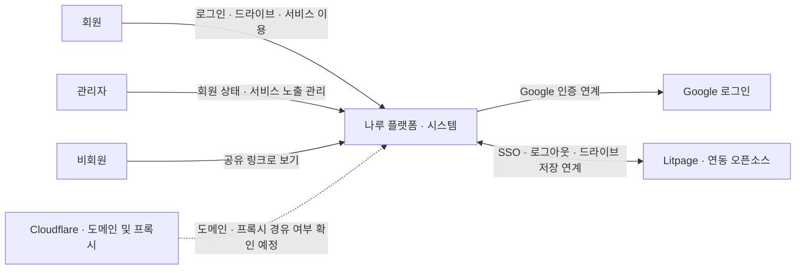
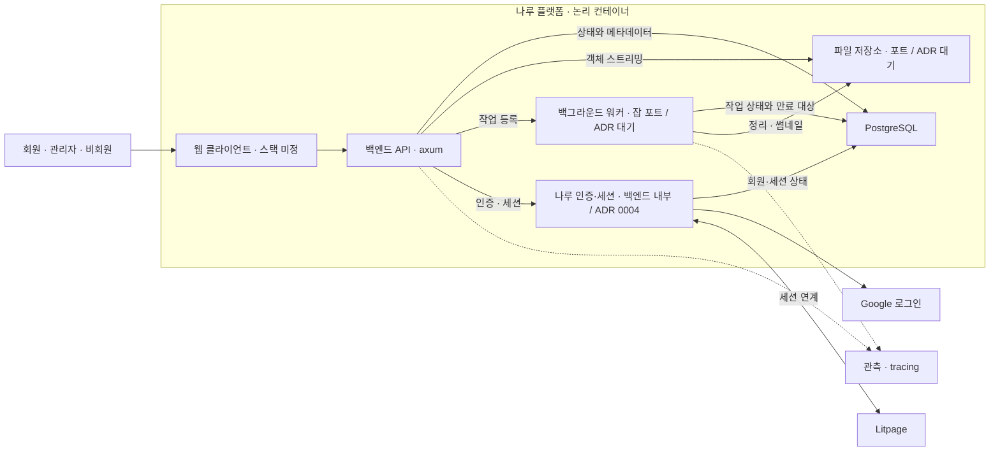
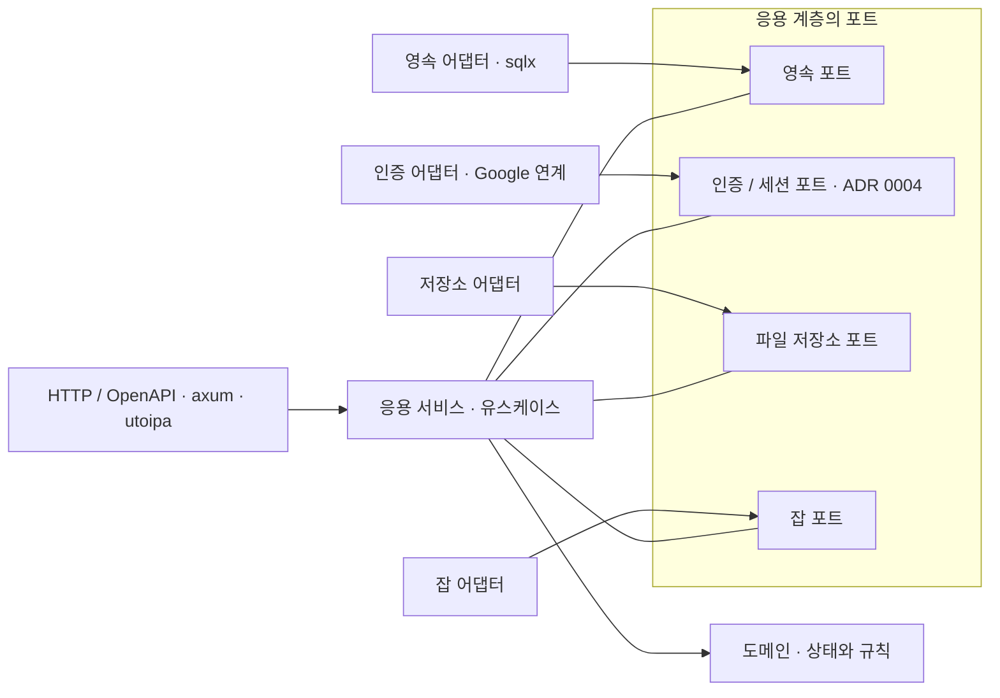
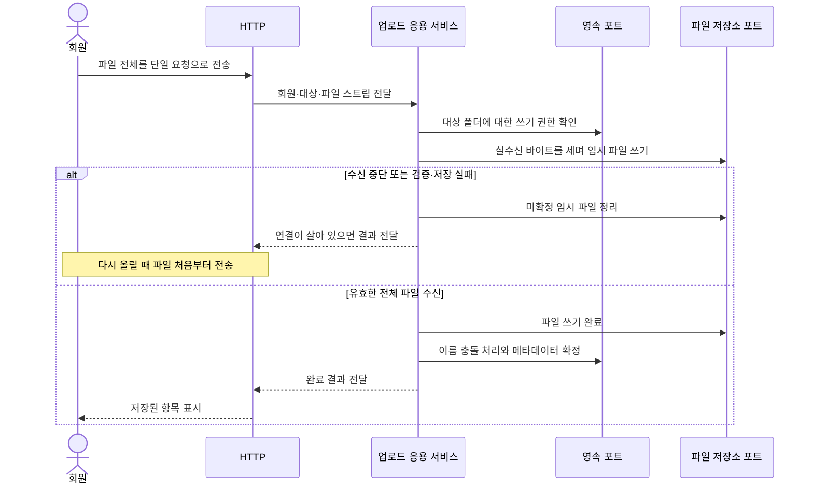
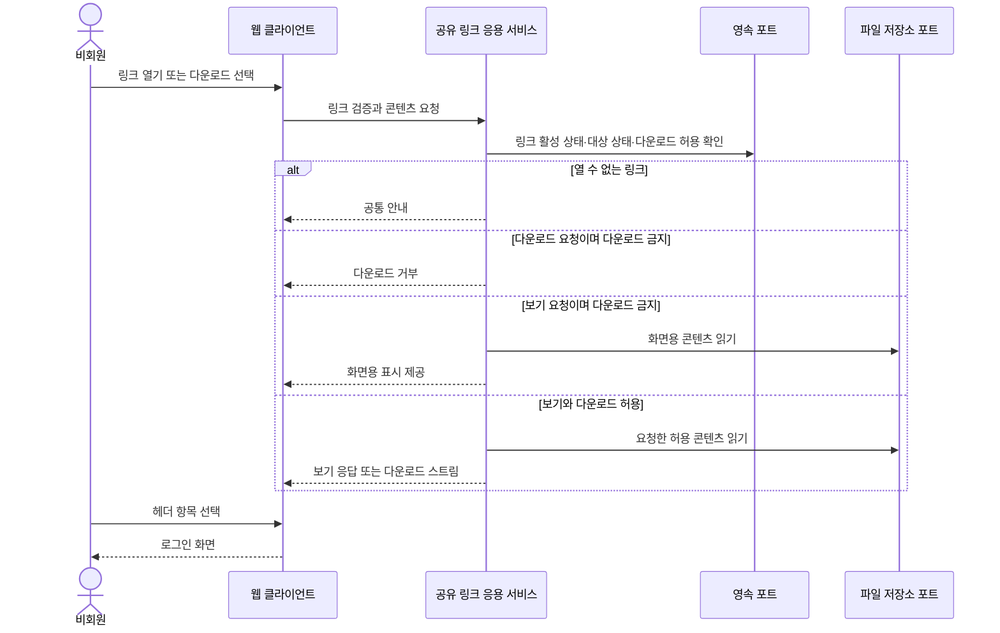
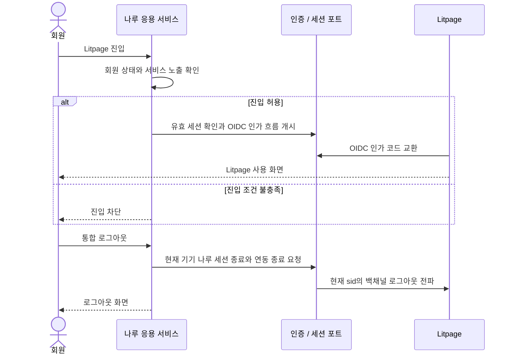
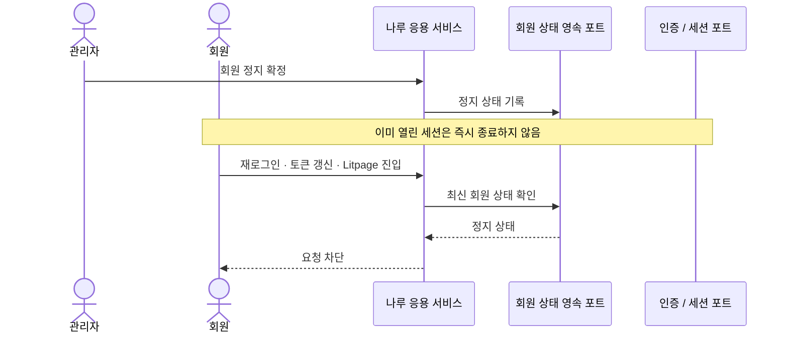

# 05. 아키텍처

## 1. 문서 정보

| 항목 | 내용 |
|---|---|
| 문서명 | NaruWorks 설계 문서 05. 아키텍처 |
| 버전 | v0.4 |
| 작성일 | 2026-11-19 (Asia/Seoul) |
| 작성 | 설계 봇 (naru-orch P2-4) |
| 상태 | [ADR 0004](../decisions/0004-auth-idp-litpage.md) 반영, Gemini 검토 대기 |
| 작업 브랜치 | `feature/NARU-94-architecture` |
| 기획 기준선 | develop `2f1db92` (PR #99, 라운드 16~19, DEC-081~121) |
| 개정일 | 2026-11-26 (KST), ADR 0004 연결 |
| 백엔드 전제 | ADR 0003, [ADR 0004](../decisions/0004-auth-idp-litpage.md) |
| 프런트엔드 | 스택 미정. 디자인 시안 확정 후 별도 ADR |

### 1.0 개정 이력

| 버전 | 일시 | 내용 |
|---|---|---|
| v0.1 | 2026-11-19 (KST) | 초안 작성 |
| v0.2 | 2026-11-19 (KST) | v0.2 — Gemini 검토(P2-4-arch-05-06-review-gemini-01) RV-001~006 반영 (2026-11-19 KST) |
| v0.3 | 2026-11-26 (KST) | rebaseline 2f1db92. 요청 흐름, 만료·백업 정책, 운영·프런트 책임 재대조 반영. |
| v0.4 | 2026-11-26 (KST) | [ADR 0004](../decisions/0004-auth-idp-litpage.md) 연결. 나루 자체 인증·PostgreSQL 세션 및 Litpage 인증 경계 반영. |
| v0.4 보완 | 2026-11-26 21:45 KST | 호배님 Litpage SSO B-1 결정 반영. |

### 1.1 입력 기준선

| 직접 읽은 파일 | 확인한 표기 |
|---|---|
| [0003-backend-stack.md](../decisions/0003-backend-stack.md) | 개정 1, 2026-11-26 재대조. 스택 승인일 2026-11-19 |
| [ADR 0004](../decisions/0004-auth-idp-litpage.md) | 개정 2. 2026-11-19 15:07 KST 호배님 승인, 2026-11-26 21:45 KST SSO B-1 결정 |
| [04-NFR-technical.md](04-NFR-technical.md) | v0.3 |
| [06F-stack-feasibility.md](06F-stack-feasibility.md) | v0.4 |
| [NFR.md](../01-planning/nfr/NFR.md) | v1.3 |
| [PRD.md](../01-planning/prd/PRD.md) | v1.2 |
| [FRD.md](../01-planning/frd/FRD.md) | v1.4 |
| [BR.md](../01-planning/business-rules/BR.md) | v1.4 |
| [AC.md](../01-planning/acceptance-criteria/AC.md) | v1.2 |
| [UF.md](../01-planning/user-flow/UF.md) | v1.2 |
| [decision-log.md](../01-planning/02-decision-log/decision-log.md) | 버전 표기 없음. DEC-001~121. 이번 재대조 DEC-081~121 |
| [open-questions.md](../01-planning/02-decision-log/open-questions.md) | 라운드 19 이후 |
| [0002-open-source-service-platform.md](../decisions/0002-open-source-service-platform.md) | 버전 표기 없음. 2026-11-12 방향 확정 |

기획 인용은 develop `2f1db92`에 머지된 워크트리 원문을 따른다. 문서가 충돌하면 최신 DEC를 우선하고 나머지 우선순위는 DEC-081을 따른다([04 §1.1](04-NFR-technical.md)).

### 1.2 문서 번호

05는 C4 아키텍처, 06은 크레이트 구조다. API 계약은 07에서 다룬다. 인증/IdP·세션은 [ADR 0004](../decisions/0004-auth-idp-litpage.md)를 따르고 Litpage SSO는 B-1로 결정했으며 세부 계약은 [09](09-auth.md#4-litpage-sso)를 따른다. 배포 구성과 가용률 관측 세부는 후속 배포·운영 설계에 둔다.

## 2. 범위와 원칙

나루 플랫폼의 시스템 경계, 요청 흐름과 백그라운드 작업의 책임을 정의한다. [ADR 0003](../decisions/0003-backend-stack.md)에 따라 Rust 백엔드는 axum 0.8.x, sqlx 0.8.x와 `sqlx migrate`, utoipa 5.x, tracing과 tower-http, tokio 1.x를 사용한다. ADR 0003은 스파이크에서 해석된 패치 버전을 고정하지 않는다. 프런트엔드 스택은 미정이다. 인증/IdP·세션은 응용 계층의 트레이트 경계를 두고 [ADR 0004](../decisions/0004-auth-idp-litpage.md)에 따라 나루 백엔드에서 처리한다. 파일 저장소와 잡 러너는 각 포트의 구현을 별도 ADR에 맡긴다. 배포 토폴로지와 IaC는 [미확인]이다.

1차 용량 전제는 예상 사용자 100명 이내다. 기획 성능 목표는 최근 60초 안에 요청한 활성 세션 20개에서 5xx·타임아웃 오류율 0.1% 이하이며, 가입자 80명·100명 도달은 운영 경보만 발행한다(DEC-088). 화면 이동 p95 2초·썸네일 표시 p95 3초를 적용하며, Google 로그인과 썸네일 최초 생성은 제외하고 Litpage 로딩은 포함한다(DEC-087, 04 §4.2). 가용률은 미리 알린 점검과 외부 장애를 제외해 출시 후 한 달간 관찰한다(DEC-089).

## 3. C4 Context

[기획] DEC-082에 따라 CO-01(도메인)·CO-02(Cloudflare)는 Cloudflare 대시보드, CO-03(Google OAuth)은 Google Cloud Console을 보관 위치로 참조한다. **RB-017 [미확인] · 기획 결정 대기 중.** CO-02 프록시 경로와 본문 한도가 DEC-090의 1GB 단일 업로드와 충돌하는지 확인이 필요하다(04 §4.1, GAP-005).

## 4. C4 Container

컨테이너는 논리 단위다. 인증·세션은 [ADR 0004](../decisions/0004-auth-idp-litpage.md)에 따라 백엔드 내부에 둔다. 파일 저장소의 배치 위치, 워커 실행 형태, 관측 수집·보관 경로는 후속 ADR 또는 운영 문서에서 정한다. HTTP 요청 관측의 경계는 tower-http에 두고 토큰·시크릿·원문 이메일은 로그에서 제외한다([제안값 PV-016]). 프록시 경로와 본문 한도는 §3의 RB-017을 참조한다.

## 5. C4 Component — 백엔드 API

화살표는 코드 의존 방향이다. 포트는 응용 계층 소유다. 실행 시 응용 서비스는 주입받은 포트를 호출한다. 도메인은 상태 전이와 정책을 표현하며 프레임워크와 공급자 SDK 의존성은 바깥 계층에 둔다. 조립과 의존 금지 규칙은 [06 §3–4](06-crate-layout.md)를 따른다.

## 6. 요청 흐름

### 6.1 단일 요청 스트리밍 업로드

[기획] FR-DRV-003, BR-024, NFR-PERF-002. 파일당 1~1,073,741,824 B를 한 요청으로 전송한다(DEC-086·090·107). 끊긴 파일은 처음부터 다시 업로드한다. 서버는 실제 수신한 파일 바이트로 경계를 강제한다. [제안값 PV-003] 업로드당 서버 메모리 증가 목표는 ≤64 MiB다. CO-02에서 이 한도의 요청을 처리할 수 있는지는 §3의 RB-017 [미확인]을 참조한다.

폴더 업로드도 파일별로 같은 경계를 적용한다. 정상 파일의 하위 구조는 유지한다. 한도를 초과한 파일만 제외하고 이름을 안내하며 0바이트 파일도 거부한다(DEC-106·107). 같은 위치에서 파일·폴더 이름이 겹치면 `(1)`, `(2)` 등 첫 빈 번호를 부여한다(DEC-108). 동시 이름 배정은 영속 경계에서 조정한다.

파일은 저장소와 메타데이터가 모두 확정된 뒤 노출한다. 저장소 쓰기를 마쳤더라도 메타데이터가 확정되기 전에 실패한 객체는 미확정 상태로 정리한다. 구체적인 기록·보상 방식은 영속 모델과 저장소 ADR에서 정한다.

### 6.2 비회원 공유 링크

[기획] NFR-SEC-003, FR-DRV-006·007, BR-007·008·022. 비회원 링크는 보기 전용이며 만료·비밀번호는 두지 않는다. 다운로드를 금지한 회원 보기 공유와 비회원 링크는 원본을 전송하지 않고 화면용 콘텐츠만 제공한다(DEC-095·109). 화면용 형식은 설계 이관 [미확인]이다. 탈퇴 보관 중 소유 공유·링크는 보기만 가능하다(DEC-099·111). 비회원에게 열 수 없는 링크는 원인에 관계없이 하나의 안내를 표시한다(DEC-117). 비회원 헤더 항목을 클릭하면 로그인 화면으로 이동한다(AC-FR-DRV-007-04). 휴지통에 있는 파일은 링크에서 차단하고 복원 시 다시 연다(BR-006). 링크 보호의 [제안값 PV-019]는 128비트 이상 CSPRNG 토큰, IP당 분당 60회, `no-store`·색인 금지·`no-referrer`, 링크 끄기 반영 5초 이하다.

### 6.3 Litpage SSO 진입과 통합 로그아웃

[기획] FR-AUTH-002, FR-OSS-001, NFR-SEC-001. 통합 로그아웃은 현재 기기의 나루와 Litpage 세션을 끝내며 다른 기기 세션은 유지한다(DEC-094). [제안값 PV-017] 로그아웃 전파 p99 ≤ 5초, 로그아웃 API p95 ≤ 2초, 액세스 토큰 수명 5분 이하 또는 백채널 로그아웃을 검토한다(AS-008). 토큰 수명만으로 전파 지연 목표를 만족하는지는 [미확인]이며 09에서 검증한다.

[ADR 0004](../decisions/0004-auth-idp-litpage.md)는 Litpage 인증 연결을 새로 붙이고 SSO는 B-1로 결정했다. 나루가 OIDC OP, Litpage가 새 RP이며 세부 계약은 [09](09-auth.md#4-litpage-sso)를 따른다.

### 6.4 정지와 세션

[기획] NFR-SEC-002·006, BR-005, DEC-092·098. 세션은 유휴 7일 또는 로그인 시작 후 절대 30일 중 먼저 도달하는 시점에 만료한다. 정지 회원의 재로그인·토큰 갱신·Litpage 진입은 새 로그인으로 보고 최신 회원 상태를 확인해 차단한다. 정지만으로 이미 열린 세션을 즉시 종료하지 않는다. 나루 PostgreSQL에서 세션을 관리한다. [ADR 0004](../decisions/0004-auth-idp-litpage.md)

Q-087 [미확인]. 열린 세션이 토큰 갱신 때 차단되기까지의 최대 시간은 기획 확인이 필요하다. 액세스 토큰 수명 ≤5분은 PV-017의 제안값이다. Litpage RP의 사용 가능 기간은 나루 세션 만료를 넘지 않게 제안했다. 실제 갱신·차단 지연은 [미확인]이다. 정지 시험과 만료 경계는 04 §4.4, PV-018·029를 따른다.

## 7. 백그라운드 작업과 운영 책임

작업 실행 경계는 잡 포트이며 러너는 [ADR 대기]다. 삭제 작업은 실행 직전에 시각과 최신 상태를 확인한다. 복구와 삭제가 경합할 때 한쪽 상태 전이만 확정되도록 영속 경계에서 조정한다. 부분 성공 후 재실행은 미완료 단계부터 수렴하도록 설계한다.

| 작업 | 주기와 판정 | 멱등 처리 |
|---|---|---|
| 휴지통 만료 삭제 | [기획] 달력 날짜 30일이며 탈퇴 보관 중에도 휴지통 시계는 계속 진행한다(DEC-096). 시간대·경계 시각·시작일은 Q-085 [미확인]. [제안값 PV-020] 매시간 스위프. | 휴지통 상태와 만료 여부를 재확인한다. 복원된 항목을 건너뛰고 이미 삭제된 객체는 완료로 취급한다. |
| 탈퇴 데이터 삭제 | [기획] 달력 날짜 30일 보관(DEC-096). 같은 Google 계정의 기간 내 재가입 시 정지 여부와 관계없이 복구한다. 정지는 유지되며 관리자가 해제한다. 소유 공유·링크는 보관 중 보기만 가능하며 받은 공유는 탈퇴 즉시 회수하고 재가입 시 복구하지 않는다(DEC-099·111·114). [제안값 PV-020] 요청 시 복구·접근 경계를 판정하고 매시간 스위프. | 탈퇴 상태와 만료 대상을 재확인한다. 복구된 계정은 건너뛰고 완료 단계는 중복 적용하지 않는다. |
| 미확정 임시 파일 정리 | 업로드 실패·중단 시 정리한다. 즉시 정리에 실패하면 후속 작업으로 재시도한다. | 진행 중인 전송과 확정된 파일은 건너뛰고 이미 정리된 파일은 완료로 취급한다. |
| 비동기 썸네일 | [제안값 PV-005] 업로드 확정 뒤 등록한다. 준비 전에는 형식 아이콘을 표시한다. 터치 기기의 마우스 올림 썸네일은 생략한다(DEC-084). | 같은 원본의 결과를 중복 발행하지 않는다. 삭제·교체된 원본의 이전 결과는 발행하지 않는다. |

[기획] NFR-OPS-001·DEC-046·083·091에 따라 회원 정보와 드라이브 파일만 매일 백업하고 30일 후 자동 만료한다. 공유·링크·설정은 백업 범위에서 제외하며, 복원 후 이 항목들이 없을 수 있음을 절차와 안내에 명시한다. 복원 시 이미 처리된 탈퇴·휴지통 삭제를 다시 적용한다. [제안값 PV-013~015] RPO ≤24시간, RTO ≤4시간, 03:00 KST 백업과 월 1회 복원 훈련, 삭제 원장을 검토한다. 같은 예정 회차를 재시도할 때 완료 세트를 중복 발행하지 않는다. 원장 보관과 복원 절차는 운영 설계에서 다룬다.

[기획] NFR-OPS-002에 따라 운영 로그는 30일 보관한다. 성공 지표 집계는 로그와 별도로 보관하며 로그 만료 시 함께 삭제하지 않는다(DEC-085). 집계 보관 기간은 [미확인]이다.

[기획] NFR-OPS-003·DEC-104. 회원 정지·해제와 오픈소스 숨김·노출을 수행하는 응용 서비스가 확정된 관리자 동작을 영속 경계에 감사 기록으로 남긴다. 취소한 정지는 성공 동작으로 기록하지 않는다. 운영 책임자는 기록 보관 정책을 관리한다. 감사 기록 항목·보관 기간과 로그 30일 정책 적용 여부는 Q-091 [미확인]이다.

[기획] NFR-OPS-004·DEC-105. 운영 관측 경계에서 서비스 전체 저장 용량을 집계하고 운영 경보를 발행한다. 업로드 승인 경로는 경보에 의존하지 않는다. 기준 수치·수신 대상·방법은 Q-092 [미확인]이다.

## 8. 플러그 가능한 경계

| 포트 | 책임 | 결정 또는 후보와 판단 기준 |
|---|---|---|
| 인증/IdP·세션 | Google 인증 연계, 세션 발급·검증·갱신, Litpage SSO와 현재 기기 로그아웃 전파. 응용 계층이 재로그인·갱신·Litpage 진입 때 최신 정지 상태를 검사한다. | [ADR 0004](../decisions/0004-auth-idp-litpage.md). 나루(axum)가 Google 로그인·PostgreSQL 세션·정지를 직접 처리하고 Litpage 인증 연결을 새로 작성한다. GAP-028 해소. SSO는 B-1(나루 OP·Litpage RP)이다. |
| 파일 저장소 | 단일 요청의 파일 스트림을 임시 파일에 쓰고 확정 또는 실패 정리를 수행한다. 확정 객체의 읽기·삭제와 전체 사용량 관측에 필요한 저장소 메타데이터를 제공한다. | [ADR 대기] 로컬 FS(`tokio::fs`), S3 호환 + `aws-sdk-s3`, `object_store` 추상화. 06F §5에 따라 단일 요청 스트리밍, 실패 정리, 다중화·무중단 필요성, S3 이관 가능성, 백업·삭제 정합성과 운영 부담을 비교한다(AS-004). |
| 잡 | 작업 등록, 예약 시각, 실행 상태, 재시도와 완료 기록을 다룬다. 응용 시각 판정에 쓰는 시계 경계를 포함한다. | [ADR 대기] tokio 내장 + DB 상태 테이블, apalis(PostgreSQL), tokio-cron-scheduler + 인프라 분리. 06F §4.5·§9에 따라 영속화와 중복 실행 제어를 검토한다. |

감사 기록 쓰기는 응용 서비스가 영속 경계를 통해 수행한다(§7). 저장 용량 관측과 경보 전달은 운영 경계에서 수행한다. 기록 항목·보관 기간과 경보 기준·수신 대상·방법은 Q-091·Q-092 [미확인]이다.

## 9. 프런트엔드

웹 클라이언트의 스택은 미정이다. 디자인 시안이 확정된 뒤 별도 ADR에서 결정한다. 화면 데이터 목록을 반영할 API 계약은 07에서 다룰 예정이다.

- [기획] 프로필에서 system/light/dark를 고르고 계정에 저장한다. 시스템 모드는 기기 설정을 따른다. 테마는 나루 화면과 이용약관·개인정보처리방침 등 법적 문서에 적용하고 Litpage에는 적용하지 않는다(DEC-101·113, NFR-USAB-002). 로그인 전 적용 방식 [미확인].
- [기획] 1차 화면은 라이트·다크 모드 모두 WCAG 2.1 AA를 따른다(DEC-102, NFR-USAB-003). Litpage·법적 문서 등 화면별 적용 범위와 검증 방식의 세부는 [미확인]이다.
- [기획] 설정 전에는 기기 언어 규칙을 적용한다. 로그인 화면에 한·영 전환을 두고, 로그인 후 계정 언어를 우선한다. Litpage 화면도 나루 언어에 맞춘다(DEC-045·052·100·110, NFR-I18N-002).
- [기획] 터치 기기에서는 마우스 올림 썸네일을 생략한다(DEC-084).

## 10. 추적 표

| 절 | 기획 기준선 | 04 추적 |
|---|---|---|
| §2–5 시스템·계층 | FR-AUTH-001, FR-OSS-001·003, NFR-SEC-005, DEC-082 | RB-017·GAP-005, GAP-028, AS-001·003, PV-016 |
| §6.1 업로드 | FR-DRV-003, BR-024, NFR-PERF-002, DEC-086·090·106~108 | §4.1, PV-003, RB-017·GAP-005 |
| §6.2 공유 링크 | FR-DRV-006·007, NFR-SEC-003, BR-006·007·008·022, DEC-095·109·117 | PV-019 |
| §6.3 Litpage SSO·로그아웃 | FR-AUTH-002, FR-OSS-001, NFR-SEC-001, DEC-094 | PV-017, GAP-028, AS-008 |
| §6.4 정지·만료 | FR-AUTH-005, FR-ADM-002, NFR-SEC-002·006, BR-005, DEC-092·098 | PV-017·018·029, Q-087 [미확인] |
| §7 작업·운영 | FR-DRV-004·008, NFR-SEC-004, NFR-OPS-001~004, DEC-083·085·091·096·099·104·105·111·114 | PV-005·013~016·020, Q-085·091·092 [미확인] |
| §8 포트 | DEC-008·090·094·098, FR-OSS-001 | GAP-028, AS-004·008 |
| §9 웹 클라이언트 | NFR-USAB-001~003, NFR-I18N-002·003, FR-DRV-008, DEC-084·100~102·110·113 | §4.8, PV-024·026 |

## 11. 열린 질문

- [ADR 0004](../decisions/0004-auth-idp-litpage.md)의 Litpage SSO B-1에 대한 종단 동작과 로그아웃 전파를 [09](09-auth.md) 기준으로 검증한다 [미확인].
- [ADR 대기] 파일 저장소, 잡 러너, 프런트엔드 스택.
- [미확인] RB-017 Cloudflare 프록시 경로·본문 한도의 1GB 단일 업로드 충돌 여부(기획 결정 대기 중), 배포 토폴로지·IaC.
- [미확인] Q-085 달력 날짜 30일의 시간대·경계 시각·시작일. 삭제 원장 보관과 복원 절차는 운영 설계에서 다룬다.
- [미확인] Q-087 정지 회원이 갱신 때 차단되기까지의 최대 시간, Litpage 자체 세션 만료 적용과 통합 로그아웃 전파 구현.
- [미확인] Q-091 감사 기록 항목·보관 기간, Q-092 전체 저장 용량 경보 기준·수신 대상·방법.
- [미확인] Litpage Markdown·CSV의 무손실 재열기 여부. 패키징 채택 조건과 왕복 스파이크는 [ADR 0004](../decisions/0004-auth-idp-litpage.md)를 따른다. 자동 저장 지연·재시도·실패 정의·1GB 한도 적용은 GAP-025로 남는다.
