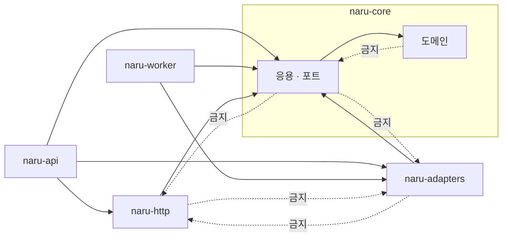

# 06. 크레이트 구조

## 1. 문서 정보

| 항목 | 내용 |
|---|---|
| 문서명 | NaruWorks 설계 문서 06. 크레이트 구조 |
| 버전 | v0.4 |
| 작성일 | 2026-11-19 (Asia/Seoul) |
| 작성 | 설계 봇 (naru-orch P2-4) |
| 상태 | [ADR 0004](../decisions/0004-auth-idp-litpage.md) 반영, Gemini 검토 대기 |
| 작업 브랜치 | `feature/NARU-94-architecture` |
| 기획 기준선 | develop `2f1db92` (PR #99, 라운드 16~19, DEC-081~121) |
| 개정일 | 2026-11-26 (KST), ADR 0004 연결 |
| 백엔드 전제 | ADR 0003, [ADR 0004](../decisions/0004-auth-idp-litpage.md) |
| 프런트엔드 | 스택 미정. 디자인 시안 확정 후 별도 ADR |

### 1.0 개정 이력

| 버전 | 일시 | 내용 |
|---|---|---|
| v0.1 | 2026-11-19 (KST) | 초안 작성 |
| v0.2 | 2026-11-19 (KST) | v0.2 — Gemini 검토(P2-4-arch-05-06-review-gemini-01) RV-001~006 반영 (2026-11-19 KST) |
| v0.3 | 2026-11-26 (KST) | rebaseline 2f1db92. 업로드·회원·운영 모듈 책임과 시험 기준 재대조 반영. |
| v0.4 | 2026-11-26 (KST) | [ADR 0004](../decisions/0004-auth-idp-litpage.md) 연결. 나루 자체 인증·PostgreSQL 세션 및 Litpage 인증 경계 반영. |
| v0.4 보완 | 2026-11-26 21:45 KST | 호배님 Litpage SSO B-1 결정 반영. |

### 1.1 입력 기준선

| 직접 읽은 파일 | 확인한 표기 |
|---|---|
| [0003-backend-stack.md](../decisions/0003-backend-stack.md) | 개정 1, 2026-11-26 재대조. 스택 승인일 2026-11-19 |
| [ADR 0004](../decisions/0004-auth-idp-litpage.md) | 개정 2. 2026-11-19 15:07 KST 호배님 승인, 2026-11-26 21:45 KST SSO B-1 결정 |
| [04-NFR-technical.md](04-NFR-technical.md) | v0.3 |
| [06F-stack-feasibility.md](06F-stack-feasibility.md) | v0.4 |
| [NFR.md](../01-planning/nfr/NFR.md) | v1.3 |
| [PRD.md](../01-planning/prd/PRD.md) | v1.2 |
| [FRD.md](../01-planning/frd/FRD.md) | v1.4 |
| [BR.md](../01-planning/business-rules/BR.md) | v1.4 |
| [AC.md](../01-planning/acceptance-criteria/AC.md) | v1.2 |
| [UF.md](../01-planning/user-flow/UF.md) | v1.2 |
| [decision-log.md](../01-planning/02-decision-log/decision-log.md) | 버전 표기 없음. DEC-001~121. 이번 재대조 DEC-081~121 |
| [open-questions.md](../01-planning/02-decision-log/open-questions.md) | 라운드 19 이후 |
| [0002-open-source-service-platform.md](../decisions/0002-open-source-service-platform.md) | 버전 표기 없음. 2026-11-12 방향 확정 |

기획 인용은 develop `2f1db92`에 머지된 워크트리 원문을 따른다. 문서가 충돌하면 최신 DEC를 우선하고 나머지 우선순위는 DEC-081을 따른다([04 §1.1](04-NFR-technical.md)).

### 1.2 문서 번호

05는 C4 아키텍처, 06은 크레이트 구조다. API 계약은 07에서 다룬다. 인증/IdP·세션은 [ADR 0004](../decisions/0004-auth-idp-litpage.md)를 따르고 Litpage SSO는 B-1로 결정했으며 세부 계약은 [09](09-auth.md#4-litpage-sso)를 따른다. 배포 구성과 NFR-AVAIL-001(DEC-089)의 운영 관찰 세부는 후속 배포·운영 설계에 둔다.

## 2. 범위와 원칙

Rust 백엔드의 Cargo 워크스페이스 책임과 의존 방향을 제안한다. [ADR 0003](../decisions/0003-backend-stack.md)의 axum 0.8.x, sqlx 0.8.x와 `sqlx migrate`, utoipa 5.x, tracing과 tower-http, tokio 1.x를 따른다. 스파이크가 해석한 패치 버전은 고정하지 않는다. 기획의 1차 규모인 회원 100명 이내와 동시 접속 목표 20명(NFR-PERF-001·004)을 기준으로 도메인과 응용을 한 크레이트에 둔다. 기능별 모듈로 분리하고, 포트는 사용하는 응용 모듈에 둔다. 프런트 패키지와 앱 구조는 디자인 시안 및 프런트 스택 결정 후 정한다.

## 3. 워크스페이스 크레이트 제안

아래 트리는 구현 전 제안이다. 실행 진입점은 각각 바이너리이며, 정책·HTTP·어댑터는 라이브러리에 둔다. `migrations/`는 PostgreSQL 어댑터가 소유한다. API 계약은 07로 이관한다.

```text
Cargo.toml
crates/
  naru-core/
    Cargo.toml
    src/
      domain/
      application/
        ports/
  naru-adapters/
    Cargo.toml
    src/
      persistence/
      storage/
      identity/
      jobs/
    migrations/
  naru-http/
    Cargo.toml
    src/
      routes/
      middleware/
      openapi/
      error/
  naru-api/
    Cargo.toml
    src/main.rs
  naru-worker/
    Cargo.toml
    src/main.rs
```

| 크레이트 | 유형 | 책임 |
|---|---|---|
| `naru-core` | 라이브러리 | `domain`은 엔티티, 회원·파일 상태, 만료 규칙, 도메인 오류를 둔다. `application`은 유스케이스, 입력·결과 타입, 영속·인증·저장소·잡 포트를 소유한다. |
| `naru-adapters` | 라이브러리 | `persistence`에 sqlx 질의와 매핑, 마이그레이션을 둔다. `identity`는 [ADR 0004](../decisions/0004-auth-idp-litpage.md)의 Google 연계와 Litpage 인증 연결을 담당하는 어댑터 경계다. `storage`·`jobs`는 각각 파일 저장소·잡 러너 모듈 경계이며 구현은 [ADR 대기]다. |
| `naru-http` | 라이브러리 | axum 라우팅과 HTTP 입력·출력, utoipa OpenAPI, tower-http 미들웨어, tracing 요청 관측, HTTP 오류 매핑을 담당한다. |
| `naru-api` | 바이너리 | tokio에서 HTTP 서버를 시작한다. 설정을 읽고 응용 서비스와 어댑터를 조립한다. |
| `naru-worker` | 바이너리 | 응용 유스케이스와 포트를 재사용한다. 실행 진입점과 관측 경계를 둔다. 실제 러너와 배치 형태는 [ADR 대기]다. |

## 4. 의존 방향

화살표는 코드 의존 방향이다. 실선은 허용, 점선은 금지를 나타낸다. `application`에서 포트를 정의하고 어댑터가 이를 구현한다. 의존 방향은 [05 §5](05-architecture.md)와 같다.



도메인과 응용은 axum, sqlx, utoipa와 공급자 SDK를 의존성으로 받지 않는다. sqlx 타입과 질의는 `naru-adapters::persistence`에만 두고, utoipa 타입과 주석은 `naru-http`에만 둔다. HTTP와 어댑터는 응용 입출력·포트 타입을 경계에서 변환한다. 어댑터 모듈 사이의 순환 참조를 금지한다. 어댑터 협력이 필요한 흐름은 응용 유스케이스가 조정한다.

## 5. 모듈 경계

인증/IdP·세션 포트는 [ADR 0004](../decisions/0004-auth-idp-litpage.md)를 따른다. 파일 저장소와 잡 포트는 [05 §8](05-architecture.md)의 [ADR 대기] 경계다. `ObjectStore`는 프로젝트 내부 포트의 제안명이다. `JobQueue`와 `JobClock`은 잡 경계의 실행 상태와 시각 의존성을 각각 표현한다. 영속 포트는 응용 계층에 둔 내부 경계이며 PostgreSQL 구현은 ADR 0003을 따른다.

응용 시각은 공통 `Clock` 포트에서 가져오며, 잡 포트의 예약·실행 시각 의존성인 `JobClock`도 같은 `Clock`을 사용해 별도 시간 원천을 두지 않는다.

| 응용 모듈 | 책임 | 사용하는 포트 |
|---|---|---|
| 인증·세션 | 나루 PostgreSQL에 저장한 세션은 로그인 시작 후 절대 30일 또는 유휴 7일 중 먼저 도달하는 시점에 만료한다(DEC-092, NFR-SEC-006). 재로그인·토큰 갱신 전에 최신 회원 상태를 확인해 정지 상태면 차단한다. 정지만으로 열린 세션을 즉시 종료하지 않는다(DEC-098). | 인증/IdP·세션, 회원·세션 영속, `Clock` |
| 드라이브 업로드 | 파일 하나를 단일 요청으로 스트리밍하며 실수신 바이트로 1~1,073,741,824 B를 검증한다(DEC-086·090·107). 중단 후에는 처음부터 다시 받으며 미확정 임시 파일을 정리한다. 폴더 내 초과 파일은 제외·안내하고 정상 파일의 하위 구조를 유지한다(DEC-106). 같은 이름의 파일·폴더에는 첫 빈 번호를 부여한다(DEC-108). 파일과 메타데이터 확정 뒤 노출하고 썸네일 작업을 등록한다(PV-005). | `ObjectStore`, 업로드·파일 영속, `JobQueue` |
| 공유·링크 | 링크와 대상 상태, 보기 권한과 다운로드 설정을 확인한다. 다운로드 금지 회원 보기 공유·비회원 링크와 탈퇴 보관 중인 소유 공유·링크에는 화면용 콘텐츠만 제공하고 원본을 전송하지 않는다(DEC-095·099·109·111). 비회원의 불가 링크 안내는 일관되게 표시한다(DEC-117). | 링크·파일 영속, `ObjectStore` |
| Litpage SSO | 진입 전 유효 세션, 서비스 노출 상태, 최신 회원 정지 상태를 확인해 정지 회원의 진입을 거부한다(DEC-098). 나루 OIDC OP와 새 Litpage RP를 연동하고 현재 기기 로그아웃을 전파한다(DEC-094, [ADR 0004](../decisions/0004-auth-idp-litpage.md)). | 인증/IdP·세션, 회원·서비스 상태 영속 |
| 회원 상태 | 정지·해제, 탈퇴, 기간 내 재가입 복구를 판단한다. 탈퇴 시 받은 공유를 즉시 회수하며 재가입 때 복구하지 않는다. 보관 데이터가 복구되어도 정지를 유지하며 관리자가 해제한다(DEC-093·099·114). 확정된 정지·해제를 감사 기록으로 남긴다(DEC-104). 항목·보관 기간 Q-091 [미확인]. | 회원·공유·감사 기록 영속, `Clock` |
| 서비스 노출 관리 | 오픈소스 숨김·노출 상태를 변경하고 확정된 관리자 동작을 감사 기록으로 남긴다(DEC-104, NFR-OPS-003). 항목·보관 기간 Q-091 [미확인]. | 서비스 상태·감사 기록 영속 |
| 만료·정리 작업 | 휴지통·탈퇴 보관의 달력 날짜 30일 만료를 적용한다. 탈퇴 보관 중에도 휴지통 시계는 계속 진행한다(DEC-096). 시간대·경계 시각·시작일 Q-085 [미확인]. 실패·중단된 업로드의 미확정 임시 파일과 썸네일 작업을 처리한다. 재시도 전에 대상 상태를 확인한다. | `JobClock`·`JobQueue`, 대상 상태 영속, `ObjectStore` |
| 운영 | 백업·운영 로그 보관과 전체 저장 용량 관측은 운영 경계에 둔다. 전체 사용량이 기준을 넘으면 운영 경보를 내며 업로드 허용에는 영향을 주지 않는다(DEC-105, NFR-OPS-004). 기준 수치·수신 대상·방법 Q-092 [미확인]. | 저장소 사용량 관측, 운영 경보 전달 경계 |

파일 저장소 포트는 임시 파일 스트리밍·확정·실패 정리, 확정 객체 읽기·삭제, 저장 용량 관측에 필요한 메타데이터를 제공한다([05 §8](05-architecture.md)). 운영 경보 전달과 회원 업로드 처리는 독립적이다.

Q-087 [미확인]. 액세스 토큰 수명 ≤5분은 PV-017의 제안값이다. 열린 세션이 토큰 갱신 때 차단되기까지의 최대 시간과 Litpage 자체 세션 만료 적용은 [05 §6.4](05-architecture.md)를 따른다.

## 6. 오류 처리

도메인은 업무 오류를 타입으로 표현한다. HTTP 상태는 HTTP 경계에서 정하고 공급자 오류 타입은 어댑터에 국한한다. 영속·저장소·인증 어댑터는 기술 오류를 응용 오류로 변환하고 HTTP 계층은 공개 응답으로 매핑한다. 도메인 오류의 표시가 필요할 경우 `thiserror`를 후보로 둔다. DEC-086에 따라 실수신 파일 크기가 1,073,741,824 B를 초과하면 개별 파일 업로드의 HTTP 경계에서 413으로 매핑한다(04 §4.1). 폴더 업로드는 초과 파일만 제외·안내한다(DEC-106). 0바이트도 두 경로에서 거부한다(DEC-107). 세부 응답 계약은 07에서 정의할 예정이다.

공개 오류 메시지는 요청자가 이해할 수 있는 실패 이유를 담는다. 토큰, 시크릿, 원문 이메일, SQL 원문, 내부 경로와 공급자 세부 응답은 공개 메시지에서 제외한다. 구조화 로그도 NFR-SEC-005의 비밀 관리 원칙과 [제안값 PV-016]의 마스킹 규칙을 따른다.

## 7. 설정

API와 워커의 진입점에서 환경별 설정을 읽고 필요한 설정만 각 어댑터에 주입한다. 다음 표는 위치와 설정 이름의 종류를 제안한다. 실제 파일 경로, 환경 변수의 철자, 비밀 참조 방식은 운영 설계에서 정한다.

| 구분 | 위치와 설정 이름의 종류 |
|---|---|
| 로컬 | 로컬 프로세스 환경 변수 또는 로컬 설정 파일. HTTP 바인딩, PostgreSQL 연결 참조, 로그 수준 |
| 스테이징 | 스테이징 실행 환경의 환경 변수 또는 배포 설정 파일. HTTP 바인딩, PostgreSQL 연결 참조, 로그 수준 |
| 프로덕션 | 운영 실행 환경의 환경 변수 또는 배포 설정 파일. HTTP 바인딩, PostgreSQL 연결 참조, 로그 수준 |
| 인증/IdP·세션 포트 | [ADR 0004](../decisions/0004-auth-idp-litpage.md). Google 연계와 나루 PostgreSQL 세션. B-1의 나루 OIDC OP·Litpage RP 계약은 [09](09-auth.md#4-litpage-sso). |
| 파일 저장소 포트 | [ADR 대기] |
| 잡 포트 | [ADR 대기] |

비밀 보관 위치 명칭은 [05 §3](05-architecture.md)의 CO-01~03을 참조한다. 구체적인 배포 파일과 환경별 비밀 위치는 [미확인]이다.

## 8. 시험 배치

| 위치 | 시험 범위 |
|---|---|
| 각 크레이트 `src/` 또는 `tests/` | 단위 시험은 가까운 모듈에 둔다. 크레이트 경계를 검증하는 시험은 해당 크레이트의 `tests/`에 둔다. |
| `naru-core` | 외부 어댑터 없이 엔티티·상태 전이와 유스케이스를 시험한다. 시험용 포트와 주입 시계로 재로그인·토큰 갱신·Litpage 진입 차단, 세션 유휴·절대 만료, 달력 날짜 30일 복구 경계를 검증한다. 폴더 업로드 예외·이름 충돌, 관리자 감사 기록 및 용량 경보 후 업로드가 유지되는지도 검증한다. |
| `naru-adapters` | 실제 PostgreSQL에서 `#[sqlx::test]`로 마이그레이션 적용과 `query_as` 실행을 검증하는 것은 ADR 0003 후속 항목이다([미확인]). `sqlx query!`는 2026-11-19 호배님 결정으로 당분간 제외한다. |
| `naru-http` | 응용 서비스를 경계에서 대체해 HTTP 입력·오류 매핑을 확인한다. 실수신 파일 크기 초과 시 HTTP 413과 0바이트 거부, 중단 시 부분 파일 미노출과 처음부터 재전송을 검증한다(04 §4.1). |
| 후속 테스트·성능 설계 | 활성 세션 20개와 오류율 0.1% 이하(DEC-088), 기획의 p95 기준(DEC-087), 브라우저 검증을 다룬다. k6 부하와 목록·메타데이터 API 예산은 PV-008·009 제안값을 참고한다. |

06F §6의 스파이크는 업로드와 OpenAPI의 참고 근거다. 워크스페이스 구조는 이식 없이 제안한다. 실제 PostgreSQL 시험에 필요한 권한은 PostgreSQL 설치·실행 승인이다(ADR 0003 후속 확인, 06F §6.1).

## 9. 추적 표

| 절 | 기획 기준선 | 04 추적 |
|---|---|---|
| §2–4 워크스페이스·의존 | NFR-PERF-001·004, DEC-088 | PV-011, AS-001·002 |
| §5 인증·세션·회원 | FR-AUTH-001~005, FR-ADM-002, FR-OSS-001, NFR-SEC-001·002·004·006, DEC-092~094·098·099·114 | PV-017·018·020·029, Q-085·087 [미확인], GAP-028 |
| §5 드라이브·공유 | FR-DRV-003·006·007, NFR-PERF-002, NFR-SEC-003, DEC-086·090·095·106~109·117 | §4.1, PV-003·019, RB-017·GAP-005 |
| §5 작업·운영 | FR-DRV-004·008, FR-ADM-002·003, NFR-SEC-004, NFR-OPS-001~004, DEC-083·091·096·104·105 | PV-005·013~016·020, Q-085·091·092 [미확인] |
| §6–7 오류·설정 | NFR-PERF-002, NFR-SEC-005, NFR-OPS-002, DEC-082·086·106·107 | §4.1, PV-016 |
| §8 시험 | NFR-PERF-002~004, NFR-SEC-002·004·006, NFR-OPS-003·004 | PV-003·008·009·020·029, §4.7 |

## 10. 열린 질문

- [ADR 0004](../decisions/0004-auth-idp-litpage.md)의 Litpage SSO는 B-1이며 [09](09-auth.md)의 인증 연결을 종단 검증한다 [미확인]. Markdown·CSV의 무손실 재열기와 패키징 채택은 ADR 0004의 왕복 스파이크로 검증한다 [미확인].
- [ADR 대기] 파일 저장소, 잡 러너. 포트 구현과 설정 계약은 각각의 ADR에서 정한다.
- [ADR 대기] 프런트엔드 스택. Cargo 외부의 패키지 구조는 시안 및 스택 결정 후 다룬다.
- [미확인] 실제 PostgreSQL 마이그레이션과 질의 실행, 동시 부하, 프록시 경유 업로드. 실측 범위는 06F §6을 참조한다.
- [미확인] 환경별 설정 파일 위치와 배포 조립 방식. 화면 데이터 목록을 반영한 API 계약은 07에서 다룬다.
- [미확인] Q-085 달력 날짜 30일 경계와 시작일, Q-087 정지 회원의 갱신 차단까지 최대 시간, Q-091 감사 기록 항목·보관 기간, Q-092 전체 저장 용량 경보 기준·수신 대상·방법.
