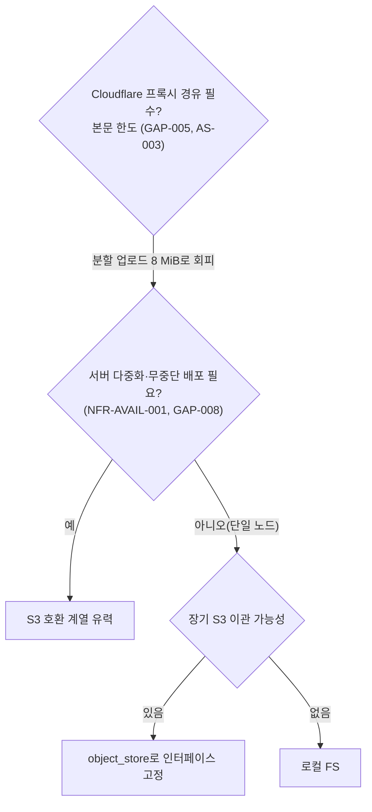

# 06F. 스택 타당성 검토 (백엔드만)

## 1. 문서 정보

| 항목 | 내용 |
|---|---|
| 문서명 | NaruWorks 설계 문서 06F — 스택 타당성 검토 (백엔드만) |
| 버전 | v0.4 |
| 작성일 | 2026-11-19 (Asia/Seoul) |
| 작성 | 설계 봇 |
| 상태 | 백엔드 추천 승인됨 → [ADR 0003](../decisions/0003-backend-stack.md) (2026-11-19 호배님), 인증/IdP·Litpage → [ADR 0004](../decisions/0004-auth-idp-litpage.md) (§9). 기존 평가·미확인 표는 당시 검토 기록으로 유지. |
| 개정일 | 2026-11-26 (KST), ADR 0004 연결 |
| 입력 | `_reviews/06F-spike-mac.md` (Mac 실측, job `P2-2-06F-update-claude-01`로 반영), `_reviews/06F-research-gemini.md` (job `P2-2-06F-research-gemini-01`), `_reviews/06F-spike-codex.md` (job `P2-2-06F-spike-codex-01`), `04-NFR-technical.md` v0.2, `01-planning/02-decision-log/decision-log.md`(DEC-001~080 전체 직접 확인), `01-planning/nfr/NFR.md`(§1~4.4 직접 확인), `01-planning/prd/PRD.md`(§1~5 Must 직접 확인), `01-planning/02-decision-log/open-questions.md` |
| 직접 읽지 못한 입력 | `FRD.md`, `BR.md`, `NFR.md` §4.5 이후, `PRD.md` §5 Won't 이후. 이들 내용은 04 문서를 경유해 인용했으며 원문 대조는 [미확인] (§11 U-15) |

### 1.0 개정 이력

| 버전 | 일시 | 내용 |
|---|---|---|
| v0.1 | 2026-11-19 (KST) | 초안. 조사(Gemini)·스파이크(Codex) 결과를 04 문서 PV·GAP 번호와 대조해 정리 |
| v0.2 | 2026-11-19 (KST) | Mac 실측 스파이크(06F-spike-mac.md) 반영, 2026-11-19 KST. §6 실측 교체, 해석 버전 표 추가, 재채점(변동 없음), 추천 "확정 후보"로 상향, §8·§11 갱신. 기획 원문(NFR·PRD·decision-log) 직접 대조 |
| v0.3 | 2026-11-19 (KST) | 백엔드 추천 승인, ADR 0003 연결 |
| v0.4 | 2026-11-26 (KST) | §9 인증/IdP·세션 결정에 [ADR 0004](../decisions/0004-auth-idp-litpage.md) 연결. |

## 2. 범위와 원칙

- **백엔드만 다룬다**: Rust 웹 프레임워크, DB 접근, 마이그레이션, OpenAPI, 백그라운드 작업, 관측성, 시험(실제 PostgreSQL), 파일 저장소.
- **프런트엔드는 평가·선택하지 않는다.** 시안이 확정되지 않았고(04 문서 §1 "프런트엔드 스택은 미정"), 프런트 스택이 PV-006·PV-024 등 수치에 영향을 주기 때문이다. 자리표시는 §10.
- **[미확인] 규칙**: 확인하지 못한 크레이트 유지보수·다운로드 수·라이선스·취약점 이력은 [미확인]으로 둔다. 버전은 스파이크 `Cargo.lock`에서 해석된 크레이트(§6.2)만 확정이다. 실행하지 않은 항목은 합격으로 쓰지 않는다.
- **제안값 규칙**: 기획에 없는 숫자(가중치·점수 포함)는 "제안값"이며 근거를 단다. 수치 근거는 04 문서의 PV 번호를 인용한다.
- **DEC-008(인증 구현 방식)은 미결**이다(decision-log DEC-008: "설계 봇 인증·IdP ADR에서 결정", open-questions "설계 이관"). GAP-028·GAP-034와 연결되는 부분은 결정하지 않고 선택지로 남긴다.

## 3. 평가 기준과 가중치

가중치는 **제안값**이다. 조사 문서(Gemini)의 7개 기준 구조는 유지하되 두 가지를 조정했다.
- 인증·IdP 가중치를 20 → 15로 낮췄다. DEC-008이 미결이므로, 웹 프레임워크 점수는 "어느 IdP가 선택돼도 수용 가능한가"(중립성)만 반영하고 IdP 자체의 우열은 별도 ADR에 맡긴다.
- 성능 가중치를 15 → 10으로 낮추고 유지보수·생태계를 10 → 15로 올렸다. 목표 부하가 20 VU·약 15 rps(PV-033, PV-009)로 작아 Rust 후보 간 처리량 차이가 합격 여부를 가르지 않을 것으로 보는 판단이다(실측 없음).

| 기준 | 내용 | 가중치(제안값) | 근거 ID |
|---|---|---:|---|
| K1 | 대용량 스트리밍 업로드·메모리 효율 | 20 | NFR-PERF-002, DEC-037, PV-001·002·003 |
| K2 | 인증·세션·IdP 수용 유연성(중립성) | 15 | NFR-SEC-001·002, DEC-008·014·015·027, PV-017·018·029, GAP-012·028·034 |
| K3 | API 응답 성능·동시성 | 10 | NFR-PERF-003·004, DEC-041·049, PV-008·009·010·033 |
| K4 | PostgreSQL 접근·마이그레이션 | 15 | NFR-SEC-004, NFR-AVAIL-001, PV-011·015·020, GAP-021 |
| K5 | 백그라운드 작업·스케줄링 | 10 | NFR-SEC-004, NFR-OPS-001·002, PV-002·005·014·016·020 |
| K6 | OpenAPI·관측성·실제 DB 시험 | 15 | NFR-OPS-002, NFR-SEC-005, PV-016·020·029, GAP-024 |
| K7 | 유지보수·생태계·학습 | 15 | 기존 백엔드가 Java(Spring Boot) 구성임(저장소 코드 구조로 확인). Rust 전환 비용은 일정에 직접 영향. 버전·유지보수 지표는 [미확인] |
| 합계 | | **100** | |

영역별 표에서는 해당 영역에 적용되는 기준만 골라 **영역 내 가중치 합이 100이 되도록 재정규화**했다(반올림, 아래 각 표에 명시). 가중 합계 = Σ(점수 × 가중치), 만점 500.

## 4. 후보별 점수

> **점수는 설계 판단(제안값)이다.** 근거는 조사 문서의 일반 지식과 04 문서 요구이며, 크레이트 유지보수는 [미확인]이다. Mac 스파이크(§6)로 K1(업로드 메모리·무결성·413)과 utoipa OpenAPI 생성은 두 조합 모두 실측 합격했다. 그러나 **K3(부하·p95)는 여전히 실측이 아닌 구조 기반 추정**이고 `query!`·PostgreSQL 항목은 미검증이다. 1~5점(5 우수).
>
> **재채점(v0.2): 실측 후 변동 없음.** 이유: ① K1 — A·B 모두 RSS 증가가 상한(65,536 KiB)의 약 9%·7%(5,712 / 4,768 KiB)이고 SHA-256·413 세 경우도 동일하게 합격해 둘 다 이미 5점이며 변별력이 없다. ② K6(utoipa) — A·B 모두 OpenAPI 3.1.0 유효해 기존 5점 유지. ③ 빌드(클린 18.71초 vs 22.61초, 증분 1.71초 vs 2.05초)·바이너리(1.9 MiB vs 5.3 MiB) 차이는 절대값이 작아 점수 기준(K1~K7)에 직접 대응하지 않고, K7(개발 생산성)을 움직일 정도도 아니다(증분 0.3초 차). 참고 관찰로만 남긴다. ④ sqlx는 `query!` 검증이 제외(호배님 결정)돼 K4·K6 점수의 근거 중 해당 부분은 여전히 조사 문서 주장이다. 점수를 올리거나 내릴 실측이 없다. 가중치·점수는 여전히 제안값이다(AS-A2).

### 4.1 웹 프레임워크

적용 기준·재정규화 가중치: K1 27, K2 20, K3 13, K6 20, K7 20 (원 가중치 20:15:10:15:15를 75로 나눠 반올림).

| 후보 | K1 | K2 | K3 | K6 | K7 | 가중 합계 | 근거 한 줄 |
|---|---:|---:|---:|---:|---:|---:|---|
| **axum** | 5 | 5 | 5 | 5 | 4 | **480** | `Body::into_data_stream`으로 프레임 단위 누적 검사 가능(스파이크 A 핸들러가 이 구조, 1 GiB 업로드 RSS 증가 5,712 KiB 실측 합격). Tower 계층으로 세션·OIDC·`TraceLayer` 조합, 특정 IdP에 비종속. `utoipa-axum` 지원은 조사 문서 주장, 버전 [미확인] |
| **actix-web** | 5 | 4 | 5 | 4 | 4 | 440 | `Payload` 스트리밍은 동등(스파이크 B 핸들러, RSS 증가 4,768 KiB 실측 합격). Tower 생태계와 직접 호환되지 않아 인증·관측 미들웨어를 전용으로 맞춰야 함 |
| **poem** | 4 | 3 | 4 | 5 | 3 | 380 | `poem-openapi` 일체형으로 OpenAPI가 단순. 인증·세션 레퍼런스 규모 [미확인], 스파이크 대상 아님 |
| **loco** | 3 | 3 | 4 | 4 | 3 | 333 | 규약 중심 프레임워크(axum+sea-orm 기반, 조사 문서 설명). 1 GiB 커스텀 스트리밍·DEC-008 미결 상황에서 우회 비용 우려. 성숙도 [미확인], 스파이크 대상 아님 |

### 4.2 DB 접근

적용 기준·가중치: K4 28, K3 18, K6 27, K7 27.

| 후보 | K4 | K3 | K6 | K7 | 가중 합계 | 근거 한 줄 |
|---|---:|---:|---:|---:|---:|---|
| **sqlx** | 5 | 5 | 5 | 4 | **473** | SQL 직접 통제로 PV-020(30일 경계)·PV-011(인덱스) 질의를 그대로 표현. `#[sqlx::test]`·`query!` 컴파일 검사는 조사 문서 주장이며 **`query!`는 호배님 결정으로 제외, `query_as`는 컴파일만 합격(실행·PG 시험 없음)** |
| **sea-orm** | 4 | 4 | 4 | 4 | 400 | `sqlx` 위 ORM. CRUD 생산성은 높으나 공유·재귀 폴더·시각 경계 질의는 raw SQL로 내려갈 가능성 |
| **diesel (+diesel-async)** | 4 | 5 | 3 | 3 | 364 | 핵심 diesel이 동기라 `diesel-async` 병용 필요, 학습 곡선이 가파름. `diesel-async` 유지보수 [미확인] |

### 4.3 마이그레이션

적용 기준·가중치: K4 40(PG 전용 기능·SQL 표현력), K6 30(실제 DB 시험과의 통합), K7 30.

| 후보 | K4 | K6 | K7 | 가중 합계 | 근거 한 줄 |
|---|---:|---:|---:|---:|---|
| **sqlx migrate** | 5 | 5 | 4 | **470** | 순수 SQL 파일, `sqlx::test`가 자동 적용(조사 문서 주장). down 스크립트 규율은 팀이 유지해야 함 |
| **refinery** | 4 | 3 | 3 | 340 | SQL·Rust 마이그레이션 모두 가능하나 `sqlx` 사용 시 연결 설정이 중복 |
| **sea-orm-migration** | 3 | 3 | 3 | 300 | `sea-orm` 미선택 시 실익 낮음. 부분 인덱스 등 PG 전용 기능 표현이 장황해질 수 있음 |

### 4.4 OpenAPI

적용 기준·가중치: K6 60, K7 40.

| 후보 | K6 | K7 | 가중 합계 | 근거 한 줄 |
|---|---:|---:|---:|---|
| **utoipa** | 5 | 4 | **460** | axum·actix-web 양쪽 지원(조사 문서 주장). **스파이크 c 실측 합격**(axum·actix 모두 `GET /openapi.json`, OpenAPI 3.1.0, JSON 유효). 응답 타입과 어노테이션의 불일치는 규율로 막아야 함 |
| **poem-openapi** | 5 | 3 | 420 | **`poem` 선택 시에만 성립(조건부)**. 웹 프레임워크 결정과 묶임 |
| **aide** | 4 | 3 | 360 | axum 특화, 핸들러 시그니처에서 스펙 추론. 커스텀 Extractor마다 트레이트 구현 필요, 유지보수 [미확인] |

### 4.5 백그라운드 작업

작업은 두 갈래다(조사 문서 §2.5): 앱 작업(매시간 멱등 스위퍼 PV-020·PV-002, 비동기 썸네일 PV-005)과 운영 작업(03:00 KST 백업 PV-014, 일 1회 로그 로테이션 PV-016). 적용 기준·가중치: K5 60, K4 20(추가 인프라 없이 PG 활용), K7 20.

| 후보 | K5 | K4 | K7 | 가중 합계 | 근거 한 줄 |
|---|---:|---:|---:|---:|---|
| **apalis (PostgreSQL 백엔드)** | 4 | 4 | 3 | 380 | 영속 큐·재시도·동시성 제한(조사 문서 주장). 버전·안정성 [미확인] |
| **tokio 내장 (`interval` + `mpsc`)** | 2 | 5 | 5 | 320 | 스위퍼는 멱등이라 재시작 후 다음 주기에 복구되어 충분(PV-020). 썸네일 대기 작업은 재시작 시 유실 |
| **tokio-cron-scheduler** | 3 | 4 | 3 | 320 | KST 정시 스케줄에 편리. 영속화 범위·다중 인스턴스 중복 실행 방지 [미확인] |
| 인프라 분리 (systemd timer·cron + `pg_dump`·`logrotate`) | 4 | 3 | 5 | 400 | **백업·로그 로테이션 전용 보완책**이며 앱 작업(썸네일 큐)을 대체하지 못함. 순위 비교 대상 아님 |

해석: 앱 작업은 영속성이 필요한 썸네일 큐가 승부처다. 스위퍼만이라면 tokio 내장으로 충분하다. 운영 작업은 인프라 분리를 병행한다(앱 장애와 무관하게 백업 보증, PV-013·PV-014).

### 4.6 관측성

적용 기준·가중치: K6 50(구조화 로그·상관 ID·마스킹 가능성), K7 30, K3 20(오버헤드).

| 후보 | K6 | K7 | K3 | 가중 합계 | 근거 한 줄 |
|---|---:|---:|---:|---:|---|
| **`tracing` + `tracing-subscriber` + `tower-http` TraceLayer** | 4 | 5 | 5 | **450** | JSON 로그·`EnvFilter`·요청 상관 ID. 토큰·이메일 마스킹(PV-016)은 어떤 후보든 앱 코드로 구현해야 함 |
| `tracing` + OpenTelemetry (`tracing-opentelemetry`, `opentelemetry-otlp`) | 5 | 3 | 4 | 420 | 분산 트레이스 가능하나 크레이트 간 버전 호환 [미확인], 수집기 운영 부담. 100명 규모(PV-011)에서 필요성 불분명 |
| `log` + `env_logger` | 2 | 4 | 5 | 320 | 구조화·상관 ID 부족 |

DEC-080 성공 지표는 로그가 아닌 별도 비식별 일 집계(PV-016, GAP-024)로 기록해야 하며 이는 후보와 무관한 설계 요구다.

### 4.7 PostgreSQL 시험 방법

적용 기준·가중치: K6 50(시험 충실도: PV-020·PV-029 시각 경계), K7 25(CI 단순성), K4 25(격리·마이그레이션 적용).

| 방법 | K6 | K7 | K4 | 가중 합계 | 근거 한 줄 |
|---|---:|---:|---:|---:|---|
| **`#[sqlx::test]`** | 4 | 4 | 5 | **425** | 테스트별 격리 DB와 마이그레이션 자동 적용(조사 문서 주장). PG 서버 사전 기동 필요 |
| Compose + 시계 주입(`Clock` trait) | 5 | 3 | 3 | 400 | 30일·유휴 7일·절대 30일 경계를 결정적으로 시험. 병렬 시 격리는 직접 관리 |
| `testcontainers` | 4 | 3 | 4 | 375 | 사전 PG 불필요하나 Docker 데몬·권한 필요, 기동 지연 |

`Clock` 주입은 앱 계층 기법이라 `#[sqlx::test]`와 **병용 가능**하다(PV-020·PV-029 시험은 병용이 자연스럽다). 이 점이 위 점수표로는 드러나지 않는다.

### 4.8 점수 요약

| 영역 | 1위(가중 합계) | 2위 | 비고 |
|---|---|---|---|
| 웹 | axum 480 | actix-web 440 | poem 380, loco 333 |
| DB 접근 | sqlx 473 | sea-orm 400 | diesel-async 364 |
| 마이그레이션 | sqlx migrate 470 | refinery 340 | sea-orm-migration 300 |
| OpenAPI | utoipa 460 | poem-openapi 420(poem 조건부) | aide 360 |
| 백그라운드(앱) | apalis 380 | tokio 내장·tokio-cron-scheduler 320 | 운영 작업은 인프라 분리 병행 |
| 관측성 | tracing+tower-http 450 | tracing+OTel 420 | |
| PG 시험 | `#[sqlx::test]` 425 | Compose+Clock 400 | 병용 권장 |

## 5. 파일 저장소 선택지

**결정하지 않는다.** 비교만 하고 ADR-파일 저장소(§9)로 넘긴다. 04 문서 수치는 저장소 종류에 비종속이다(AS-004).

| 관점 | 로컬 FS (`tokio::fs`) | S3 호환 (MinIO 등) + `aws-sdk-s3` | `object_store` 추상화 |
|---|---|---|---|
| 분할·재개 업로드 (PV-001·002, 64 MiB PV-003) | 임시 디렉터리에 청크 기록 후 병합. 스파이크 공통 코드가 이 방식(디스크에 청크 파일 기록, Mac에서 1 GiB 128청크 저장·SHA-256 일치 확인. 병합·재개는 미구현). 24시간 미완료 조각은 스위퍼가 정리 | S3 Multipart 네이티브. 미완료 파트는 Lifecycle 규칙으로 만료 가능(조사 문서 주장) | `PutMultipart` 추상화. 세부 제어·Presigned URL 지원 범위 [미확인] |
| 백업·삭제 정합성 (NFR-OPS-001, PV-014·015, GAP-009·010) | 별도 장애 도메인으로 `rsync`·`restic` 등 복제 필요. 삭제 원장 재적용은 스크립트로 관리 | 버킷 복제·버저닝·객체 잠금 활용 가능. 단 버저닝은 "삭제 후 30일 내 완전 제거"(PV-015, GAP-010)와 상충 소지 | 실제 백엔드 정책에 따름 |
| 썸네일(PV-005, p95 ≤ 3.0초 PV-004) | 워커가 로컬 경로를 직접 읽음, 네트워크 홉 없음 | 워커가 다운로드 후 생성. Presigned URL 서빙은 링크 끄기 5초(PV-019)·`no-store` 요구와 충돌 가능, 프록시 서빙이면 API 서버 부하 증가 | 전환 시 워커 수정 최소화 |
| 운영 부담·가용성 (월 99%, PV-012) | 낮음(단일 바이너리+볼륨). 서버 다중화 시 공유 스토리지 필요 | 중~높음(별도 서비스 운영·모니터링). 매니지드 사용 시 비용·지연 | 로컬로 시작해 S3 이관 여지를 남김 |
| 규모 적합성 (100명·동시 20명, 총용량 무제한 DEC-010, GAP-027) | 디스크 용량만 충분하면 단순·빠름. 총용량 전제 없음(GAP-027) | 규모에 과할 수 있으나 구조는 깔끔 | 1차 로컬 + 인터페이스 고정 전략 가능 |

ADR 결정 전 필요한 기획 확인: GAP-005(재개 필수·프록시 경유), GAP-009·010(백업 범위·삭제 상충), GAP-027(예상 총용량), GAP-008(무중단 수준).

## 6. 스파이크 결과

출처: `06F-spike-mac.md`(실측, 호배님 Mac 직접 실행). 환경: macOS 26.6.2 arm64, cargo 1.94.0, rustc 1.94.0, 2026-11-19 12:13~12:14 KST, 코드는 Codex 작성분 무수정. 조합 A = axum, B = actix-web. 호배님 결정(2026-11-19)으로 sqlx `query!`는 제외했다. PostgreSQL은 없다. 서버는 A가 tokio `current_thread`, B가 `workers(1)`이며 업로드는 **1건·청크 순차** 전송이다.

**이력(06F-spike-codex.md):** Codex 샌드박스에서 `index.crates.io` DNS 조회가 차단돼 의존성 해석·서버 빌드가 불가했고, 한도 로직 단위 시험(`rustc --test` 3/3)만 통과했다. 통합 항목은 전부 "건너뜀"이었다. 아래 실측이 이를 대체한다.

| 항목 | A axum | B actix-web | 기준·근거 |
|---|---|---|---|
| 서버 release 빌드 | 합격 | 합격 | 경고 없이 완료 |
| (a) 1 GiB 업로드 저장 바이트 | 합격 — 1,073,741,824 B (8 MiB × 128청크) | 합격 — 1,073,741,824 B | 바이트 일치 (NFR-PERF-002) |
| (a) SHA-256 일치 | 합격 — 원본=저장 (`ffa3d8fd…f0822`) | 합격 — 동일 | 일치 |
| (a) 서버 RSS 증가 ≤ 64 MiB (PV-003) | 합격 — 기준 6,928 KiB → 최고 12,640 KiB, **증가 5,712 KiB(≈5.6 MiB)**, 표본 138개 | 합격 — 기준 8,992 KiB → 최고 13,760 KiB, **증가 4,768 KiB(≈4.7 MiB)**, 표본 137개 | 상한 65,536 KiB |
| (a) 1 GiB+1 B 거부 — 마지막 청크(127) 8 MiB+1 B, Content-Length 지정 (PV-001) | 합격 — 413 | 합격 — 413 | 413 |
| (a) 같은 조건, `Transfer-Encoding: chunked`(길이 미지정) | 합격 — 413, 기존 127번 청크 체크섬 불변 | 합격 — 413, 불변 | 413 + 기존 데이터 보존 |
| (a) 129번째 청크(128번) 1 B 거부 | 합격 — 413 | 합격 — 413 | 413 |
| (b) sqlx `query!` 컴파일 타임 검사 | **제외(호배님 결정, 2026-11-19)** | **제외(호배님 결정, 2026-11-19)** | 불합격 아님. 미검증 상태 |
| (b) sqlx `query_as` 런타임 쿼리 컴파일 | 합격(컴파일만, 실행·DB 없음) | 합격(컴파일만) | 빌드 성공 |
| (c) utoipa OpenAPI JSON | 합격 — `GET /openapi.json`, OpenAPI **3.1.0**, `python3 -m json.tool` 통과, `PUT /uploads/{id}/chunks/{n}` 응답 204·400·413·500 | 합격 — 동일 | JSON 파싱 + 경로·응답 존재 |
| 클린 release 빌드(새 target) | 18.71초 | 22.61초 | 참고(합격 기준 아님) |
| 증분 release 빌드(`touch src/main.rs`) | 1.71초 | 2.05초 | 참고 |
| release 바이너리 크기 | 1,966,192 B(≈1.9 MiB) | 5,577,216 B(≈5.3 MiB) | 참고 |
| target 디렉터리 | 311 MB | 482 MB | 참고 |
| Rust 소스 줄 수(Codex) | 271 | 263 | 관찰값일 뿐 우열 근거 아님 |

**결론:** 스파이크 (a) 업로드(저장 바이트·SHA-256·RSS·413 세 경우)와 (c) OpenAPI는 **A·B 모두 합격**이고 둘 사이 합격 여부 차이는 없다. (b)는 `query_as` 컴파일만 합격이며 `query!`는 제외됐다. 통합 수준 합격 항목은 이제 0개가 아니다. 단, 한도는 "청크 128개 × 8 MiB" 구조로 강제한 것이며 합계 원장(DB)·재개·병합은 구현하지 않았다.

**실측의 한계(해석 주의):**
- 동시 3건 업로드(PV-009), 20 VU 부하의 RSS·p95(PV-008)는 측정하지 않았다.
- RSS는 `ps -o rss=` 약 25 ms 간격 표본 최고치이며 연속 측정이 아니다. 원본은 `/dev/zero`+청크 번호 8바이트라 내용 의존 효과가 없다.
- 로컬 루프백·HTTP/1.1이다. 프록시(Cloudflare)·TLS는 시험하지 않았다(GAP-005, U-13).
- PostgreSQL 대상 시험은 하나도 없다(U-10). macOS arm64 측정이며 운영 OS 차이는 [미확인](U-16, 합격 최종 판정은 스테이징 AS-012).

조사 문서가 제안한 나머지 항목(인증·Litpage 연동, PV-011 데이터셋 + k6 20 VU p95, 썸네일 동시성 격리, `Clock` 기반 30일 경계)은 범위 밖이며 **미실행**이다.

### 6.1 재실행 조건 (남은 것)

네트워크(crates.io)와 sqlx-cli 설치 승인은 Mac 실행으로 해소됐다(`query!`는 제외). 남은 항목:

| 조건 | 내용 | 필요한 승인·권한 |
|---|---|---|
| 동시 업로드 3건 | PV-003·PV-009 가정(1×1 GiB, 2×100 MiB)에서 서버 RSS·업로드당 증가량 측정. `verify.py`에 시나리오 추가 필요 | 없음(스크립트 보완) |
| 20 VU 부하 | PV-008 p95 ≤ 300 ms, PV-011 데이터셋, k6 등. 도구·데이터셋 준비 필요 | 부하 도구 설치 승인 |
| PostgreSQL 시험 | `#[sqlx::test]`·`Clock` 기반 30일 경계·`query_as` 실행 검증 | PostgreSQL 설치·실행 승인 |
| 프록시·TLS | Cloudflare 경유 본문 한도·청크 8 MiB 통과 확인(GAP-005, U-13) | 프록시 환경 접근 |
| 운영 OS 측정 | 스테이징(AS-012)에서 RSS·부하 재판정(U-16) | 환경 준비 |
| (선택) `query!` | 호배님 결정으로 제외했으나 ADR-DB 접근 확정 전 재검토 여부 결정 가능. 재개 시 `.sqlx` 메타데이터·PG·음성 시험 필요 | 호배님 결정, PG 설치 승인 |

### 6.2 해석된 크레이트 버전 (`Cargo.lock`, 2026-11-19 기준 crates.io)

| 크레이트 | A axum | B actix-web |
|---|---|---|
| axum | 0.8.9 | — |
| axum-core | 0.5.6 | — |
| actix-web | — | 4.20.0 |
| actix-http | — | 3.22.0 |
| sqlx (sqlx-core, sqlx-postgres) | 0.8.6 | 0.8.6 |
| utoipa | 5.5.0 | 5.5.0 |
| tokio | 1.54.1 | 1.54.1 |
| hyper | 1.12.0 | (actix는 hyper 미사용) |
| tower | 0.5.3 | — |
| futures-util | 0.3.34 | 0.3.34 |

위 버전은 확정이다. 유지보수 활동·라이선스 변경·취약점 이력은 여전히 확인하지 않았다(U-01). 스파이크에 쓰지 않은 크레이트(poem, loco, diesel, diesel-async, sea-orm, refinery, sea-orm-migration, aide, poem-openapi, apalis, tokio-cron-scheduler, tracing 계열 등)의 버전은 [미확인]이다.

## 7. 추천 조합 + 차선

> **승인됨** — [ADR 0003](../decisions/0003-backend-stack.md)(2026-11-19 호배님). 후속 확인 항목은 ADR 0003과 §7.2에 있다. 근거: Mac 스파이크 (a) 업로드(저장 바이트·SHA-256·RSS 증가·413)와 (c) OpenAPI가 A·B 모두 합격했다(§6). 점수는 여전히 제안값이다.

### 7.1 조합

| 순위 | 구성 | 핵심 이유 |
|---|---|---|
| **1순위(확정 후보)** | `axum` + `sqlx` + `sqlx migrate` + `utoipa` + `tracing`/`tower-http` + 시험 `#[sqlx::test]` + `Clock` 주입. 앱 백그라운드는 스위퍼=`tokio` 내장, 썸네일 큐=ADR에서 결정(apalis 후보). 백업·로그 로테이션=인프라 분리 | ① 같은 tokio·tower 생태계로 스트리밍(K1)·세션/인증 미들웨어(K2)·`TraceLayer`(K6)를 한 계층 구조로 조합. ② `sqlx`가 PV-020·PV-011 질의를 SQL로 직접 통제하고 같은 도구로 실제 PG 시험 가능. ③ axum 라우터·Extractor는 특정 IdP에 묶이지 않아 DEC-008 어느 결과에도 열려 있음 |
| **2순위(차선)** | `actix-web` + `sqlx` + `sqlx migrate` + `utoipa` (ORM 생산성을 우선하면 `sea-orm` + `sea-orm-migration`) | 스트리밍·성능은 동등하며 점수 차(440 vs 480)는 K2·K6의 Tower 호환성 차이에서 나온다. 인증·관측 미들웨어를 전용으로 구성해야 하는 부담이 있음 |

**순위 판단(v0.2): 1순위·차선 조합 유지.** 실측에서 A·B 모두 합격해 순위를 뒤집을 근거가 없다. 점수 차(480 vs 440)는 제안값이며 Tower 호환성(K2·K6)이라는 구조 차이에서 나온다. 실측 참고: A는 바이너리(1.9 vs 5.3 MiB)·빌드 시간에서 조금 유리하고, B는 RSS 증가량이 조금 작다(4,768 vs 5,712 KiB). 어느 쪽도 상한 대비 큰 여유라 판단 근거로 쓰지 않는다. 동시 3건·20 VU에서 A가 PV-003·PV-008을 만족하지 못하고 B가 만족하면 순위를 재검토한다.

### 7.2 확정 조건 (스파이크 합격 기준과 현황)

| 기준 | 합격 조건 | 현황(v0.2) | 근거 |
|---|---|---|---|
| 메모리(단일) | 업로드 중 서버 RSS 증가 ≤ 64 MiB | **합격**(A 5,712 / B 4,768 KiB) | PV-003 |
| 메모리(동시 3건) | 1×1 GiB, 2×100 MiB 동시 업로드 시 업로드당 증가 ≤ 64 MiB | **미실행(남음)** | PV-003, PV-009 |
| 무결성 | 저장 바이트 SHA-256 일치(1 GiB) | **합격**(A·B) | NFR-PERF-002 |
| 한도 | 1,073,741,824 B 이하 성공, +1 B·선언 초과 전송 시 HTTP 413 | **합격**(413 세 경우, A·B) | PV-001 |
| OpenAPI | 생성 JSON 유효 | **합격**(3.1.0, A·B) | 스파이크 c |
| sqlx | `query_as` 컴파일 | **합격**(컴파일만) | 스파이크 b |
| sqlx `query!` | 컴파일 타임 검사 + 음성 시험 | **제외(호배님 결정)** | 스파이크 b |
| API p95 | 20 VU 부하에서 p95 ≤ 300 ms | **미실행(남음)** | PV-008 |
| PostgreSQL | `#[sqlx::test]`·`Clock` 시각 경계 시험 | **미실행(남음)** | PV-020·029, U-10 |
| 인증/IdP | 인증/IdP ADR 결과와 정합(GAP-028) | **미결(남음)** | DEC-008 |

**ADR 확정 전 남은 조건:** ① 동시 3건 업로드 RSS, ② 20 VU p95 ≤ 300 ms(PV-008), ③ PostgreSQL 시험, ④ 인증/IdP ADR·GAP-028 결과와의 정합. 호배님 검토 후 ADR 작성으로 넘긴다. 기획 확정이 필요한 선행: GAP-004(1 GB 바이트 수) — 한도 상수(현재 128×8 MiB = 1 GiB)와 시험 경계가 바뀔 수 있다.

## 8. 위험

| 번호 | 내용 | 영향 | 완화 | 관련 ID |
|---|---|---|---|---|
| RK-001 | **(축소)** 단일 업로드 메모리·무결성·413·OpenAPI는 실측 합격. 남은 미검증: 동시 3건 RSS, 20 VU p95, PostgreSQL 시험, 프록시·TLS 경유. 단일 1건·루프백·macOS 측정이라는 한계 | 동시 부하에서 PV-003·PV-008이 깨지면 순위 변동 가능 | §6.1 남은 조건 실행, §7.2 합격 기준 적용 | PV-001·003·008·009, K1·K3 |
| RK-002 | **(해소, 잔여 있음)** Mac에서 crates.io 접근이 되어 빌드·검증 가능. CI·운영 빌드 환경에서의 접근·재현성은 별도 확인 필요 | CI 구성 시 지연 가능 | `Cargo.lock` 커밋, 필요 시 벤더링·미러 캐시 | §6.1 |
| RK-003 | **(축소)** 스파이크 크레이트 버전은 `Cargo.lock`로 확정(§6.2). 유지보수·라이선스·취약점 이력은 [미확인], 스파이크 미사용 크레이트 버전도 [미확인] | 사용 중단·보안 이슈 사전 파악 불가 | `cargo audit`·`cargo deny` 등 점검을 ADR 전 단계에서 수행(미실행), 릴리스 현황 기록 | U-01·U-14 |
| RK-004 | DEC-008 미결 → 인증 크레이트(`openidconnect`·`oauth2`·`tower-sessions` 등) 선택 불가, PV-017·018 재조정 가능 | 06 문서·세션 계층 설계 차단 | 인증/IdP ADR을 먼저 진행. 웹 프레임워크는 IdP 중립성으로만 평가 | DEC-008, GAP-012·028·034, AS-008 |
| RK-005 | Cloudflare 프록시 본문 한도 미확인 → 단일 요청 업로드 가능 여부 불명 | 업로드 구조(분할 필수 여부) 결정 불가 | 분할 업로드(8 MiB, PV-002)를 기본으로 설계 | GAP-003·005, AS-003 |
| RK-006 | 기존 백엔드가 Java(Spring Boot)이고 Rust로 전환 → 학습·디버깅 비용 | 일정·품질 | 범위를 1차 기능(드라이브·인증)에 한정, 레퍼런스 구조 먼저 확정 | K7 |
| RK-007 | 썸네일(이미지·PDF·동영상) 생성이 외부 바이너리·라이브러리에 의존하고 메모리를 크게 쓸 수 있음 | API 서버 64 MiB·p95 300 ms 예산과 충돌 | 워커 동시성 제한·프로세스 분리 검토(미검증) | PV-003·005·008 |
| RK-008 | `sqlx` 컴파일 타임 검사(`query!`)는 호배님 결정으로 제외돼 검증되지 않았고, 채택 시 CI에 PG 또는 `.sqlx` 메타데이터 관리가 필요할 수 있음(조사 문서 일반 지식). `query_as`는 컴파일만 확인 | 빌드 파이프라인 복잡도 증가, 런타임 쿼리 오류가 컴파일에서 안 잡힘 | `query!` 채택 여부를 ADR-DB 접근에서 결정, 채택 시 오프라인 메타데이터 규칙·음성 시험 | K4, K6 |
| RK-009 | 다중 인스턴스 시 스케줄 작업 중복 실행 | 정리·백업 중복 | 스위퍼 멱등 유지(PV-020), 단일 인스턴스 전제 명시 또는 락 | NFR-SEC-004, PV-020 |
| RK-010 | 로그에 토큰·이메일 원문 유출 | NFR-SEC-005 위반 | 필드 화이트리스트·마스킹 레이어, 시크릿 스캔 CI(PV-021), 로그 샘플 1만 줄 점검(PV-035) | NFR-SEC-005, PV-016 |
| RK-011 | 정지·로그아웃 요구(PV-017·018)와 상태 없는 토큰이 충돌 | 정지 회원 기존 세션 처리 모호 | 상태 유지형 세션 또는 백채널 로그아웃을 지원하는 구조 — IdP ADR 결과에 따름 | GAP-034, DEC-014·027 |
| RK-012 | 로컬 FS 선택 시 스케일아웃 한계, S3 선택 시 운영 부담·링크 끄기 5초(PV-019)와 Presigned URL 충돌 | 후일 이관 비용 | 저장소 접근을 인터페이스 뒤에 두는 설계를 ADR에서 평가 | §5, PV-019 |
| RK-013 | 가중치·점수가 제안값이며 기획·호배님 확인을 받지 않음 | 결론이 판단에 좌우됨 | 검토 단계에서 가중치 확인, 민감도(K2·K7 가중치 변경) 점검 | §3 |
| RK-014 | 1 GB의 정의(GiB vs SI GB), 0바이트·폴더 업로드 범위 미정 | 한도 상수·경계 시험·청크 수(128개) 설계 변경 | GAP-004 답변 후 PV-001 확정 | GAP-004, PV-001 |

## 9. ADR 연결

**ADR 본문은 이 문서에서 쓰지 않는다.** 아래는 작성 대상과 입력 목록이다. ADR 번호는 부여하지 않았다.

| ADR | 대안 | 결정 입력 | 선행 조건 |
|---|---|---|---|
| **ADR-웹 프레임워크** → [ADR 0003](../decisions/0003-backend-stack.md)으로 결정 | ① axum ② actix-web ③ poem(OpenAPI 일체형 포함) ④ loco | §4.1 점수, §6 스파이크 a, K1·K2·K7 | 동시 3건·20 VU 측정(§7.2, 단일 업로드·OpenAPI는 합격). 인증/IdP ADR과의 정합 확인 |
| **ADR-DB 접근·마이그레이션** → [ADR 0003](../decisions/0003-backend-stack.md)으로 결정 | ① sqlx + sqlx migrate ② sea-orm + sea-orm-migration ③ diesel + diesel-async + (refinery 등) | §4.2·§4.3, PV-011·015·020 질의 요구 | `query_as` 컴파일 합격(`query!`는 제외, 채택 여부는 ADR에서 결정), PG 검증 환경 승인, GAP-021 답변(30일 기산) |
| **ADR-파일 저장소** | ① 로컬 FS ② S3 호환(MinIO 등) + aws-sdk-s3 ③ `object_store` 추상화(로컬로 시작) | §5 비교, PV-001·002·003·014·015, GAP-005·009·010·027 | 스파이크 a(단일 업로드 합격, 동시 3건 남음), GAP-005(재개·프록시), GAP-010(백업 삭제 상충), 05 문서 배포 구조 |
| **ADR-인증/IdP·세션** → 완료 ([ADR 0004](../decisions/0004-auth-idp-litpage.md)) | Keycloak 제거, 나루(axum)가 Google 로그인·PostgreSQL 세션·정지를 직접 처리. Litpage 인증 연결을 새로 작성하고 저장 형식은 Markdown·CSV(무손실 재열기 조건). | DEC-008·092·094·098, NFR-SEC-001·002·006, PV-017·018·029, FR-OSS-001~003 | GAP-028 해소. SSO 최종 확정은 09, 무손실 패키징 채택은 왕복 스파이크 합격 후. Q-087 [미확인]. |
| **ADR-백그라운드 작업** | ① tokio 내장 + DB 상태 테이블(자체 큐) ② apalis(PostgreSQL) ③ tokio-cron-scheduler + 인프라 분리 | §4.5, PV-002·005·014·016·020 | 썸네일 유실 허용 여부(PV-005 확인), 스파이크 미포함 → 별도 소규모 검증 |
| ADR-API 계약·관측성 (필요 시 분리) | ① utoipa → [ADR 0003](../decisions/0003-backend-stack.md)으로 결정 ② aide ③ poem-openapi(poem 선택 시) / 관측: tracing 단독 vs +OTel | §4.4·§4.6, PV-016·021 | 웹 프레임워크 ADR(스파이크 c는 합격) |

## 10. 프런트엔드: 디자인 시안 확정 후 작성

디자인 시안 확정 후 별도 작성, 본 문서에서는 평가·선택하지 않음.

## 11. [미확인] 목록, 기획 확인 필요 사항, 가정

### 11.1 [미확인] 목록 (v0.2: 열림 8개, 해소 7개, 제외 1개. 총 16개)

| 번호 | 상태 | 내용 |
|---|---|---|
| U-01 | **부분 해소(열림)** | **버전은 확정**(§6.2: axum 0.8.9, axum-core 0.5.6, actix-web 4.20.0, actix-http 3.22.0, sqlx 0.8.6, utoipa 5.5.0, tokio 1.54.1, hyper 1.12.0, tower 0.5.3, futures-util 0.3.34). 이 크레이트들의 **유지보수 활동·다운로드 수·라이선스는 여전히 [미확인]**. 스파이크 미사용 크레이트(poem, loco, diesel, diesel-async, sea-orm, refinery, sea-orm-migration, aide, poem-openapi, tokio-cron-scheduler, apalis, tracing 계열, testcontainers, aws-sdk-s3, object_store, openidconnect, oauth2, jsonwebtoken, tower-sessions)는 버전부터 [미확인]. 점수의 K7 근거도 일반 지식에 한정 |
| U-02 | 해소(06F-spike-mac.md) | 실제 해석된 의존성 버전 — §6.2 |
| U-03 | 해소(06F-spike-mac.md) | 두 조합 서버 빌드 성공, 클린 18.71초(A)·22.61초(B) |
| U-04 | 해소(06F-spike-mac.md) | RSS 증가 A 5,712 KiB·B 4,768 KiB(단일 업로드). **동시 3건은 여전히 미측정** |
| U-05 | 해소(06F-spike-mac.md) | 1,073,741,824 B 저장, SHA-256 일치 |
| U-06 | 해소(06F-spike-mac.md) | 413 세 경우(Content-Length·chunked·129번째 청크) |
| U-07 | **호배님 결정으로 제외**(2026-11-19) | sqlx `query!` 오프라인 컴파일 검사. 검증하지 않음(불합격 아님). 재검토 여부는 ADR-DB 접근 |
| U-08 | 해소(06F-spike-mac.md) | `query_as` 컴파일 합격(실행 없음) |
| U-09 | 해소(06F-spike-mac.md) | utoipa OpenAPI 3.1.0 JSON 유효 |
| U-10 | 열림(유지) | PostgreSQL 대상 어떤 시험도 미실행 — `#[sqlx::test]`·`Clock` 시험 효과는 일반 지식 |
| U-11 | 열림 | `tokio-cron-scheduler`의 영속화·다중 인스턴스 안정성, `apalis` 안정성 |
| U-12 | 열림 | `object_store`의 S3 Multipart 세부 제어·Presigned URL 지원 범위 |
| U-13 | 열림 | Cloudflare 프록시 실제 본문 한도·플랜(CO-02 문서 없음, 04 문서 AS-003). 스파이크는 루프백만 시험 |
| U-14 | 열림 | 인증 관련 크레이트의 최신 상태·취약점 이력 |
| U-15 | **부분 해소(열림)** | **직접 대조 완료:** decision-log DEC-001~080 전체, `NFR.md` §1~4.4(NFR-PERF-001~004·SEC-001~005·AVAIL-001·USAB-001), `PRD.md` §1~5 Must. 인용한 DEC-008·014·015·027·036·037·041·042·046·049·080과 NFR-PERF-002~004 내용이 본 문서 서술과 일치함. **여전히 [미확인]:** Litpage 현황(`services/litpage/NARU.md`, `oidc.ts`의 Keycloak 결합, "세션 수명 7일" 위험), README 기술 방향 서술, `FRD.md`·`BR.md`, `NFR.md` §4.5 이후, `PRD.md` Won't 이후 |
| U-16 | 열림(유지) | 타깃 운영 환경(OS·사양)과 스파이크 측정 환경(macOS arm64)의 RSS·성능 차이 |

**남은 [미확인](열림):** U-01(유지보수·라이선스·다운로드 수, 미사용 크레이트 버전), U-10(PostgreSQL 시험), U-11, U-12, U-13(프록시 한도), U-14, U-15(Litpage·FRD·BR 등), U-16(운영 OS), 그리고 U-04의 동시 3건 RSS. **해소:** U-02~U-06, U-08, U-09. **제외:** U-07(`query!`, 호배님 결정).

### 11.2 기획 확인 필요 사항 (04 문서 GAP 연결)

| GAP | 확인 내용 | 이 문서에 미치는 영향 |
|---|---|---|
| GAP-028 | DEC-008(Keycloak vs 자체), Litpage 코드 재사용, 저장 형식 | 인증/IdP ADR. 미결이므로 선택지로만 남김 |
| GAP-034, GAP-012, GAP-014, GAP-013 | 토큰 갱신·SSO 재진입 시 정지 처리, 세션 수명, 로그아웃 범위, 정지 상태 상호작용 | 세션 모델(RK-011), K2 평가 |
| GAP-004 | 1 GB 바이트 수, 0바이트·폴더 업로드 | 한도 상수·스파이크 합격 기준(RK-014) |
| GAP-005, GAP-003 | 분할·재개 필수 여부, 프록시 경유·한도 | 파일 저장소·업로드 구조(RK-005) |
| GAP-009, GAP-010, GAP-027 | 백업 범위·삭제 상충·총용량 | 저장소 ADR, 삭제 원장 |
| GAP-021 | 30일 기산 방식 | 스위퍼 질의·경계 시험 |
| GAP-006, GAP-007 | 성능 측정 기준·동시 20명 정의 | K3 평가의 기준 수치(PV-004·008·009) |
| GAP-024, GAP-011 | 성공 지표 집계 vs 로그 30일, 감사 로그 범위 | 관측성 설계(일 집계 분리) |
| GAP-008 | "이용 가능"·계획 점검 정의 | 무중단 수준 → 저장소·배포 선택 |

### 11.3 가정 목록

| 번호 | 내용 |
|---|---|
| AS-A1 | 1차 규모(100명, 동시 20명, 약 15 rps)에서는 Rust 후보 간 처리량 차이가 합격 여부를 좌우하지 않는다(PV-033·009 산술 기반, 실측 없음). K3 가중치를 낮춘 근거 |
| AS-A2 | 가중치·점수는 설계 봇 판단이다. 기획 확인을 받지 않았다 |
| AS-A3 | 조사 문서의 PV·GAP·DEC 번호 인용은 04 문서와 decision-log DEC-001~056을 대조해 일치함을 확인했다. DEC-080 관련 서술은 04 문서 §4.7·PV-016 기준이며 DEC 원문은 [미확인] |
| AS-A4 | 단일 서버·서울 리전 구성(04 문서 AS-001). 다중 인스턴스는 가정하지 않음 |
| AS-A5 | 04 문서 AS-004·AS-008 유지: 저장소 비종속, IdP는 백채널 로그아웃 또는 5분 이하 토큰을 지원 |
