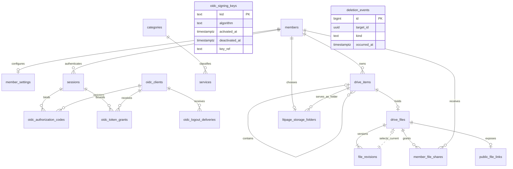

# 08 DB 스키마와 초기 마이그레이션

| 항목 | 값 |
| --- | --- |
| 버전 | v0.2 |
| 일시 | 2026-11-26 (KST) |
| 상태 | 초안, Gemini 검토 대기 |
| 기획 기준선 | develop `2f1db92` |
| 입력 | [07 API v0.4](../07-api/07-api.md) · [OpenAPI 3.1](../07-api/openapi.yaml) · [05 아키텍처 v0.4](../05-architecture.md) · [06 크레이트 구조 v0.4](../06-crate-layout.md) · [ADR 0003](../../decisions/0003-backend-stack.md) · [ADR 0004](../../decisions/0004-auth-idp-litpage.md) · [09 인증 v0.2](../09-auth.md) |
| 초기 마이그레이션 | [0001_init.sql](migrations/0001_init.sql) · PostgreSQL, 문서용 초안 |

07 계약과 1차 Must FR에 필요한 데이터만 둔다. 컬럼·제약·인덱스와 트랜잭션 설계는 **제안**이다. API 자원 ID는 애플리케이션이 할당하는 불투명 UUID를 문자열로 직렬화한다. 시각은 `timestamptz`로 기록하며 만료에 쓰는 달력 설정은 별도로 적용한다. SQL 기본값으로 초기 상태를 정하지 않는다. 아래 표의 `NULL`은 생략 가능을 뜻하며 PK는 암묵적으로 `NOT NULL`이고 PK·UNIQUE의 인덱스는 자동 생성된다. 기획 참조는 모두 위 기준선 기준이다. [FRD](../../01-planning/frd/FRD.md), [BR](../../01-planning/business-rules/BR.md), [NFR](../../01-planning/nfr/NFR.md), [AC](../../01-planning/acceptance-criteria/AC.md), [UF](../../01-planning/user-flow/UF.md), [추적 매트릭스](../../01-planning/traceability/matrix.csv)

## 변경 이력

| 버전 | 일시 | 변경 |
| --- | --- | --- |
| v0.1 | 2026-11-26 (KST) | 1차 DB 설계와 문서용 초기 SQL. |
| v0.2 | 2026-11-26 (KST) | 호배님 21:45 KST B-1 결정 반영. 등록·코드·키 메타데이터·토큰 다이제스트·백채널 전파 기록 추가. |

## 전체 개요

`deletion_events.target_id`는 종류에 따라 회원 또는 드라이브 항목을 가리킨다. 원본 행이 제거된 뒤에도 재적용에 쓰이므로 FK 없이 보존한다.

## 테이블 및 제약

### `members` — Google 계정과 회원 상태

근거 FR-AUTH-001·003·004·005, FR-ADM-001·002, BR-001·002·005·007·017·026, NFR-SEC-002·004, ADR 0004.

| 컬럼 | 타입 | 제약과 의미 |
| --- | --- | --- |
| `id` | uuid | PK |
| `google_subject` | text | NOT NULL, UNIQUE, CHECK 비어 있지 않음. 같은 Google 계정 식별과 재가입에 사용 |
| `google_name` | text | NOT NULL |
| `google_email` | text | NOT NULL, CHECK 비어 있지 않음 |
| `photo_url` | text | NULL 허용. Google 프로필 사진 URI |
| `suspended` | boolean | NOT NULL. 정지 여부 |
| `withdrawn_at` | timestamptz | NULL 허용. 보관 시작 시각. 정지와 독립 |

`members_active_email_idx`는 미탈퇴·비정지 회원의 `lower(google_email)` 완전 일치 조회용이다. `members_withdrawn_at_idx`는 탈퇴 행을 만료 후보로 찾는다. 관리자 여부는 미리 지정한 계정 설정에서 판정한다(BR-017). 지정 방식은 09 [미확인]이다.

### `member_settings` — 계정 설정

근거 FR-SHELL-003, FR-OSS-001, BR-025·026, NFR-I18N-002, NFR-USAB-002, DEC-100·101·110·113.

| 컬럼 | 타입 | 제약과 의미 |
| --- | --- | --- |
| `member_id` | uuid | PK, FK → `members.id`, CASCADE |
| `display_name` | text | NULL 허용, UNIQUE, CHECK 비어 있지 않음. NULL이면 Google 이름 표시 |
| `language` | text | NULL 허용, CHECK `ko` / `en`. NULL은 미설정 |
| `theme` | text | NOT NULL, CHECK `system` / `light` / `dark` |

PK·UNIQUE 인덱스를 쓴다. 표시 이름의 한글·영문·숫자 제한과 가중치 2~20 검사는 응용 계층에서 수행한다. UNIQUE는 탈퇴 보관 중에도 유지하며 보관 종료 시 이름 예약을 해제한다. 계정 언어를 우선하고 미설정 시 기기 언어 규칙을 따른다. 로그인 전 언어 전환의 임시 보관은 [미확인]이다. Litpage에는 나루 언어만 동기화한다. 설정 행이 없는 신규·백업 복원 계정에는 **제안**으로 `system` 테마를 반환한다.

### `sessions` — 나루 로그인 세션

근거 FR-AUTH-001·002·003·004·005, BR-004·005·007, NFR-SEC-001·002·006, DEC-092·094·098·114, ADR 0004.

| 컬럼 | 타입 | 제약과 의미 |
| --- | --- | --- |
| `id` | uuid | PK. 로그인 세션 식별자 |
| `member_id` | uuid | NOT NULL, FK → `members.id`, CASCADE |
| `credential_digest` | bytea | NOT NULL, UNIQUE, CHECK 길이 > 0. 제안된 쿠키 자격 검증용 다이제스트 |
| `login_started_at` | timestamptz | NOT NULL. 갱신 뒤에도 유지되는 절대 만료 기준 |
| `last_activity_at` | timestamptz | NOT NULL, CHECK 로그인 시작 이상 |
| `data_restored` | boolean | NOT NULL. 이번 로그인에서 보관 데이터를 복구했는지 여부 |

`sessions_member_id_idx`는 탈퇴할 때 회원의 세션을 찾아 폐기하는 데 쓴다. 로그아웃은 현재 세션만 폐기한다. 세션 자격 발급·CSRF 계약은 09를 따르며 활동 집계와 화면의 복구 안내 소비 방식은 [미확인]이다. B-1에서 `sessions`는 나루 세션을 관리한다. Litpage RP의 세션은 Litpage에 별도로 둔다.

### `oidc_clients` — 정적 RP 등록

B-1의 1차 운영은 Litpage 한 개를 수동 등록한다. URI 컬럼의 SQL CHECK는 HTTPS 접두사를 검사한다. 나루는 등록 시 유효한 절대 HTTPS URL인지 확인하고, 요청 URI는 등록 값과 문자열로 정확히 대조한다. 1차 등록은 클라이언트마다 목적별 URI 하나를 둔다. 실제 등록 URI와 저장소 위치는 [미확인]이다. [09 §4·5](../09-auth.md)

| 컬럼 | 타입 | 제약과 의미 |
| --- | --- | --- |
| `client_id` | text | PK, 비어 있지 않음 |
| `redirect_uri` | text | NOT NULL, HTTPS 접두사 CHECK. 인가 콜백 |
| `post_logout_redirect_uri` | text | NOT NULL, HTTPS 접두사 CHECK. 로그아웃 뒤 브라우저 복귀 |
| `backchannel_logout_uri` | text | NOT NULL, HTTPS 접두사 CHECK. RP의 서버 간 통지 수신 |
| `grant_types` | text[] | NOT NULL, CHECK로 `authorization_code`, `refresh_token` 순서의 배열만 허용 |
| `token_endpoint_auth_method` | text | NOT NULL, CHECK `client_secret_basic` |
| `client_secret_ref` | text | NOT NULL, 비어 있지 않음. 나루 배포 비밀 저장소의 위치 참조 |

`UNIQUE (client_id, redirect_uri)`를 인가 코드의 등록 대상 FK로 사용한다.

### `oidc_authorization_codes` — 일회용 인가 코드

| 컬럼 | 타입 | 제약과 의미 |
| --- | --- | --- |
| `code_digest` | bytea | PK, CHECK 32바이트 SHA-256 다이제스트 |
| `client_id`, `redirect_uri` | text | 각각 NOT NULL. 복합 FK → `oidc_clients(client_id, redirect_uri)` ON DELETE CASCADE |
| `session_id` | uuid | NOT NULL, FK → `sessions.id` ON DELETE CASCADE |
| `pkce_challenge` | text | NOT NULL, CHECK 43자 base64url 문자 |
| `pkce_method` | text | NOT NULL, CHECK `S256` |
| `nonce` | text | NOT NULL, 비어 있지 않음. ID 토큰에 바인딩 |
| `issued_at` | timestamptz | NOT NULL |
| `expires_at` | timestamptz | NOT NULL, CHECK 발급 시각보다 늦음 |
| `consumed_at` | timestamptz | NULL, 값이 있으면 발급 시각 이상·만료 시각 미만 |

`oidc_authorization_codes_session_idx(session_id)`는 세션 폐기, `oidc_authorization_codes_expiry_idx(expires_at)`는 만료 정리에 쓴다. 코드 소비와 토큰 행 생성은 최신 회원 상태와 연결 세션을 확인한 같은 트랜잭션에서 처리한다. 이미 소비한 코드는 거부한다. 유효기간과 세션 상한은 09의 응용 규칙이다.

### `oidc_signing_keys` — 서명 키 메타데이터

| 컬럼 | 타입 | 제약과 의미 |
| --- | --- | --- |
| `kid` | text | PK, 비어 있지 않음. JWKS와 토큰의 키 ID |
| `algorithm` | text | NOT NULL, CHECK `RS256` |
| `activated_at` | timestamptz | NULL이면 JWKS 사전 게시 단계. 값이 있으면 서명 활성 시각 |
| `deactivated_at` | timestamptz | NULL 가능. 값이 있으면 활성 시각이 존재하며 그 이후여야 함 |
| `key_ref` | text | NOT NULL, 비어 있지 않음. 나루 배포 비밀 저장소의 위치 참조 |

`oidc_signing_keys_one_active_idx(algorithm)`는 활성 시각이 있고 비활성 시각이 없는 키를 알고리즘별 최대 한 개로 제한한다. 정상 회전 시 이전 키를 비활성화하고 새 키를 활성화하는 변경을 한 트랜잭션으로 처리한다. 공개 키 사전 게시·검증 유예·손상 시 배제는 09의 운영 규칙이다. DB는 공개·개인 키 값 없이 메타데이터만 보관한다.

### `oidc_token_grants` — RP 토큰 다이제스트와 회전 상태

| 컬럼 | 타입 | 제약과 의미 |
| --- | --- | --- |
| `refresh_token_digest` | bytea | PK, CHECK 32바이트 SHA-256 다이제스트 |
| `access_token_digest` | bytea | NOT NULL, UNIQUE, CHECK 32바이트 SHA-256 다이제스트. UserInfo용 |
| `family_id` | uuid | NOT NULL. 최초 grant와 회전 후 grant를 같은 계열로 식별 |
| `client_id` | text | NOT NULL, FK → `oidc_clients.client_id` ON DELETE CASCADE |
| `session_id` | uuid | NOT NULL, FK → `sessions.id` ON DELETE CASCADE |
| `issued_at` | timestamptz | NOT NULL |
| `access_expires_at` | timestamptz | NOT NULL, CHECK 발급 시각보다 늦음 |
| `refresh_expires_at` | timestamptz | NOT NULL, CHECK 액세스 토큰 만료 시각 이상 |
| `refresh_used_at` | timestamptz | NULL. 값이 있으면 발급 시각 이상·리프레시 토큰 만료 시각 미만 |
| `revoked_at` | timestamptz | NULL. 값이 있으면 발급 시각 이상 |

`oidc_token_grants_session_idx(session_id)`는 세션 폐기에, `oidc_token_grants_family_idx(client_id, session_id, family_id)`는 재사용 시 계열 폐기에 쓴다. 같은 계열의 회전·재사용 판정을 직렬화한다. 소비 시각을 기록하고 새 두 토큰의 다이제스트와 만료를 원자적으로 저장한다. UserInfo는 폐기된 행과 회전으로 소비된 행을 거부한다. 재사용 감지에 필요한 소비 기록의 보존·정리 기준은 [미확인]이다. 수명과 유휴·절대 상한은 09의 응용 규칙이다.

### `oidc_logout_deliveries` — 현재 기기 백채널 전파

| 컬럼 | 타입 | 제약과 의미 |
| --- | --- | --- |
| `id` | uuid | PK, 통지 식별자 |
| `client_id` | text | NOT NULL, FK → `oidc_clients.client_id` ON DELETE RESTRICT |
| `sid` | uuid | NOT NULL. 폐기한 `sessions.id`와 같은 상관 식별자. 삭제 이후 재전송을 위해 세션 FK를 두지 않음 |
| `created_at` | timestamptz | NOT NULL |
| `next_attempt_at` | timestamptz | NOT NULL, CHECK 생성 시각 이상 |
| `delivered_at` | timestamptz | NULL은 미전달. 완료 시각은 생성 시각 이상 |

`UNIQUE (client_id, sid)`로 같은 RP·기기의 중복 등록을 막는다. `oidc_logout_deliveries_pending_idx(next_attempt_at)`는 미전달 행만 조회한다. 세션 폐기와 통지 행 저장을 같은 트랜잭션에 넣고, OP는 전송 시점에 서명하여 등록 주소로 보낸다. 전달 완료·재시도·만료의 운영 정책은 [미확인]이다. RP 로컬 세션과 수신 중복 방지 기록은 Litpage의 재작성 범위다. [09 §5](../09-auth.md#5-현재-기기-통합-로그아웃)

### `categories` — 서비스 카테고리

근거 FR-HOME-002, FR-SHELL-001, FR-ADM-004, BR-016·023, DEC-115·120.

| 컬럼 | 타입 | 제약과 의미 |
| --- | --- | --- |
| `id` | uuid | PK |
| `name` | text | NOT NULL, CHECK 비어 있지 않음. 입력된 이름 그대로 표시 |

PK 인덱스를 쓴다. 이름 중복·정규화 규칙은 [미확인]이다.

### `services` — 드라이브·오픈소스 목록과 노출

근거 FR-HOME-001·002, FR-SHELL-001, FR-OSS-001, FR-DRV-005, FR-ADM-003·004, BR-013·017·019·023, NFR-OPS-003, DEC-028·104·115·120.

| 컬럼 | 타입 | 제약과 의미 |
| --- | --- | --- |
| `id` | uuid | PK |
| `category_id` | uuid | NOT NULL, FK → `categories.id`, RESTRICT. 서비스당 하나 |
| `name` | text | NOT NULL, CHECK 비어 있지 않음 |
| `kind` | text | NOT NULL, CHECK `drive` / `openSource` |
| `visible` | boolean | NOT NULL. CHECK 드라이브는 노출 상태 |

`services_category_id_idx`는 배정 조회와 삭제 제한 확인에 쓴다. 숨긴 오픈소스는 회원 목록에서 제외하고 진입·사용을 차단한다. 기존 결과 파일은 드라이브에서 계속 조회한다. 앱이 Litpage 서비스 행을 식별하는 초기 설정 방식은 [미확인]이다.

### `drive_items` — 폴더 트리와 휴지통 메타데이터

근거 FR-DRV-001·002·003·004·005, FR-OSS-002·003, BR-006·007·011·018·024, NFR-PERF-002·003, NFR-SEC-004, DEC-096·108·116, DM-003.

| 컬럼 | 타입 | 제약과 의미 |
| --- | --- | --- |
| `id` | uuid | PK |
| `owner_id` | uuid | NOT NULL, FK → `members.id`, RESTRICT |
| `parent_id` | uuid | NULL은 루트 직접 하위. `(owner_id, parent_id)` FK → `drive_items(owner_id, id)` |
| `name` | text | NOT NULL, CHECK 비어 있지 않음 |
| `kind` | text | NOT NULL, CHECK `folder` / `file` |
| `modified_at` | timestamptz | NOT NULL. 항목 변경 시각 |
| `trashed_at` | timestamptz | NULL 또는 휴지통으로 직접 이동한 시각 |
| `trash_original_parent_names` | text[] | NULL 또는 삭제 당시 부모 경로의 폴더 이름 배열. 루트 바로 아래면 빈 배열 |

복합 UNIQUE `(owner_id, id)`, `(id, kind)`는 FK 대상이다. CHECK로 자기 자신을 부모로 두는 경우를 막고 휴지통 시각과 경로 스냅숏을 함께 기록한다. `drive_items_owner_parent_idx`는 자식 조회용이다. 활성 형제 이름은 루트의 `drive_items_live_root_name_uq`와 하위의 `drive_items_live_sibling_name_uq`로 지킨다. `drive_items_trashed_at_idx`는 휴지통 만료 후보용이다.

부모가 유효한 동일 소유자 폴더인지, 간접 순환이 없는지, 이동·복원 경합에서 부모와 조상 상태가 유효한지는 응용 트랜잭션에서 확인한다. **제안**으로 휴지통에 넣은 폴더의 하위에는 조상 상태를 적용한다. 하위 항목을 별도로 휴지통에 넣은 기록이 이미 있으면 그 시각을 유지한다. 상위 폴더가 먼저 영구 삭제될 때에는 독립 보관 중인 하위의 메타를 분리해 원래 위치 스냅숏을 보존한다. 원래 위치 소멸·이름 충돌 때 복원 위치와 화면 경로 표기는 [미확인]이다.

### `drive_files` — 파일의 현재 버전

근거 FR-DRV-001·003·005·006·007, FR-OSS-003, BR-009·014·019, NFR-PERF-002, DEC-112.

| 컬럼 | 타입 | 제약과 의미 |
| --- | --- | --- |
| `item_id` | uuid | PK. 파일 항목 ID |
| `item_kind` | text | NOT NULL, CHECK `file`. `(item_id, item_kind)` FK → `drive_items(id, kind)`, CASCADE |
| `current_revision_id` | uuid | NOT NULL. `(item_id, current_revision_id)` FK → `file_revisions(file_id, id)`, 커밋 시까지 검사 지연 가능 |
| `is_litpage_document` | boolean | NOT NULL. Litpage 결과물 여부 |

PK 인덱스를 쓴다. 파일 항목·파일 행·첫 버전을 한 트랜잭션에 저장하며 응용 계층에서 파일 항목당 파일 행 하나를 유지한다. 현재 버전 제약은 타 파일 버전 참조를 막는다. Litpage `resultId` 대응·재시도 식별·패키징은 자동 저장 경계에서 확정한다(GAP-025 [미확인]).

### `file_revisions` — 파일 객체·버전·대표 썸네일

근거 FR-DRV-003·005·006·008, FR-OSS-003, BR-009·012·024, NFR-PERF-002·003, DEC-090·107·112.

| 컬럼 | 타입 | 제약과 의미 |
| --- | --- | --- |
| `id` | uuid | PK. API에는 불투명 버전 값으로 반환 |
| `file_id` | uuid | NOT NULL, FK → `drive_files.item_id`, CASCADE |
| `size_bytes` | bigint | NOT NULL, CHECK 0 이상. 확정한 바이트 수 |
| `file_type` | text | NULL 허용. 파일 형식 메타데이터 |
| `object_key` | text | NOT NULL, UNIQUE, CHECK 비어 있지 않음. 저장소 원본 키 |
| `storage_state` | text | NOT NULL, CHECK `ready` / `deleting`. 확정 객체와 제거 중인 객체 상태 |
| `thumbnail_object_key` | text | NULL 허용, UNIQUE, CHECK 비어 있지 않음. 해당 버전의 대표 썸네일 키 |
| `created_at` | timestamptz | NOT NULL. 버전 확정 시각 |

복합 UNIQUE `(file_id, id)`는 현재 버전 FK의 대상이다. `file_revisions_file_created_idx`는 파일별 최신 버전 탐색·정리용이다(`created_at DESC, id`). 현재 버전의 원본과 썸네일은 항상 같은 버전을 가리킨다. 파일 행을 잠근 뒤 요청의 기준 버전과 현재 버전을 비교한다. 일치하면 새 버전을 확정한다. 충돌 시 원본 폴더에 `이름 (충돌 사본)`을 새 파일로 저장한다. 두 번째 충돌 사본의 명명 및 사본 소유권은 [미확인]이다.

### `litpage_storage_folders` — Litpage 저장 폴더 설정

근거 FR-OSS-001·002·003, BR-011·019, NFR-I18N-002(진입 시 언어 동기화), DEC-026·032·063·100.

| 컬럼 | 타입 | 제약과 의미 |
| --- | --- | --- |
| `member_id` | uuid | PK, FK → `members.id`, CASCADE |
| `folder_id` | uuid | NOT NULL. `(member_id, folder_id)` FK → `drive_items(owner_id, id)`, CASCADE |

PK 인덱스를 쓴다. 유효한 소유 폴더인지 응용 계층에서 확인한다. 지정 또는 변경 이후 저장할 결과물에 새 폴더를 적용한다. 폴더가 휴지통에 있는 동안에는 쓰기를 차단하고 진입 응답에서 폴더 재지정을 요구하는 것을 **제안**한다. 영구 삭제 시 FK가 설정을 제거한다.

### `member_file_shares` — 파일의 회원 공유

근거 FR-DRV-006, BR-007·009·014·022·026, NFR-SEC-003·004, DEC-099·109·111·114.

| 컬럼 | 타입 | 제약과 의미 |
| --- | --- | --- |
| `file_id` | uuid | PK 구성, NOT NULL, FK → `drive_files.item_id`, CASCADE |
| `recipient_id` | uuid | PK 구성, NOT NULL, FK → `members.id`, CASCADE |
| `permission` | text | NOT NULL, CHECK `view` / `edit` |
| `download_allowed` | boolean | NULL 허용. CHECK `view`이면 필수, `edit`이면 NULL |

복합 PK `(file_id, recipient_id)`와 받은 공유 조회·회수용 `member_file_shares_recipient_file_idx`를 쓴다. 응용 계층에서 소유자 자기 공유를 거부하고 대상이 활동 회원인지 확인한다. 탈퇴자가 받은 공유는 탈퇴 트랜잭션에서 제거한다.

### `public_file_links` — 파일에 한정된 공개 링크

근거 FR-DRV-004·007, BR-006·007·008·014·022, NFR-SEC-003·004, DEC-095·111·117, DM-005.

| 컬럼 | 타입 | 제약과 의미 |
| --- | --- | --- |
| `file_id` | uuid | PK, FK → `drive_files.item_id`, CASCADE. 파일당 링크 하나 |
| `key_digest` | bytea | NOT NULL, UNIQUE, CHECK 길이 > 0. 제안된 링크 조회용 다이제스트 |
| `key_ciphertext` | bytea | NOT NULL, CHECK 길이 > 0. 소유자가 주소를 다시 조회할 때 복원할 암호화 값 |
| `download_allowed` | boolean | NOT NULL. 소유자가 설정한 값 |

링크 조회는 UNIQUE 인덱스를 쓴다. **제안**으로 행의 존재가 켜짐을 뜻한다. 끌 때 행을 제거하고 다시 켤 때 새 키를 발행한다. 휴지통 이동으로 차단할 때에는 링크 행을 유지해 복원 후 기존 주소로 접근할 수 있게 한다. 요청마다 파일·버전·조상·소유 회원 상태를 검사한다. 유효 다운로드 권한은 저장된 설정과 탈퇴 보관 상태를 함께 적용하며 링크 키 보호 방식은 구현 설계에서 확인한다 [미확인].

### `deletion_events` — 백업 복원 시 삭제 재적용

근거 FR-AUTH-003·004, FR-DRV-004, BR-006·007, NFR-OPS-001, DEC-083·091·096.

| 컬럼 | 타입 | 제약과 의미 |
| --- | --- | --- |
| `id` | bigint | PK, GENERATED ALWAYS AS IDENTITY. 내부 재적용 식별자 |
| `target_id` | uuid | NOT NULL. 회원 ID 또는 휴지통 항목 ID |
| `kind` | text | NOT NULL, CHECK `account_withdrawn` / `account_restored` / `account_purged` / `trash_purged` |
| `occurred_at` | timestamptz | NOT NULL. 상태 전이가 확정된 시각 |

`deletion_events_target_id_idx`로 같은 대상의 이벤트를 찾고, `deletion_events_terminal_target_uq`로 같은 대상·종류의 최종 삭제 확정을 한 번만 기록한다. 복원 시 탈퇴와 보관 중 재가입 순서를 반영할 수 있도록 탈퇴 및 복구 이벤트를 해당 상태 변경과 같은 트랜잭션에서 기록한다.

## 보존·삭제 규칙

| 대상 | 보존 및 삭제 |
| --- | --- |
| 휴지통·탈퇴 보관 | 달력 날짜 30일(DEC-096). 시간대, 경계 시각, 시작일 산입은 Q-085 [미확인]이다. 탈퇴 보관 중에도 휴지통 시계는 계속 간다. 휴지통에서는 해당 항목과 하위의 공유·링크를 차단하며 복원 후 현재 권한을 재판정한다. |
| 탈퇴·재가입 | 탈퇴 시 나루 세션을 폐기하고 받은 공유를 즉시 회수한다. 보관 중 소유 공유·링크는 화면 보기만 허용하며 편집·다운로드는 차단한다. 같은 Google 계정이 30일 안에 돌아오면 보관 데이터와 소유 공유·링크를 복구하고 받은 공유는 복구 대상에서 제외한다. DEC-114에 따라 정지를 유지하며 세션은 거부한다. 관리자의 정지 해제 뒤에는 복구 데이터를 이용할 수 있다. 보관 기간이 끝나면 회원 데이터·파일과 연결된 공유·링크를 삭제한다. 보관 만료 이후 정지 식별자를 어떤 근거와 기간으로 보유할지는 [미확인]이다. |
| 로그·감사 기록 | 운영 로그는 30일(DEC-044, NFR-OPS-002). 관리자 정지·해제와 오픈소스 숨김·노출 동작은 감사 기록 대상이다(DEC-104, NFR-OPS-003). 감사 항목·보관 기간·로그 30일과 감사 기록의 법적 적정성은 Q-081·Q-091 [미확인]이다. 감사 저장 경계와 컬럼 정의는 Q-091 확인 뒤 설계한다. |
| 백업·복원 | 회원 정보와 드라이브 파일만 매일 백업하고 백업본은 30일 후 자동 만료한다(DEC-091). 드라이브 파일의 트리·버전 참조 메타와 객체를 복구할 수 있어야 한다. 공유·링크·계정 및 저장 폴더 설정은 백업 범위에서 제외한다. 복원 시 이미 처리된 탈퇴·휴지통 삭제를 재적용한다(DEC-083). |
| 나루 세션 | 유휴 7일 또는 로그인 시작 후 절대 30일 중 먼저 도달하면 만료한다(DEC-092, NFR-SEC-006). 기기별 현재 세션만 로그아웃한다(DEC-094). 정지 시 재로그인·토큰 갱신·Litpage 진입에서 PostgreSQL의 최신 회원 상태를 읽고 차단한다. 정지만으로 열린 세션을 즉시 종료하지 않는다(DEC-098). |
| 파일 버전 | 최근 10개를 30일 보관한다(DEC-112). **제안**으로 현재 버전은 파일이 존재하는 동안 유지하고, 지난 버전은 최신 10개 범위와 30일을 함께 적용한다. 선별된 이전 버전은 `deleting`으로 표시한 후 객체를 제거하고 메타데이터를 정리한다. 현재 버전 포함 여부와 30일 시작점은 [미확인]이다. |

**제안**으로 최종 삭제는 잡이 대상 잠금 아래 최신 만료 및 복구 상태를 확인하고 `deletion_events`에 확정한 뒤 진행한다. 상태가 확정된 대상과 해당 하위의 접근·복구를 차단하고 객체 키를 참조하는 메타데이터로 삭제를 재시도한다. 객체 제거를 확인한 뒤 해당 행을 정리한다. 계정의 표시 이름 예약은 보관 종료 시 해제한다. 동일 대상에 대한 반복 처리에서 이미 삭제된 객체는 완료로 취급한다. 백업 복원 과정에서 재적용할 기록은 데이터 스냅숏의 복원으로 덮어쓰지 않으며 복원 가능한 백업의 기간을 포함하도록 유지한다. 재적용 순서와 스냅숏 기준점, 외부 보관 위치, 복원 중 접근 차단과 실행 주체는 후속 운영 설계에서 확인한다 [미확인]. [05 §7](../05-architecture.md), [결정 로그](../../01-planning/02-decision-log/decision-log.md), [열린 질문](../../01-planning/02-decision-log/open-questions.md)

## 파일 저장과 목록 노출

- 서버는 실제 수신한 바이트를 기준으로 파일당 1~1,073,741,824바이트를 단일 요청으로 받는다. 0바이트는 거부하고(DEC-107), 폴더 업로드의 1 GiB 초과 파일은 그 파일만 제외하고 알린다(DEC-106). 끊기면 처음부터 다시 올린다. 분할·이어 올리기와 청크·파트 테이블은 범위에서 제외한다(DEC-090). 파일 메타의 `size_bytes` 범위와 업로드의 요청별 바이트 검사는 별도다. Litpage 자동 저장의 용량 경계는 GAP-025 [미확인]이다.
- 업로드의 기존 파일·폴더 이름 충돌은 첫 빈 번호 `(1)`, `(2)` 등을 붙인다(DEC-108). 응용 계층에서 대상 부모 아래 이름 할당을 조정하고, 동시 요청에서 이름 UNIQUE 충돌 시 다음 후보를 재검사한다. 폴더를 직접 생성·변경·이동할 때의 충돌은 07의 오류 규칙을 따른다.
- 저장소 쓰기와 메타데이터 커밋이 모두 완료된 `ready` 파일만 노출한다. 쓰는 중인 임시 객체와 DB 커밋에 실패한 객체의 정리는 저장소·잡 포트에 맡긴다. 썸네일은 준비된 경우 같은 버전의 객체 키로 읽으며, 교체·삭제된 원본의 늦은 썸네일을 현재 목록에 발행하지 않는다. DB에는 저장소 독립적인 객체 키·상태를 두며 저장소 구현·잡 러너와 부분 실패 정리 방식은 별도 ADR 대기다. [05 §6.1·§7](../05-architecture.md), [06 §5](../06-crate-layout.md)

## 07 API v0.4 응답과 데이터 출처

JSON 본문의 필드별 출처와 파일·문서 본문, 응답 헤더의 생성 위치를 함께 적는다. 접근이 허용된 행을 먼저 판정하고 목록·메타데이터를 반환한다. [OpenAPI 3.1](../07-api/openapi.yaml)

| 응답 스키마 또는 계약 | 필드 | 출처 또는 도출 방식 |
| --- | --- | --- |
| `Session` | `isAdmin`, `dataRestored` | 미리 지정된 관리자 설정과 현재 회원 매칭, `sessions.data_restored` |
| `Profile` | `googleName`, `googleEmail`, `photoUrl` | `members.google_name`, `google_email`, `photo_url` |
| `Profile` | `displayName`, `effectiveDisplayName`, `language`, `theme` | `member_settings.display_name`, 미설정 시 `members.google_name`으로 대체한 이름, `member_settings.language`, `theme`. 설정 행이 없으면 언어는 null, 테마는 제안 기본 `system` |
| OP Discovery·JWKS | RP 발급자 메타데이터와 공개 JWK | 배포 issuer·경로 설정, `oidc_clients`의 지원 계약, `oidc_signing_keys`와 키 공개 정책 |
| OP authorize·token·UserInfo | 일회용 코드, 토큰, 토큰 주체 | `oidc_authorization_codes`, `oidc_token_grants`, `sessions`와 최신 회원 상태. `sub`는 `members.id` |
| OP end_session·Litpage 백채널 | 현재 기기 폐기 및 전달 결과 | `sessions`의 현재 행 폐기와 `oidc_logout_deliveries`. RP 세션 및 소켓 폐기는 Litpage가 처리 |
| `Profile` | `driveUsageBytes` | **제안**으로 소유한 활성 파일의 현재 `file_revisions.size_bytes` 합계. 빈 집합은 0. 휴지통·이전 버전의 사용량 산입은 [미확인] |
| `Category` | `id`, `name` | `categories.id`, `name` |
| `Service` | `id`, `name`, `kind`, `categoryId` | `services.id`, `name`, `kind`, `category_id`. 일반 서비스 목록에는 노출된 행을 적용 |
| `LitpageEntry` | `state`, 준비 상태의 `language` | 유효한 저장 폴더 설정 존재 여부로 `storageFolderRequired` / `ready` 분기. 언어는 `member_settings.language` 우선, 미설정 시 나루 화면에서 해석한 언어 |
| `StorageFolder` | `folderId`, `suggestedFolderName` | `litpage_storage_folders.folder_id`의 유효값 또는 null, Litpage의 `services.name` |
| `DriveItem` | `id`, `parentId`, `name`, `kind`, `modifiedAt` | `drive_items.id`, `parent_id`, `name`, `kind`, `modified_at` |
| `DriveItem` | `sizeBytes`, `fileType`, `isLitpageDocument`, `isShared` | 현재 버전의 `size_bytes`, `file_type`과 `drive_files.is_litpage_document`. 폴더 크기는 [미확인]으로 null 제안, 형식은 null, Litpage 문서 여부는 false. 받은 공유 목록은 조회자 공유 행, 소유 목록은 파일의 회원 공유 또는 활성 링크 존재로 `isShared` 도출을 제안하며 소유 목록의 공유 표시 범위는 [미확인] |
| `DriveItemPage`, `Breadcrumb` | `breadcrumbs[].id`, `breadcrumbs[].name` | 현재 조회 폴더에서 같은 소유자의 `parent_id`를 루트까지 재귀 탐색하고 역순으로 `drive_items.id`, `name`을 투영한다. 현재 폴더 포함. 루트 및 받은 공유 목록은 빈 배열 |
| `FolderUploadResult` | `folder`, `skipped[].relativePath`, `skipped[].code` | 저장된 폴더의 `DriveItem`. 제외 경로는 요청 manifest, 코드는 실제 바이트 검사 결과 `FILE_TOO_LARGE` / `EMPTY_FILE` |
| `TrashItem` | `id`, `name`, `kind`, `sizeBytes` | `drive_items.id`, `name`, `kind`, 현재 `file_revisions.size_bytes`. 폴더 크기는 [미확인]으로 null 제안 |
| `TrashItem` | `remainingCalendarDays`, `originalFolderPath` | `trashed_at`과 현재 달력 날짜에서 30일 기준으로 0 이상을 계산(Q-085 [미확인]). `trash_original_parent_names`를 표시 경로로 조립하며 구분자와 루트 표시명은 [미확인] |
| `ShareRecipient`, `MemberShare`, `MemberShareSettings` | `id`, `displayName`, `recipient`, `settings.permission`, `settings.downloadAllowed` | `members.id`, 설정 표시 이름 또는 Google 이름으로 `recipient` 구성. `member_file_shares.permission`, `download_allowed`를 저장된 설정으로 반환하며 `edit`이면 다운로드 필드 생략 |
| `EditResult` | `outcome`, `itemId`, `revision` | 기준 버전 비교로 `saved` / `conflictCopySaved` 결정. 저장된 원본 또는 사본의 `drive_files.item_id`와 새 `file_revisions.id` |
| `LinkSettings` | `enabled`, 켜진 경우 `url`, `downloadAllowed` | `public_file_links` 행 존재 여부. 저장된 암호화 키를 복원해 URL을 구성하고 소유자가 설정한 `download_allowed`를 반환 |
| `PublicLink` | `name`, `sizeBytes`, `downloadAllowed` | 공개 키로 찾은 파일의 `drive_items.name`과 현재 `file_revisions.size_bytes`. 열 수 있는 링크의 `public_file_links.download_allowed`에 탈퇴 보관 중 다운로드 금지를 적용 |
| `AdminMember` | `id`, `displayName`, `email`, `suspended` | `members.id`, 설정 표시 이름 또는 `members.google_name`, `google_email`, `suspended` |
| `AdminOpenSource` | `id`, `name`, `visible` | `services.kind = 'openSource'`인 행의 `id`, `name`, `visible` |
| 모든 `*Page` | `items`, `nextCursor` | 해당 목록 쿼리 결과를 각 응답 형식으로 투영한다. 다음 커서는 동률을 구분할 정렬 키·ID에서 도출하며 마지막은 null. 페이지 크기는 07의 제안값(기본 50, 최대 100)을 따른다. 커서 포맷·정렬 기준·유효기간과 페이지 크기의 실측 적정성은 [미확인] |
| 파일 응답 `Binary` | 원본·편집 바이트, 화면용 데이터, 썸네일 | 원본·편집 바이트는 현재 버전 `object_key`에서 읽는다. 화면용 표현은 같은 버전의 원본에서 도출하며 형식·생성 방식은 [미확인]이다. 원본 제공이 금지된 접근에서는 화면용 콘텐츠만 전송한다. 썸네일은 `thumbnail_object_key`로 읽고 준비되지 않으면 07의 204 응답 적용 |
| 공개 문서 `Text`, 로그인 HTML | HTML 본문 | 법적 문서는 문서 종류와 언어로 공개 콘텐츠를 골라 제공한다. 콘텐츠 위치·언어 협상은 [미확인]. 로그인 정지 안내는 `members.suspended` 확인 후 응용 응답에서 렌더링 |
| `Error`, `X-Request-Id` | `code`, `message`, `requestId` | 응용 결과를 HTTP 공개 오류 계약으로 변환. 본문과 헤더는 같은 요청 상관 ID를 사용 |
| HTTP 헤더 | `X-File-Revision`, `Content-Disposition` | 읽은 현재 `file_revisions.id`, 권한 확인 후 `drive_items.name`으로 첨부 파일명 구성 |
| HTTP 헤더 | `Location`, `Set-Cookie`, `X-CSRF-Token`, `Cache-Control` | 로그인 제공자·요청 흐름 및 승인된 복귀 경로로 이동 주소 구성. 쿠키는 세션 발급·폐기 결과, CSRF는 09 계약에 따라 HTTP 인증 계층에서 생성, 캐시 지시는 07의 응답별 규칙 적용 |
| 본문 없는 응답 | `204` | 해당 변경·폐기·저장 처리의 응용 결과 또는 미준비 썸네일. 응답 스키마 필드 없음 |

## 버전 관리와 시드

- ADR 0003과 06을 따라 PostgreSQL 스키마 이력을 `sqlx migrate`로 관리한다. `0001_init.sql`은 순방향 초기 스키마의 문서용 초안이다. 확정·적용 이후에는 기존 파일을 고쳐 기록을 바꾸는 대신 번호를 올린 마이그레이션을 추가한다. 파괴적 스키마 변경 및 데이터 삭제를 포함한 마이그레이션은 승인 대상이다.
- 기존 Java/Flyway 및 Keycloak·회원 DB의 데이터 이전은 없다. CO-03의 보관 위치는 Google Cloud Console이다. [ADR 0004](../../decisions/0004-auth-idp-litpage.md), [CO-03](../../01-planning/carry-over/README.md)
- BR-023·DEC-034·040에서 초기 카테고리는 문서·저장소, 서비스 배정은 Litpage → 문서, 나루 드라이브 → 저장소로 정했다. 이 초기 데이터의 주입 시점, 식별자 관리와 Litpage 초기 노출값은 [미확인]이다. 초안 SQL에는 시드 INSERT가 없다. 관리자 지정은 계정 설정 경계에서 별도로 다룬다.

## 남은 확인 사항

| 항목 | 확인할 내용 |
| --- | --- |
| RB-017 [미확인] | CO-02 프록시 경로 및 본문 한도와 1 GiB 단일 업로드의 양립 여부 |
| GAP-016 [미확인] | 보안 기본선과 09의 쿠키·CSRF 최종 규칙 |
| GAP-018 [미확인] | 지원 브라우저의 최신 기준과 iOS 타 브라우저 취급 |
| GAP-025 [미확인] | Litpage 자동 저장 호출·지연·재시도·실패 정의·1 GiB 적용, resultId 대응 및 무손실 패키징 |
| Q-081 [미확인] | 정식 배포 전 사업자·운영자 표시 의무 |
| Q-085 [미확인] | 보관 30일의 시간대·경계 시각·시작일 산입 |
| Q-087 [미확인] | 토큰 갱신 주기와 정지 회원 세션 차단까지 최대 시간 |
| Q-091 [미확인] | 감사 기록 항목·보관 기간, 일반 로그 30일 및 감사 기록의 법적 적정성 |
| Q-092 [미확인] | 전체 저장 용량 운영 경보 기준·수신 대상·전달 방법 |
| DM-002·004·006·007·009·010·011 [미확인] | 07에서 보류한 디자인 대응 사항 |
| 09·별도 ADR [미확인] | B-1 RP 등록·키 배포·토큰 정리·Litpage 세션과 로그아웃 통지 운영 및 실측, 객체 저장소·잡 러너, 감사 저장 및 복원 절차 |
| 응답 표현·초기화 [미확인] | 화면용 콘텐츠 형식, 휴지통 경로 및 복원 정책, 폴더 크기·사용량·공유 표시 범위, 커서 세부 규칙, 시드 주입 방식 |
| 실제 PostgreSQL 적용 [미확인] | 마이그레이션과 제약·질의 동작 시험 |

[04 기술 NFR](../04-NFR-technical.md), [결정 로그](../../01-planning/02-decision-log/decision-log.md), [열린 질문](../../01-planning/02-decision-log/open-questions.md)
