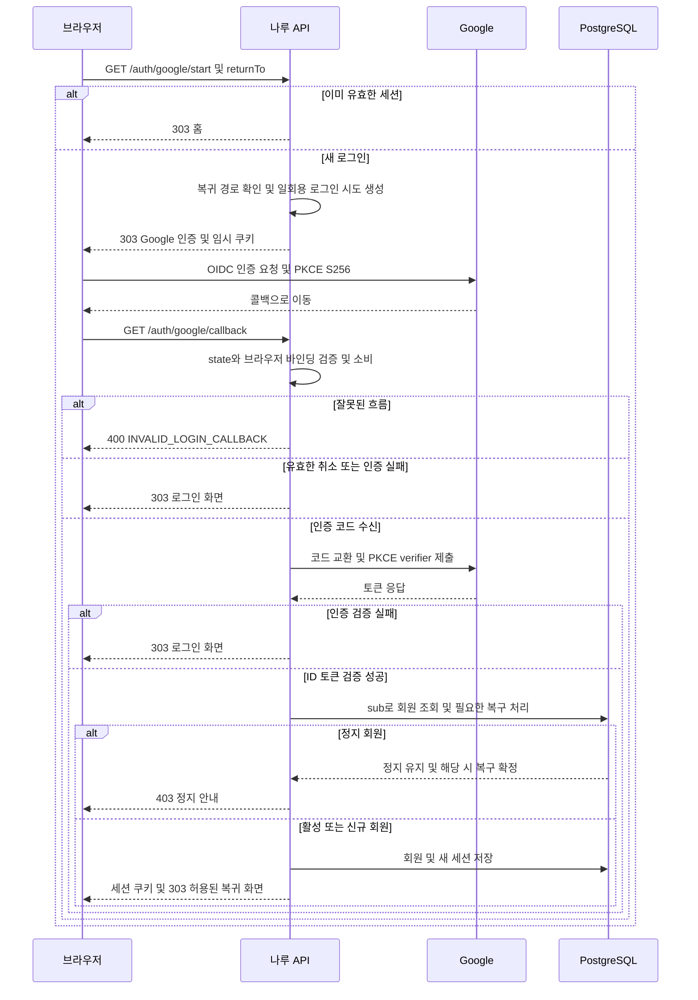
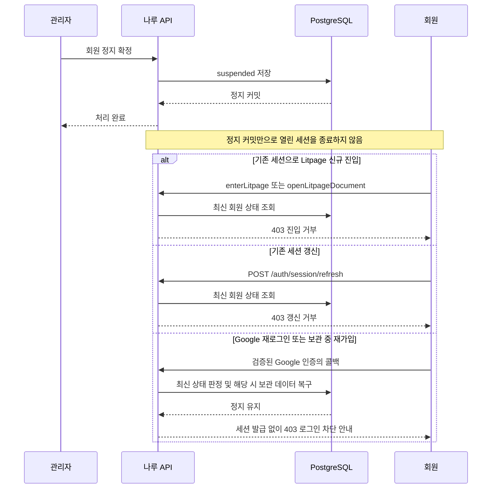
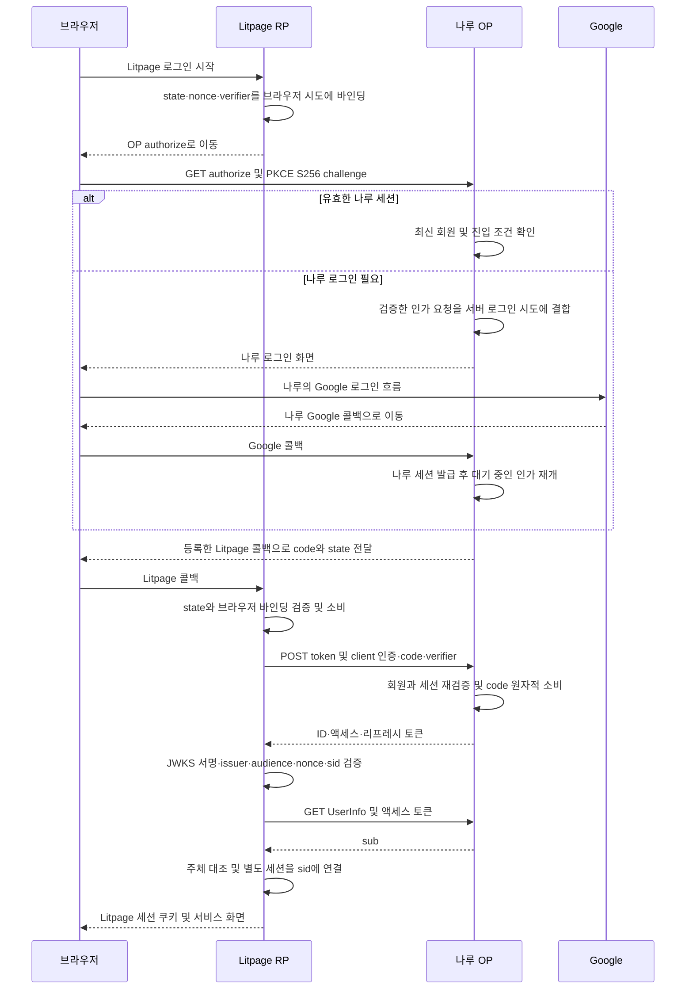
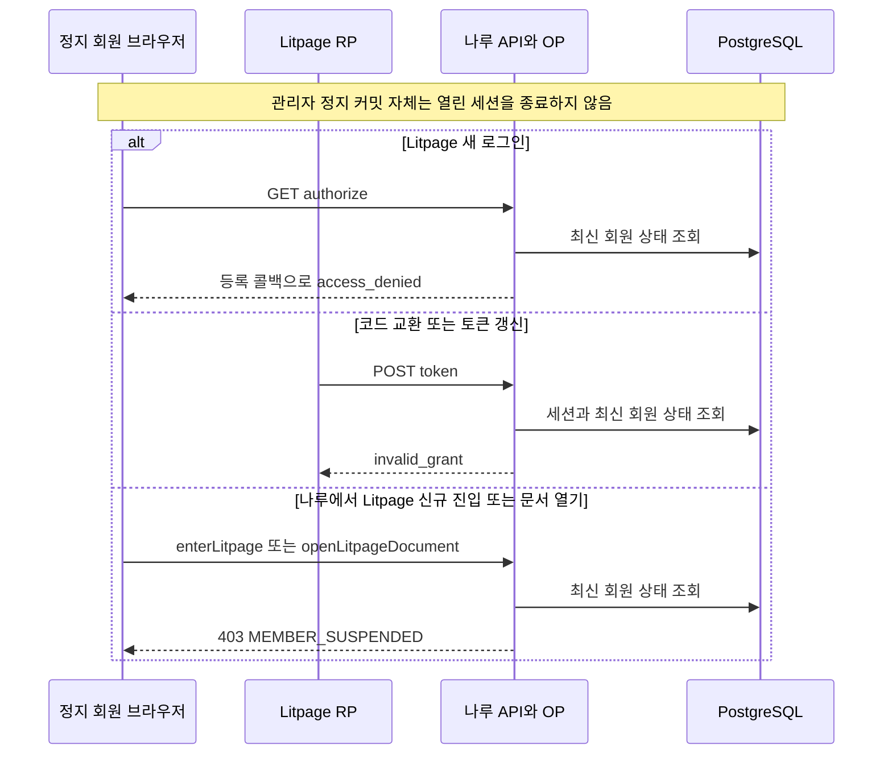
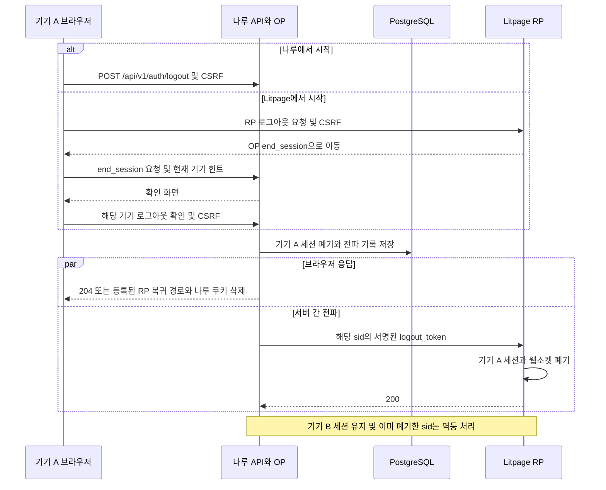
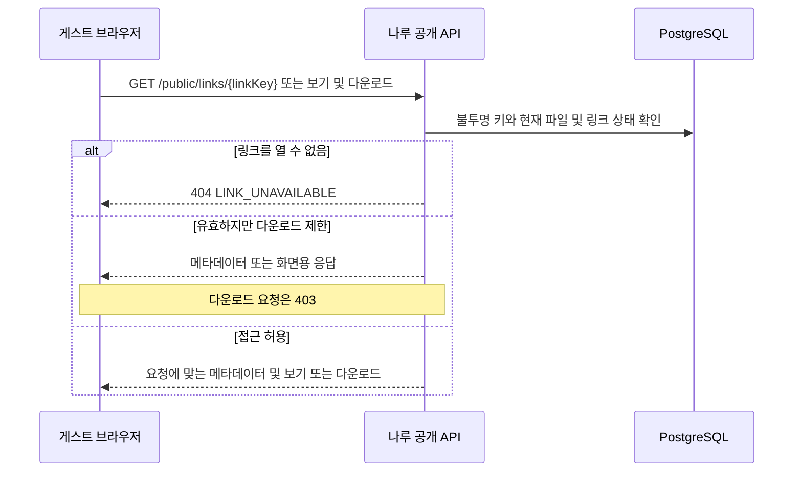
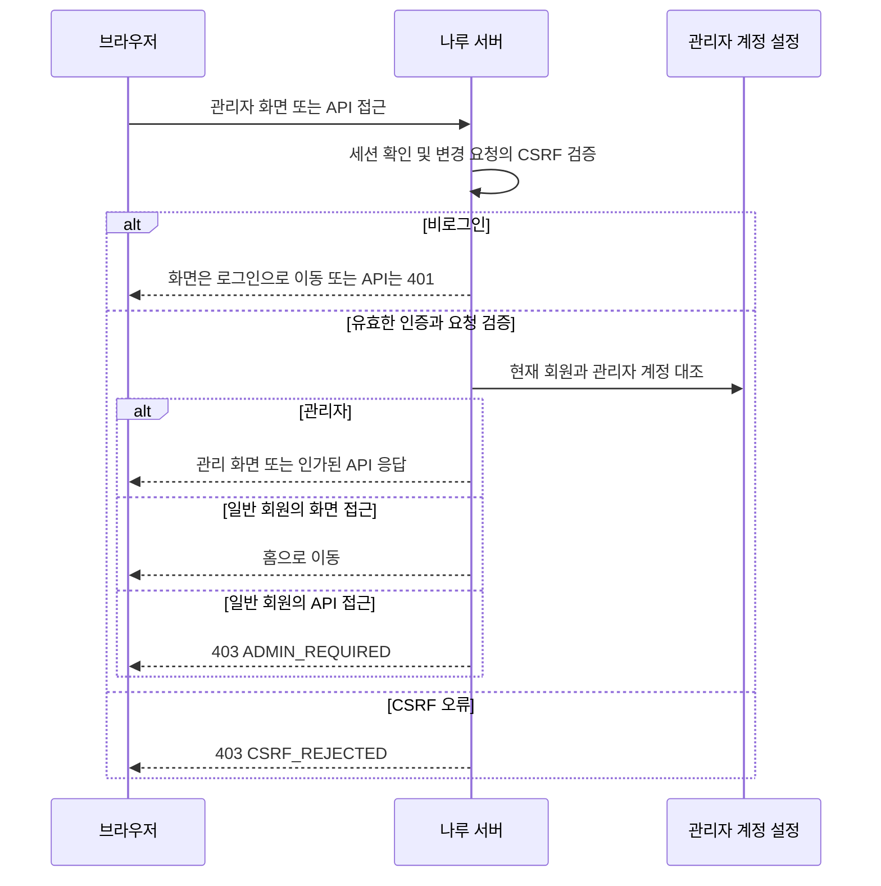

# 09 인증·세션·Litpage 연동 상세 설계

| 항목 | 값 |
| --- | --- |
| 버전 | v0.2 |
| 일시 | 2026-11-26 (KST) |
| 상태 | 초안, Gemini 검토 대기 |
| 기획 기준선 | develop `2f1db92` |
| 설계 입력 | [ADR 0004](../decisions/0004-auth-idp-litpage.md), [04 기술 NFR](04-NFR-technical.md), [05 아키텍처 v0.4](05-architecture.md), [06 크레이트 구조 v0.4](06-crate-layout.md), [07 API v0.4](07-api/07-api.md), [OpenAPI](07-api/openapi.yaml), [08 DB v0.2](08-db/08-db-schema.md), [문서용·미실행 SQL](08-db/migrations/0001_init.sql) |

설계서 23장의 `09-auth-security.md` 정의에 대응하는 산출물은 `09-auth.md`다. 인증 방식, 소셜 로그인 설정 이월, 권한 모델과 세션 정책을 다룬다.

기획 인용은 모두 `2f1db92`를 기준으로 한다. ADR 0004는 호배님이 2026-11-19 15:07 KST에 승인했다. 나루 axum 백엔드가 Google에 직접 연결하는 로그인 B를 적용한다. Keycloak과 전용 DB는 제거하며 기존 Keycloak·회원 DB 데이터는 이전 대상에서 제외한다. Litpage의 인증 연결은 새로 작성한다. 문서와 표는 사용자 지정 드라이브 폴더에 Markdown·CSV로 저장하고 무손실 재열기를 검증한다. 패키징 방식은 [미확인]이다. [ADR 0004](../decisions/0004-auth-idp-litpage.md), [FRD](../01-planning/frd/FRD.md), [추적 매트릭스](../01-planning/traceability/matrix.csv)

## 변경 이력

| 버전 | 일시 | 변경 |
| --- | --- | --- |
| v0.1 | 2026-11-26 (KST) | 인증·세션 설계 초안. |
| v0.2 | 2026-11-26 (KST) | 호배님 21:45 KST 결정으로 SSO B-1 채택, B-2 기각. OP/RP 계약과 현재 기기 로그아웃, 07·08 정합 반영. |

## 1. Google 로그인과 CO-03

### 프로토콜과 이월 범위

- Google만 지원한다. axum이 OIDC Authorization Code 흐름의 기밀 클라이언트이며 브라우저는 Google 인증과 콜백 이동을 담당한다. 서버 간 코드 교환에 클라이언트 인증과 **PKCE `S256`**을 함께 사용한다. 클라이언트 인증은 서버의 신원을 증명하고, PKCE는 각 브라우저 로그인 트랜잭션에 코드를 묶어 코드 주입·오용을 완화한다. RFC 9700 §2.1.1은 기밀 클라이언트에도 PKCE를 권고하며 Google의 Discovery 메타데이터에 `S256`이 명시되어 있다. 엔드포인트와 검증 키는 Google 공식 Discovery를 기준으로 삼는다. Rust 라이브러리 선정 및 대상 OAuth 클라이언트의 실제 교환 동작은 [미확인]이다. [Google OIDC](https://developers.google.com/identity/openid-connect/openid-connect), [Google Discovery](https://accounts.google.com/.well-known/openid-configuration), [RFC 9700 §2.1.1](https://www.rfc-editor.org/rfc/rfc9700.html#section-2.1.1)
- CO-03의 Google OAuth 클라이언트 ID·시크릿 보관 위치는 **Google Cloud Console**이다. 배포 시 백엔드의 기밀 클라이언트 설정에 사용한다. 기존 클라이언트 재사용·재발급, 접근 권한자, 교체 절차 및 redirect URI 재사용·신규 등록 필요 여부는 [미확인]이다. 새 콜백 경로는 **제안** `/api/v1/auth/google/callback`이다. `/api/v1`은 07의 제안 접두사다. Google 요청의 redirect URI는 신뢰하는 배포 HTTPS 오리진과 콜백 경로로 구성하고 등록 값과 정확히 일치시킨다. 배포 오리진 및 실제 등록 상태는 [미확인]이다. [DEC-082](../01-planning/02-decision-log/decision-log.md), [CO-03](../01-planning/carry-over/README.md), [NFR-SEC-005](../01-planning/nfr/NFR.md), [Google OIDC 인증 요청](https://developers.google.com/identity/openid-connect/openid-connect#sendauthrequest)

### 브라우저와 서버 흐름

1. 보호 화면에 비로그인 상태로 접근하면 로그인 화면으로 보낸다. 링크 보기 화면에서는 사용자가 로그인을 선택할 수 있다. `startGoogleLogin`은 유효 세션이 있으면 홈으로 보낸다(DEC-119). 비로그인 요청의 `returnTo`는 정규화한 뒤 서버의 화면 경로 허용 목록과 대조해 로그인 시도에 묶는다(DEC-118). 보호된 화면과 링크 보기 화면을 허용 대상으로 삼고 경로별 필요한 쿼리만 보존한다. 단일 `/`로 시작하는 루트 상대 경로를 신뢰하는 오리진에서 파싱한다. 절대 URL, `//`, 역슬래시, 제어 문자, 인코딩을 해석하면 경로 의미가 바뀌는 입력, 로그인·콜백·API 등 화면 허용 목록 밖의 경로는 버린다. 복귀 시 같은 정규형으로 검사하고 기본 목적지는 홈이다. 실제 화면 라우트 목록은 [미확인]이다.
2. 서버는 시도마다 임의의 `state`, `nonce`, PKCE verifier를 만든다. **제안**으로 로그인 시작 시각·복귀 경로와 함께 유효기간이 짧은 서버 측 일회용 기록에 두고, 별도 host-only `Secure; HttpOnly; SameSite=Lax` 임시 쿠키의 브라우저 바인딩과 연계한다. 콜백에서 일치 여부를 확인한 뒤 성공과 취소 모두 기록을 원자적으로 소비한다. 유효기간·기록 저장소·멀티 인스턴스 공유 방식은 [미확인]이다. 콜백은 브라우저 최상위 GET을 사용한다.
3. `completeGoogleLogin`은 브라우저 바인딩과 `state`를 먼저 검증한다. 누락·만료·재사용 또는 잘못된 파라미터 조합은 `400 INVALID_LOGIN_CALLBACK`이다. 유효한 흐름에서 취소·인증 실패는 `303`으로 로그인 화면에 복귀한다. 성공이면 서버에서 code를 교환하고 ID 토큰의 서명, issuer, audience, 만료, `nonce` 및 해당하는 경우 `azp`를 검증한다. `openid email profile`을 요청한다. 설계 제안으로 검증된 이메일과 필수 회원 프로필을 확인한 뒤 처리한다. 회원 식별에는 `sub`를 `members.google_subject`로 사용한다. 이메일이나 표시 이름은 회원 연결 키로 쓰지 않는다. 교환 결과의 Google 토큰과 콜백 파라미터 원문은 앱 세션, 브라우저 응답, 로그에 남기지 않는다.
4. 회원 상태·복구·세션 발급은 일관된 트랜잭션 경계에서 판단한다. 활성 회원과 신규 회원(관리자 승인 없이 즉시 가입)은 새 세션을 발급받고 `303`으로 복귀한다. 보관 기간 안에 같은 Google 계정으로 재가입하면 데이터를 복구하고, 로그인에 성공한 경우 `sessions.data_restored`로 홈의 안내를 연결한다. 이미 회수된 받은 공유는 복구 대상에서 제외한다. 보관 종료 후에는 08의 삭제·신규 가입 규칙을 따른다. 정지 상태라면 복구가 필요한 경우 해당 복구를 먼저 확정하고 정지 상태를 유지한다(DEC-114). 세션 발급 없이 `403 MEMBER_SUSPENDED`를 반환한다. 브라우저 콜백은 HTML 안내(WF-10)로 제공할 수 있고, 안내의 나가기 목적지는 로그인 화면이다. 인증 응답은 `Cache-Control: no-store`를 사용하며 콜백 화면의 참조자 전송을 제한한다.

[DEC-098·114·118·119](../01-planning/02-decision-log/decision-log.md), [FR-AUTH-001·003~006](../01-planning/frd/FRD.md), [BR-001~005·007](../01-planning/business-rules/BR.md), [AC-FR-AUTH-001·004·005](../01-planning/acceptance-criteria/AC.md), [UF-01·04·05](../01-planning/user-flow/UF.md), [Google OIDC](https://developers.google.com/identity/openid-connect/openid-connect)

## 2. 나루 세션 쿠키와 CSRF

### 쿠키 계약

| 항목 | 09 확정값과 이유 |
| --- | --- |
| 이름·값 | `naru_session`. CSPRNG로 생성한 256비트 불투명 자격을 URL-safe 형식으로 인코딩한다. PostgreSQL에는 SHA-256 다이제스트만 `sessions.credential_digest`에 저장한다. |
| 전송·읽기 | `Secure`, `HttpOnly`, `SameSite=Lax`. HTTPS와 스크립트 직접 읽기 방지를 적용한다. Google에서 돌아오는 최상위 GET과 일반 링크 이동을 지원하고 교차 사이트 쓰기에 대해서는 CSRF 검증을 추가한다. |
| 경로·호스트 | `Path=/`, `Domain` 생략(host-only). 나루 호스트의 화면·API와 OP 경로에 적용한다. Litpage는 별도 RP 세션으로 인증한다. 배포 호스트명과 서비스별 오리진 배치는 [미확인]이다. |
| 브라우저 수명 | `Max-Age`는 발급 시점에서 절대 만료까지 남은 초를 내림한 값이다. `Expires`는 생략한다. 절대 만료 이후에는 발급하지 않는다. 서버는 쿠키가 남아 있어도 유휴 7일 또는 절대 30일에 세션을 거부한다. 갱신은 절대 만료를 연장하지 않는다. 삭제 시 같은 이름·경로·host-only 범위에 `Max-Age=0`을 보낸다. |

PV-022·023은 04의 설계 제안값으로 인용한다. 위 쿠키 규칙은 09의 계약이며, GAP-016의 기획 기본 보안선과 04의 TLS·HSTS·남용 제한 시험 조건은 04를 따른다. [04 §4.9](04-NFR-technical.md#49-기본-보안선-검증-pv-022pv-023-gap-016), [NFR-SEC-006](../01-planning/nfr/NFR.md)

### CSRF 계약

- 세션 자격을 새로 발급할 때 CSRF 값도 생성된다. 같은 오리진의 `GET /auth/session` 성공 응답에 `X-CSRF-Token` 헤더와 `Cache-Control: no-store`를 보낸다. 브라우저는 헤더 값을 메모리에 보관하고 필요한 요청의 같은 이름 헤더에 넣는다. URL·쿠키·브라우저 영속 저장소·로그에는 넣지 않는다. 외부 오리진에 자격 포함 CORS 접근이나 이 헤더의 읽기를 허용하지 않는다.
- 서버 전용 CSRF 키로 용도가 고정된 라벨과 현재 쿠키 자격을 입력해 HMAC-SHA-256 값을 만들고 URL-safe 형식으로 인코딩한다. 요청에서 세션 쿠키를 먼저 검증하고 같은 방식으로 산출한 값과 헤더 값을 상수 시간으로 비교한다. DB에는 세션 자격 다이제스트만 둔다. CSRF 값·별도 CSRF 컬럼 없이 조회와 검증을 모두 할 수 있다. 키는 기존 Google OAuth 설정과 분리한다. 키 보관·배포·교체 절차는 [미확인]이다.
- 로그인마다 새 자격을 발급한다. 성공한 갱신은 같은 세션 행에서 쿠키 자격 다이제스트를 원자적으로 교체하고 새 쿠키·새 `X-CSRF-Token`을 `204` 응답에 보낸다. 이전 자격 및 CSRF 값은 무효다. 클라이언트는 갱신을 직렬화하고 다른 탭에서 회전한 경우 세션 조회로 최신 값을 읽는다. 실패한 변경 요청은 안전한 재시도가 보장되는 경우에만 재전송한다. 로그아웃은 현재 세션을 폐기해 값을 무효화하며 새 값은 발급하지 않는다.
- 필수 범위는 07 OpenAPI에서 `sessionCookie`와 `csrfHeader`가 같은 보안 요구 객체에 선언된 모든 작업이다. 갱신, 유효 세션의 로그아웃, 프로필·탈퇴·드라이브·공유·관리 변경, `enterLitpage`와 `openLitpageDocument`를 포함한다. 유효 세션 없이 호출한 로그아웃은 추가 상태 변경 없이 완료한다. 세션 조회와 공개 읽기는 CSRF 헤더가 필요 없다. 로그인 콜백은 자체 `state`와 브라우저 바인딩을 검증한다. 헤더가 없거나 현재 자격과 불일치하면 인증된 변경을 거부한다(`403 CSRF_REJECTED`).

[07 인증·세션·CSRF](07-api/07-api.md#인증세션csrf), [07 OpenAPI `csrfHeader`](07-api/openapi.yaml), [08 `sessions`](08-db/08-db-schema.md#sessions--나루-로그인-세션)

## 3. 세션 수명·갱신·회원 정지

- 서버 시각이 `min(last_activity_at + 7일, login_started_at + 30일)`에 도달하면 만료한다. 세션 기간은 **설계 기준**으로 UTC 기준 경과 시간으로 계산한다. `login_started_at`은 Google 흐름을 시작한 서버 시각으로 고정하고 `last_activity_at`은 세션 발급 시각에서 시작한다. 탈퇴 보관·휴지통 달력 날짜의 Q-085는 [미확인]이다. 만료 검사와 활동 시각 저장은 동시 요청에도 만료한 행을 되살리지 않도록 적용한다.
- **활동 집계 제안.** 사용자 화면 조작에 따른 인증·인가 성공 요청(화면 데이터 조회, 변경, Litpage 작업)을 집계한다. 정적 리소스, 비인증·실패 요청, 백그라운드 폴링·keepalive, 자동 세션 조회·갱신은 유휴 시계를 연장하지 않는다. 서버가 집계할 경로와 자동 저장의 활동 귀속 기준은 [미확인]이다. 클라이언트 임의 헤더만으로 유휴 시간을 늘리지 않는다.
- `POST /auth/session/refresh`(`refreshSession`, outline)는 세션·CSRF와 만료 경계를 확인한 뒤 PostgreSQL의 최신 `members.suspended`, `withdrawn_at`을 확인한다. 정지 변경과 자격 교체를 직렬화해 정지 저장 확정 뒤 예전 회원 상태로 갱신할 수 없게 한다. 성공 시 동일한 세션 ID와 절대 만료 기준을 유지하면서 §2대로 자격을 회전한다. 이 갱신은 나루 세션용이다. 만료 시 `401 SESSION_EXPIRED`, 정지 시 `403 MEMBER_SUSPENDED`를 반환한다. **제안**으로 정지 때문에 갱신이 거부되면 검증을 마친 현재 세션을 폐기하고 §5의 세션별 전파를 등록한다. 정지를 저장하는 행위 자체는 열린 세션을 즉시 종료시키지 않는다.
- **Q-087 [미확인].** 갱신 정책은 열린 세션에서 일정 주기로 서버 판정을 강제하는 후보를 검토한다. 브라우저 타이머에만 기대면 백그라운드 탭·비활성 기기·직접 요청에서 주기를 보장하기 어려우므로 서버가 강제할 경계와 주기를 함께 확정해야 한다. PV-017의 액세스 토큰 수명 5분 이하 또는 백채널 로그아웃은 로그아웃 전파를 위한 설계 후보 수치다. B-1은 짧은 액세스 토큰과 세션별 백채널 통지를 함께 제안한다(§4·§5). PV-017은 Q-087의 주기나 기존 세션 차단 상한을 결정하지 않는다.

[DEC-092·098·114](../01-planning/02-decision-log/decision-log.md), [NFR-SEC-002·006](../01-planning/nfr/NFR.md), [Q-087](../01-planning/02-decision-log/open-questions.md), [05 §6.4](05-architecture.md), [06 §5](06-crate-layout.md), [04 PV-017·018·029](04-NFR-technical.md)

## 4. Litpage SSO

**『결정: B-1(2026-11-26 21:45 KST 호배님)』.** 나루 axum이 얇은 OIDC 제공자(OP), Litpage가 기밀 RP로 동작한다. 나루와 Litpage는 각자 세션을 발급한다. Google 로그인 B와 Litpage 인증 연결 재작성은 ADR 0004의 승인 사항이다. 아래 프로토콜과 수명은 1차 설계 제안이다. [ADR 0004](../decisions/0004-auth-idp-litpage.md)

### 4.1 OP와 RP의 최소 계약

- Authorization Code와 PKCE `S256`만 지원한다. authorize는 GET·폼 POST를 받고 등록한 Litpage의 `openid` 인가 범위에 한정한다. RP는 서버에 일회용 브라우저 바인딩·`state`·`nonce`·verifier를 보관한다. OP는 등록한 HTTPS redirect URI와 문자 단위로 일치하고 `openid` 범위인 요청을 받는다. 코드 교환에서는 `client_secret_basic`으로 클라이언트를 인증하고 코드에 바인딩된 client, redirect URI, verifier를 확인한다. 코드 유효성 검사·소비와 토큰 발급은 하나의 트랜잭션에서 처리한다. 실패한 브라우저 요청은 등록 URI가 확인된 경우에만 OAuth 오류를 복귀시킨다.
- issuer는 나루 인증 오리진의 HTTPS 루트(경로 없음), Discovery는 `/.well-known/openid-configuration`로 제안한다. authorize·token·JWKS·UserInfo·end_session의 주소는 Discovery에서 제공한다. 실제 배포 호스트는 [미확인]이다. 1차 등록은 Litpage 한 개를 운영자가 수동 등록한다. 동적 클라이언트 등록은 1차 범위 밖이다. RP 클라이언트 시크릿은 나루 OP와 Litpage RP의 배포 비밀 저장소에만 둔다. 08에는 나루 쪽 위치 참조만 둔다.
- `id_token`은 비대칭 `RS256`으로 서명한다. OIDC Discovery의 필수 지원 알고리즘이며 RP는 JWKS 공개 키로 검증할 수 있다. RP는 설정된 issuer와 Discovery의 일치, 허용 알고리즘, `kid`, 서명, `iss`, `aud`, `exp`, `iat`, `nonce`, 필요한 경우 `azp`, 그리고 `sid`를 확인한다. Litpage 계정은 검증된 `(iss, sub)`로 연결한다. `sub`는 나루 회원의 불변 ID이고 `sid`는 현재 나루 세션 ID를 담은 로그아웃 상관 식별자이며 접근 자격이 아니다. Google 식별자와 나루 쿠키 자격은 RP에 전달하지 않는다.
- UserInfo는 GET·POST를 지원하고 헤더의 Bearer 자격을 받는다. 액세스 토큰의 1차 사용처이며 로그인과 갱신 과정에서 RP가 토큰에 연결된 주체를 확인하는 데 쓴다. `sub`만 돌려준다. 최초 로그인에서 RP는 이를 검증한 ID 토큰의 `sub`와 일치시킨다. OP는 서버 측 다이제스트로 불투명 토큰을 대조하고 클라이언트·용도·만료·현재 나루 세션과 최신 회원 상태를 확인한다. 나루 앱 API와 Litpage 공개 API·MCP는 이 토큰의 사용처에 포함되지 않는다.
- 활성 키와 정상 회전으로 비활성화한 이전 키의 공개 JWK를 함께 게시한다. 정기 회전과 손상 의심을 회전 계기로 삼는다. 정상 회전 시 새 공개 키를 먼저 게시하고 RP의 JWKS 캐시가 갱신될 여유를 둔다. 마지막 서명 토큰의 유효기간에 검증 시계 오차와 JWKS 캐시 여유를 더한 뒤 이전 공개 키를 내린다. 손상 의심 키는 검증에서 즉시 제외하도록 RP 캐시 무효화와 자격 폐기를 연계한다. 개인 키는 나루 OP의 배포 비밀 저장소에 두며, 08에는 `kid`·알고리즘·활성/비활성 시각·위치 참조만 둔다. 주기·캐시·비상 교체 절차는 [미확인]이다.

[OIDC Core](https://openid.net/specs/openid-connect-core-1_0.html), [OIDC Discovery §3·4](https://openid.net/specs/openid-connect-discovery-1_0.html), [RFC 7636](https://www.rfc-editor.org/rfc/rfc7636.html), [07 API v0.4](07-api/07-api.md), [08 DB v0.2](08-db/08-db-schema.md)

### 4.2 수명과 정지 차단

| 자격 | 1차 수명 제안 |
| --- | --- |
| 인가 코드 | 발급 후 최대 60초. 일회용이며 client·redirect URI·PKCE·나루 세션에 바인딩한다. |
| `id_token` | 발급 후 최대 5분. 최초 RP 로그인에서만 발급한다. |
| 액세스 토큰 | 발급 후 최대 5분(PV-017 제안값). UserInfo 전용이며 RP 사용 가능 기간도 해당 발급 만료를 넘기지 않는다. |
| 리프레시 토큰 | 발급 후 최대 24시간. RP 서버에만 두고 소비 시 원자적으로 회전한다. 사용된 토큰의 재제출은 같은 토큰 계열을 폐기한다. |

모든 발급에서 현재 나루 세션의 **유휴 7일과 로그인 시작 후 절대 30일 중 빠른 만료**로 상한을 다시 계산한다. 신규 인가·코드 교환·갱신은 원본 세션이 만료·폐기되면 거부한다. 자동 토큰 갱신은 나루 세션 활동을 연장하지 않는다. RP는 기간을 갱신하기 전 서버에서 OP 판정을 받아야 하고, 거부되거나 만료까지 판정을 받지 못하면 보호 접근과 장기 연결을 막는다. 갱신 성공 응답에는 새 액세스·리프레시 토큰을 반환한다. RP는 UserInfo와 기존 세션 주체를 대조한다.

- **재로그인·진입.** Google 콜백(§1), OP authorize, `enterLitpage`와 `openLitpageDocument`에서 최신 회원 상태를 확인한다. 나루 진입 API는 세션·CSRF·서비스 노출·저장 폴더 및 해당 문서 권한을 검사한다. 저장 폴더 미설정이면 `storageFolderRequired`, 성공이면 `ready`와 언어를 반환한다. RP의 새 로그인은 OP authorize를 거치며 보호 진입과 문서 열기에서 기존 RP 쿠키만으로 정지 검사를 우회할 수 없게 한다. Litpage 쪽 진입 컨텍스트·문서와 언어 전달 방식은 [미확인]이다.
- **토큰 판정.** OP token은 코드 교환과 갱신 모두에서 발급 직전 최신 정지·탈퇴 상태를 확인해 정지 회원에게 `invalid_grant`를 반환한다. 인가 단계의 정지는 등록된 콜백으로 `access_denied`를 반환한다. UserInfo도 정지 회원의 토큰을 `401 invalid_token`으로 거부한다. 토큰 발급 및 폐기와 회원 상태 갱신은 오래된 상태로 자격을 발급하지 않도록 직렬화한다.
- **열린 세션.** 정지 처리 자체는 열린 나루·Litpage 세션을 즉시 종료하지 않으며 백채널 통지를 보내지 않는다. 이미 발급된 RP 세션에는 다음 서버 판정이나 현재 사용 가능 기간 만료까지 접근이 남을 수 있다. 짧은 토큰은 재판정 경계를 제공하고, 실제 로그아웃은 §5에서 별도로 전파한다. RP 갱신 주기·장기 연결 경계·정지 후 열린 세션 차단 상한 **Q-087 [미확인]**이다. 보관 기간 내 재가입은 데이터를 복구하되 정지를 유지하고 세션 발급을 거부한다(DEC-114).

[DEC-092·098·114](../01-planning/02-decision-log/decision-log.md), [FR-AUTH-004·005](../01-planning/frd/FRD.md), [NFR-SEC-002·006](../01-planning/nfr/NFR.md), [04 PV-017·018](04-NFR-technical.md)

Google 복귀 시 원래 인가 요청은 검증한 서버 측 시도에서 복구한다. 일반 로그인 화면 경로의 `returnTo` 허용 범위와 이미 로그인한 사용자의 홈 이동 규칙은 §1을 따른다. Litpage 진입 전 저장 폴더 선택과 문서별 인가는 기존 07의 흐름을 따른다.

### 4.3 Litpage 재작성 범위와 기각안

- `oidc.ts`의 Keycloak 전용 URL·역할 검사·이메일 기반 계정 연결·브라우저 ID 토큰 쿠키·MCP Bearer를 인증 연결에서 제거한다. 새 RP 로그인·콜백·로그아웃·백채널 수신을 작성한다. 기존 Keycloak OIDC 코드를 재사용하지 않는다. MCP 인증 대체 계약은 [미확인]이며 Keycloak Bearer를 새 인증의 우회 경로로 허용하지 않는다.
- `auth.ts`의 고정 7일 SQLite 인증 연결은 새 RP의 수명 판정·독립 host-only 보안 쿠키·HTTP 및 웹소켓 가드로 교체한다. `db.ts`의 Keycloak `sub` 매핑과 기존 인증 세션 연결을 새 `(iss, sub)` 매핑과 `(iss, client_id, sid)` 기준 세션 폐기 계약으로 교체한다. SQLite 콘텐츠 `records`, 나루 상단 바, 비밀번호 로그인 비활성화는 유지한다. 실제 종단 동작은 [미확인]이다. [Litpage NARU.md](../../services/litpage/NARU.md), [oidc.ts](../../services/litpage/apps/server/src/oidc.ts), [auth.ts](../../services/litpage/apps/server/src/auth.ts), [db.ts](../../services/litpage/apps/server/src/db.ts)

| 대안 | 판단과 이유 |
| --- | --- |
| B-1 나루 OP와 Litpage RP | **채택.** 표준 RP 연동을 활용하고 OIDC 기반 후속 오픈소스 연동으로 확장할 수 있다. OP 발급·키 운영과 RP별 로그아웃 검증이 필요하다. |
| B-2 공유 세션 또는 내부 토큰 | **기각.** 호배님이 2026-11-26 21:45 KST에 B-1을 선택했다. 공유 세션은 동일 오리진 배치와 사용자 콘텐츠 격리 부담이 있다. 내부 토큰은 별도 신뢰 경계와 표준 OIDC RP용 어댑터가 필요하다. |

[ADR 0004](../decisions/0004-auth-idp-litpage.md)

## 5. 현재 기기 통합 로그아웃

**1차 설계 제안.** OP → RP에는 **Back-Channel Logout**을 사용한다. 브라우저 쿠키나 탭 상태와 무관하게 Litpage 서버가 현재 `sid`의 세션과 웹소켓을 폐기할 수 있다. RP → OP에는 **RP-Initiated Logout**을 함께 적용한다. Litpage에서 시작해도 같은 기기의 나루 세션까지 종료하기 위해서다. 프런트채널 전파는 1차 범위 밖이다. [OIDC Back-Channel Logout](https://openid.net/specs/openid-connect-backchannel-1_0.html), [OIDC RP-Initiated Logout](https://openid.net/specs/openid-connect-rpinitiated-1_0.html)

- **나루 시작.** `POST /auth/logout`에서 유효 세션·CSRF를 확인하고 현재 세션만 삭제한다. 그 세션의 코드·토큰 자격 폐기와 백채널 통지 기록을 같은 DB 트랜잭션으로 처리한다. 나루는 쿠키를 지우고 `204`로 응답한다. 이미 로그아웃했으면 추가 상태 변경 없이 `204`로 완료한다.
- **Litpage 시작.** RP가 현재 세션과 CSRF를 검증하고 브라우저를 OP `end_session_endpoint`로 보낸다. 제안 프로필은 `client_id`, 현재 RP 세션의 `sid`를 담은 비자격 `logout_hint`, 등록한 `post_logout_redirect_uri` 및 일회용 `state`를 사용한다. OP는 등록 URI를 정확히 대조하고 현재 나루 쿠키의 세션이 해당 `sid`와 일치하는 경우에만 사용자 확인과 동일 오리진 CSRF 검증 후 폐기한다. 요청 수신용 GET·POST는 확인 화면으로 이어지며, 교차 사이트 POST는 등록 검증을 마친 비자격 매개변수로 같은 OP의 최상위 GET에 연결한다. 브라우저 인가·로그아웃 응답에는 `no-store`와 `no-referrer`를 적용하고 code·state·logout_hint는 로그에서 제외한다. 이미 나루 세션이 없거나 힌트가 다른 세션을 가리키면 다른 세션에 영향을 주지 않고 검증된 복귀 경로로 돌아간다. RP는 `state`를 확인하고 원래 RP 세션에 한해 로컬 로그아웃을 완료한다. 사용자가 확인을 취소하면 OP에서 폐기 없이 안내하고, 로그아웃 완료 콜백으로 보내지 않는다.
- **전파와 장애.** OP는 정적 등록한 RP 수신 주소로 RS256 서명 `logout_token`을 폼 POST한다. 한 RP인 1차에는 현재 나루 세션을 폐기할 때 등록된 Litpage에 통지를 남기며, 대응하는 RP 세션이 없어도 수신은 성공한다. RP는 서명·알고리즘·`iss`·`aud`·`iat`·`exp`·`jti`·로그아웃 `events`·`sid`·`nonce` 부재를 검증한다. 해당 `sid`에 묶인 로컬 세션과 소켓만 종료하고 이미 종료된 경우에도 성공한다. RP가 저장하는 사용 가능 기간은 토큰 요청을 시작한 시각에 `expires_in`을 더한 시각을 상한으로 삼아 응답 지연만큼 기간이 늘지 않게 한다. 통지와 지연된 콜백·갱신 응답이 경합하면 폐기 기록이 이겨 새 세션이 열리지 않게 한다. RP는 중복 `jti`와 폐기한 `sid`를 재처리·경합 방지 기간 동안 기억한다. 전파 실패를 재시도하고 그동안 기존 RP 접근이 남을 수 있다. 나루 세션 폐기로 새 코드 교환·갱신은 실패한다. 짧은 토큰은 실패 시 접근 기간을 제한하는 보조 수단이며, 초 단위 로그아웃 목표는 백채널 통지로 검증한다. 재시도·재전송 감지·폐기 기록 보존 경계 및 실측값은 [미확인]이다.
- 다른 기기의 `sid`는 유지한다. 백채널은 브라우저 쿠키를 직접 지울 수 없으므로 Litpage는 다음 요청에서 무효 자격을 거부하고 쿠키를 지운다. [DEC-094](../01-planning/02-decision-log/decision-log.md), [FR-AUTH-002](../01-planning/frd/FRD.md), [NFR-SEC-001](../01-planning/nfr/NFR.md)

## 6. 게스트 링크와 권한 모델

`GET /public/links/{linkKey}` 및 `/view`·`/download`는 공개 경로다. 세션 쿠키를 요구하지 않는다. 서버는 불투명 키의 다이제스트와 현재 링크·파일·버전·조상·소유 회원 상태를 요청마다 대조한다. 꺼짐·휴지통·삭제·탈퇴 데이터 삭제는 동일한 `404 LINK_UNAVAILABLE`과 공개 안내를 반환한다(DEC-117). 다운로드 금지 또는 탈퇴 보관 중에는 보기만 허용하며 원본 파일을 보내지 않는다. 공개 다운로드 요청에서 권한이 없으면 07의 `403`을 적용한다. 링크 키 원문은 로그에서 제외한다. 링크 보기에서 로그인하면 DEC-118의 검증된 복귀 경로를 사용한다. [FR-DRV-007](../01-planning/frd/FRD.md), [BR-007·008·022](../01-planning/business-rules/BR.md), [UF-04](../01-planning/user-flow/UF.md), [07 PublicLinks](07-api/openapi.yaml), [08 `public_file_links`](08-db/08-db-schema.md#public_file_links--파일에-한정된-공개-링크)

| 주체 | 권한 | 07·08 및 기획의 근거 |
| --- | --- | --- |
| 회원 | 유효한 나루 세션으로 회원 기능을 이용한다. 자신의 파일 및 별도로 인가받은 공유에 접근한다. | `sessionCookie`, `members`·`sessions`, FR-AUTH-001, BR-003 |
| 비회원 | 공개 링크 대상 파일만 볼 수 있다. 허용 상태의 링크로만 다운로드할 수 있다. | PublicLinks, `public_file_links`, FR-DRV-007, BR-008·022 |
| 관리자 | 같은 세션에 서버가 미리 지정한 관리자 계정 일치 여부를 검사해 관리 작업을 허용한다. | `Session.isAdmin`, `members`, FR-ADM-001~004, BR-017 |
| 공유 수신자 | 회원의 파일 단위 권한. `view`에는 다운로드 허용 여부가 적용되고 `edit`는 내용 편집을 허용한다. 08에서 `edit`에는 별도 다운로드 허용 필드를 두지 않는다. 탈퇴 보관 중에는 보기만 가능하다. | 회원 공유 계약, `member_file_shares`, FR-DRV-006, BR-007·014·022 |

[FRD](../01-planning/frd/FRD.md), [BR](../01-planning/business-rules/BR.md), [AC](../01-planning/acceptance-criteria/AC.md), [07 API](07-api/07-api.md), [08 DB](08-db/08-db-schema.md)

## 7. 관리자 접근

서버는 현재 회원을 미리 지정된 관리자 계정 설정과 맞춰 `GET /auth/session`의 `isAdmin`을 계산한다. 같은 판정을 모든 관리자 API에서 수행한다. 관리자 여부의 식별자 형식과 저장 위치(설정 파일 또는 DB)는 [미확인]이다. 화면에서는 관리자에게만 관리 메뉴를 노출한다. 일반 회원의 관리자 화면 직접 접근은 홈으로 이동시키고, 관리자 API는 `403 ADMIN_REQUIRED`로 거부한다. 미인증 API 요청에는 `401`을 반환한다. 변경 요청은 CSRF 검증도 적용한다. 정지·해제와 오픈소스 숨김·노출에는 기획의 감사 기록 요구를 적용한다. 항목·보관 기간은 Q-091 [미확인]이다. [BR-017](../01-planning/business-rules/BR.md), [FR-ADM-001~004](../01-planning/frd/FRD.md), [UF-06](../01-planning/user-flow/UF.md), [07 Admin](07-api/openapi.yaml), [08 `members`](08-db/08-db-schema.md#members--google-계정과-회원-상태)

## 8. 07·08 정합과 페이지 크기

| 07 경로 | operationId | 09 계약 |
| --- | --- | --- |
| `GET /auth/google/start` | `startGoogleLogin` | 공개 시작. 유효 세션이면 홈으로 이동. |
| `GET /auth/google/callback` | `completeGoogleLogin` | 공개 콜백. 로그인 시도 검증과 세션 발급, 정지 안내. |
| `GET /auth/session` | `getSession` | `sessionCookie`. 응답 헤더에 `X-CSRF-Token`, 본문에 `isAdmin`·`dataRestored`. |
| `POST /auth/session/refresh` | `refreshSession` (outline) | `sessionCookie`와 `csrfHeader`. 성공 시 `204` 및 새 쿠키·CSRF 헤더. |
| `POST /auth/logout` | `logoutCurrentDevice` | 유효 세션이면 두 보안 스킴을 함께 적용. 이미 로그아웃했으면 상태 변경 없이 `204`. |

07의 목록 응답은 커서 제안(`items`·`nextCursor`)을 유지한다. 기획 DEC-121과 04에서 페이지 크기 수치는 확인되지 않았다. **제안**으로 07 공통 `limit`의 기본값은 **50**, 최댓값은 **100**이다. 목록에서 다음 요청 횟수를 줄이고 응답당 조회·직렬화 작업량은 제한한다. 범위 `1~100`을 벗어나거나 정수가 아니면 `400 INVALID_REQUEST`로 처리한다. 정렬 기준·커서 유효기간과 실측 적정성은 [미확인]이다. [DEC-121](../01-planning/02-decision-log/decision-log.md), [04 기술 NFR](04-NFR-technical.md), [07 목록과 페이지네이션](07-api/07-api.md#목록과-페이지네이션)

- **07 v0.4**에 B-1의 OP 경로와 Litpage RP 백채널 수신 계약을 추가했다. 쿠키·CSRF, 갱신 헤더와 `limit` 스키마를 유지한다. 기존 Auth 경로·operationId와 두 보안 스킴 이름을 유지한다. [07 변경 이력](07-api/07-api.md#변경-이력)
- **08 v0.2**에 `oidc_clients`, `oidc_authorization_codes`, `oidc_signing_keys`, `oidc_token_grants`, `oidc_logout_deliveries`를 추가했다. `members.google_subject`는 회원 식별, `suspended`·`withdrawn_at`은 상태 판정에 대응한다. `sessions.credential_digest`는 쿠키 검증, `login_started_at`·`last_activity_at`은 만료 판정, `data_restored`는 이번 로그인 복구 안내에 쓰인다. 08의 CSRF 설계 이관 항목은 §2로 연결한다. 다이제스트와 서버의 CSRF 키를 이용하는 계약이라 별도 컬럼이 필요 없다. [08 스키마](08-db/08-db-schema.md), [0001_init.sql](08-db/migrations/0001_init.sql)

## 9. PV-017 / PV-018 시험 방법

환경은 실제와 같은 쿠키·TLS·프록시 구성을 갖춘 스테이징이다. 같은 회원으로 분리된 두 브라우저 프로필 또는 두 기기에 나루·Litpage 세션을 연다. 다른 계정으로 관리자 작업을 한다. 요청 ID와 내부 시각을 연결하되 쿠키·인증 헤더·인가 코드·토큰·링크 키 원문은 수집하지 않는다. 요청 시작·응답 완료는 클라이언트 단조 시계로, 서버 커밋·검증 시각은 서버 계측으로 기록한다. 서로 다른 시계의 값은 공통 기준이 검증된 경우에만 빼서 지연을 계산한다. 브라우저 자동화·부하·계측 도구와 버전, 폴링 해상도 및 실측값은 [미확인]이다. [04 §4.4·§4.9, PV-017·018·028·029](04-NFR-technical.md), [AC-NFR-SEC-001·002·006](../01-planning/acceptance-criteria/AC.md)

| 시험 | 절차와 측정 | 04 판정 기준 |
| --- | --- | --- |
| PV-017 현재 기기 로그아웃 | 나루 및 Litpage에서 시작하는 경로를 각각 시험한다. 현재 `sid`의 백채널 통지·재시도·중복 수신과 이전 콜백의 경합을 확인한다. A의 새로고침, 이전 쿠키를 사용한 요청, Litpage 재진입이 거부되는지 확인한다. 열린 웹소켓의 종료·후속 작업 거부를 계측하고 기기 B에서 기존 세션으로 나루와 Litpage를 계속 사용하는지 검사한다. API 요청 시작부터 응답 완료까지와 응답 완료부터 A에서 접근 거부·연결 종료가 관측될 때까지를 따로 기록한다. 응답 전에 이미 무효화되었다고 관측한 경우 응답 후 전파 지연은 0으로 기록한다. 마지막 성공·첫 거부와 요청 간격도 남긴다. | 제안 목표는 전파 p99 ≤ 5초와 API p95 ≤ 2초다. PV-028에 따라 각 시작 경로의 같은 30회에서 전파 지연 최댓값 ≤ 5초와 API p95 ≤ 2초를 판정한다. Litpage 시작 경로는 OP 확인 제출을 기준으로 API 시간을 재고 사용자의 확인 대기 시간은 제외한다. 이전 자격 접근 실패와 다른 기기 유지도 전 회차 확인한다. |
| PV-018 정지 반영 | 열린 세션을 보유한 상태에서 관리자가 정지를 커밋한다. 정지 자체가 열린 세션을 즉시 종료하지 않는지 확인한다. 별도 브라우저 흐름의 재로그인, 나루 세션 갱신, OP authorize·token(코드 교환 및 갱신)·UserInfo, 기존 나루 세션의 Litpage 신규 진입을 각각 시험한다. 한 시도의 갱신 거부나 로그아웃이 다른 검증을 가리지 않도록 독립 세션을 쓴다. 정지 저장 확정과 각 경로의 차단 판정 시각을 기록하고 정지 해제 후 로그인 성공을 확인한다. | 제안 목표는 정지 확정 후 **새 로그인 차단 반영 ≤ 5초**다. 세 경계가 모두 차단되는지 확인한다. 이미 열린 세션의 최대 차단 시간은 Q-087 [미확인]이다. |
| PV-029 만료 경계 | 주입 시계로 유휴 7일 직전의 활동 요청과 7일 무요청 후 접근을 각각 시험한다. 지속 활동과 자격 갱신에도 로그인 시작 후 30일 도달 시 만료되는지 확인한다. | DEC-092·NFR-SEC-006의 만료 경계를 확인한다. 정지 회원의 갱신·Litpage 신규 진입 차단은 별도로 검증한다. |

## 10. 위협과 완화

| 위협 | 완화 | 잔여 위험과 확인 사항 |
| --- | --- | --- |
| 세션 탈취·고정 | `Secure`·`HttpOnly`·host-only 쿠키, 불투명 자격과 서버 다이제스트, 로그인·갱신 시 새 자격, 유휴·절대 만료와 현재 세션 폐기. | 브라우저·단말이 침해되면 현재 세션으로 요청할 수 있다. Litpage 쿠키와 사용자 콘텐츠의 오리진 격리 및 웹소켓 폐기 [미확인]. |
| CSRF | `SameSite=Lax`, 쿠키와 `X-CSRF-Token` 동시 검증, same-origin 응답, OAuth 시도별 `state`와 브라우저 바인딩, RP 시작 로그아웃의 OP CSRF 확인. | 동일 오리진 스크립트 침해, CSRF 키 운영 절차 [미확인]. |
| 오픈 리다이렉트 | `returnTo`를 고정 오리진의 화면 경로 허용 목록으로 검증하고 로그인 시도에 묶는다. | 실제 화면 허용 목록, 프록시 정규화 일치 시험 [미확인]. |
| 정지 우회 | 재로그인·갱신·Litpage 신규 진입에 최신 회원 상태 적용. 기간 내 재가입 시 복구하되 정지 유지. | 열린 세션의 갱신 주기와 차단 상한 Q-087 [미확인]. 기존 RP 세션이 다음 서버 판정까지 남을 수 있다. 직접 진입·웹소켓 경계는 [미확인]. |
| 등록되지 않은 redirect URI | authorize·token에서 정적 등록 URI를 정확히 대조한다. 로그아웃 복귀 URI도 별도로 등록·대조하며, 검증 전 외부로 리다이렉트하지 않는다. | 실제 등록 주소와 프록시 경유 시 정규화 차이 [미확인]. |
| ID·액세스 토큰 위조·변조 | ID 토큰의 RS256·JWKS·issuer·audience·nonce·만료를 검증한다. UserInfo는 불투명 토큰의 다이제스트와 용도·세션·회원 상태를 대조한다. 로그아웃 토큰은 별도 클레임 검증을 적용한다. | 발급된 자격 탈취·재전송, 키 캐시와 클레임 검증 종단 동작 [미확인]. |
| 서명 키 유출 | 서명 키는 OP 배포 비밀 저장소로 접근을 제한한다. 정상 회전 시 검증 여유를 두고 손상 의심 시 키 배제와 RP 캐시 무효화를 연계한다. | 캐시·서비스별 키 배제 시간과 비상 교체 시험 [미확인]. |
| OAuth 코드 주입·재사용 | 기밀 클라이언트 인증, PKCE `S256`, 일회용 `state`와 `nonce`, ID 토큰 검증, 코드·토큰 로그 제외. | 대상 OAuth 클라이언트 및 라이브러리의 종단 처리 [미확인]. |
| 공개 링크 유출·오래된 권한 재사용 | 불투명 키, 다이제스트 조회, 매 요청 현재 상태·권한 확인, 다운로드 제한 시 원본 미전송. | 받은 링크 자체는 재공유될 수 있다. 키 보호 구현과 화면용 표현 [미확인]. |

## 11. 남은 [미확인]

| 항목 | 확인할 내용 |
| --- | --- |
| RB-017 [미확인] | CO-02 Cloudflare 프록시 경로·본문 한도와 1 GiB 단일 요청의 양립. |
| GAP-016 [미확인] | 기획 기본 보안선. PV-022·023은 04의 설계 제안값이다. |
| GAP-018 [미확인] | 지원 브라우저의 ‘최신’ 정의와 iOS 타 브라우저 취급. |
| GAP-025 [미확인] | Litpage 자동 저장·지연·재시도·실패 정의·1 GiB 적용·무손실 패키징. |
| Q-081 [미확인] | 사업자·운영자 정보 표시의 법적 요건. |
| Q-085 [미확인] | 달력 날짜 30일의 시간대·경계 시각·시작일 산입. |
| Q-087 [미확인] | 갱신 주기, 서버 강제 방식과 정지 후 이미 열린 세션 차단의 최대 시간. |
| Q-091 [미확인] | 감사 기록 항목·보관 기간과 로그 보관의 법적 적정성. |
| Q-092 [미확인] | 저장 용량 경보 기준과 수신 대상·방법. |
| DM-002/004/006/007/009/010/011 [미확인] | 07·08에서 보류한 디자인 대응. |
| B-1 구현·운영 [미확인] | RP 등록 URI·배포 비밀 저장소 구체 위치, 진입 컨텍스트, 갱신·키 회전·JWKS 캐시·통지 재시도·폐기 기록, 웹소켓·MCP 인증, 종단 동작과 전파 실측. |
| 인증 라이브러리 [스파이크 필요] | ADR 0003의 axum·sqlx·utoipa 스택에서 OP/RP 구현에 쓸 라이브러리의 지원 범위, 유지보수·취약점과 호환성을 확인한다. |
| 무손실 패키징 [스파이크 필요] | Markdown·CSV 왕복 재열기와 패키징 채택 조건을 검증한다. |
| CO-03 [미확인] | 기존 OAuth 클라이언트 재사용·재발급, 기존 redirect URI 재사용·추가 등록 필요 여부, 접근 권한자와 교체 절차. |
| 배포 [미확인] | 실제 호스트명과 쿠키가 귀속될 호스트. 세션 쿠키의 `Domain` 속성은 생략으로 확정했다. |
| 인증 구현·검증 [미확인] | Rust 인증 라이브러리, 로그인 시도 저장소·수명, 관리자 설정 위치와 식별자, 활동 집계 경로, 복귀 allowlist, 복구 안내 소비, CSRF 키 교체, 정지 상태의 탈퇴 실행 가능 여부, 페이지 정렬·커서 유효기간, 시험 도구와 실측. |

[기획 열린 질문](../01-planning/02-decision-log/open-questions.md), [04 기술 NFR](04-NFR-technical.md), [05 아키텍처](05-architecture.md), [06 크레이트 구조](06-crate-layout.md), [07 열린 사항](07-api/07-api.md), [08 열린 사항](08-db/08-db-schema.md)
