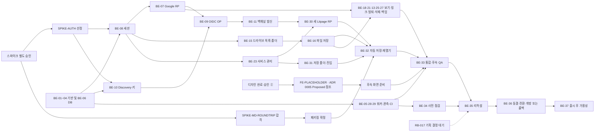

# 12 작업 분해

| 항목 | 값 |
| --- | --- |
| 버전 | v0.2 |
| 일시 | 2026-11-26 (KST) |
| 상태 | 초안, Gemini minor 4건 반영 및 ADR 0005 Proposed 연결 |
| 기획 기준선 | develop `2f1db92` |
| 작업 브랜치 | `feature/NARU-94-architecture` |
| 설계 입력 | [04 기술 NFR](04-NFR-technical.md), [05 아키텍처](05-architecture.md), [06 크레이트 구조](06-crate-layout.md), [06F 타당성](06F-stack-feasibility.md), [07 API v0.4](07-api/07-api.md), [OpenAPI](07-api/openapi.yaml), [08 DB](08-db/08-db-schema.md), [08 SQL 초안](08-db/migrations/0001_init.sql), [09 인증 v0.2](09-auth.md), [10 관측·CI](10-observability-ci.md), [11 시험 계획](11-test-plan.md), [13 전환](13-cutover.md) |
| 관련 결정 | [ADR 0003](../decisions/0003-backend-stack.md), [ADR 0004](../decisions/0004-auth-idp-litpage.md), [ADR 0005](../decisions/0005-frontend-stack.md) |

설계서 23장 12번의 `12-task-breakdown.md (+ issues.csv)` 정의에 따라 에픽과 이슈를 나누고 이슈마다 완료 조건과 병렬 가능 여부를 표시한다. 이번 파일은 `12-work-breakdown.md`와 `12-issues.csv`다.

## 1. 범위와 전제

- **[기획]** develop `2f1db92` 기준. 문서 간 충돌에는 DEC-081의 최신 DEC, FRD·BR 우선 원칙을 적용한다. [AC](../01-planning/acceptance-criteria/AC.md), [FRD](../01-planning/frd/FRD.md), [NFR](../01-planning/nfr/NFR.md), [BR](../01-planning/business-rules/BR.md), [PRD](../01-planning/prd/PRD.md), [결정 로그](../01-planning/02-decision-log/decision-log.md), [추적 매트릭스](../01-planning/traceability/matrix.csv)
- 호배님 결정(2026-11-26 21:45 KST)으로 **B-1 채택, B-2 기각**. 나루 axum은 얇은 OP, Litpage는 새 RP다. **[기획]** 정지 회원은 재로그인·토큰 갱신·Litpage 진입에서 차단(DEC-098), 나루 로그아웃 시 현재 기기의 Litpage 세션도 종료(DEC-094). [ADR 0004](../decisions/0004-auth-idp-litpage.md), [09 §3~5](09-auth.md), [07 v0.4](07-api/07-api.md)
- **[기획]** 파일당 단일 요청 스트리밍·최대 1 GiB(DEC-086·090). 8 MiB 분할 업로드 기준은 폐기됐다. Cloudflare 경로 RB-017은 **[미확인]**이며 기획 결정 대기다. ZIP 사이드카 또는 ZIP 번들은 ADR 0004의 추천이며 채택은 왕복 검증 합격에 달려 있다. [04 §4.1](04-NFR-technical.md), [05 §6.1](05-architecture.md), [ADR 0004 왕복 검증](../decisions/0004-auth-idp-litpage.md#무손실-왕복-검증-스파이크)
- 백엔드는 axum 0.8.x, sqlx 0.8.x와 `sqlx migrate`, utoipa 5.x, tracing, tower-http, tokio 1.x를 적용한다. 프런트는 디자인 완료 뒤 호배님 승인 ②로 확정한다. [ADR 0003](../decisions/0003-backend-stack.md), [06](06-crate-layout.md), [06F](06F-stack-feasibility.md), [05 §9](05-architecture.md#9-프런트엔드)
- **[기획]** 기존 DB 데이터 이관과 병행 운영 없음. CO-01·02 보관 위치는 Cloudflare 대시보드, CO-03은 Google Cloud Console이다. [CO-01~03](../01-planning/carry-over/README.md), [13 §1~2](13-cutover.md)

## 2. 에픽

| 에픽 | 이슈 | 수 |
| --- | --- | ---: |
| 스파이크 | SPIKE-AUTH, SPIKE-MD-ROUNDTRIP | 2 |
| 기반 | BE-01, BE-02, BE-03, BE-04, BE-05 | 5 |
| DB | BE-06 | 1 |
| 인증 | BE-07, BE-08, BE-09, BE-10, BE-11 | 5 |
| 계정 | BE-12, BE-13 | 2 |
| 카탈로그·법적 문서 | BE-14 | 1 |
| 드라이브 | BE-15, BE-16, BE-17, BE-18 | 4 |
| 공유 | BE-19, BE-20, BE-21 | 3 |
| 관리자 | BE-22, BE-23 | 2 |
| 워커·삭제·보존 | BE-24, BE-25, BE-26, BE-27 | 4 |
| 관측·CI | BE-28, BE-29 | 2 |
| Litpage | BE-30, BE-31, BE-32 | 3 |
| QA | BE-33 | 1 |
| 전환 | BE-34, BE-35, BE-36, BE-37 | 4 |
| 프런트 · 스택 미정, 디자인 완료 후 | FE-PLACEHOLDER | 1 |
| 합계 | | 40 |

## 3. 이슈와 완료 조건 [제안]

초안 ID는 `SPIKE-*`(선행 검증), `BE-01`~`BE-37`(백엔드·QA·전환), `FE-PLACEHOLDER`(승인 자리)다. 기존 GitHub #91·#93·#94와 별개다. 추정은 1인 작업일(인일) 범위이며 승인·환경 대기와 운영 관찰 기간을 제외한다. 스파이크는 계획 문서와 승인 후 검증 공수의 합이다.

병렬 ‘가능’은 선행 완료 후 다른 이슈와 함께 진행할 수 있다는 뜻이다. BE-35~37은 전환 경로상 순차다. 각 AC는 원문 전체를 추적한다. 화면으로만 판정하는 조건은 BE-33 후속 QA에 포함하며 API·작업 구현과 접점이 있는 경우 공동으로 수락한다. API 경로는 07 OpenAPI에 따른 상대 경로다. OP 및 RP 백채널은 각각의 인증 오리진에 둔다. CSV의 선행 및 AC·TP는 세미콜론으로 구분하며 모든 행에 `phase:설계`를 적용한다.

| ID | 제목 | 영역 | 선행 | 인일 | 병렬 | 완료 조건·설계 경계 | AC / TP |
| --- | --- | --- | --- | --- | --- | --- | --- |
| SPIKE-AUTH | 인증 라이브러리 선정 | 스파이크 | — | 2.5–4 | 가능 | 비교표와 추천·대안을 검토하고 별도 승인 후 샌드박스에서 Google RP와 09 §4~5 계약을 검증한다. [인증 계획](spikes/spike-auth-library.md) | TP-C-OIDC-LOGIN; TP-C-OIDC-KEYS; TP-I-OIDC-GRANTS; TP-C-SESSION-CSRF; TP-E-SEC-001-01; TP-C-SEC-002-01 |
| SPIKE-MD-ROUNDTRIP | Markdown·CSV 무손실 왕복 검증 | 스파이크 | — | 3–4.75 | 가능 | 별도 승인 후 두 차례 재열기에서 편집 불가·누락·변형·오연결·권한 밖 노출 각 0건. 실패 시 손실 보고 및 형식 채택 보류. [왕복 계획](spikes/spike-md-csv-roundtrip.md) | AC-FR-OSS-003-01; AC-FR-DRV-005-01; TP-E-LITPAGE-ROUNDTRIP |
| BE-01 | Rust 워크스페이스와 공통 설정 | 기반 | — | 1–2 | 가능 | 06의 naru-core·naru-adapters·naru-http·naru-api·naru-worker 멤버와 공통 설정을 구성하고 잘못된 설정을 시작 시 자격 원문 없이 보고한다. | TP-I-DB-BOOTSTRAP; TP-R-SEC-005-01 |
| BE-02 | 도메인 오류와 유스케이스 포트 | 기반 | BE-01 | 2–3 | 가능 | naru-core의 오류·시계·저장소·인증·파일·작업 포트를 정의하고 어댑터 독립성을 확인한다. | TP-U-DRV-002-02; TP-U-SEC-006-01 |
| BE-03 | 영속성 어댑터와 마이그레이션 골격 | 기반 | BE-02 | 2–3 | 가능 | naru-adapters의 sqlx 풀·트랜잭션과 구현 마이그레이션 위치를 구성한다. 유스케이스는 06 포트를 통해 접근한다. | TP-I-DB-BOOTSTRAP |
| BE-04 | HTTP 경계와 API 부트스트랩 | 기반 | BE-02 | 2–3 | 가능 | naru-http에서 axum 라우팅·DTO·07 오류 응답·미들웨어·utoipa 정의를 마련하고 naru-api에서 설정·의존성·종료를 연결한다. 보안 경계는 BE-08과 통합 확인한다. | TP-C-SESSION-CSRF; TP-C-SEC-BASELINE |
| BE-05 | 워커 실행 골격 | 기반 | BE-03 | 1–2 | 가능 | naru-worker 공통 실행·종료·스케줄 경계를 마련한다. 중복 실행과 재시작에 대한 판정은 만료·복원 작업에서 통합 확인한다. 실제 러너·배치 형태 [미확인]. | TP-I-DRV-004-07; TP-I-OPS-001-02 |
| BE-06 | 초기 스키마 적용과 시드 | DB | BE-03 | 2–4 | 가능 | 08 제약·인덱스를 구현 마이그레이션으로 옮겨 빈 PostgreSQL에서 적용하고 문서·저장소 및 Litpage·나루 드라이브 초기 배정을 검증한다. 08 SQL은 문서용 초안이며 시드 적용 방식과 초기 Litpage 노출값은 [미확인]이다. | AC-FR-HOME-002-01; AC-FR-ADM-004-01; TP-I-DB-BOOTSTRAP |
| BE-07 | Google OIDC 로그인과 가입 | 인증 | SPIKE-AUTH, BE-08 | 2–4 | 가능 | GET /auth/google/start·/auth/google/callback에서 인증 응답과 복귀 대상 검증, 신규·기존 회원 분기, 실패·정지 시 발급 거부. members·sessions, 탈퇴 복구는 BE-13과 통합 확인. | AC-FR-AUTH-001-01; AC-FR-AUTH-001-02; AC-FR-AUTH-001-03; AC-FR-AUTH-001-05; AC-FR-AUTH-005-01 |
| BE-08 | 세션 쿠키·CSRF·갱신과 정지 | 인증 | SPIKE-AUTH, BE-04, BE-06 | 3–5 | 가능 | /auth/session·/auth/session/refresh, members·sessions. 호스트 전용 보안 쿠키·변경 요청 CSRF, 유휴 7일·절대 30일, 갱신 회전과 최신 상태 직렬화. 정지 저장 자체로 열린 세션을 종료하지 않는다. Q-087 [미확인]. | AC-FR-AUTH-005-04; AC-NFR-SEC-006-01; TP-C-SESSION-CSRF; TP-I-SEC-002-01; TP-U-SEC-006-01; TP-I-SEC-006-01; TP-E-SEC-002-01 |
| BE-09 | OIDC 인가·토큰·UserInfo | 인증 | BE-07, BE-10 | 3–5 | 가능 | /oidc/authorize·/oidc/token·/oidc/userinfo. 등록 URI·PKCE S256·클라이언트 인증, 코드 소비·갱신 원자성, 재사용 시 계열 폐기, UserInfo 전용 불투명 토큰·정지 차단. oidc_clients·oidc_authorization_codes·oidc_token_grants. | AC-FR-AUTH-005-02; AC-NFR-SEC-002-01; TP-C-OIDC-LOGIN; TP-I-OIDC-GRANTS; TP-E-SEC-002-01; TP-C-SEC-002-01 |
| BE-10 | OIDC Discovery·JWKS·서명 키 | 인증 | SPIKE-AUTH, BE-04, BE-06 | 2–4 | 가능 | /.well-known/openid-configuration·/oidc/jwks에서 메타데이터와 공개 키를 제공하고 RS256 서명·키 회전을 검증한다. oidc_signing_keys에 메타데이터·위치 참조만 보관. 주기·캐시·비상 절차 [미확인]. | TP-C-OIDC-LOGIN; TP-C-OIDC-KEYS; TP-E-OIDC-KEYS |
| BE-11 | 현재 기기 통합 로그아웃과 백채널 발신 | 인증 | BE-09 | 3–5 | 가능 | /auth/logout·/oidc/end-session에서 현재 sid만 폐기하고 oidc_logout_deliveries로 전파·재시도한다. BE-30과 양쪽 시작 경로, 중복·경합, 웹소켓 종료, 다른 기기 유지를 검증한다(DEC-094, 09 §5). | AC-FR-AUTH-002-01; AC-FR-AUTH-002-02; AC-FR-AUTH-002-03; AC-NFR-SEC-001-01; TP-E-SEC-001-01; TP-C-OIDC-LOGIN |
| BE-12 | 프로필과 회원 설정 저장 | 계정 | BE-08 | 2–3 | 가능 | /account/profile, members·member_settings. 표시 이름 규칙·대체 이름, 언어·테마·드라이브 사용량 확인. 이름 예약은 BE-13과 확인한다. | AC-FR-SHELL-003-02; AC-FR-SHELL-003-03; AC-FR-SHELL-003-04; AC-FR-SHELL-003-05; AC-FR-SHELL-003-06; AC-FR-SHELL-003-09 |
| BE-13 | 탈퇴와 보관 중 재가입 복구 | 계정 | BE-07, BE-19, BE-21 | 3–5 | 가능 | DELETE /account와 Google 콜백 복구에서 보관 상태·이름 예약, 소유 공유·링크 보기만 허용, 받은 공유 즉시 회수·미복구 및 재가입 정지 유지를 확인한다. 실삭제 BE-25, Q-085 [미확인]. | AC-FR-AUTH-003-01; AC-FR-AUTH-004-01; AC-FR-AUTH-004-02; AC-FR-AUTH-004-04; AC-FR-SHELL-003-07; AC-FR-SHELL-003-08; AC-NFR-SEC-004-01 |
| BE-14 | 서비스 목록과 공개 법적 문서 | 카탈로그·법적 문서 | BE-04, BE-06 | 2–3 | 가능 | /catalog/categories·/catalog/services는 categories·services 노출을 반영한다. /legal/{document}는 약관·개인정보·라이선스 한·영 응답 계약을 지킨다. 표시 의무 Q-081 [미확인], 창 동작은 후속 QA. | AC-FR-HOME-001-02; AC-FR-SHELL-001-02; AC-NFR-I18N-003-01 |
| BE-15 | 드라이브 목록과 폴더 관리 | 드라이브 | BE-08 | 2–4 | 가능 | /drive/items·/drive/folders·/drive/folders/{folderId}, drive_items·drive_files. 이름·이동·커서와 breadcrumbs의 루트→현재 폴더 및 루트·받은 공유 시 빈 배열을 확인한다. | AC-FR-DRV-001-01; AC-FR-DRV-002-01; AC-FR-DRV-002-02; TP-I-PERF-001-01 |
| BE-16 | 파일 단일 요청 업로드와 다운로드 | 드라이브 | BE-15 | 3–5 | 가능 | /drive/uploads/file·/drive/files/{fileId}/download. 한 요청에서 1~1,073,741,824 B 스트리밍, 초과·0 B 거부, 부분 파일 미노출·처음부터 재전송, 해시 일치. drive_files·file_revisions 및 객체 저장 포트. Cloudflare 경로 RB-017 [미확인], 기획 결정 대기. | AC-FR-DRV-003-01; AC-FR-DRV-003-02; AC-FR-DRV-003-03; AC-FR-DRV-003-05; AC-FR-DRV-003-07; AC-FR-DRV-003-08; AC-NFR-PERF-002-01; TP-E-PERF-002-01 |
| BE-17 | 폴더 통째 업로드 | 드라이브 | BE-16 | 2–4 | 가능 | /drive/uploads/folder에서 계층을 보존하고 초과 파일·0 B 파일을 제외해 안내한다. 이름 충돌 시 첫 빈 번호, 파일당 한도와 단일 전송 정책을 적용한다. | AC-FR-DRV-003-04; AC-FR-DRV-003-06; AC-FR-DRV-003-07; AC-FR-DRV-003-08; AC-NFR-PERF-002-01 |
| BE-18 | 회원 보기 응답과 썸네일 | 드라이브 | BE-05, BE-16 | 2–4 | 가능 | /drive/files/{fileId}/view·/drive/files/{fileId}/thumbnail, file_revisions·naru-worker. 권한별 화면 응답, 비동기 대표 썸네일과 미지원 상태 확인. 화면 표현 계약 [미확인]. | AC-FR-DRV-008-01; AC-FR-DRV-008-02; AC-NFR-SEC-003-01; TP-E-DRV-008-01; TP-E-DRV-008-02 |
| BE-19 | 회원 공유 권한과 수신자 조회 | 공유 | BE-16 | 2–4 | 가능 | Sharing의 share-recipient-lookup·shares·shares/{memberId}, member_file_shares. 활동 회원 이메일 전체 일치·대소문자 무관, 표시 이름 우선, 권한 및 공유 예외. 탈퇴·화면 응답은 BE-13·18과 통합 확인. | AC-FR-DRV-006-01; AC-FR-DRV-006-02; AC-FR-DRV-006-03; AC-FR-DRV-006-06; AC-FR-DRV-006-07; AC-NFR-SEC-003-01 |
| BE-20 | 공유 편집과 버전·충돌 사본 | 공유 | BE-19 | 3–5 | 가능 | /drive/files/{fileId}/edit-content·/drive/files/{fileId}/revisions, file_revisions. 편집 유실 0, 원위치 충돌 사본, 최근 10개 버전의 30일 보관. 사본 소유권·편집 형식 [미확인]. | AC-FR-DRV-006-05 |
| BE-21 | 공개 링크 관리와 비회원 보기 | 공유 | BE-18 | 3–5 | 가능 | Sharing의 파일 /link 및 PublicLinks의 /public/links/{linkKey}와 /view·/download. public_file_links, 필수 name·sizeBytes·downloadAllowed, 비회원 편집 거부, 금지 시 원본 미전송, 불가 링크 공통 안내. 탈퇴·휴지통 BE-13·24와 통합 확인. | AC-FR-DRV-007-01; AC-FR-DRV-007-02; AC-FR-DRV-007-05; AC-FR-DRV-007-06; AC-NFR-SEC-003-01; TP-U-LINK-ENTROPY; TP-C-LINK-POLICY; TP-E-DRV-007-02; TP-E-LINK-SAMPLE |
| BE-22 | 관리자 회원 조회와 정지·감사 | 관리자 | BE-08 | 2–4 | 가능 | /admin/members·/admin/members/{memberId}/suspension, members. 관리자 전용 커서 조회, 멱등 정지·해제와 성공 감사 기록. 09 갱신 경합을 BE-33에서 통합 확인한다. Q-091 [미확인]. | AC-FR-ADM-001-01; AC-FR-ADM-001-02; AC-FR-ADM-002-01; AC-FR-ADM-002-02; AC-FR-ADM-002-04 |
| BE-23 | 오픈소스 노출·카테고리·서비스 배정 | 관리자 | BE-08, BE-14 | 3–5 | 가능 | Admin의 /admin/open-sources 및 visibility, /admin/categories 및 항목, /admin/service-assignments, /admin/services/{serviceId}/category. 노출 감사, 배정 중인 카테고리 삭제 거부, 입력 이름·서비스당 단일 배정 및 카탈로그 반영. categories·services, Q-091 [미확인]. | AC-FR-ADM-003-01; AC-FR-ADM-003-02; AC-FR-ADM-003-04; AC-FR-ADM-004-02; AC-FR-ADM-004-03; AC-FR-ADM-004-04 |
| BE-24 | 휴지통 API와 복원 | 워커·삭제·보존 | BE-15 | 2–3 | 가능 | Trash의 /drive/items/{itemId}·/drive/trash·/drive/trash/{itemId}/restore, drive_items. 단건 이동·복원, 보관 중 공유 차단과 복원 시 재개를 검증한다. 공유·공개 링크 차단의 실제 연계는 `BE-21` 또는 `BE-33`과 통합 확인한다. Q-085 및 원래 폴더 소멸·이름 충돌 규칙 [미확인]. | AC-FR-DRV-004-01; AC-FR-DRV-004-02; AC-FR-DRV-004-03; AC-FR-DRV-004-06 |
| BE-25 | 휴지통·탈퇴 만료 삭제와 삭제 원장 | 워커·삭제·보존 | BE-05, BE-13, BE-24 | 3–5 | 가능 | naru-worker에서 만료 뒤 DB·객체·공유를 정리하고 deletion_events를 남긴다. 탈퇴 중 휴지통 시계 유지, 재실행·복원에서 삭제 재적용 확인. Q-085와 원장 보관 상세 [미확인]. | AC-FR-DRV-004-07; AC-NFR-SEC-004-01; TP-I-SEC-004-01; TP-I-DRV-004-06; TP-I-DRV-004-07 |
| BE-26 | 운영 로그 만료와 성공 집계 분리 | 워커·삭제·보존 | BE-05 | 2–3 | 가능 | naru-worker 및 10 §2·4. 표식 로그 30일 만료·마스킹과 별도 비식별 성공 집계 유지. 감사 기록 보존 Q-091 및 집계 항목·기간 [미확인]. | AC-NFR-OPS-002-01; AC-NFR-OPS-002-02; TP-E-OPS-LOG-MASK; TP-E-OPS-002-02 |
| BE-27 | 일일 백업·만료와 복원 | 워커·삭제·보존 | BE-25 | 3–5 | 가능 | 10 §6 및 08 deletion_events. 회원 정보·파일 일일 백업·30일 만료, 복원 시 삭제 재적용, 공유·링크·설정 제외 확인. | AC-NFR-OPS-001-01; AC-NFR-OPS-001-02; AC-NFR-OPS-001-03; TP-E-OPS-001-02; TP-E-OPS-001-01; TP-I-OPS-001-02 |
| BE-28 | 구조화 로그·지표·추적·헬스체크 | 관측·CI | BE-04, BE-05 | 3–5 | 가능 | 10 §2~5, tracing·tower-http. API·워커 요청 상관·마스킹·헬스, 가입 80·100명 및 저장 용량 경보 뒤에도 작업 지속. Q-092·GAP-016·관측 저장소와 헬스·추적 범위 [미확인]. | AC-NFR-PERF-004-03; AC-NFR-OPS-004-01; TP-E-OPS-LOG-MASK; TP-C-SEC-BASELINE; TP-E-SEC-BASELINE |
| BE-29 | Rust·DB·OpenAPI·이미지 CI 게이트 | 관측·CI | BE-04, BE-05, BE-06 | 2–4 | 가능 | 10 §7의 fmt·clippy·test, 임시 PostgreSQL 마이그레이션, OpenAPI 린트, API 및 필요 시 워커 이미지 빌드의 결과를 기록한다. 스캔·Ruleset 활성화는 제안 또는 별도 승인. | AC-NFR-SEC-005-01; TP-I-DB-BOOTSTRAP; TP-R-SEC-SCAN; TP-R-SEC-005-01 |
| BE-30 | 새 Litpage RP와 기기별 백채널 수신 | Litpage | BE-11, BE-23 | 3–5 | 가능 | services/litpage/의 새 서버 인증 연결. 로그인·콜백·갱신·RP 시작 로그아웃 및 /oidc/backchannel-logout에서 sid로 세션·웹소켓 폐기. 저장소 밖 배포·별도 업스트림 수정은 별도 권한. 등록·진입 맥락·갱신 경계 [미확인]. | AC-FR-OSS-001-01; AC-FR-OSS-001-03; TP-C-OIDC-LOGIN; TP-E-SEC-001-01; TP-E-SEC-SECRET-ROTATION |
| BE-31 | 진입 판정과 저장 폴더 계약 | Litpage | BE-15, BE-23 | 2–4 | 가능 | /litpage/entry·/litpage/storage-folder, litpage_storage_folders. 최신 정지·노출·폴더 권한, 지정 또는 기본 폴더, 변경 뒤 기존 결과 원위치와 숨긴 서비스 직접 사용 차단. RP 종단은 BE-33. | AC-FR-AUTH-005-05; AC-FR-OSS-001-02; AC-FR-OSS-002-01; AC-FR-OSS-002-03; AC-FR-DRV-005-02 |
| BE-32 | 자동 저장과 무손실 문서 재열기 | Litpage | SPIKE-MD-ROUNDTRIP, BE-16, BE-30, BE-31 | 3–5 | 가능 | 왕복 스파이크 합격과 호배님 패키징 확정 뒤 /litpage/results/{resultId}·/drive/files/{fileId}/litpage/open을 구현한다. litpage_storage_folders·drive_files·file_revisions. 편집 가능한 재열기·인가·실패 시 유실 방지. GAP-025 [미확인]. | AC-FR-OSS-003-01; AC-FR-OSS-003-02; AC-FR-DRV-005-01; TP-E-LITPAGE-ROUNDTRIP |
| BE-33 | 백엔드 통합·계약 및 후속 종단 QA | QA | BE-12, BE-17, BE-20, BE-22, BE-26, BE-27, BE-28, BE-29, BE-32, FE-PLACEHOLDER | 3–5 | 가능 | 11 §3~8의 계정·화면·부하·지원 환경과 07/09 계약을 대조하고 구현 이슈의 사용자 경로까지 증적을 남긴다. 화면 종단은 승인 ②와 대응 화면 준비 후 진행한다. 인일은 QA 공수다. 프런트 스택·화면 확정(승인 ②) 이후 E2E·부하 QA 공수를 재산정한다. | AC-FR-AUTH-001-04; AC-FR-AUTH-001-06; AC-FR-AUTH-003-02; AC-FR-AUTH-003-03; AC-FR-AUTH-004-03; AC-FR-AUTH-005-03; AC-FR-AUTH-006-01; AC-FR-HOME-001-01; AC-FR-HOME-002-02; AC-FR-SHELL-001-01; AC-FR-SHELL-001-02; AC-FR-SHELL-001-03; AC-FR-SHELL-001-04; AC-FR-SHELL-001-05; AC-FR-SHELL-001-06; AC-FR-SHELL-002-01; AC-FR-SHELL-002-02; AC-FR-SHELL-002-03; AC-FR-SHELL-002-04; AC-FR-SHELL-003-01; AC-FR-OSS-002-02; AC-FR-OSS-002-04; AC-FR-DRV-001-02; AC-FR-DRV-001-03; AC-FR-DRV-004-04; AC-FR-DRV-004-05; AC-FR-DRV-004-08; AC-FR-DRV-006-04; AC-FR-DRV-007-03; AC-FR-DRV-007-04; AC-FR-DRV-008-03; AC-FR-ADM-001-03; AC-FR-ADM-001-04; AC-FR-ADM-002-03; AC-FR-ADM-003-03; AC-NFR-PERF-001-01; AC-NFR-PERF-003-01; AC-NFR-PERF-003-02; AC-NFR-PERF-004-01; AC-NFR-PERF-004-02; AC-NFR-USAB-001-01; AC-NFR-USAB-002-01; AC-NFR-USAB-003-01; AC-NFR-COMP-001-01; AC-NFR-COMP-002-01; AC-NFR-I18N-001-01; AC-NFR-I18N-002-01; AC-NFR-I18N-003-01; TP-R-SEC-005-01; TP-E-PERF-003-01; TP-E-PERF-API; TP-E-PERF-004-01; TP-E-PERF-004-02; TP-I-PERF-001-01; TP-E-PERF-001-01; TP-E-USAB-001-01; TP-E-COMP-002-01; TP-U-I18N-002-01; TP-E-I18N-002-01; TP-U-I18N-KEYS; TP-E-I18N-001-01; TP-E-PERF-003-02 |
| BE-34 | 전환 사전 점검과 롤백 계획 | 전환 | BE-29 | 2–3 | 가능 | 13 §2·3.1·3.5. CO 위치, 빈 DB·시드, CI·이미지, 호스트·IaC, 트래픽 경로, 동결·롤백 창과 결정권자를 확인한다. 호스트·IaC·CO-03·RB-017 [미확인]. | AC-NFR-SEC-005-02; TP-I-DB-BOOTSTRAP; TP-E-SEC-SECRET-ROTATION |
| BE-35 | 동결·전환·개방·롤백 리허설 | 전환 | BE-33, BE-34 | 2–3 | 순차 | 13 §3.2~3.5·§4. 격리 환경에서 동결→전면 교체→확인·개방→되돌리기를 연습한다. 승인된 경로의 1 GiB, B-1, 무손실 재열기 및 삭제 재적용과 단계별 시간을 기록한다. | TP-I-DB-BOOTSTRAP; TP-E-SEC-001-01; TP-E-SEC-002-01; TP-E-PERF-002-01; TP-E-LITPAGE-ROUNDTRIP; TP-E-OPS-001-02 |
| BE-36 | 운영 전환과 개방 판정 | 전환 | BE-35 | 1–2 | 순차 | 13 §3.2~3.5. 승인 후 쓰기 동결·라우팅 교체·확인·개방. 중단 시 구 Java·Keycloak·Litpage 인증과 기존 라우팅 복귀를 확인한다. 데이터 이관과 병행 운영 없음. [13 §3.4](13-cutover.md#34-확인과-개방) 전 항목(공개 링크·로그 마스킹·헬스체크 `/livez`·`/readyz` 포함)을 확인한다. 필수 점검 실패나 미확인 시 개방 보류. | TP-E-SEC-001-01; TP-E-SEC-002-01; TP-E-PERF-002-01; TP-E-LITPAGE-ROUNDTRIP; TP-E-OPS-LOG-MASK |
| BE-37 | 출시 후 가용성 관찰 | 전환 | BE-36 | 1–2 | 순차 | 04·10 및 13 §3.4에 따라 출시 후 한 달 자료로 월 99%와 중단 포함·제외 사유를 확인한다. 공지 시점·방법 및 장애 귀책 [미확인]. 인일은 집계·판정 공수다. | AC-NFR-AVAIL-001-01; AC-NFR-AVAIL-001-02; TP-E-AVAIL-001-01; TP-E-AVAIL-001-02 |
| FE-PLACEHOLDER | 스택 미정, 디자인 완료 후 | 프런트 | — | 미정 | 가능 | [ADR 0005](../decisions/0005-frontend-stack.md)(Proposed)를 참조한다. 디자인 완료 후 호배님 승인 ②로 스택·구동·시험 도구를 확정한다. 11 §8과 10 §7 프런트 검사를 이후 연결한다. AC·TP는 후속 QA 참조다. | AC-NFR-USAB-001-01; AC-NFR-COMP-002-01; TP-U-I18N-KEYS |

## 4. 의존 관계와 핵심 경로

그림은 주요 합류 지점과 외부 승인 조건을 표시한다. 전체 직접 선행 관계는 §3과 [CSV](12-issues.csv)에 있다.

**[제안] 핵심 경로.** 인일 상한과 독립 작업의 병렬 인력 확보를 가정했다. 승인·디자인·환경 대기는 일정 산정에 포함하지 않았다.

1. 백엔드 최장 선행 경로는 BE-01·02·03·06 기반·스키마 → BE-08 세션 → BE-15 폴더 → BE-16 파일 저장 → BE-18 보기 → BE-21 공개 링크 → BE-13 탈퇴 → BE-25 삭제 → BE-27 백업 → BE-33 통합 QA다.
2. 인증은 SPIKE-AUTH → BE-08·10 → BE-07·09 → BE-11 → BE-30에서 합류한다. 왕복은 SPIKE-MD-ROUNDTRIP 합격 → 패키징 확정이다. 두 경로와 BE-31 저장 폴더·진입이 BE-32에서 만난 뒤 BE-33으로 이어진다.
3. BE-33과 BE-34 완료 → BE-35 리허설 → BE-36 운영 전환 → BE-37 출시 후 관찰. 승인 ②·화면 준비, RB-017 기획 결정, 패키징 승인 및 배포 전제가 지연되면 실제 핵심 경로가 달라진다.

## 5. 병렬 작업 묶음

| 시점 | 함께 진행할 작업 |
| --- | --- |
| 초기 | 별도 실행 승인 후 두 스파이크를 병렬 진행할 수 있다. 기반 BE-02 이후 BE-03과 BE-04를 함께 진행한다. |
| DB·HTTP 기반 이후 | 워커·관측·CI, 인증·서명 키, 카탈로그·법적 문서. BE-08 이후 프로필·드라이브·관리자 회원. |
| 파일 저장 이후 | 폴더 업로드, 보기·썸네일, 회원 공유를 병렬 진행한다. 공유 편집·공개 링크는 표의 선행을 기다린다. 휴지통 API는 BE-15 이후 별도 진행할 수 있다. |
| 연동·검증 | BE-30과 BE-31은 각 선행 뒤 병렬 진행할 수 있다. BE-34 사전 점검과 모듈별 계약 시험은 준비되는 대로 시작한다. BE-33에서 종단 증적을 합친다. |

## 6. AC·TP 추적

| 범위 | 연결 결과 |
| --- | --- |
| 07 리소스 10개 | Auth BE-07·08·11, Account BE-12·13, Catalog·Legal BE-14, Litpage BE-31·32, Drive BE-15~18·32, Trash BE-24·25, Sharing BE-19~21, PublicLinks BE-21, Admin BE-22·23. OIDC 추가 계약 BE-09~11·30. |
| 11 §3의 AC 139개 | 기능 Must 109/109개 및 우선순위 표기가 없는 비기능 30/30개를 §3의 이슈에 연결했다. UI 단독 조건은 BE-33의 후속 QA를 포함한다. |
| 11 §4의 PV 33개 | 아래 담당 이슈에서 11에 연결된 TP를 추적한다. 모두 [제안] 또는 시험 자리다. |
| 판정 보류 | RB-017·GAP·Q·디자인 등 열린 입력에 의존하는 조건은 판정 보류다. ID 연결은 계획 단계의 추적 결과다. |

| 담당 이슈 | PV (11 §4) |
| --- | --- |
| BE-08 | PV-029 |
| BE-09 | PV-018 |
| BE-11 | PV-017, PV-028 |
| BE-16 | PV-003 |
| BE-18 | PV-005 |
| BE-21 | PV-019, PV-030 |
| BE-25 | PV-020 |
| BE-26 | PV-016 |
| BE-27 | PV-013, PV-014, PV-015, PV-034 |
| BE-28 | PV-022, PV-023, PV-031, PV-035 |
| BE-29 | PV-021 |
| BE-33 | PV-004, PV-006, PV-007, PV-008, PV-009, PV-010, PV-011, PV-024, PV-025, PV-026, PV-027, PV-032, PV-033 |
| BE-37 | PV-012 |

## 7. 남은 [미확인]

| 항목 | 확인할 내용 |
| --- | --- |
| RB-017 | Cloudflare 프록시 본문 한도·경로와 1 GiB 단일 요청의 양립. 기획 결정 전 전환 경로 판정 보류. |
| GAP-016/018/025 | 기본 보안선, 최신 지원 브라우저·iOS 취급, 자동 저장 지연·재시도·실패 정의·1 GiB 적용과 패키징·호출 계약. |
| Q-081/085/087/091/092 | 법적 운영자 표시, 달력 30일 시간대·경계·시작일, 기존 세션 갱신 및 정지 차단 상한, 감사 항목·보관·법적 적정성, 전체 저장 경보 기준·수신자·방법. |
| DM-002/004/006/007/009/010/011 | 디자인과 07·08의 대응 및 표현 계약. 프런트 스택·구동·시험 도구도 승인 ② 대기. |
| 인증·Litpage | 라이브러리 채택·취약점·호환성, 워커 러너·배치, CO-03 재사용·재발급 및 콜백 재사용·추가 등록, B-1 RP 등록·진입 맥락·갱신·장기 연결, 키 회전·백채널 실측, 왕복 보존 범위 및 결과. |
| 배포·운영 | 배포 호스트·IaC·객체 저장소, 초기 시드 적용 시점과 Litpage 노출값, AVAIL 공지·장애 귀책 및 롤백 창, 관측 저장소·CI 실제 적용·백업 복원 실측. |
| 23장 원문 | 저장소에서 직접 대조할 원문을 찾지 못했다. 12번 산출물 정의는 요청에 제공된 요약을 적용했다. |

[열린 질문](../01-planning/02-decision-log/open-questions.md), [07 미확인](07-api/07-api.md#미확인), [08 남은 확인](08-db/08-db-schema.md#남은-확인-사항), [09 §11](09-auth.md#11-남은-미확인), [10 §10](10-observability-ci.md#10-남은-확인-사항), [13 §6](13-cutover.md#6-남은-확인-사항)

## 8. 다음 단계와 필요한 권한

Gemini 검토 뒤 호배님 승인 지점에서 커밋 범위를 확인한다. GitHub 이슈 일괄 생성에는 승인 ④와 저장소 이슈 작성 권한이 필요하다. 자비스가 두 스파이크의 코드·crate 설치·샌드박스 실행 승인을 별도로 요청한다. 후속 PR 게이트 변경과 배포·Cloudflare·Google 설정 변경 및 운영 전환에는 호배님 승인과 각 환경의 권한이 필요하다. 현재 산출물은 문서와 CSV 초안이다.
