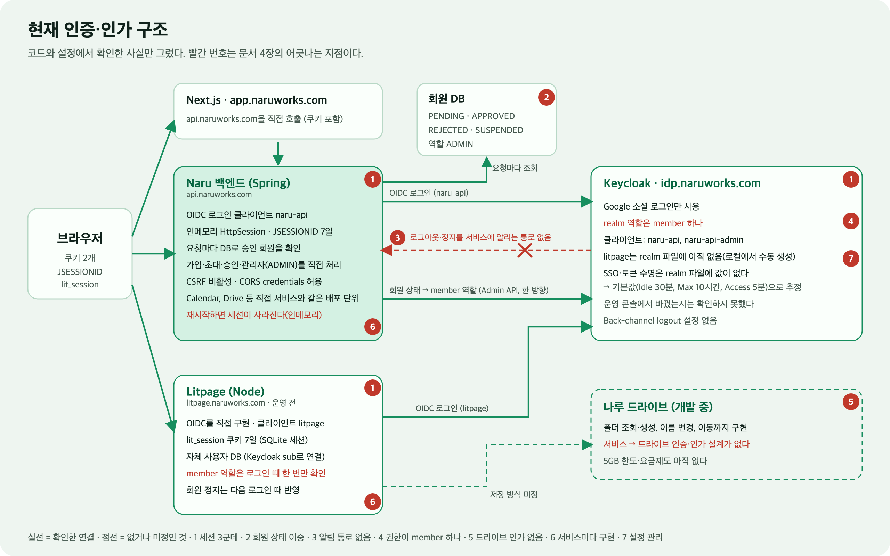
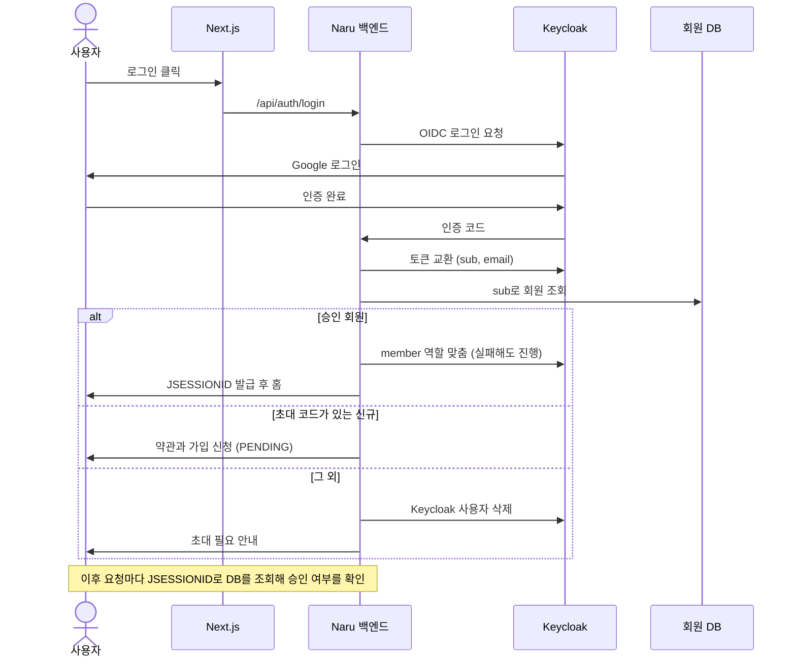
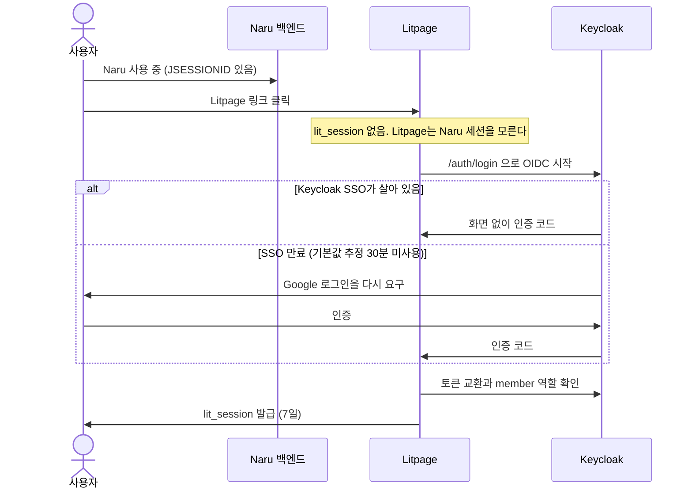
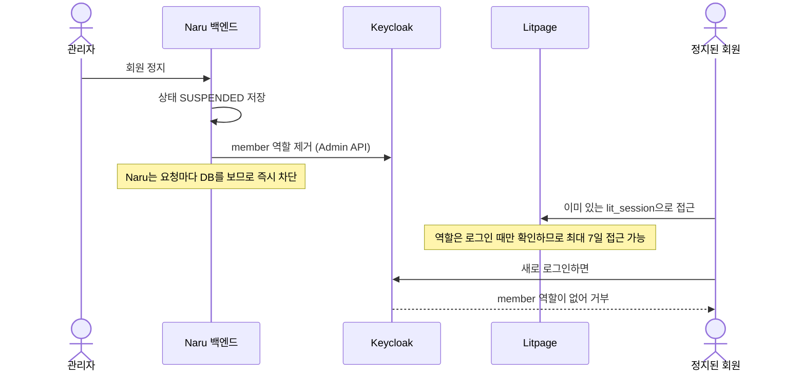
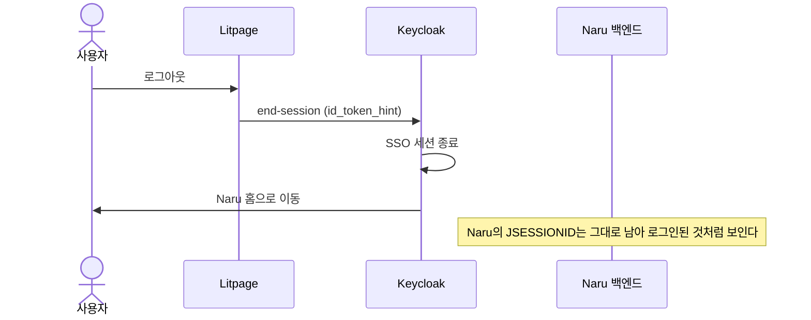
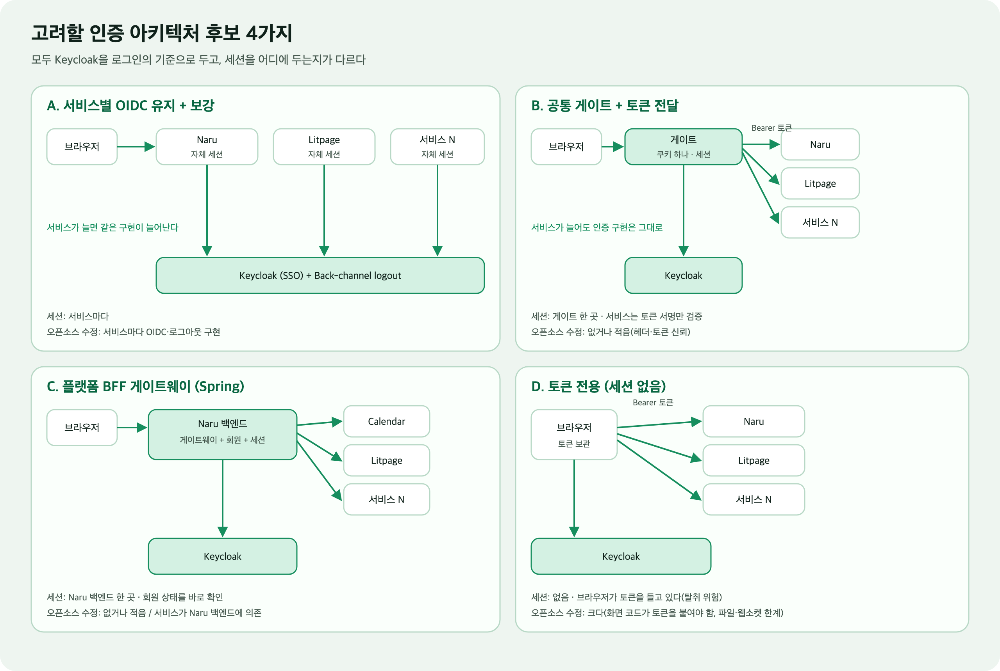
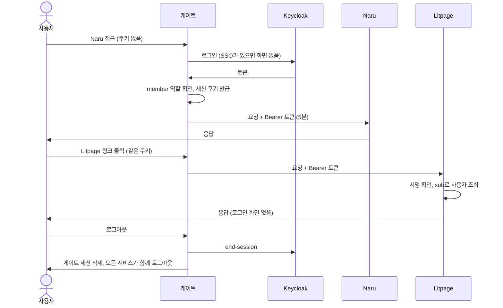

# 인증·인가 아키텍처 점검 (논의용)

작성일: 2026-11-12

상태: 논의용 초안. 결정한 것은 없고, 결정에 필요한 사실과 후보, 확인할 실험을 정리한다.

방향은 [README](../../README.md)와 [ADR 0002](../decisions/0002-open-source-service-platform.md), 연동 조건은 [오픈소스 서비스 연동 기준](open-source-integration.md)을 따른다. 세션과 로그아웃 문제는 이슈 [#80](https://github.com/HoBaeBang/naruworks-platform/issues/80)에서 시작했고, 이 문서는 그보다 넓게 구조 전체를 본다.

문장 앞의 표시는 다음을 뜻한다.

- **[사실]** 코드나 설정에서 직접 확인한 것(근거 파일을 적는다)
- **[해석]** 사실을 바탕으로 내린 판단
- **[제안]** 아직 합의하지 않은 추천
- **[미확인]** 확인하지 못한 것

## 1. 요약

1. **[해석]** 인증(누구인가)은 Keycloak으로 모았지만, **세션, 회원 상태, 권한(무엇을 해도 되나)은 서비스마다 따로** 있다. 이 차이가 지금 겪는 문제(로그인했는데 튕김, 로그아웃 후 어긋남, 정지 반영 지연)의 뿌리다.
2. **[해석]** 현재 구조는 서비스 2개(Naru, Litpage)일 때는 버틴다. 서비스가 10개 이상이 되면 서비스마다 OIDC 로그인, 세션, 로그아웃, 회원 상태 확인을 구현해야 해서 비용이 서비스 수에 비례해 늘어난다.
3. **[해석]** 방향이 요구하는데 현재 구조에 **아예 없는 것**이 있다. 사용자별 서비스 사용 권한(선택·신청한 서비스만 쓰기), 서비스에서 나루 드라이브로 저장할 때의 인증·인가, 5GB와 요금제 같은 사용량 권한이다.
4. **[제안]** 후보 4가지(A 서비스별 OIDC 보강, B 공통 게이트, C Spring 게이트웨이, D 토큰 전용) 중 B가 서비스 수와 오픈소스 수정량 면에서 방향에 가장 맞아 보이지만, 아직 시험하지 않았다. 이 문서의 8장 실험으로 확인한 뒤 정한다.
5. **[제안]** 구조 선택과 별개로 정해야 하는 것이 세 가지 있다. 회원·권한 정보의 기준(Keycloak인가, Naru DB인가), 서비스→드라이브 인가 방식, Keycloak 클라이언트 등록의 자동화다.

## 2. 방향이 요구하는 것

README와 ADR 0002에서 인증·인가에 걸리는 요구를 뽑으면 다음과 같다. 이후 비교의 기준으로 쓴다.

| 번호 | 요구 | 출처 |
| --- | --- | --- |
| R1 | 한 번 로그인하면 Naru와 모든 오픈소스 서비스를 따로 로그인하지 않고 오간다 | README 서비스 제공 흐름 |
| R2 | 서비스가 10개 이상으로 늘어도 서비스 하나를 붙이는 비용이 작다 | 사용자 발언, ADR 0002 |
| R3 | 오픈소스 코드를 많이 고치지 않고 붙일 수 있다 | 오픈소스 연동의 전제 |
| R4 | 로그아웃과 회원 정지가 모든 서비스에 빠르게 반영된다 | #80 논의 |
| R5 | 사용자가 서비스를 선택·신청하고, 선택한 서비스만 쓴다(서비스별 사용 권한) | README 카탈로그 |
| R6 | 서비스의 결과물이 나루 드라이브에 저장되고, 기본 5GB와 요금제 한도를 따른다 | README 비즈니스 모델 |
| R7 | 다양한 소셜 로그인을 지원하되 회원 정보는 한 곳에서 관리한다 | README 서비스 구성 |

## 3. 현재 구조 (사실)

### 확인한 사실

| 구성 | 사실 | 근거 |
| --- | --- | --- |
| Naru 백엔드 로그인 | Spring Security의 OAuth2 클라이언트로 Keycloak에 로그인한다. 리소스 서버(토큰 검증) 의존성은 없다 | `backend/naru-api/build.gradle`(oauth2-client) |
| 세션 | 서버 인메모리 `HttpSession`과 `JSESSIONID` 쿠키(7일). Spring Session 의존성이 없어 백엔드를 재시작하면 세션이 사라진다 | `application.properties`, `build.gradle`, 운영 메모리 "로그인 세션 운영 정책" |
| 회원 상태 확인 | 요청마다 로그인 사용자의 `sub`로 DB에서 승인 회원을 찾는다. 관리자 여부도 DB의 역할(`ADMIN`)로 판단한다 | `CurrentMemberResolver`, `AdminAuthorizationManager` |
| 회원 상태 | `PENDING`, `APPROVED`, `REJECTED`, `SUSPENDED` | `MemberStatus` |
| 회원 상태 → Keycloak | 상태가 바뀔 때 Keycloak의 `member` 역할을 맞춘다(한 방향). 관리자의 상태 변경은 역할 반영이 실패하면 취소하고, 가입·로그인에서는 실패해도 진행한다 | `MemberRoleSynchronizer` |
| Keycloak realm 파일 | 역할은 `member` 하나, 클라이언트는 `naru-api`와 `naru-api-admin`(서비스 계정), 로그인은 Google만이다. SSO 수명과 토큰 수명 값이 없고 Back-channel logout 설정도 없다 | `infra/keycloak/realm/naruworks-realm.json` |
| 클라이언트 등록 | `litpage` 클라이언트는 realm 파일에 없고 로컬에서 수동으로 만들었다. realm 파일은 realm이 없을 때만 가져온다(`--import-realm`) | realm 파일, `docker-compose.yml` |
| 프런트와 API | Next.js(`app.naruworks.com`)가 백엔드(`api.naruworks.com`)를 직접 호출하고 `credentials: include`를 쓴다. 백엔드는 CORS에서 credentials를 허용하고 CSRF는 꺼져 있다 | `frontend/src/lib/*.ts`, `WebConfig`, `SecurityConfig` |
| Litpage | OIDC를 직접 구현했고(`lit_session` 7일), 자체 사용자 DB에 Keycloak `sub`를 연결한다. `member` 역할은 로그인할 때 한 번만 확인한다 | `services/litpage/apps/server/src/oidc.ts` |
| 가입 | 초대 코드로 들어와 약관에 동의하면 `PENDING`, 관리자가 승인하면 `APPROVED`와 `member` 역할이 붙는다. 초대 없이 로그인한 비회원의 Keycloak 사용자는 삭제한다 | `OAuth2LoginSuccessHandler` |

### 확인하지 못한 것

- **[미확인]** 운영 Keycloak의 실제 SSO·토큰 수명. realm 파일에 값이 없어 기본값(Idle 30분, Max 10시간, Access 5분)일 것으로 추정하지만, 운영 콘솔에서 바꿨는지는 모른다.
- **[미확인]** Naru 쪽 서비스(Calendar, Drive) 안에서의 세부 권한 규칙 전부. 이 문서는 로그인과 회원 상태 중심으로 본다.

## 4. 방향과 어긋나는 지점

심각도는 방향(R1~R7)을 막는 정도에 대한 **[해석]**이다. 그림의 빨간 번호와 같다.

| 번호 | 지점 | 왜 방향과 어긋나나 | 심각도 | 유형 |
| --- | --- | --- | --- | --- |
| 1 | **세션이 세 군데에 따로 있다.** Naru 앱 세션(7일), Litpage 세션(7일), Keycloak SSO(기본값 추정 30분) | R1, R4. 한쪽이 끝나도 다른 쪽은 모른다. 로그인했는데 튕기거나 로그아웃 후 어긋난다. 세션이 없다는 사실만으로 비회원인지 알 수 없다 | 높음 | 설계 |
| 2 | **회원 상태의 기준이 이중이다.** 상태는 Naru DB가 기준이고 Keycloak 역할은 상태가 바뀔 때만 맞추는 사본이다 | R4. Naru는 요청마다 DB를 봐서 즉시 반영되지만, 다른 서비스는 DB를 볼 수 없고 역할을 로그인 때만 본다. 즉시성이 확장되지 않는다 | 높음 | 설계 |
| 3 | **Keycloak이 서비스에 알리는 통로가 없다.** Back-channel logout 설정이 없고 어떤 서비스도 받지 않는다 | R4. 정지된 회원의 Litpage 세션이 최대 7일 남는다. 로그아웃도 Keycloak 세션만 끝난다 | 높음 | 설계 |
| 4 | **권한이 `member` 하나뿐이다.** 서비스별 사용 권한, 플랜, 용량을 표현할 곳이 없다 | R5, R6. "신청한 서비스만 쓴다", "5GB를 넘으면 요금제"를 현재 모델로 표현할 수 없다 | 높음 | 설계 |
| 5 | **서비스→드라이브 인증·인가가 설계되지 않았다.** 오픈소스는 보통 자기 저장소에 파일을 쓴다 | R6. 오픈소스의 결과물을 사용자 드라이브로 모으는 방법이 정해지지 않았다. 드라이브 자체(rustfs 기반)는 개발 중이다 | 높음 | 설계 |
| 6 | **인증 구현이 서비스마다 반복된다.** Naru는 Spring, Litpage는 Node로 각각 OIDC 로그인, 세션, 로그아웃을 구현했다 | R2, R3. 서비스가 늘면 같은 작업이 늘고, 오픈소스마다 코드를 고쳐야 한다. 플랫폼 core(가입·승인·회원)가 Naru 앱 안에 있어 다른 서비스가 호출할 회원 API도 없다 | 중간 | 설계 |
| 7 | **설정이 코드로 관리되지 않는다.** realm 파일에 클라이언트(`litpage`)와 수명 값이 없고, 파일은 realm이 없을 때만 적용되며, 운영은 콘솔에서 수동 변경한다 | R2. 서비스를 붙일 때마다 수동 작업이 생기고 로컬과 운영이 어긋난다 | 중간 | 운영 |
| 8 | **보안·정리 부채.** CSRF 비활성(`SameSite=Lax` 쿠키에 의존), 쿠키가 `api.naruworks.com` 단일 호스트에 묶여 다른 서비스와 공유 불가, `findApprovedGoogleMember` 같은 이름 부채, Keycloak 재생성 시 `sub`가 바뀌면 사용자 연결이 끊김(Litpage는 같은 이메일로 다시 연결) | R1, R7. 지금은 위험이 작지만 구조를 바꿀 때 함께 정리해야 한다 | 낮음~중간 | 보안 |

### 장점도 있다

- **[사실]** Naru 백엔드는 요청마다 DB로 승인 여부를 확인하므로 Naru 안에서는 정지가 즉시 반영된다.
- **[사실]** Keycloak 로그인, 가입·승인, `member` 역할 동기화는 운영에 반영되어 동작한다.
- **[해석]** 기존 두 앱을 당장 뜯지 않아도 되고, 새 서비스부터 다른 방식을 적용할 수 있다.

## 5. 현재 흐름의 문제를 시퀀스로 보기

### 5.1 Naru 가입과 로그인

### 5.2 Naru에서 Litpage로 이동 (현재)

### 5.3 정지와 로그아웃이 전파되지 않는 경우 (현재)

## 6. 고려할 아키텍처

### 후보

| 후보 | 핵심 | 세션 위치 |
| --- | --- | --- |
| A. 서비스별 OIDC 유지 + 보강 | 지금 구조를 유지하고 Back-channel logout, SSO 수명 정렬, 정지 시 사용자 로그아웃을 더한다 | 서비스마다 |
| B. 공통 게이트 + 토큰 전달 | 앞단의 인증 프록시(oauth2-proxy 등) 또는 Cloudflare Access가 로그인과 세션을 맡고, 서비스에는 짧은 수명의 토큰이나 헤더로 신원을 전달한다 | 게이트 한 곳 |
| C. 플랫폼 BFF 게이트웨이 | Naru 백엔드(Spring)를 게이트웨이로 확장해 모든 서비스 앞에 둔다 | Naru 백엔드 한 곳 |
| D. 토큰 전용 | 브라우저가 Keycloak 토큰을 들고 각 서비스에 직접 Bearer로 호출한다 | 없음 |

### 요구와 비교 (해석)

기호는 ◎ 잘 맞음, ○ 맞음, △ 조건부, ✕ 맞지 않음이다. 시험하지 않은 판단이다.

| 요구 | A | B | C | D |
| --- | --- | --- | --- | --- |
| R1 한 번 로그인 | △ (SSO 수명 정렬 필요) | ◎ | ○ | ○ |
| R2 서비스 10개 이상 | ✕ (서비스마다 구현) | ◎ | △ (Naru 백엔드가 병목·의존) | △ (화면마다 토큰 처리) |
| R3 오픈소스 수정 최소 | △ | ○ (헤더·토큰 신뢰) | ○ | ✕ (파일·웹소켓 한계) |
| R4 정지·로그아웃 반영 | ○ (Back-channel 구현 시) | ◎ (게이트에서 차단) | ◎ | △ (토큰 수명만큼) |
| 운영 복잡도 | 낮음 | 중간 (게이트 운영) | 중간 | 낮음 |
| 단일 장애점 | 없음 | 게이트 | Naru 백엔드 | 없음 |

R5~R7은 후보(A~D)와 거의 무관하게 따로 정해야 한다(7장).

### 후보별 메모

- **A**: 기존 두 앱을 바꾸지 않는 가장 작은 변경이다. 다만 새 서비스가 올 때마다 같은 구현이 따라온다. Naru(Spring)의 Back-channel 지원과 Litpage 엔드포인트가 필요하다.
- **B**: 새 서비스는 인증 코드를 거의 쓰지 않아도 된다. 대신 앱을 게이트 뒤에만 두어야 하고(우회하면 헤더 위조 가능), 가입 흐름(초대 코드)과 MCP 같은 토큰 직접 접근 경로를 게이트가 어떻게 지나가게 할지 확인해야 한다. 이미 만든 Litpage의 OIDC 코드는 걷어내거나 로컬 개발용으로만 남긴다.
- **C**: 회원 정보를 이미 가진 Naru 백엔드를 게이트웨이로 쓰는 안이라 회원 상태 확인이 쉽다. 하지만 Naru 백엔드가 모든 서비스의 앞에서 병목이 되고, 서비스 코드와 플랫폼 core가 한 배포 단위에 묶인다.
- **D**: 브라우저가 토큰을 들고 있어 스크립트 공격에 약하고, 이미지·파일·웹소켓은 헤더를 붙이기 어려워 오픈소스를 많이 고쳐야 한다. 브라우저 화면용으로는 맞지 않고, MCP나 API 호출 경로에는 이미 쓰고 있다.

### B의 흐름 (제안)

## 7. 구조와 별개로 정해야 하는 것

| 축 | 질문 | 선택지 |
| --- | --- | --- |
| X. 회원·권한의 기준 | 회원 상태, 서비스별 사용 권한(R5), 플랜과 용량(R6)을 어디에 두나 | X1 Keycloak(역할·그룹)만 / X2 Naru DB가 기준이고 Keycloak에 반영하며 토큰 클레임으로 전달(현재 방식의 확장) / X3 별도 회원·권한 서비스(API) |
| Y. 서비스→드라이브 | 오픈소스가 결과물을 드라이브에 어떻게 쓰나 | Y1 Drive API와 사용자 토큰(토큰 교환) / Y2 서비스 계정과 사용자 대리 / Y3 S3 호환 저장소(rustfs)의 사전서명 URL / Y4 파일 시스템 마운트·동기화 |
| Z. 클라이언트 등록 | 서비스를 붙일 때 Keycloak 클라이언트와 설정을 어떻게 만드나 | Z1 realm 파일(코드)로 관리 / Z2 Admin API로 자동 생성 / Z3 지금처럼 수동 |

**[제안]** X는 X2로 가되 서비스가 늘면 X3를 검토한다. 이유는 가입·승인 로직이 이미 Naru DB에 있고, 토큰에 `member`와 서비스 목록, 플랜을 넣으면 서비스는 DB를 몰라도 판단할 수 있기 때문이다. Y와 Z는 근거가 약해 실험 결과를 보고 정한다.

## 8. 확인해야 할 것 (실험)

| 번호 | 확인할 것 | 방법 | 성공 기준 | 관련 |
| --- | --- | --- | --- | --- |
| E1 | 수정하지 않은 Litpage가 인증 프록시(oauth2-proxy 등) 뒤에서 동작하는가 | 로컬에서 프록시 + Keycloak + Litpage(헤더 신뢰 모드)를 띄운다 | 로그인, 로그아웃, 파일·웹소켓이 동작 | B, R3 |
| E2 | Cloudflare Access가 Keycloak OIDC와 연동되는가, 요금·사용자 수 제한은 | 공식 문서 확인, 시험 계정으로 연동 | 제한이 우리 규모에 맞고 로그아웃이 전파됨 | B |
| E3 | Spring Security가 Back-channel logout을 받는가(현재 버전) | 로컬에서 Keycloak 클라이언트에 설정하고 시험 | 다른 서비스의 로그아웃이 Naru 세션을 끊음 | A |
| E4 | 초대 코드 가입이 게이트 로그인과 공존하는가 | 가입 경로를 게이트 예외로 두고 코드를 쿠키로 전달 | 가입 → `PENDING` → 승인 → 로그인 완료 | B |
| E5 | 정지 반영 시간을 어떻게 줄이나 | 정지 시 Keycloak 사용자 로그아웃 호출과 토큰 수명 시험 | 정지 후 수 초 이내 차단(세션), 최악 토큰 수명 | A, B |
| E6 | 토큰에 `member`, 서비스 목록, 플랜을 넣을 수 있는가 | Keycloak 매퍼로 사용자 속성이나 그룹을 클레임에 넣는다 | 서비스가 토큰만으로 사용 권한을 판단 | X |
| E7 | 서비스→드라이브 저장 방식(Y3 우선) | rustfs 사전서명 URL로 Litpage 업로드를 시험 | 사용자별 경로와 5GB 한도를 적용 | Y, R6 |
| E8 | Keycloak 클라이언트 등록 자동화 | realm 파일과 Admin API 중 하나로 `litpage`를 재현 | 새 환경에서 수동 작업 없이 생성 | Z, R2 |
| E9 | 운영 Keycloak의 실제 값(수명, 클라이언트, 로그아웃 설정) | 운영 콘솔 점검 | 문서의 추정을 사실로 바꿈 | 3장 |
| E10 | Naru 세션을 재시작 후에도 유지해야 하는가 | Redis 기반 Spring Session 필요성 검토 | 요구 여부 결정 | A, C |

**[제안]** 실험 순서는 E9(값 확인, 비용 최소), E1·E2(B의 가능성), E3·E5(A의 가능성), E6·E7(권한과 드라이브) 순이다.

## 9. 논의할 질문

1. 서비스 10개 이상이라는 전제에서, 기존 두 앱은 A로 보강하고 새 서비스부터 B를 표준으로 삼는 하이브리드가 맞는가, 아니면 처음부터 B로 통일할 것인가.
2. 게이트를 직접 운영할 것인가(oauth2-proxy 등), Cloudflare Access 같은 관리형을 쓸 것인가. 관리형이라면 요금과 사용자 수 제한을 받아들일 수 있는가.
3. 서비스별 사용 권한(R5)과 플랜(R6)은 토큰 클레임으로 전달하는 방식(X2)으로 충분한가, 별도 회원·권한 서비스(X3)가 필요한가.
4. 정지 반영의 목표 시간(수 초, 최악 5분)을 확정할 것인가.
5. 서비스가 드라이브에 저장하는 방식은 어디까지 오픈소스를 고쳐서 맞추고 어디부터 마운트·동기화로 처리할 것인가.
6. Keycloak SSO를 7일로 늘리고 Max는 몇 일로 할 것인가(제안은 30일).
7. 지금 열려 있는 이슈 #80의 범위를 이 문서의 결론에 맞춰 다시 정할 것인가.

## 10. 관련 문서

- [오픈소스 서비스 연동 기준](open-source-integration.md)
- [중앙 인증 설계: Keycloak + OIDC](idp-keycloak-architecture.md)
- [회원·가입·승인 설계](auth-membership-google-approval.md)
- [ADR 0002](../decisions/0002-open-source-service-platform.md)
- [오픈소스 서비스 플랫폼 로드맵](../roadmap/open-source-platform-roadmap.md)
- 이슈 [#80](https://github.com/HoBaeBang/naruworks-platform/issues/80), [#89](https://github.com/HoBaeBang/naruworks-platform/issues/89)
