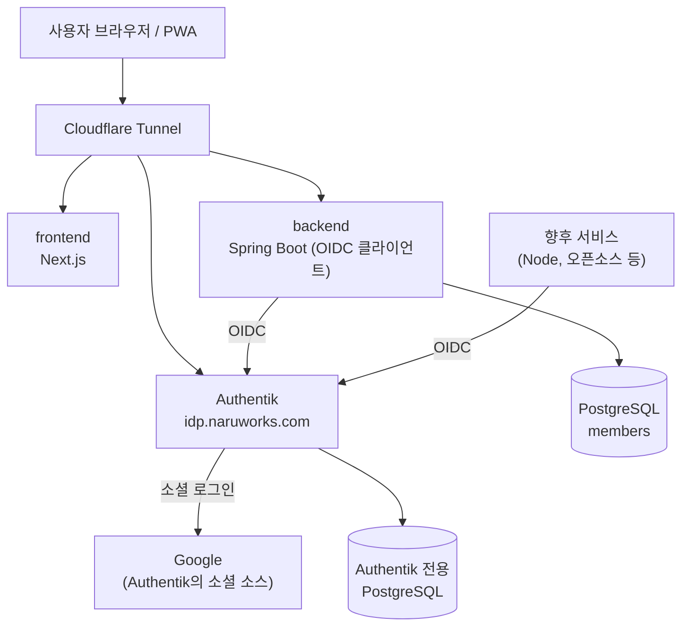

# 중앙 인증(IdP) 도입 설계: Authentik + OIDC

## 1. 목적과 결정

NaruWorks는 Calendar, Drive에 이어 여러 서비스를 추가할 예정이고, 일부는 오픈소스를 그대로 붙여 운영한다. 서비스마다 로그인 방식이 달라지면 사용자는 계정을 따로 관리해야 하고, 서비스를 추가할 때마다 인증 문제를 다시 풀어야 한다.

이를 줄이기 위해 로그인과 사용자 신원 확인을 한 곳으로 모은다.

```text
인증 서버(IdP) = 자체 호스팅 Authentik
통신 규약     = OpenID Connect (OIDC)
로그인 수단   = 소셜 로그인만 사용 (첫 대상은 Google), 비밀번호는 저장하지 않는다
각 서비스     = IdP에 앱으로 등록하고 OIDC 클라이언트로 동작한다
```

이 문서는 첫 단계로 기존 Spring 서비스(`naru-api`)의 Google 직접 로그인을 Authentik 경유 로그인으로 바꾸는 범위를 다룬다. 다른 서비스(Node 기반 오픈소스 등)를 붙이는 방법은 같은 패턴의 반복이므로 11장에서 방향만 정리한다.

### 결정하지 않은 것

- 엔터프라이즈 고객이 자체 IdP(Okta, Microsoft Entra ID)로 로그인하는 기업별 SSO와 SCIM은 이번 범위가 아니다. 해당 요구가 생기는 시점에 IdP 선택을 다시 평가한다(10장).

## 2. 현재 구조

기존 인증 문서(`auth-membership-google-approval.md`)의 정책은 유지한다. 초대 코드와 Google 로그인, 약관 동의로 가입하는 흐름은 바뀌지 않는다.

변경 대상이 되는 현재 구현은 다음과 같다.

- `SecurityConfig`가 Spring Security `oauth2Login`으로 Google에 직접 연결한다. 설정은 `spring.security.oauth2.client.registration.google.*`다.
- `OAuth2LoginSuccessHandler`가 `sub` 클레임으로 회원을 찾고, 상태별로 프런트 화면을 분기한다.
- 인증 후에는 서버 세션(유효기간 7일)을 사용한다. 토큰을 클라이언트에 저장하는 구조가 아니다.
- `members` 테이블은 `(provider, provider_user_id)`에 유일키가 있고, `provider`는 `VARCHAR(30)`이며 체크 제약이 없다. 코드는 `AuthProvider.GOOGLE`을 고정으로 사용한다.
- Google Calendar 연동은 별도 OAuth 클라이언트(`naru.google-calendar.*`)이며 이번 변경과 무관하다.

현재 코드는 이미 "OIDC 로그인 후 `sub`로 회원을 식별한다"는 구조다. 따라서 로그인 상대를 Google에서 Authentik으로 바꾸는 작업은 구조 변경이 아니라 설정 교체에 가깝다.

## 3. 목표 아키텍처



### 로그인 흐름

```text
1. 사용자가 로그인을 시작한다. (GET /api/auth/login 또는 초대 링크의 /api/auth/google?ref=...)
2. Spring이 사용자를 Authentik의 authorize 주소로 보낸다.
3. Authentik이 로그인 화면을 보여주고 사용자가 Google로 로그인한다.
4. Authentik이 사용자를 Spring의 콜백 주소로 되돌리며 일회용 code를 전달한다.
5. Spring이 code를 토큰으로 교환하고, ID 토큰의 sub, email, name으로 사용자를 확인한다.
6. 기존 OAuth2LoginSuccessHandler가 회원 상태에 따라 화면을 분기하고 서버 세션을 만든다.
```

5~6번은 현재 Google 로그인과 같은 코드를 그대로 사용한다. Spring은 비밀번호나 Google 인증을 직접 다루지 않는다.

### 사용자 식별 원칙

사용자의 기준 식별자는 이메일이 아니라 IdP가 발급하는 `sub`다. 이메일은 바뀌거나 재사용될 수 있다. 서비스 간에 같은 사람을 연결할 때도 `sub`를 키로 사용한다.

각 서비스는 Authentik에 앱을 따로 등록하므로 토큰도 서비스별로 발급된다. 서비스 사이에서 토큰을 그대로 넘겨 쓰는 구조가 아니다. 사용자가 한 서비스에서 로그인하면 Authentik에 로그인 세션이 생기고, 다른 서비스에 접속할 때는 비밀번호 입력 없이 새 토큰만 받는다(SSO).

## 4. Authentik 선택 근거와 한계

### 선택 근거

- 소셜 로그인 소스를 관리 화면에서 설정할 수 있다. 이 프로젝트는 소셜 로그인만 쓰므로 핵심 기능이다.
- OIDC를 지원하지 않는 오픈소스를 위한 프록시 인증(outpost)을 제공한다. 오픈소스를 다수 연동할 계획과 맞는다.
- Docker Compose와 PostgreSQL 기반이라 현재 홈서버 운영 방식과 비슷하다. 공식 compose는 PostgreSQL, server, worker 세 컨테이너로 구성된다.

### 대안

- Keycloak: 가장 성숙하고 자료가 많다. 대신 무겁고 설정이 복잡하다.
- Zitadel: 가볍고 멀티 테넌트에 강하다. 대고객 B2C·B2B로 커질 때 후보다.
- 관리형(Auth0, AWS Cognito, WorkOS 등): 운영 부담이 적지만 자체 호스팅 방침과 맞지 않고 사용자 수 기반으로 과금된다.

### 한계와 확인되지 않은 것

- 이 선택은 세 후보를 직접 설치해 비교한 결과가 아니라 문서상 특징과 요구 조건을 기준으로 한 것이다. 메모리 사용량, 장기 안정성, 업그레이드 난이도는 측정하지 않았다.
- 공식 compose의 worker 컨테이너는 `/var/run/docker.sock`을 마운트하고 root로 실행된다. 운영 환경에서는 보안 부담이 된다(7장).
- 다수 고객사를 관리하는 멀티 테넌트 B2B 용도에는 Zitadel, Keycloak이 더 알려져 있다. 이 부분은 깊이 검증하지 않았다.

### 교체 가능성 유지

앱 쪽은 표준 OIDC 설정(issuer-uri, client-id, client-secret)만 사용하고 Authentik 전용 기능에 의존하지 않는다. 이렇게 하면 IdP를 다른 제품으로 바꿔도 Spring 변경은 설정값 수준으로 제한된다.

## 5. Spring 변경 범위

변경은 작게 유지한다.

1. `application-*.properties`에 `registration.authentik.*`와 `provider.authentik.issuer-uri`를 추가한다. 스코프는 `openid,email,profile`이다. 환경변수 이름은 기존 방식에 맞춰 `AUTHENTIK_*`로 정한다.
2. `AuthController`의 리다이렉트 경로 `/oauth2/authorization/google`을 `/oauth2/authorization/authentik`으로 바꾼다. `/api/auth/login`과 `/api/auth/google?ref=...` 두 곳이다. 초대 코드를 세션에 보관한 뒤 로그인으로 보내는 기존 흐름은 그대로 유지한다.
3. 로그아웃: 현재 `POST /api/auth/logout`은 Spring 세션만 무효화한다. Authentik 세션까지 끊도록 OIDC 로그아웃(RP-initiated logout)을 적용한다. 사용자가 로그아웃한 뒤 같은 브라우저에서 다시 로그인하면 IdP에 남은 세션 때문에 비밀번호 없이 바로 로그인되는 문제를 막기 위해서다. 프런트는 백엔드가 알려주는 종료 주소로 이동하고, 로그아웃이 끝나면 홈 화면(`/`)으로 돌아온다. 이 주소는 Authentik 앱 설정의 허용된 로그아웃 후 리다이렉트 주소에도 등록한다.
4. `SecurityConfig`, `OAuth2LoginSuccessHandler`, `CurrentMemberResolver`, `AdminAuthorizationManager`는 `sub`로 회원을 조회하는 구조를 그대로 쓰므로 로직 변경이 없다.
5. 프로필 이미지: 현재 `registerGoogleMember`가 `picture` 클레임을 사용한다. Authentik 기본 스코프가 이 클레임을 주지 않을 수 있으므로, 없을 때 `profile_image_url`이 `null`로 저장되어도 가입이 깨지지 않는지 확인한다. 필요하면 Authentik 스코프 매핑으로 추가한다.

### 의도적으로 하지 않는 것

- `AuthProvider` enum에 값을 추가하거나 `provider` 컬럼 값을 바꾸지 않는다. `provider`는 `GOOGLE`로 유지한다.
- 의미상으로는 실제 인증 경로가 Authentik인데 값은 `GOOGLE`이므로 부정확하다. 이 이름 정리는 알려진 부채로 두고 별도 작업에서 처리한다.

## 6. 기존 회원 이전

현재 회원은 1명이다. Authentik이 발급하는 `sub`는 Google의 `sub`와 다르므로 그대로 전환하면 기존 회원이 신규 사용자로 취급되어 가입 화면으로 이동한다. 코드로 이메일 매칭 로직을 만들지 않고 데이터 한 건을 수정해 이전한다.

절차:

1. Authentik에서 Spring용 앱(OAuth2 Provider)을 만들 때 Subject mode를 `Based on user UUID`(`user_uuid`)로 정한다. 이 설정을 나중에 바꾸면 모든 사용자의 `sub`가 달라진다. 기본값인 해시 방식은 사용자 ID에서 계산한 값이라 Authentik 설정이 바뀌면 달라질 수 있어 피하고, UUID는 관리자 화면에서 값을 직접 볼 수 있어 이전 작업에도 편하다. 이메일 기반 모드는 이메일이 바뀌면 신원이 바뀌므로 사용하지 않는다.
2. 해당 사용자의 Authentik 계정에 Google 소스를 연결해 로그인한다.
3. Authentik에서 확인한 `sub` 값을 기록한다.
4. 대상 행이 한 건인지 `SELECT`로 확인한 뒤 `members.provider_user_id`를 새 `sub`로 `UPDATE`한다. `provider`는 `GOOGLE` 그대로다.
5. 다시 로그인해서 가입 화면이 아니라 서비스 화면으로 들어가는지 확인한다.

참고: 회원이 늘어난 뒤에는 이 방식을 쓸 수 없다. 대고객 오픈 전에 전환을 끝내는 것이 전제다.

### 관리자 잠금 방지

최초 관리자는 `NARU_INITIAL_ADMIN_EMAIL`과 `hasNoMember()` 조건으로 결정된다. 이미 관리자 회원이 존재하므로 이전이 잘못되면 로그인할 수 없고 신규 가입 경로로도 관리자가 복구되지 않는다. 이전 직전에 해당 행의 기존 `provider_user_id`를 기록해 두어 되돌릴 수 있게 한다.

## 7. 운영 구성

### 같은 compose에 넣는 결정

Authentik은 별도 compose로 분리하지 않고 기존 `docker-compose.yml`에 서비스로 추가한다. 홈서버 한 대를 한 명이 운영하므로 compose가 둘이면 기동 순서, 네트워크 연결, 환경변수 관리가 늘어나고 얻는 이득이 작기 때문이다. 대신 다음 조건을 지킨다.

- Authentik은 전용 PostgreSQL 컨테이너를 사용한다. 기존 `naruworks-postgres`와 DB를 공유하지 않는다. 서비스 DB 장애나 마이그레이션이 인증 DB에 영향을 주지 않게 하기 위해서다. 인증 DB는 호스트 포트를 공개하지 않는다.
- 공식 compose의 worker가 마운트하는 `/var/run/docker.sock`은 운영 구성에서 제외하는 것을 기본으로 한다. 컨테이너 탈취가 호스트 Docker 권한으로 이어질 수 있기 때문이다. 제외하면 Docker 기반 outpost 자동 관리가 제한될 수 있으므로, 프록시 인증이 필요해지는 시점에 방식을 다시 결정한다. OIDC만 쓰는 현재 범위에서는 필요하지 않다. 이 동작은 설치한 버전에서 확인한다.
- 이미지 태그는 고정한다(`latest` 금지). 업그레이드는 릴리스 노트를 확인한 뒤 의도적으로 한다.
- 비밀값(`AUTHENTIK_SECRET_KEY`, DB 비밀번호, 부트스트랩 비밀번호)은 `.env`에서 관리하고 저장소에 올리지 않는다. 기존 `.gitignore`가 `.env`를 제외한다.

### 외부 노출

- Authentik은 Cloudflare Tunnel로 `idp.naruworks.com`에 노출한다. 도메인은 이미 Cloudflare에서 관리한다.
- 관리자 화면(`/if/admin/`)은 Cloudflare Access로 운영자 계정만 접근하게 제한한다. 인증 서버의 관리자 계정은 서비스 전체를 장악할 수 있는 권한이다. 로그인 흐름과 OIDC 엔드포인트는 일반 사용자가 써야 하므로 Access 대상에서 제외하고 관리자 화면 경로만 보호한다. 적용 가능한 요금제와 사용자 수 한도는 Cloudflare Zero Trust 대시보드에서 확인한다.
- 관리자 계정에는 2단계 인증을 적용한다.

### 가용성과 백업

- Authentik이 멈추면 신규 로그인이 막힌다. 이미 만들어진 서비스 세션은 만료 전까지 유효하다.
- 인증 DB와 `./data` 볼륨을 정기 백업 대상에 넣는다. 복원 절차를 한 번 실제로 실행해 확인한다.
- 대고객 오픈 전에 클라우드 이전을 계획하고 있으므로, 설정은 모두 환경변수와 볼륨으로 분리해 이전 가능하게 유지한다.

## 8. 보안 고려사항

- Spring은 서버 앱이므로 `confidential` 클라이언트로 등록하고 Client Secret을 사용한다. 체험용으로 만든 `public` 클라이언트는 사용하지 않는다.
- Redirect URI는 정확히 일치하는 주소만 허용한다(Strict). 로컬과 운영 주소를 각각 등록한다.
- Google 소스는 검증된 이메일만 신뢰한다. 이메일로 계정을 자동 병합하는 정책은 사용하지 않는다.
- 비밀번호 로그인은 비활성화하거나 관리자 비상 접근용으로만 남긴다.
- 로그에 토큰과 Client Secret이 남지 않는지 확인한다.

## 9. 구현 순서

1. 로컬에서 Authentik에 Google 소스를 연결하고, 로그인 화면에서 Google 버튼이 동작하는지 확인한다.
2. Spring용 `confidential` 앱을 등록하고 Subject mode를 정한다.
3. Spring 설정과 `AuthController` 리다이렉트를 바꾼다. 인증 관련 기존 테스트가 통과하는지 확인한다.
4. OIDC 로그아웃을 적용하고 `AuthController` 로그아웃 동작 테스트를 추가한다.
5. 로컬에서 기존 회원 이전 절차를 연습한다.
6. 운영 compose에 Authentik과 전용 DB를 추가하고, 터널과 도메인을 설정한다.
7. 운영에서 기존 회원을 이전하고 로그인·로그아웃·초대 가입을 확인한다. 문제가 있으면 Google 직접 설정으로 되돌린다(`provider_user_id`를 기록해 둔 기존 값으로 복원).

병행 운영 기간은 두지 않는다. 사용자가 사실상 운영자 1명이므로 위험이 작고, 롤백은 설정 복원으로 처리한다.

### 검증 기준

- 기존 회원이 로그인하면 가입 화면이 아니라 서비스 화면으로 이동한다.
- 초대 링크로 들어온 신규 사용자가 Google 로그인 후 `/join/terms`로 이동한다.
- 초대 코드가 없는 신규 사용자는 기존과 같이 `/join?error=invitation-required`로 돌려보내진다.
- 로그아웃 후 보호된 API가 401을 반환하고, 같은 브라우저에서 다시 로그인하려 하면 로그인 화면이 나온다.
- 관리자 API(`/api/admin/**`)가 관리자에게만 허용된다.

## 10. 재평가 시점

다음 상황이 생기면 IdP 선택을 다시 평가한다.

- 기업 고객이 자체 Okta, Entra ID로 로그인하기를 요구하는 경우(기업별 SSO, SCIM)
- 사용자 수나 테넌트 수가 늘어 단일 인스턴스로 운영하기 어려운 경우
- Authentik의 안정성, 업그레이드, 메모리 사용량에 문제가 확인되는 경우

## 11. 이후 확장

새 서비스를 붙일 때는 같은 절차를 따른다.

1. 서비스가 OIDC를 지원하는지 확인한다. 지원 여부를 오픈소스 선정의 첫 번째 기준으로 둔다.
2. Authentik에 앱을 등록하고 Client ID, Client Secret, 콜백 주소를 설정한다.
3. OIDC를 지원하지 않으면 프록시 인증(forward auth)으로 보호하되, 서비스 내부 사용자와의 매핑 가능 여부를 확인한다. 둘 다 어려우면 도입을 보류한다.
4. 서비스 간에 같은 사용자를 연결할 때는 `sub`를 키로 쓴다.

Litpage는 README 기준으로 OIDC 지원 여부를 확인하지 못했다. 도입 검토 시 코드에서 확인해야 하는 항목이다.

## 12. 미결 사항

- Cloudflare Access 적용 범위와 요금제 확인
- Authentik 스코프에서 `picture`를 제공할지 여부
- 이미지 태그 버전 고정 값과 업그레이드 주기
- `AuthProvider` 이름 정리 작업의 시점
