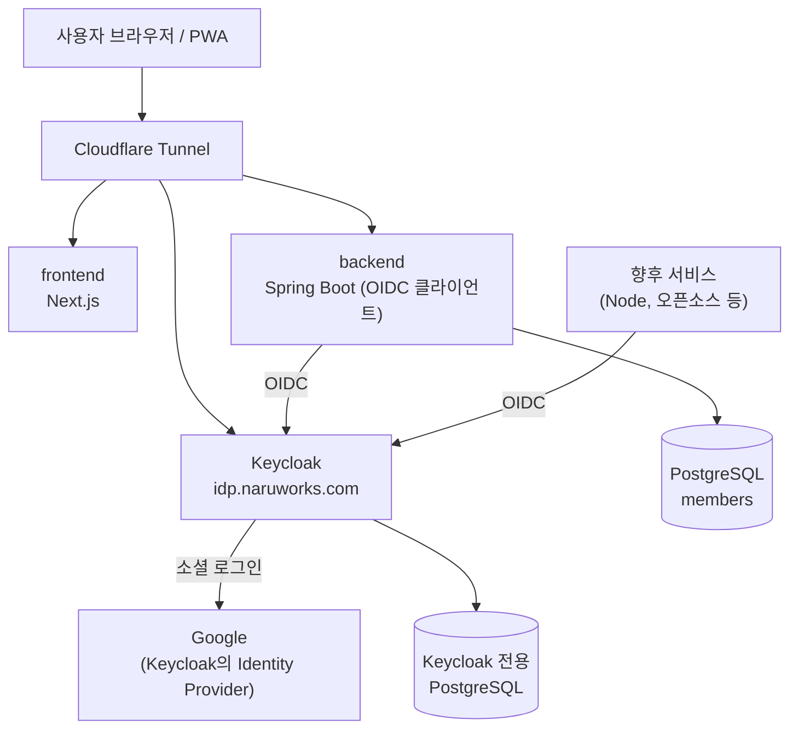

# 중앙 인증(IdP) 설계: Keycloak + OIDC

> 상태 (2026-10-28): Keycloak으로 교체하는 작업이 이슈 #58에서 진행 중이다. 처음에는 Authentik을 도입했으나 요건 R1을 충족하지 못해 폐기했다(13장).

## 1. 목적과 결정

NaruWorks는 Calendar, Drive에 이어 여러 서비스를 추가할 예정이고, 일부는 오픈소스를 그대로 붙여 운영한다. 서비스마다 로그인 방식이 다르면 사용자는 계정을 따로 관리해야 하고, 서비스를 추가할 때마다 인증 문제를 다시 풀어야 한다. 그래서 로그인과 사용자 신원 확인을 한 곳으로 모은다.

```text
인증 서버(IdP) = 자체 호스팅 Keycloak
통신 규약     = OpenID Connect (OIDC)
로그인 수단   = 소셜 로그인만 사용 (첫 대상은 Google), 비밀번호는 저장하지 않는다
각 서비스     = IdP에 클라이언트로 등록하고 OIDC로 로그인한다
```

## 2. 요건

| 번호 | 요건 | 이유 |
| --- | --- | --- |
| R1 | 사용자에게 IdP 화면이 보이지 않는다. 로그인을 누르면 곧바로 Google 로그인으로 이동하고, 돌아올 때도 IdP 화면이 없다. | 사용자는 IdP의 존재를 알 필요가 없다. |
| R2 | IdP의 클라이언트, 소셜 연동, 로그인 흐름이 저장소의 파일로 재현된다. | 클릭으로 만든 설정은 운영에서 재현할 수 없고 변경 이력도 남지 않는다. |
| R3 | 관리자가 비밀번호로 들어갈 수 있는 별도 경로가 유지된다. | Google 연동이 고장 났을 때 관리자가 복구할 수 있어야 한다. |
| R4 | 비밀값은 저장소에 두지 않고 환경 변수로 주입한다. | 보안. |

R1이나 R2를 충족할 수 없으면 IdP를 다시 선택한다.

## 3. 현재 구조 (Spring)

- `SecurityConfig`가 Spring Security `oauth2Login`을 사용한다. 등록 ID는 `idp`이고 IdP 이름에 의존하지 않는다.
- `OAuth2LoginSuccessHandler`가 `sub` 클레임으로 회원을 찾고, 상태별로 프런트 화면을 분기한다. 인증 후에는 서버 세션(7일)을 사용한다.
- `members` 테이블은 `(provider, provider_user_id)`에 유일키가 있다. `provider`는 `VARCHAR(30)`이고 코드는 `AuthProvider.GOOGLE`을 고정으로 쓴다.
- Google Calendar 연동은 별도의 OAuth 클라이언트(`naru.google-calendar.*`)이며 이 설계와 무관하다.
- 가입 정책(`auth-membership-google-approval.md`)은 유지한다: 초대 코드 + Google 로그인 + 약관 동의.

## 4. 아키텍처



### 로그인 흐름

```text
1. 사용자가 로그인을 시작한다. (GET /api/auth/login 또는 초대 링크의 /api/auth/google?ref=...)
2. Spring이 Keycloak의 authorize 주소로 보낸다.
3. Keycloak의 로그인 흐름(naru-browser)이 Identity Provider Redirector로 곧바로 Google로 리다이렉트한다. 화면은 없다.
4. 사용자가 Google에서 계정을 선택한다.
5. Google이 Keycloak으로 돌아오고, 사용자가 처음이면 naru-first-broker-login 흐름이 화면 없이 사용자를 만든다.
6. Keycloak이 Spring의 콜백 주소로 code를 전달한다.
7. Spring이 code를 토큰으로 교환하고, ID 토큰의 sub, email, email_verified로 사용자를 확인한다.
8. 기존 OAuth2LoginSuccessHandler가 회원 상태에 따라 화면을 분기하고 서버 세션을 만든다.
```

### 사용자 식별 원칙

기준 식별자는 이메일이 아니라 Keycloak 사용자 ID(`sub`)다. 이메일은 바뀌거나 재사용될 수 있다. 서비스 간에 같은 사람을 연결할 때도 `sub`를 키로 쓴다. 각 서비스는 Keycloak에 클라이언트를 따로 등록하고 토큰도 서비스별로 받으며, 한 서비스의 토큰을 다른 서비스가 그대로 받지 않는다. Keycloak 로그인 세션이 있으면 다른 서비스에서 비밀번호 입력 없이 새 토큰만 받는다(SSO).

## 5. Keycloak 선택 근거와 한계

### 선택 근거

- R1: 로컬에서 로그인 요청이 HTML 화면 없이 서버 리다이렉트(303) 두 번만으로 Google까지 가는 것을 확인했다. 사용자가 브라우저에서 Google 로그인을 끝까지 해서 돌아올 때 Keycloak 화면, 로딩 화면, 프로필 확인 화면이 없고 주소가 앱 콜백(`?code=...`)이 되는 것을 확인했다.
- R2: realm을 JSON 한 파일로 두고 컨테이너와 DB를 지웠다가 다시 띄워도 수동 설정 없이 같은 상태가 된다. 파일 안의 `${환경변수}`가 치환된다.
- 소셜 로그인 직행, 다른 IdP 연결(SAML 등)로의 확장, 자료의 양이 가장 많다.

### 대안

- Authentik: 폐기했다(13장).
- Zitadel: 가볍고 멀티 테넌트에 강하다고 알려져 있다. 검증하지 않았다.
- 직접 구현(Spring Authorization Server): 검토만 했다. 보안 책임과 유지보수가 전부 우리에게 있어 채택하지 않았다.

### 한계와 확인되지 않은 것

- Authentik보다 설정 객체가 많고 실행 방식이 복잡하다. 메모리는 시험용 개발 모드 기준으로 약 800MiB였고 운영 모드에서의 사용량은 측정하지 않았다.
- OIDC를 지원하지 않는 오픈소스를 프록시로 보호하는 기능은 Keycloak 기본 기능이 아니다. 필요해지면 별도로 조합한다.
- 다수 고객사를 관리하는 멀티 테넌트 B2B 용도는 검증하지 않았다.
- 앱은 표준 OIDC 설정(issuer-uri, client-id, client-secret)만 사용하므로 IdP를 다시 바꿔도 Spring 변경은 설정값 수준이다.

## 6. 구성

### 파일

| 파일 | 역할 |
| --- | --- |
| `docker-compose.yml` | `keycloak`, `keycloak-postgres` 서비스. 이미지 `quay.io/keycloak/keycloak:26.8.1` 고정 |
| `infra/keycloak/realm/naruworks-realm.json` | realm, Google 연동, 로그인 흐름, `naru-api` 클라이언트 |
| `.env.example` | 필요한 환경 변수와 로컬/홈서버 값 설명 |

### realm 파일의 핵심

- `naru-browser` 흐름: Identity Provider Redirector(필수)가 기본 IdP `google`로 곧바로 보낸다. realm의 `browserFlow`로 지정한다. 기본 `master` realm은 건드리지 않아서 관리 콘솔은 비밀번호로 로그인된다(R3).
- `naru-first-broker-login` 흐름: Google로 처음 온 사용자를 화면 없이 만든다. 같은 이메일의 기존 사용자는 자동 연결한다.
- Google IdP는 `trustEmail: true`다. Google이 검증한 이메일이라서 Keycloak 사용자의 `emailVerified`가 `true`가 되고 ID 토큰의 `email_verified`도 `true`로 나간다(Google 사용자로 확인함).
- `naru-api` 클라이언트: confidential, 표준 흐름만 사용, PKCE `S256`. 리다이렉트 주소와 로그아웃 후 복귀 주소는 환경 변수(`KEYCLOAK_REDIRECT_URI`, `KEYCLOAK_POST_LOGOUT_REDIRECT_URI`)로 받아 로컬과 운영의 주소가 섞이지 않게 한다.
- `sslRequired: external`: 공개 주소는 HTTPS여야 하고 로컬과 사설 주소는 HTTP를 허용한다.

### 환경 변수

| 변수 | 쓰는 곳 | 설명 |
| --- | --- | --- |
| `GOOGLE_CLIENT_ID`, `GOOGLE_CLIENT_SECRET` | Keycloak | 로그인용 Google OAuth 클라이언트. 승인된 redirect URI는 `<KEYCLOAK_HOSTNAME>/realms/naruworks/broker/google/endpoint` |
| `KEYCLOAK_NARU_API_SECRET` | Keycloak, backend | `naru-api` 클라이언트의 시크릿. 두 곳이 같은 값을 읽는다(backend에서는 `IDP_CLIENT_SECRET`) |
| `KEYCLOAK_ADMIN_PASSWORD`, `KEYCLOAK_PG_PASSWORD` | Keycloak | 관리자와 전용 DB 비밀번호 |
| `KEYCLOAK_HOSTNAME`, `KEYCLOAK_REDIRECT_URI`, `KEYCLOAK_POST_LOGOUT_REDIRECT_URI`, `IDP_ISSUER_URI` | Keycloak, backend | 기본값은 홈서버 주소. 로컬 값은 `.env.example`에 있다 |

### 운영 시 유의

- **realm 파일은 realm이 아직 없을 때만 가져온다**(`--import-realm`의 기본 동작). 이미 만들어진 realm의 설정을 파일로 바꿔도 자동 반영되지 않는다. 변경은 관리 콘솔이나 별도 절차로 적용하고 파일도 함께 고친다. 이 동작은 로그에서 확인한 내용이고, 부분 갱신 방법은 확인하지 않았다.
- Keycloak 전용 PostgreSQL을 쓰고 기존 서비스 DB와 분리한다. 호스트 포트는 열지 않는다.
- Keycloak 포트는 `127.0.0.1`에만 연다. Cloudflare Tunnel로 `idp.naruworks.com`을 노출할 때는 로그인에 필요한 경로(`/realms/`, `/resources/`)만 공개하고 관리 콘솔(`/admin/`)과 `master` realm은 공개하지 않거나 Cloudflare Access로 제한한다. 이 경로 분리는 아직 구성하지 않았다.
- Keycloak이 멈추면 신규 로그인이 막힌다. 이미 만들어진 서비스 세션은 만료 전까지 유효하다. 전용 DB를 정기 백업하고 복원을 실제로 한 번 해 본다.
- 이미지 태그는 고정하고 업그레이드는 릴리스 노트를 확인한 뒤 의도적으로 한다.

## 7. Spring 변경

- 등록 ID를 `idp`로 하고 환경 변수를 `IDP_CLIENT_ID`(기본 `naru-api`), `IDP_CLIENT_SECRET`, `IDP_LOGIN_REDIRECT_URI`, `IDP_ISSUER_URI`로 정했다. issuer-uri 하나로 엔드포인트를 자동 구성한다.
- `AuthController`의 로그인 리다이렉트는 `/oauth2/authorization/idp`다. 초대 코드를 세션에 담고 로그인으로 보내는 기존 흐름은 그대로다.
- 로그아웃: `POST /api/auth/logout`이 Spring 세션을 끊고, Keycloak의 종료 주소(`end_session_endpoint`)에 `id_token_hint`와 `post_logout_redirect_uri`를 붙여 응답한다. 프런트가 그 주소로 이동하고 끝나면 홈(`/`)으로 돌아온다. 복귀 주소는 클라이언트의 `post.logout.redirect.uris`에 등록되어 있어야 한다.
- Authentik 때 필요했던 토큰 요청의 HTTP/1.1 고정(`OAuth2TokenClientConfig`)은 제거했다. Keycloak은 `Upgrade: h2c` 요청도 정상 처리하는 것을 확인했다.
- `provider`는 `GOOGLE`로 유지한다. 실제 인증 경로는 Keycloak 경유이지만 값은 Google 로그인이라는 뜻이고, 이름 정리는 알려진 부채다(12장).

## 8. 기존 회원 이전

`sub`가 Google의 값에서 Keycloak 사용자 ID로 바뀌므로 기존 회원이 신규 사용자로 취급되지 않도록 `members.provider_user_id`를 바꿔야 한다. 코드로 이메일 매칭을 만들지 않고 데이터를 수정한다.

1. 대상 회원 수를 확인한다. 로컬에는 2명이 있었다.
2. 회원이 Keycloak에 Google로 한 번 로그인해 사용자를 만든다(가입 화면으로 돌아가는 것은 정상).
3. Keycloak 관리 콘솔의 사용자 목록에서 그 사용자의 ID를 확인한다.
4. 수정 전에 기존 `provider_user_id`를 기록하고, `SELECT`로 대상이 한 건인지 확인한 뒤 `UPDATE`한다.
5. 다시 로그인해 서비스 화면으로 들어가는지 확인한다.

주의:
- Keycloak 사용자를 삭제했다가 다시 만들면 ID가 바뀌어 연결이 끊긴다. 정지는 삭제가 아니라 비활성화로 한다.
- Keycloak의 DB를 새로 만들면(로컬에서 컨테이너와 볼륨을 지우면) 같은 사람도 ID가 달라진다. 운영의 Keycloak DB는 백업 없이 지우지 않는다.
- 최초 관리자(`NARU_INITIAL_ADMIN_EMAIL`)는 회원이 한 명도 없을 때만 가입할 수 있다. 이전이 잘못되면 관리자가 로그인하지 못하므로 수정 직전의 값을 기록해 되돌릴 수 있게 한다.

## 9. 보안

- Spring은 서버 앱이므로 `confidential` 클라이언트로 등록하고 시크릿을 사용한다. PKCE `S256`을 요구한다.
- 리다이렉트 주소는 정확히 일치하는 값만 허용한다.
- Keycloak의 사용자 셀프 가입은 끈다(`registrationAllowed: false`). 다만 Google로 로그인한 사람은 Keycloak에 사용자가 만들어진다. 즉 **Google 계정이 있는 누구나 Keycloak 사용자가 될 수 있다.** NaruWorks는 초대 코드로 가입을 막지만, 앞으로 다른 서비스를 붙일 때는 그 서비스가 자체 접근 제어를 해야 한다. 그래서 회원이 아닌 사람이 NaruWorks 로그인을 시도하면 backend가 그 Keycloak 사용자를 바로 삭제한다(아래 "비회원 사용자 정리").

### 비회원 사용자 정리

초대 코드 없이 로그인한 비회원은 `OAuth2LoginSuccessHandler`가 세션을 끊고 가입 안내로 돌려보낸다. 이때 `IdentityProviderUserWriter`(구현: `KeycloakUserAdminAdapter`)로 Keycloak 사용자를 삭제한다. 삭제가 실패해도 거절 응답은 나가고, 실패는 `WARN`으로 남는다. 시크릿이 비어 있으면 삭제하지 않고 같은 경고를 남긴다.

- 서비스 계정 클라이언트 `naru-api-admin`(client credentials)에 `realm-management`의 `manage-users` 역할을 준다. 이 역할은 realm 전체 사용자를 관리할 수 있어 범위가 넓다. backend가 침해되면 사용자 관리 권한이 노출되므로 시크릿을 backend 환경 변수로만 둔다. 더 좁은 권한 방법은 확인하지 않았다.
- backend는 `/admin`이 공개 주소에서 막혀 있으므로 compose 내부 주소(`IDP_ADMIN_BASE_URL`, 기본 `http://keycloak:8080`)로 호출한다.
- 환경 변수 `KEYCLOAK_ADMIN_CLIENT_SECRET`(새로 생성)을 Keycloak(realm 가져오기)과 backend(`IDP_ADMIN_CLIENT_SECRET`)가 함께 읽는다.
- **이미 만들어진 realm에는 realm 파일이 적용되지 않는다.** 운영 Keycloak에는 관리 콘솔(서버 localhost)에서 같은 클라이언트를 직접 만든다: 클라이언트 `naru-api-admin`(Client authentication 켬, Standard flow 끔, Service accounts roles 켬), Credentials 탭의 시크릿을 `KEYCLOAK_ADMIN_CLIENT_SECRET` 값으로 맞춤, Service account roles 탭에서 `realm-management`의 `manage-users` 추가.
- 로컬 검증: 임시 Keycloak(`start-dev --import-realm`)에 realm 파일을 가져와 서비스 계정 토큰 발급, 사용자 삭제(204), 같은 사용자 재삭제(404), 잘못된 시크릿(401)을 확인했다. 실제 Google 로그인으로 비회원을 거절하는 전체 흐름은 브라우저로 확인하지 않았다.
- 남은 한계: 초대 링크로 들어와 Google 로그인까지 하고 약관 동의 전에 그만둔 사람의 Keycloak 사용자는 남는다(회원이 아니고 거절 경로도 타지 않음).
- 최초 관리자 가입은 `email_verified`가 `true`일 때만 허용한다(`OAuth2LoginSuccessHandler`, 테스트 있음). `trustEmail`로 Google이 검증한 이메일만 `true`가 된다.
- 관리 콘솔 계정은 서비스 전체를 장악할 수 있다. 공개 경로에서 분리하고 강한 비밀번호와 2단계 인증을 쓴다.
- 로그에 토큰과 시크릿이 남지 않는지 확인한다.

## 10. 로컬 실행과 검증

### 실행

```bash
# 프로젝트 루트 .env에 값을 채운다 (.env.example 참고, 로컬 값 포함)
docker compose up -d keycloak
cd backend && IDP_CLIENT_SECRET=<KEYCLOAK_NARU_API_SECRET 값> ./gradlew :naru-api:bootRun
cd frontend && NEXT_PUBLIC_API_BASE_URL=http://localhost:8081 npm run dev
```

`docker compose`는 모든 서비스의 필수 변수를 확인하므로 `NARU_DRIVE_S3_ACCESS_KEY`, `NARU_DRIVE_S3_SECRET_KEY`도 `.env`에 있어야 한다(`.env.example` 값). backend는 시작할 때 `issuer-uri`로 Keycloak의 설정을 가져오므로 Keycloak이 먼저 떠 있어야 한다.

### 확인한 것

- 저장소의 `docker compose`로 띄운 Keycloak이 realm을 가져오고(`naru-browser` 흐름, 리다이렉트 주소, 로그아웃 복귀 주소, PKCE가 반영됨), 앱 시크릿이 토큰 엔드포인트에서 받아들여진다.
- 앱의 리다이렉트 주소로 로그인을 시작하면 HTML 화면 없이 Google까지 303 두 번으로 이동한다.
- 백엔드 단위·통합 테스트 117개가 통과한다.

### 확인하지 못한 것

- Spring 앱을 Keycloak에 연결한 상태의 브라우저 로그인 전체 흐름(기존 회원 로그인, 초대 가입).
- 로그아웃 후 홈으로 돌아오는지, 다시 로그인하면 Google 계정 선택이 다시 나오는지.
- 운영 모드(`start`)에서 HTTPS 뒤(Cloudflare Tunnel)의 동작과 메모리 사용량.

### 운영 반영 중 발생한 로그인 장애 (2026-10-29)

운영 반영 직후 로그인이 두 단계로 실패했다. 둘 다 로컬(`localhost`, 터널 없음)에서는 나오지 않았다.

| 증상 | 원인 | 조치 |
| --- | --- | --- |
| Keycloak 로그인 후 `/login?error`(Spring 기본 "Invalid credentials") | ID 토큰 검증에 쓰는 공개키(JWKS)를 공개 도메인 `idp.naruworks.com`으로 가져오다 `Read timed out`. 토큰 교환은 성공했다. 같은 URL을 컨테이너에서 `wget`으로 호출하면 성공했고, Java 클라이언트만 타임아웃인 이유는 확정하지 못했다. | `jwk-set-uri`를 compose 내부 주소 `http://keycloak:8080/...`로 지정한다. issuer 검증은 그대로 `issuer-uri`(공개 주소) 기준이다. |
| 위를 고친 뒤 `http://api.naruworks.com/oauth2/authorization/idp`로 이동하며 Chrome 보안 경고 | `AuthController`의 상대 경로 리다이렉트를, 터널 뒤에서 http로 인식한 backend가 `http://` 절대 주소로 바꿨다. | `server.forward-headers-strategy=framework`로 `X-Forwarded-*`를 읽는다. |

배제한 원인: 서버 시계 어긋남, issuer 불일치, client secret·redirect URI. 토큰 교환은 성공했으므로 Keycloak 쪽 설정은 정상이다.

확인하지 못한 것: Keycloak 로그의 `IDENTITY_PROVIDER_LOGIN_ERROR cookie_not_found`(1회). 이후 로그인은 정상이다.

## 11. 운영 반영 (이 작업의 범위가 아님)

서버 `.env`, Cloudflare Tunnel(`idp.naruworks.com`), 공개 경로 제한(`/admin/` 차단 또는 Cloudflare Access, 요금제 한도는 확인하지 못함), 운영용 Google OAuth 클라이언트(리다이렉트 URI 추가), 운영 회원 이전은 로컬 검증이 끝난 뒤 별도 작업으로 한다.

## 12. 알려진 부채

- `AuthProvider`의 `GOOGLE` 값이 실제로는 Keycloak 경유 로그인에도 쓰인다. 이름 정리가 필요하다.
- 가입을 끝내지 않은 초대 사용자의 Keycloak 사용자 정리(9장 "비회원 사용자 정리"). 다른 서비스는 가입을 마친 회원만 쓰게 접근 제어(역할 등)를 추가로 정해야 한다.
- 다른 소셜 로그인을 추가할 때 같은 사람을 하나의 사용자로 묶는 정책이 필요하다.
- Keycloak 사용자 삭제와 DB 재생성 시 `sub`가 바뀌는 문제(8장).
- 캘린더: 만료된 학교 계정 연동(로컬 2번)의 정리, 만료 시 재연결을 안내하는 화면, 스케줄러가 30분마다 같은 스택트레이스를 남기는 문제.

## 13. Authentik 폐기 기록

Authentik을 먼저 도입해(#51) 로컬에서 로그인과 로그아웃 설정을 만들었으나 R1을 충족하지 못해 폐기했다.

- 원인: Authentik의 로그인 흐름 화면은 서버가 302로 넘기는 방식이 아니다. 먼저 스피너가 있는 흐름 화면(HTML)을 내려 주고 브라우저의 JavaScript가 API로 단계를 조회한 뒤 소스로 이동시킨다. 그래서 "Welcome to authentik! Loading" 화면이 나갈 때와 Google에서 돌아올 때 두 번 보인다. 로컬 브라우저에서 확인했다.
- 처음에는 서버 이벤트 기록만 보고 "화면 생략이 된다"고 잘못 결론지었다. 사용자가 보는 화면을 직접 확인해서 정정했다.
- 나가는 길은 소스 로그인 주소로 직접 보내면 줄일 수 있었으나 돌아오는 길의 화면은 없앨 수 없었다.
- 도입 중에 알게 된 함정(IdP를 다시 바꿀 때 참고): 평문 HTTP에서 Java HttpClient의 `Upgrade: h2c`를 Authentik이 처리하지 못해 토큰 요청이 `400`이 되었다(Keycloak은 문제없다). Authentik의 기본 `email` 스코프 매핑은 `email_verified`를 항상 `false`로 내보냈다. 로그아웃 후 복귀 주소는 Redirect URI 중 Logout 종류로 등록해야 했고, 앱의 Invalidation flow가 `default-provider-invalidation-flow`이면 Authentik 세션이 끊기지 않았다.
