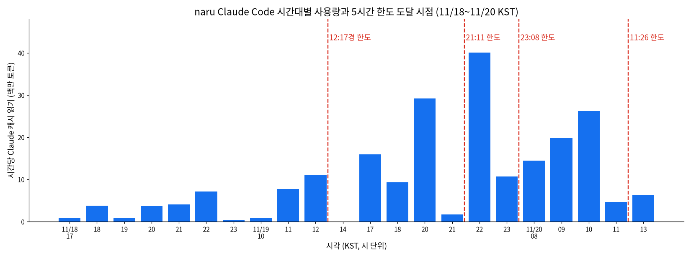
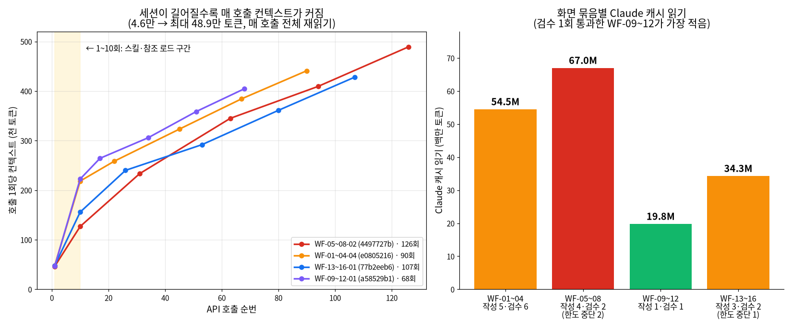
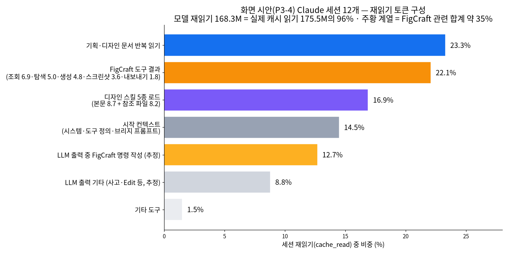
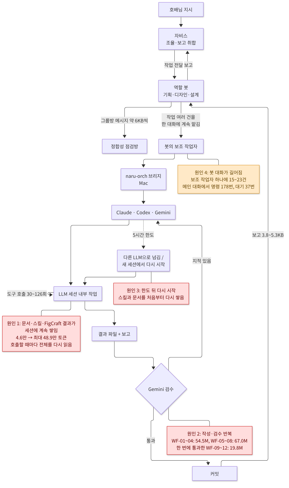
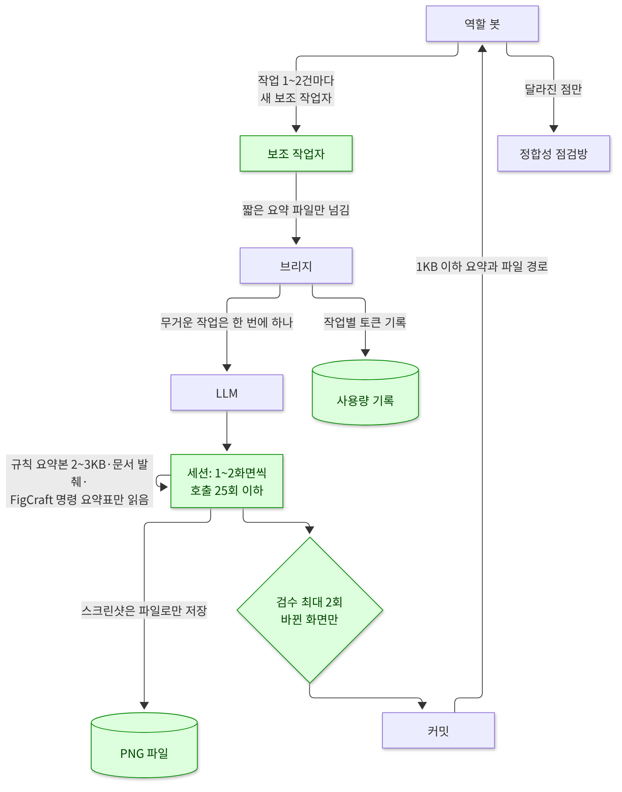

# [트러블슈팅] naruworks 멀티봇 작업의 토큰 과다 사용과 Claude 5시간 한도 도달

| 항목 | 내용 |
|---|---|
| 작성일 | 2026-11-25 |
| 작성 | 자비스 |
| 상태 | 개선 적용 중 (C1~C6·C13 적용, C7~C10 봇 규칙 반영 대기, C11·C12 제외) |
| 관련 이슈 | #96 (이 문서), #93 (UI 디자인), #94 (아키텍처) |
| 대상 기간 | 2026-11-18 ~ 11-20 KST (분석 2026-11-24) |
| 근거 자료 | `report.md`, `figcraft-analysis.md`, 집계 CSV (자비스 분석 작업 공간, 저장소 밖 · 원본 대화는 저장소에 넣지 않음) |

## 1. 요약

화면 시안 작업(P3-4)에서 Claude Code 세션 하나가 화면 4개 분량을 처리했습니다. 세션마다 호출이 68~126회까지 길어졌고, 호출 1회의 컨텍스트가 최대 48.9만 토큰까지 커졌습니다.

같은 세션에서는 호출할 때마다 쌓인 컨텍스트 전체를 다시 읽습니다. 그래서 naru Claude 사용량(캐시 읽기 219.6M)의 79.9%가 화면 시안 세션 12개에서 나왔고, 11/19~11/20 사이에 Claude 5시간 한도에 4번 걸렸습니다.

다시 읽힌 양을 내용별로 나누면 다음과 같습니다.

- FigCraft 관련: 약 35%
- 문서 반복 읽기: 23.3%
- 디자인 스킬 로드: 16.9%
- 시작 컨텍스트: 14.5%

여기에 긴 세션과 검수 반복이 곱해졌습니다. 근본 원인은 도구 자체가 아니라 작업 단위와 컨텍스트 관리 규칙이 없었다는 점입니다.

## 2. 현상

| 구분 | 내용 | 출처 |
|---|---|---|
| 어디서 | Mac의 naru-orch 브리지가 Paseo로 실행한 Claude Code 세션. 특히 디자인 봇의 화면 시안 작업(P3-4)에서 발생 | state.db `jobs`, `~/.claude/projects/*naru-design*` |
| 무엇이 | 세션마다 호출 수가 많고(68~126회), 매 호출 컨텍스트가 4.6만에서 최대 48.9만 토큰까지 커짐 | `claude_session_context.csv` |
| 결과 ① | Claude 5시간 한도 4회: 11/19 12:17경, 21:11, 23:08, 11/20 11:26 (KST) | state.db `fallbacks` 5건, 한도 메시지가 남은 세션 8개 |
| 결과 ② | 한도로 작업 중단·재실행: wf05-08-01, wf05-08-02b, wf13-16-02는 Codex로 폴백한 뒤 취소되거나 재실행됨. 11/19 12시대에는 한도를 감지하지 못해 잡 4개가 "error"로 실패 | `bridge_jobs_state.csv` |
| 결과 ③ | Grok Bot 사용 비중이 11/18 41%, 11/19 44%, 11/20 9%로 몰림. 봇별로는 디자인 41%, 기획 28%, 자비스 23%, 설계 8%. 주간 한도는 11/24 20:38 KST에 초기화됨 | Grok Bot 사용량 보고서 (지난 7일) |

## 3. 영향

| 영향 | 내용 |
|---|---|
| 일정 | 한도 때문에 화면 시안 작업이 끊겼습니다. 예를 들어 WF-05~08 수정은 23:08에 멈췄고 다음 날 08:39에 재개했습니다. 11/20 오후 이후 11/24 저녁까지는 봇 작업이 이어지지 않았습니다. |
| 비용 | 한도에 걸린 작업을 다시 돌리면 스킬과 문서를 처음부터 다시 읽습니다. 예를 들어 수정 3건짜리 재작업(wf13-16-03)도 호출 25회, 캐시 읽기 3.5M이었습니다. |
| 운영 | 브리지가 사용량을 기록하지 않아, 원인을 사후에 추적하는 데 시간이 걸렸습니다. |

## 4. 원인 파악 방법

| 데이터 | 센 방법 | 산출물 |
|---|---|---|
| 브리지 기록 (`~/.naru-orch/state.db`, `jobs/*`) | DB를 읽기 전용으로 열어 잡 74개의 공급자·상태·폴백·시각을 뽑고, 잡 폴더별 프롬프트·결과 파일 크기를 셈 | `bridge_jobs_state.csv`, `bridge_job_files.csv` |
| Claude Code 세션 (`~/.claude/projects/*.jsonl`) | usage 필드(input, output, cache_creation, cache_read)만 합산. 같은 메시지 ID의 중복 기록은 한 번만 셈 | `claude_code_sessions.csv`, `claude_code_hourly.csv` |
| 재읽기 분해 | 호출마다 새로 들어간 토큰을 직전 출력과 그 사이 도구 결과에 나눠 붙이고, "그 뒤 남은 호출 수"를 곱함. 이 계산이 실제 캐시 읽기의 96%를 설명함 | `p34_context_attribution.csv` |
| 봇 대화 기록 (기획·디자인·설계) | 메시지·도구 호출 단위로 크기와 횟수만 셈 (기획 봇은 1,096개 중 1,090개) | `grokbot_transcript_items.csv`, `grokbot_summary.csv` |
| Grok Bot 사용량 | 날짜별·봇별 사용 비중 | `grokbot_usage_by_day.csv` |

**정정:** 처음에는 "스크린샷이 도구 결과의 70~80%"라고 판단했습니다. 이는 바이트 기준이었습니다. 이미지는 바이트가 아니라 픽셀 크기로 토큰이 매겨지므로, 토큰 기준으로 다시 세면 스크린샷 181장은 약 13.5만 토큰이고 재읽기의 3.6%에 불과합니다. 이 문서는 정정한 토큰 기준을 씁니다.

## 5. 원인

### 5.1 직접 원인: 긴 세션에서 컨텍스트 전체를 매번 다시 읽음

| 지표 | 값 |
|---|---|
| 화면 시안(P3-4) 세션 | 12개, 호출 723회 |
| 캐시 읽기 | 175.5M (naru 전체 219.6M의 79.9%) |
| 컨텍스트 증가 | 호출 1회 약 4.6만 → 10회 10~22만 → 최대 30~49만 토큰 |
| 최대 세션 | WF-05~08-02: 126회, 캐시 읽기 39.9M (한 세션으로 23:08 한도 직전 창의 79%) |
| 비교 | 프롬프트 19~23KB(약 5~7천 토큰)는 최대 컨텍스트의 1~2%. LLM 최종 출력(1.89M)은 캐시 읽기의 0.9% |

### 5.2 무엇이 다시 읽혔나 (재읽기 분해)

| 내용 | 비중 | 근거 |
|---|---|---|
| FigCraft 관련 (도구 결과 22.1% + 명령 작성 약 12.7%) | **약 35%** | 조회 6.9, 명령 탐색(list_commands 52회) 5.0, 생성·수정 4.8, 스크린샷 3.6, 내보내기 1.8. LLM 출력 바이트의 58.9%가 FigCraft 명령 입력 (node.create 1,944회) |
| 기획·디자인 문서 반복 읽기 | **23.3%** | screens.md를 12개 세션에서 32회, screen-data-actions.md를 11회 읽음 |
| 디자인 스킬 5종 로드 | **16.9%** | 본문 0.66MB + 참조 파일 0.76MB. 세션마다 "0단계: 다섯 스킬 실제 로드"를 실행 |
| 시작 컨텍스트 | **14.5%** | 시스템 프롬프트, 도구 정의, 브리지 프롬프트(인라인 가이드라인 13.6~16.7KB) |
| LLM 출력 기타 (사고·Edit) | 약 8.8% | thinking이 출력 바이트의 24.4% |

### 5.3 곱셈 요인

| 요인 | 근거 |
|---|---|
| 작업 단위가 큼 (화면 4개 × 상태 × 라이트/다크 × 기기) | 세션당 호출 68~126회 |
| 검수 → 재작성 반복 | WF-01~04 작성 5회 + 검수 6회 → 54.5M. 검수 1회 통과한 WF-09~12는 19.8M |
| 재작성은 새 세션 | 스킬과 문서를 처음부터 다시 로드 |
| 동시 실행 | 11/19 11:50~12:20에 세 봇의 Claude 작업이 동시에 돌다가 12:17경 한도 |

### 5.4 봇 쪽 보조 원인 (Grok Bot 사용량)

| 현상 | 근거 |
|---|---|
| 보조 작업자(executor) 재사용 | 기획 봇은 작업자 1개에 23건, 디자인 봇은 작업자 1개에 15건 (대화 1,118개 메시지까지 누적) |
| 메인 대화에서 직접 작업 | 기획 봇: 명령 178회, 상태 확인 36회, 대기(sleep) 포함 명령 37회, 파일 복사 84회, 이미지 열기 18회 |
| 보고 반복 전달 | 완료 보고 평균 3.8~5.3KB, 그룹방 메시지 평균 약 6KB가 수신 봇마다 들어감 |

### 5.5 근본 원인

1. 작업 단위와 세션 길이에 대한 기준이 없었습니다.
2. 공통 자료(문서·스킬·도구 사용법)를 요약해 두지 않고 매번 원문을 통째로 로드했습니다.
3. 검수 반복 횟수와 재검수 범위에 상한이 없었습니다.
4. 사용량 관측 수단(잡별 토큰 기록)이 없어, 한도에 걸리기 전까지 아무도 알 수 없었습니다.

## 6. 개선 방안 (2026-11-25 승인 · 적용 상태는 표 참고)

**기존 프로세스 흐름**: 빨강은 원인 1~3, 주황은 원인 4(봇 쪽)입니다.

**개선 프로세스 흐름**: 초록은 바뀐 지점입니다.

| # | 무엇을 | 어디서 | 기대 효과 (추정) | 상태 |
|---|---|---|---|---|
| 1 | 디자인 잡을 화면 1~2개 단위로 쪼개기 (목표: 세션당 호출 25회 이하) | 디자인 봇 작업 규칙 | 호출 수와 컨텍스트가 함께 줄어 곱셈 효과를 제거 (참고: 25회 잡은 3.5M, 126회 잡은 39.9M) | 규칙 문구 확정(C7) · 봇 설정 반영 대기 |
| 2 | 스킬 5종 로드를 디자인 규칙 요약본 1개(2~3KB)로 대체하고, 인라인 가이드라인 제거 | 브리지 프롬프트 템플릿 + 요약본 신규 파일 | 재읽기 16.9% 중 대부분과 시작 컨텍스트 일부 감소 | 적용(C1·C4) |
| 3 | 문서는 해당 화면 절만 발췌해서 전달 | 프롬프트 템플릿 | 재읽기 23.3% 감소 | 적용(C3·C4) |
| 4 | FigCraft 명령 요약표를 만들고 탐색(list_commands) 대신 사용. 오류가 잦았던 파라미터는 요약표에 명시 | 신규 파일 + 프롬프트 템플릿 | 탐색 5.0%와 오류 31건 감소 | 적용(C2·C4) |
| 5 | 렌더 확인 스크린샷은 프레임당 마지막 1회, 1000px 이하 | 프롬프트 템플릿 | 3.6% 중 일부 감소 | 적용(C5) |
| 6 | 검수는 묶음당 최대 2회, 재검수는 바뀐 화면만 | 디자인 봇 작업 규칙 + 검수 프롬프트 | 재작성 세션 수 감소 | 검수 프롬프트 적용(C6) · 봇 규칙 반영 대기(C7) |
| 7 | 보조 작업자를 작업 1~2건마다 새로 시작하고, 메인 대화에서 폴링·대기·이미지 열기 금지 | 각 봇 작업 규칙 | Grok Bot 누적 대화 감소 | 규칙 문구 확정(C8) · 봇 설정 반영 대기 |
| 8 | 보고는 1KB 이하 요약 + 파일 경로, 그룹방에는 달라진 점만 | 자비스·각 봇 작업 규칙 | 보고 반복 전달 감소 | 규칙 문구 확정(C9) · 봇 설정 반영 대기 |
| 9 | Claude 무거운 잡은 동시에 1개만, 한도 감지 시 남은 잡 보류 | 브리지 코드 | 한도 도달과 중단 재실행 감소 | 운영 규칙으로 대체(C10). 코드(C11·C12)는 이번 범위 제외 |
| 10 | 잡별 토큰 사용량 기록 | 브리지 코드 | 개선 효과 측정과 조기 경보 | 적용(C13, 브리지 v0.1.7, 2026-11-25) |

구체적인 변경 내용과 되돌리는 방법은 `change-list.md`, 봇 규칙 문구는 `bot-rules.md`, 새 입력 파일은 `docs/design/agent-inputs/`를 참고하세요.

## 7. 재발 방지 체크리스트

| ✓ | 점검 항목 | 기준 |
|---|---|---|
| ☐ | 잡 1개가 다루는 화면 수 | 1~2개 |
| ☐ | 세션 호출 수 / 최대 컨텍스트 | 25회 이하 / 15만 토큰 이하 (측정 후 조정) |
| ☐ | 프롬프트에 스킬 원문 로드나 가이드라인 인라인이 들어 있는가 | 없어야 함 (요약본 경로만) |
| ☐ | 문서 전체를 읽으라는 지시가 있는가 | 해당 절 발췌만 |
| ☐ | 같은 묶음의 검수 회차 | 2회 이하 |
| ☐ | Claude 무거운 잡 동시 실행 수 | 1개 |
| ☐ | 보조 작업자 1개가 맡은 작업 수 | 2건 이하 |
| ☐ | 봇 메인 대화의 sleep·폴링·이미지 열기 | 0회 |
| ☐ | 잡 종료 후 토큰 사용량이 기록됐는가 | 기록 있음 |

## 8. 검증 계획 (개선 전후 비교)

| 지표 | 개선 전 (기준값) | 측정 방법 |
|---|---|---|
| 잡당 API 호출 수 | P3-4 평균 약 60회 (723회 / 12개 세션), 최대 126회 | `scripts/claude_usage_by_session.py` |
| 최대 컨텍스트 | 30~49만 토큰 | 같은 스크립트 (ctx_max) |
| 화면 1개당 캐시 읽기 | 175.5M / 화면 16개 ≈ 11M (추정) | 같은 스크립트 + 잡↔화면 매핑 |
| 묶음당 검수 회차 | 1~6회 | state.db `jobs` |
| list_commands 호출 / FigCraft 오류 | 52회 / 31건 | jsonl 도구별 집계 |
| Claude 5시간 한도 도달 | 3일간 4회 | state.db `fallbacks`, `provider_limits` |
| Grok Bot 일별 사용 비중 | 11/18 41%, 11/19 44% | 사용량 보고서 (날짜·봇별) |

- **판정 기준:** 같은 분량의 화면 작업에서 캐시 읽기 50% 이상 감소, 한도 도달 0회.
- **이후 별도 검증:** FigCraft와 이미지(HTML→PNG) 방식의 토큰 비교. 같은 화면 1~2개를 두 방식으로 만들어 비교합니다.

## 9. 미확인 사항

| 항목 | 이유 |
|---|---|
| 자비스 대화 내역 (사용 비중 23%) | 분석 환경에서 자비스 대화 기록에 접근할 수 없음 |
| 보조 작업자별 토큰 | 보조 작업자 대화 기록을 직접 열 수 없음 |
| Grok Bot 지난주 한도를 몇 % 썼는지 | 사용량 보고서는 이번 주 사용률만 제공 |
| Claude 한도 계산 방식, Mac 밖의 Claude 사용 | 계산 방식이 공개되지 않음. claude.ai 사용은 Mac 기록에 없음 |
| Gemini 토큰 | Antigravity 기록에서 사용량 필드를 찾지 못함 |
| FigCraft 도구 정의 크기 | 시작 컨텍스트에서 따로 떼어 볼 수 없음 |
| 11/21~23 Codex 비봇 사용 (약 100.8M 토큰) | 봇 작업이 아님. 공유 한도에 영향을 줬는지는 미확인 |
